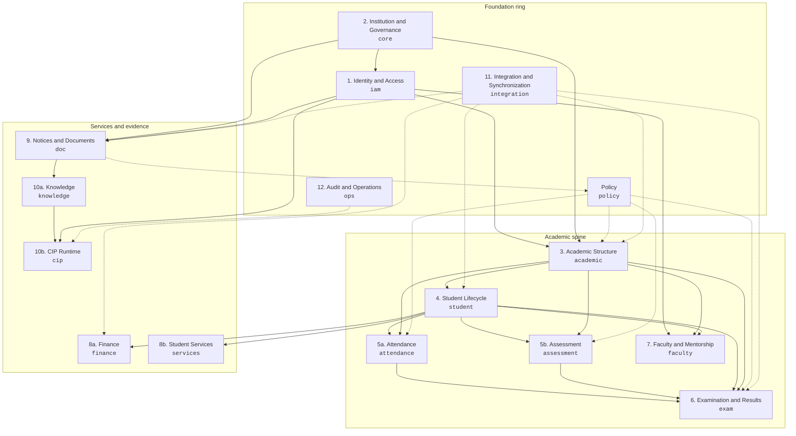
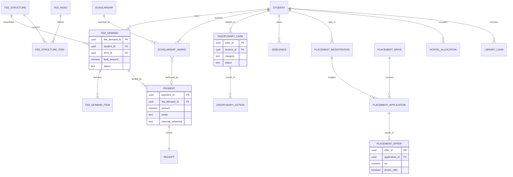

# Domain Model — BCREC Campus ERP + CIP

**Purpose:** define the twelve bounded domains, their schema ownership, their authority, and the only allowed cross-domain dependencies. This is the map that `ENTITY_CATALOG.md`, the ERDs, and `DATA_DICTIONARY.md` follow.

**Design stance:** modular monolith on one PostgreSQL cluster. Each domain owns its tables. Other domains read through APIs, views, or explicitly granted functions; they do not write another domain's tables. Cross-domain foreign keys are allowed for integrity, but they never transfer ownership.

**Naming convention:** `Programme` = degree (B.Tech CSE); `Course` = subject/paper; `Batch` = admission cohort; `Term` = dated academic period; `Offering` = a course taught to a batch/section in a term.

---

## 1. Domain map

**Reading the arrows:** an arrow means "the target domain may depend on the source domain's public identifiers or read API". It does not mean the target may write the source. Dotted arrows are governance or observability links, not data ownership.

---

## 2. Domain definitions

### 2.1 Domain 1 — Identity and Access

| Attribute | Definition |
|---|---|
| Schema | `iam` |
| Purpose | Represent a human once, link login identities, define roles and permissions, and grant time-bound authority within a scope. |
| In scope | Person, contact points, identity account, role, permission, role-permission, role assignment, delegation. |
| Out of scope | Student academic facts, employment history, committee composition (owned by `core`), authentication secrets (owned by the IdP). |
| Owner | Registrar (person records); ERP Administrator (accounts, roles, permissions). |
| Authority | BCREC for persons and role definitions; external IdP for authentication subject. |
| Classification | Person and contact: Confidential. Account: Confidential. Role/permission: Internal. |
| Release | Foundation. Must exist before every other domain. |
| Dependencies | `core.org_unit`, `core.institution`, `core.programme`, `core.governance_body` (for scope); `doc.document_version` (for source order) — deferred FKs. |
| Key invariants | One person per human; one active account link per person per IdP; every role assignment has exactly one scope and a validity window; roles are not inferred from designations. |
| Trace | Research §7, §11.2–11.3; S6–S9; F-07, F-08. |

### 2.2 Domain 2 — Institution and Governance

| Attribute | Definition |
|---|---|
| Schema | `core` |
| Purpose | Hold the legal institution, sponsoring society, org tree, statutory and non-statutory bodies, approvals, affiliation, academic years, terms, and calendars. |
| In scope | Institution, society, org unit, governance body (statutory body or committee), governance membership, statutory approval, affiliation record, academic year, term, academic calendar, calendar milestone, accreditation, regulatory return. |
| Out of scope | Role permissions (owned by `iam`), programme curriculum (owned by `academic`), documents (owned by `doc`). |
| Owner | Principal and Registrar; IQAC for accreditation. |
| Authority | BCREC, MAKAUT, UGC, AICTE, NBA/NAAC depending on the record. |
| Classification | Institution/public data: Public. Governance membership: Internal/Confidential. Statutory approvals and affiliation: Internal. |
| Release | Foundation; accreditation and regulatory returns are future. |
| Dependencies | `iam.person` for memberships; `doc.document_version` for orders and approvals. |
| Key invariants | One institution row for the first release; every org unit has one parent except the root; every membership has a start date and an order/source; a body term is a date range, not a string. |
| Trace | Research §3, §6, §9.13; S3–S8, S14–S16. |

### 2.3 Domain 3 — Academic Structure

| Attribute | Definition |
|---|---|
| Schema | `academic` |
| Purpose | Define what is taught, to which cohort, under which regulation version, and by whom. |
| In scope | Department, programme, programme version, batch, section, section teacher assignment, curriculum, curriculum-course, course, course version, course offering, offering faculty, timetable slot, room (future). |
| Out of scope | Student registration (owned by `student`), marks (owned by `assessment`), results (owned by `exam`). |
| Owner | Registrar for programmes and batches; HOD/BoS for courses and curricula; Academic Council for programme versions and curriculum approval. |
| Authority | BCREC under autonomy; MAKAUT programme codes and affiliation. |
| Classification | Internal. Programme and course catalogue may be Public. |
| Release | Foundation for departments/programmes/terms; Initial ERP for batches, curricula, offerings, timetable. |
| Dependencies | `core` for institution, org units, academic years, terms; `iam` for faculty allocation; `policy` for programme regulation binding. |
| Key invariants | A batch binds exactly one programme version; a course version is immutable once offered; an offering references a course version and a term; a curriculum is versioned and approved; no course version is deleted after use. |
| Trace | Research §3.2, §8.2–8.3, §10.4; S1, S9, S14, S15. |

### 2.4 Domain 4 — Student Lifecycle

| Attribute | Definition |
|---|---|
| Schema | `student` |
| Purpose | Track a person from application to admission, identifiers, registration, course enrolment, and status. |
| In scope | Admission application, admission offer, student profile, guardian, guardian link, student document, university registration, exam roll number, semester registration, course registration, section assignment, status history, eligibility determination, branch change (future), migration (future). |
| Out of scope | Attendance, marks, results, fees, discipline, placement. |
| Owner | Admission Cell for applications and offers; Registrar for student records, registration, and status; COE for exam roll numbers. |
| Authority | BCREC for admission, college roll, course registration; MAKAUT for university registration number; COE for exam roll. |
| Classification | Confidential; category/identity documents Restricted/Regulated. |
| Release | Initial ERP. |
| Dependencies | `core`, `iam`, `academic`, `doc` (documents), `policy` (eligibility rules). |
| Key invariants | One student profile per person per programme career; college roll number unique; university registration number unique when present; exam roll number unique and current; every status change has history; course registration cannot exist without semester registration. |
| Trace | Research §8.1–8.2, §10.5; S1 §9, S20. |

### 2.5 Domain 5 — Attendance and Assessment

| Attribute | Definition |
|---|---|
| Schemas | `attendance`, `assessment` |
| Purpose | Capture classroom attendance and internal assessment inputs, with correction and eligibility history, without computing final results. |
| In scope | Attendance session, record, correction, summary, eligibility assessment, condonation case, duty leave (future); assessment scheme, component, schedule, mark entry, mark version, correction, conflict declaration, moderation (future). |
| Out of scope | Final grades, result publication, grade cards (owned by `exam`); semester registration (owned by `student`). |
| Owner | Faculty for capture; HOD for verification; COE for scheme configuration; Academic Council for condonation. |
| Authority | BCREC. |
| Classification | Confidential. Condonation evidence may be Restricted. |
| Release | Initial ERP. |
| Dependencies | `student`, `academic`, `iam`, `policy`, `doc`. |
| Key invariants | One attendance record per student per session; corrections never delete the original value; a summary records its calculation time and policy version; a mark version is immutable; a mark correction references the version it replaces; conflict-of-interest declarations are checked before assessment. |
| Trace | Research §8.4–8.5, §9.3–9.4; S1 §§16–19; G-01, G-13–G-15. |

### 2.6 Domain 6 — Examination and Results

| Attribute | Definition |
|---|---|
| Schema | `exam` |
| Purpose | Represent examination events, eligibility, imported published results, result revisions, grade cards, supplementary/backlog state, PPR/correction cases, progression, degree recommendation, and certificates. |
| In scope | Initial: result import, result set, result record, result revision, result input, grade card, grade card result. Future: exam event, exam registration, exam registration course, backlog, supplementary registration, PPR case, correction case, promotion decision, degree eligibility, degree recommendation, certificate issue, answer script, MAR, MOOC, achievement. |
| Out of scope | Internal marks and attendance (inputs); fee collection; the MAKAUT degree award itself. |
| Owner | COE for examination operations and results; Registrar for promotion and degree recommendation; Principal for approval where policy requires. |
| Authority | BCREC COE for published results; MAKAUT for degree award and university registration. |
| Classification | Confidential; answer scripts and PPR evidence Restricted. |
| Release | Initial: read-only imported results and grade cards. Future: examination operations, computation, publication, PPR, progression, degree. |
| Dependencies | `student`, `academic`, `assessment`, `attendance`, `policy`, `doc`, `iam`. |
| Key invariants | A result belongs to a result set and a student; a result revision is immutable; a grade card references explicit result revisions; publication has an approval event or an external publication reference; BCREC never records itself as degree awarder. |
| Trace | Research §8.6–8.8, §9.5–9.7, §12 M10–M14; S1 §§20–24, S8, S16 §3.4. |

### 2.7 Domain 7 — Faculty and Mentorship

| Attribute | Definition |
|---|---|
| Schema | `faculty` |
| Purpose | Hold employment and academic attributes for teaching staff and non-teaching staff, and the mentor–mentee relationship. |
| In scope | Faculty profile, staff profile, mentor assignment, mentoring session (future), workload allocation (future), external person (future). |
| Out of scope | Role permissions (owned by `iam`), course allocation (owned by `academic.offering_faculty`), student profile (owned by `student`). |
| Owner | HR for employment data; HOD for workload and mentoring; Principal for senior appointments. |
| Authority | BCREC Society/HR. |
| Classification | Confidential; qualifications and employment data Internal/Confidential; mentoring notes Restricted. |
| Release | Initial ERP for profiles and mentor assignment; mentoring sessions and workload future. |
| Dependencies | `iam.person`, `core.org_unit`, `academic.department`, `student.student`. |
| Key invariants | One faculty profile per person; employee ID unique; a mentor assignment is term-bound; a mentor cannot be the student's assessment-only relationship; mentoring notes are not visible to general faculty. |
| Trace | Research §8.9–8.10, §9.11; S3, S12; G-18. |

### 2.8 Domain 8 — Finance and Student Services

| Attribute | Definition |
|---|---|
| Schemas | `finance`, `services` |
| Purpose | Record fee obligations and payments, scholarships, discipline, grievances, placement, hostel, and library transactions. |
| In scope | Finance: fee head, fee structure, structure item, demand, demand item, payment, receipt, scholarship, award. Services: disciplinary case/action, grievance, placement registration/drive/application/offer, hostel allocation, library loan. |
| Out of scope | Academic eligibility decisions (owned by `student`/`exam`); attendance; marks. |
| Owner | Finance/CFO for fees; Registrar/Scholarship Cell for scholarships; Principal/CDC for discipline; Dean (SW&A) for grievances; T&P for placement; Hostel Superintendent and Librarian for auxiliary services. |
| Authority | BCREC Finance; Government/scheme owner for scholarships; BCREC T&P for placement. |
| Classification | Confidential; fee and scholarship data Restricted; disciplinary and grievance data Restricted. |
| Release | Future (Phase 2). |
| Dependencies | `student`, `academic`, `iam`, `doc`, `policy`. |
| Key invariants | A demand is an obligation, not a payment; a payment is never deleted; a receipt is immutable; a disciplinary case has a decision and an appeal record; placement eligibility is a policy determination. |
| Trace | Research §8.12–8.14, §9.9–9.10, §12 M15–M19; S10, S11, S20, S22, S23; G-08, G-20, G-21. |

### 2.9 Domain 9 — Notices and Document Management

| Attribute | Definition |
|---|---|
| Schema | `doc` |
| Purpose | Preserve the authoritative file, its versions, its relations, and time-bound notices with audience and supersession. |
| In scope | Document, document version, document relation, notice, notice version, notice audience, notice acknowledgement (future). |
| Out of scope | Chunks and embeddings (owned by `knowledge`); conversation citations (owned by `cip`). |
| Owner | Issuing office for content; Registrar/CIP Curator for the corpus; Principal for institutional notices. |
| Authority | The issuing authority named on the document or notice. |
| Classification | Public, Internal, Confidential, Restricted, Regulated — carried on the document and inherited by versions/chunks. |
| Release | Foundation for document metadata; Initial ERP for notices; Initial CIP for ingestion. |
| Dependencies | `core.org_unit`, `iam.person`, `policy` (approval rules). |
| Key invariants | Every version has a SHA-256 and an immutable original; supersession is explicit; a notice audience attaches to a version; a superseded version is never silently treated as current. |
| Trace | Research §8.11, §10.10, §11.10, §13.7; S1, S20; G-19. |

### 2.10 Domain 10 — AI and Knowledge Retrieval

| Attribute | Definition |
|---|---|
| Schemas | `knowledge`, `cip` |
| Purpose | Turn approved documents into retrievable, cited knowledge; run conversations and voice calls; log retrieval, citations, feedback, escalation, and evaluation. |
| In scope | Knowledge: document chunk, embedding, ingestion run. CIP: conversation, call session, message, retrieval log, retrieval hit, citation, feedback, escalation, evaluation case/run/result. |
| Out of scope | Source document metadata (owned by `doc`); student records; final policy decisions. |
| Owner | CIP Content Curator for corpus; CIP Operator for conversations; AI/Platform for models. |
| Authority | Derived from approved documents and structured APIs; no independent institutional authority. |
| Classification | Internal/Confidential; call recordings and transcripts Restricted; restricted personal data excluded from the corpus. |
| Release | Initial CIP. |
| Dependencies | `doc`, `iam`, `ops`, `policy`, `student`/`exam` APIs for personal self-service. |
| Key invariants | Every factual answer cites a document version or a structured source; restricted personal data is never embedded; a superseded document is not cited as current; a no-answer path exists; every retrieval is logged. |
| Trace | Research §13.7–13.10, §11.10; S1, S20; database audit. |

### 2.11 Domain 11 — Integration and Synchronization

| Attribute | Definition |
|---|---|
| Schema | `integration` |
| Purpose | Keep internal IDs stable, map external IDs, declare source-of-truth per field, run syncs, detect conflicts, and preserve provenance. |
| In scope | Entity type registry, external system, external ID mapping, source-of-truth rule, sync run, sync record, sync conflict, record provenance, outbox event. |
| Out of scope | Direct writes to domain tables (adapters call domain APIs); identity authentication (IdP). |
| Owner | ERP Administrator and Data Steward. |
| Authority | BCREC decides source of truth per field; external systems remain authoritative for their own fields. |
| Classification | Internal; external identifiers may be Confidential. |
| Release | Foundation for mappings and provenance; adapters are future. |
| Dependencies | All domains via the entity registry; `iam` for service accounts. |
| Key invariants | No external ID is stored on a domain table; every mapping has a validity window; every conflict is queued, never silently overwritten; a rerun is idempotent; every external field has provenance. |
| Trace | Research §13.1–13.6; S14, S18, S20; G-09, G-10. |

### 2.12 Domain 12 — Audit and Operations

| Attribute | Definition |
|---|---|
| Schema | `ops` |
| Purpose | Record who did what, why, and when; track data quality; control break-glass access; define retention. |
| In scope | Audit event, data quality issue, break-glass grant, retention schedule, background job run (optional). |
| Out of scope | Business state (owned by domains); application logs (observability platform). |
| Owner | Audit/Security; Principal as institutional owner; Data Steward for data quality. |
| Authority | BCREC; UGC §11.1 record-keeping; retention law pending. |
| Classification | Confidential/Restricted; audit events are immutable. |
| Release | Foundation. |
| Dependencies | All domains via the entity registry; `iam` for actors and role assignments. |
| Key invariants | Audit events are append-only; every state change has an actor and correlation ID; before/after values are captured for sensitive fields; break-glass expires; retention periods are not invented. |
| Trace | Research §11.6, §11.9; S16 §11.1; G-22. |

### 2.13 Cross-cutting — Policy

| Attribute | Definition |
|---|---|
| Schema | `policy` |
| Purpose | Store institutional rules as stable identities, immutable versions, scopes, parameters, sources, status, and conflicts. |
| Owner | Academic Council for academic rules; BOG for institutional rules; Registrar as custodian. |
| Authority | The named authority on each rule; never the database designer. |
| Classification | Internal; draft/disputed status is visible. |
| Release | Foundation. |
| Dependencies | `doc.document_version` for source evidence; `core` for authority and scope. |
| Key invariants | A rule version used by a record is immutable; status and confidence are explicit; a conflict is a first-class record; no rule is silently promoted from Draft to Current. |
| Trace | Research §9, §9.14, §9.15; G-01, G-02. |

---

## 3. Schema ownership and release

| # | Domain | Schema(s) | Owning office | Release | Entity count (catalog) |
|---|---|---|---|---|---|
| 1 | Identity and Access | `iam` | Registrar / ERP Admin | Foundation | 8 |
| 2 | Institution and Governance | `core` | Principal / Registrar | Foundation | 13 |
| 3 | Academic Structure | `academic` | Registrar / HOD / BoS | Foundation + Initial | 14 |
| 4 | Student Lifecycle | `student` | Registrar / Admission Cell / COE | Initial | 15 |
| 5 | Attendance and Assessment | `attendance`, `assessment` | Faculty / HOD / COE | Initial | 15 |
| 6 | Examination and Results | `exam` | COE / Registrar | Initial (read-only) + Future | 22 |
| 7 | Faculty and Mentorship | `faculty` | HR / HOD | Initial + Future | 6 |
| 8 | Finance and Student Services | `finance`, `services` | Finance / Registrar / T&P / Dean | Future | 18 |
| 9 | Notices and Documents | `doc` | Issuing office / Registrar | Foundation + Initial | 7 |
| 10 | AI and Knowledge Retrieval | `knowledge`, `cip` | CIP Curator / CIP Operator | Initial | 14 |
| 11 | Integration and Synchronization | `integration` | ERP Admin / Data Steward | Foundation | 9 |
| 12 | Audit and Operations | `ops` | Audit / Security | Foundation | 4 |
| — | Policy | `policy` | Academic Council / BCREC BOG | Foundation | 7 |

Total catalogued entities: **152** logical entities; **108** are in the Initial Release data dictionary (Foundation + Initial ERP + Initial CIP + the one `F/B` retention schedule). The remaining **44** are future or blocked and are catalogued but not column-dicted in v1.

---

## 4. Allowed dependency matrix

Rows may depend on columns. `R` = read/reference; `W` = write through the owning domain only; `—` = no dependency.

| Domain ↓ / depends on → | iam | core | academic | student | attendance | assessment | exam | faculty | finance | services | doc | knowledge | cip | policy | integration | ops |
|---|---|---|---|---|---|---|---|---|---|---|---|---|---|---|---|
| iam | — | R | R | — | — | — | — | — | — | — | R | — | — | R | R | W |
| core | R | — | — | — | — | — | — | — | — | — | R | — | — | R | R | W |
| academic | R | R | — | — | — | — | — | R | — | — | — | — | — | R | R | W |
| student | R | R | R | — | — | — | — | — | — | — | R | — | — | R | R | W |
| attendance | R | — | R | R | — | R | — | R | — | — | R | — | — | R | R | W |
| assessment | R | — | R | R | R | — | — | R | — | — | R | — | — | R | R | W |
| exam | R | — | R | R | R | R | — | — | R | — | R | — | — | R | R | W |
| faculty | R | R | R | R | — | — | — | — | — | — | — | — | — | R | R | W |
| finance | R | — | R | R | — | — | R | — | — | — | R | — | — | R | R | W |
| services | R | R | R | R | — | — | R | — | R | — | R | — | — | R | R | W |
| doc | R | R | — | — | — | — | — | — | — | — | — | — | — | R | R | W |
| knowledge | — | — | — | — | — | — | — | — | — | — | R | — | — | R | R | W |
| cip | R | — | — | R | — | — | R | — | — | — | R | R | — | R | R | W |
| policy | R | R | R | — | — | — | — | — | — | — | R | — | — | — | R | W |
| integration | R | R | R | R | R | R | R | R | R | R | R | — | — | R | — | W |
| ops | R | R | R | R | R | R | R | R | R | R | R | R | R | R | R | — |

**Enforcement:** the matrix is a design constraint, not a database grant. PostgreSQL grants are narrower: each application role gets `SELECT` on needed views and `INSERT/UPDATE` only on its owning tables/functions. `integration` writes through domain service functions, never via direct table grants.

---

## 5. Cross-domain invariants

1. **Identity is never duplicated.** A student, faculty member, guardian, or committee member references one `iam.person`.
2. **Academic history is immutable.** A course version, scheme, mark version, result revision, policy version, or document version used by a record is never edited.
3. **Scope is explicit.** Every role assignment, eligibility determination, attendance summary, mark, result, and fee demand resolves to a person and a term/offering/programme scope.
4. **Policy is referenced, not inferred.** A record that depends on a threshold stores the policy rule version or bundle version applied.
5. **Documents are evidence, not state.** Changing a document creates a version; it never mutates an academic record.
6. **External systems never own internal IDs.** `integration.external_id_mapping` is the only place an external ID appears.
7. **Audit is append-only.** No domain updates or deletes `ops.audit_event`.
8. **CIP cannot read restricted records.** Retrieval filters on document classification and user scope before ranking; `R`/`G` fields are never ingested.
9. **No hard-coded institution.** Institution, college code, programme codes, and term dates are data.
10. **Release is a property of activation, not of table existence.** A table may exist in the schema while its module is disabled; the API and UI must honour the phase gate.
11. **Authority is only `iam.role_assignment`.** Operational assignments (`offering_faculty`, `section_teacher_assignment`, `mentor_assignment`, `section_assignment`) scope effect and never grant a permission.
12. **Section membership is historical.** `student.section_assignment` is the truth; `student.section_id` is a derived cache.
13. **Attendance is anchored to registration.** A record is valid only when the student is registered in the exact session offering; composite FKs enforce it.
14. **Release boundaries are one-way.** An Initial Release table never references a Future/Blocked table. Future tables may reference Initial ones.

---

## 6. Domain lifecycle and authority

| Domain | Created by | Changed by | Retired by | Authority |
|---|---|---|---|---|
| Identity | Registrar/HR/Admission | Registrar/HR | Disable account, retain person | BCREC |
| Governance | Principal's office | Principal's office | Close membership with end date | BCREC/UGC |
| Academic structure | Registrar/BoS | Academic Council | Supersede version; never delete | BCREC/MAKAUT |
| Student | Admission/Registrar | Registrar; COE for exam roll | Status history; never delete | BCREC/MAKAUT |
| Attendance | Faculty | Faculty/HOD; correction approval | Retain; correct, do not delete | BCREC |
| Assessment | COE/HOD | Faculty; correction approval | Lock; retain versions | BCREC |
| Examination | COE | COE; approval | Publish/supersede; retain | BCREC |
| Faculty | HR | HR/HOD | End employment; retain | BCREC |
| Finance | Finance | Finance | Retain; reverse, do not delete | BCREC |
| Services | Owning office | Owning office/committee | Close case; retain | BCREC |
| Documents | Issuing office | Curator/issuer | Supersede/withdraw; retain | Issuing authority |
| Knowledge | Ingestion service | Re-ingest new version | Deactivate embeddings | Derived |
| CIP | Runtime | Runtime/operator | Retain per policy | Derived |
| Integration | ERP Admin | Data Steward | Deactivate mapping/rule | BCREC |
| Audit | All services | Nobody (append-only) | Retain per policy | BCREC |
| Policy | Academic Council/BOG | New version only | Supersede; never delete | Named authority |

### 6.1 Assignment authority reconciliation

Four operational relationships can look like authority. Only one thing grants a permission: `iam.role_assignment`.

| Appointment | Authority (grant) | Scope evidence (effect) | Validity | Derived cache |
|---|---|---|---|---|
| HOD | `iam.role_assignment` role `HOD`, scope = department org unit | the assignment itself | assignment `valid_from`/`valid_to` | `academic.department.hod_person_id` |
| Class/co-class teacher | `iam.role_assignment` role `Faculty`, scope = department | `academic.section_teacher_assignment` | section assignment dates; one open class teacher | — |
| Offering teacher / coordinator | `iam.role_assignment` role `Faculty`, scope = department | `academic.offering_faculty` (`role_in_offering`) | offering allocation dates; one open coordinator | — |
| Mentor | `iam.role_assignment` role `Faculty`, scope = department | `faculty.mentor_assignment` | term-bound; one active mentor per student | — |
| Student section membership | authorising `iam.role_assignment` (Registrar/HOD) | `student.section_assignment` | effective dates; one open assignment | `student.section_id` |

**Rules:**

1. An operational assignment never creates a permission; it narrows where an existing permission applies.
2. `authority_role_assignment_id` records *who authorised the allocation* and must be an open assignment whose scope covers the target.
3. A derived cache (`hod_person_id`, `section_id`) is updated in the same transaction and reconciled nightly. A mismatch is a data-quality incident.
4. No table stores a second pointer to the same appointment (`section.class_teacher_person_id`, `course_offering.coordinator_person_id` are removed).
5. There is no `Mentor` or `Course Coordinator` role; those are duties of a `Faculty` appointment scoped by the operational record.

---

## 7. Domain anti-patterns explicitly rejected

| Anti-pattern | Why it is rejected |
|---|---|
| One `users` table with a `role` column | Cannot represent concurrent roles, scope, or history. |
| `student.programme` and `batch.programme` both authoritative | Duplicate truth; batch binds the programme version. |
| Storing attendance percentage only | Cannot audit, correct, or recompute under a different rule. |
| Storing marks and grades in one row without versions | Corrections overwrite history; PPR cannot be audited. |
| Storing a result as a grade card row | Per-course correction and per-term aggregation are different. |
| A single `documents` table with `content` and `embedding` | Mixes evidence, text, and model output; blocks re-embedding and retention. |
| Storing external IDs on domain tables | Couples internal identity to a replaceable vendor. |
| Hard-coding `75`, `40`, `6.0`, or `120` | Violates the research's "must not be hard-coded" list (§9.14). |
| Using Redis as a system of record | Ephemeral; no audit; not justified at initial scale. |
| One enormous ERD | Unreadable; hides ownership. The seven ERDs are deliberately separate. |
| A `class_teacher_person_id` or `coordinator_person_id` column beside the assignment table | Two sources of truth for the same appointment; bypasses the role-assignment model. |
| `student.section_id` as the only section record | Loses transfer history and cannot answer "which section was the student in last term". |
| `attendance.record(session_id, student_id)` without the registration | Allows attendance for a student who never registered in the offering. |
| An Initial Release FK to a Phase-2 table | The migration cannot run; forces a placeholder table or a disabled release. |

---

## 8. Appendix — Finance and student-services relationships (future)

This diagram is included here because the seven required ERDs focus on identity, academic, attendance/assessment, examination, knowledge, and integration. Finance and services are future, but their relationships must not be guessed later.

**Finance invariants:** a fee structure is versioned per programme, batch, and term; a demand snapshots the amounts used; a payment is never edited; a receipt is immutable; a scholarship award is separate from a fee waiver. **Services invariants:** a disciplinary case has a decision and an appeal record; a grievance is not a disciplinary case; placement registration is annual and application is per drive; hostel and library records are term-bound.

**Activation:** none of these tables is in the Initial Release dictionary. They are Phase 2 and remain blocked where the policy is unresolved (G-08, G-20, G-21).
