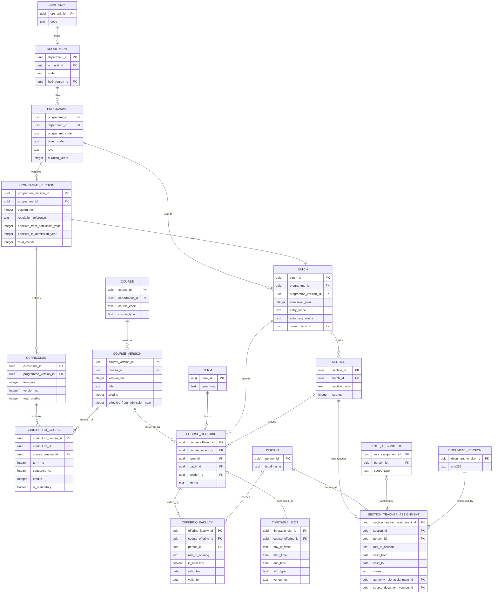

# ERD — Institutional and Academic Structure

**Domains:** Institution and Governance (`core`), Academic Structure (`academic`), Student Lifecycle (`student`).
**Trace:** Research §3, §6, §8.1–8.3, §10.4–10.5; S1 §9, S3–S9, S14–S15.
**Purpose:** separate the constitutional frame, the curriculum/delivery frame, and the student record frame so that no diagram is unreadable and no relationship is guessed.

**Why three diagrams:** governance changes on order, curriculum changes by programme version and batch, and student records change every term. Drawing them together hides which entity owns which lifecycle.

---

## 1. Constitutional and statutory frame

```mermaid
erDiagram
    PERSON {
        uuid person_id PK
        text legal_name
    }
    INSTITUTION {
        uuid institution_id PK
        text legal_name
        text college_code
        text autonomy_status
        date autonomy_from
        date autonomy_to
    }
    SOCIETY {
        uuid society_id PK
        uuid institution_id FK
        text registration_no
    }
    ORG_UNIT {
        uuid org_unit_id PK
        uuid institution_id FK
        uuid parent_org_unit_id FK
        text code
        text unit_type
        text path
    }
    GOVERNANCE_BODY {
        uuid governance_body_id PK
        uuid institution_id FK
        uuid scope_org_unit_id FK
        text body_type
        boolean is_statutory
        date term_start
        date term_end
    }
    GOVERNANCE_MEMBERSHIP {
        uuid governance_membership_id PK
        uuid governance_body_id FK
        uuid person_id FK
        text role_in_body
        date valid_from
        date valid_to
    }
    STATUTORY_APPROVAL {
        uuid statutory_approval_id PK
        uuid institution_id FK
        uuid programme_id FK
        text approval_type
        text authority
        text reference_no
        date valid_from
        date valid_to
    }
    AFFILIATION_RECORD {
        uuid affiliation_record_id PK
        uuid programme_id FK
        uuid academic_year_id FK
        integer intake_approved
        text affiliation_status
    }
    ACADEMIC_YEAR {
        uuid academic_year_id PK
        text label
        date start_date
        date end_date
    }
    TERM {
        uuid term_id PK
        uuid academic_year_id FK
        text term_type
        date start_date
        date end_date
        integer working_days_planned
    }
    ACADEMIC_CALENDAR {
        uuid academic_calendar_id PK
        uuid term_id FK
        integer version_no
        text status
    }
    CALENDAR_MILESTONE {
        uuid calendar_milestone_id PK
        uuid academic_calendar_id FK
        text milestone_code
        date planned_start
        date planned_end
        date actual_start
    }
    DOCUMENT_VERSION {
        uuid document_version_id PK
        text sha256
        text status
    }
    PROGRAMME {
        uuid programme_id PK
        text programme_code
        text level
    }

    SOCIETY ||--o{ INSTITUTION : sponsors
    INSTITUTION ||--o{ ORG_UNIT : contains
    ORG_UNIT ||--o{ ORG_UNIT : parent_of
    INSTITUTION ||--o{ GOVERNANCE_BODY : constitutes
    ORG_UNIT ||--o{ GOVERNANCE_BODY : scopes
    GOVERNANCE_BODY ||--o{ GOVERNANCE_MEMBERSHIP : has
    PERSON ||--o{ GOVERNANCE_MEMBERSHIP : sits_on
    INSTITUTION ||--o{ STATUTORY_APPROVAL : holds
    STATUTORY_APPROVAL }o--o| PROGRAMME : scoped_by
    PROGRAMME ||--o{ AFFILIATION_RECORD : affiliated
    ACADEMIC_YEAR ||--o{ AFFILIATION_RECORD : renews
    INSTITUTION ||--o{ ACADEMIC_YEAR : runs
    ACADEMIC_YEAR ||--o{ TERM : contains
    TERM ||--o{ ACADEMIC_CALENDAR : versioned_as
    ACADEMIC_CALENDAR ||--o{ CALENDAR_MILESTONE : schedules
    STATUTORY_APPROVAL }o--o| DOCUMENT_VERSION : evidenced_by
    GOVERNANCE_BODY }o--o| DOCUMENT_VERSION : constituted_by
    AFFILIATION_RECORD }o--o| STATUTORY_APPROVAL : granted_by
```

**Cardinality notes:**

| Relationship | Cardinality | Why |
|---|---|---|
| Society → institution | 1:1 in this deployment | The Society sponsors one college. A future multi-institution group would make this 1:N. |
| Institution → org unit | 1:N | Departments, offices, cells, and support units share one tree. |
| Org unit → org unit | 1:N, self | Tree; the root has no parent. |
| Institution → governance body | 1:N | BOG, Academic Council, Finance Committee, Boards of Studies, Examination Committee, IQAC, and committees. |
| Governance body → membership | 1:N | Composition changes by order and term. |
| Programme → approval / affiliation | 1:N | Approvals are annual and programme-scoped; an institution-level approval is also possible. |
| Term → calendar | 1:N | Provisional and approved versions coexist; only one is active. |

**Versioning:** a new BOG/Academic Council order creates a new body term or membership set; the old rows are closed with `valid_to`. A calendar change creates a new `academic_calendar` version; milestones are copied and amended, not overwritten. Affiliation is per academic year and never overwrites the prior year.

---

## 2. Programme, curriculum, and delivery

**The three-level course distinction:**

| Level | Identity | Changes when | Used by |
|---|---|---|---|
| `course` | Stable subject/paper code | A new subject is created or retired | Catalogue, search, curriculum |
| `course_version` | Content, credits, outcomes, syllabus | The syllabus or credit structure changes | Curriculum, offering, scheme |
| `course_offering` | Delivery to a batch/section in a term | A new term starts, or a section is added | Attendance, assessment, registration |

**Batch and programme version:** a batch binds exactly one programme version. This is the anchor for "which regulation applies" (G-04). If the institution later says a batch is partly MAKAUT and partly autonomous, the `autonomy_status` column and the policy scope carry the exception; the version binding does not change silently.

**Curriculum versioning:** a curriculum is per programme version and term. It includes course versions, not course identities. An elective is a curriculum-course with a category; the actual choice is a course registration. A curriculum change after a batch has started requires a new curriculum version; the old one remains for historical registration.

**Offering staffing:** `offering_faculty` is the academic allocation. It is not a role assignment by itself. Authorization checks combine the person's `Faculty` role with the relationship "is allocated to this offering" and the validity window. The coordinator is one `role_in_offering` value; a partial unique index permits one open coordinator per offering, so there is no duplicate `coordinator_person_id`. This avoids creating a role assignment for every teaching allocation while still applying least privilege.

**Section teaching:** `section_teacher_assignment` records the class teacher, co-class teacher, or substitute over a validity window. It replaces `section.class_teacher_person_id`, which would have bypassed the role model. The assignment scopes access to the section; it does not grant a permission. The `authority_role_assignment_id` proves the allocating HOD acted under a valid HOD assignment, and `source_document_version_id` holds the office order when one exists. One active class teacher per section is enforced by a partial unique index and an exclusion constraint over the date range.

**Timetable:** the Initial Release stores the slot and a `venue_text` only. `academic.room` is Phase 2, so there is **no `room_id` column** in the Initial Release schema. When rooms arrive, an expand migration adds a nullable `room_id`, backfills from `venue_text` where possible, then adds the FK and capacity/overlap checks. This is a phase-sequencing rule, not an open design decision.

---

## 3. Student academic record

```mermaid
erDiagram
    PERSON {
        uuid person_id PK
        text legal_name
    }
    ADMISSION_APPLICATION {
        uuid application_id PK
        uuid person_id FK
        uuid programme_id FK
        uuid batch_id FK
        text application_no
        text eligibility_status
        text application_status
    }
    ADMISSION_OFFER {
        uuid offer_id PK
        uuid application_id FK
        date offered_at
        date accepted_at
        text status
    }
    STUDENT {
        uuid student_id PK
        uuid person_id FK
        uuid batch_id FK
        uuid section_id FK
        text college_roll_no
        integer admission_year
        text current_status
    }
    GUARDIAN {
        uuid guardian_id PK
        uuid person_id FK
    }
    STUDENT_GUARDIAN {
        uuid student_guardian_id PK
        uuid student_id FK
        uuid guardian_id FK
        text relation
        boolean is_primary
    }
    UNIVERSITY_REGISTRATION {
        uuid university_registration_id PK
        uuid student_id FK
        text registration_number
        integer registration_year
        text status
    }
    EXAM_ROLL_NUMBER {
        uuid exam_roll_number_id PK
        uuid student_id FK
        text roll_number
        boolean is_current
    }
    SEMESTER_REGISTRATION {
        uuid semester_registration_id PK
        uuid student_id FK
        uuid term_id FK
        text registration_no
        text status
    }
    COURSE_REGISTRATION {
        uuid course_registration_id PK
        uuid student_id FK
        uuid semester_registration_id FK
        uuid course_offering_id FK
        text registration_type
        integer credits
        text status
    }
    STATUS_HISTORY {
        uuid status_history_id PK
        uuid student_id FK
        text status
        date effective_from
        date effective_to
        text reason
    }
    ELIGIBILITY_DETERMINATION {
        uuid eligibility_determination_id PK
        uuid student_id FK
        uuid term_id FK
        text gate_code
        text status
        uuid policy_rule_version_id FK
    }
    MENTOR_ASSIGNMENT {
        uuid mentor_assignment_id PK
        uuid mentor_person_id FK
        uuid student_id FK
        uuid term_id FK
        date valid_from
        date valid_to
    }
    STUDENT_DOCUMENT {
        uuid student_document_id PK
        uuid student_id FK
        uuid document_version_id FK
        text document_type
        text verification_status
    }
    BATCH {
        uuid batch_id PK
        integer admission_year
    }
    PROGRAMME {
        uuid programme_id PK
        text programme_code
    }
    SECTION {
        uuid section_id PK
        text section_code
    }
    SECTION_ASSIGNMENT {
        uuid section_assignment_id PK
        uuid student_id FK
        uuid section_id FK
        uuid batch_id FK
        date effective_from
        date effective_to
        text assignment_reason
        text status
        uuid authority_role_assignment_id FK
    }
    ROLE_ASSIGNMENT {
        uuid role_assignment_id PK
        uuid person_id FK
        text scope_type
    }
    TERM {
        uuid term_id PK
        text term_type
    }
    COURSE_OFFERING {
        uuid course_offering_id PK
        uuid course_version_id FK
    }
    RULE_VERSION {
        uuid rule_version_id PK
        text status
    }
    DOCUMENT_VERSION {
        uuid document_version_id PK
        text sha256
    }

    PERSON ||--o{ ADMISSION_APPLICATION : applies
    ADMISSION_APPLICATION ||--o| ADMISSION_OFFER : receives
    ADMISSION_APPLICATION ||--o| STUDENT : becomes
    PERSON ||--o| STUDENT : is
    BATCH ||--o{ STUDENT : enrols
    STUDENT ||--o{ SECTION_ASSIGNMENT : assigned_to
    SECTION ||--o{ SECTION_ASSIGNMENT : receives
    BATCH ||--o{ SECTION_ASSIGNMENT : scopes
    ROLE_ASSIGNMENT |o--o{ SECTION_ASSIGNMENT : authorises
    PROGRAMME ||--o{ ADMISSION_APPLICATION : applied_for
    STUDENT ||--o{ STUDENT_GUARDIAN : has
    GUARDIAN ||--o{ STUDENT_GUARDIAN : linked_to
    STUDENT ||--o| UNIVERSITY_REGISTRATION : registered_as
    STUDENT ||--o{ EXAM_ROLL_NUMBER : issued
    STUDENT ||--o{ SEMESTER_REGISTRATION : registers
    TERM ||--o{ SEMESTER_REGISTRATION : accepts
    SEMESTER_REGISTRATION ||--o{ COURSE_REGISTRATION : contains
    STUDENT ||--o{ COURSE_REGISTRATION : enrols
    COURSE_OFFERING ||--o{ COURSE_REGISTRATION : enrolled_in
    STUDENT ||--o{ STATUS_HISTORY : changes
    STUDENT ||--o{ ELIGIBILITY_DETERMINATION : evaluated
    TERM ||--o{ ELIGIBILITY_DETERMINATION : scopes
    RULE_VERSION ||--o{ ELIGIBILITY_DETERMINATION : governs
    STUDENT ||--o{ MENTOR_ASSIGNMENT : assigned
    PERSON ||--o{ MENTOR_ASSIGNMENT : mentors
    STUDENT ||--o{ STUDENT_DOCUMENT : provides
    DOCUMENT_VERSION ||--o{ STUDENT_DOCUMENT : evidences
```

**Section membership is historical:** a student belongs to a section through `section_assignment`, not through a column on `student`. Each row has `effective_from`, `effective_to`, a reason, and the authority under which the change was made. `student.section_id` is a derived current-section cache, updated in the same transaction that opens or closes an assignment; it is never the source of truth. The composite foreign keys `(student_id, batch_id)` and `(section_id, batch_id)` make it impossible to assign a student to a section in a different batch.

**Course registration carries the student:** `course_registration.student_id` is an integrity anchor, not a duplicate of the semester registration's student. A composite FK `(semester_registration_id, student_id)` proves the anchor matches the parent term registration; a unique key `(course_registration_id, student_id, course_offering_id)` lets `attendance.record` prove that the student was enrolled in the exact offering being taught.

**Registration layers:**

| Layer | Record | Meaning | Gate |
|---|---|---|---|
| University registration | `university_registration` | MAKAUT registration number | MAKAUT confirmation |
| Semester registration | `semester_registration` | The student is registered for a term | Academic and configurable eligibility gates |
| Course registration | `course_registration` | The student is enrolled in a specific offering | Offering capacity, prerequisites, approval |
| Examination registration | `exam_registration` (future) | The student will sit an exam event | Attendance, fee, discipline, form fill-up |

The four are deliberately separate. The research shows they occur at different times and with different owners. Collapsing them would make a fee or attendance gate impossible to audit.

**Eligibility determination:** this is the generic gate record. A gate code names the check (`ACADEMIC_PREREQUISITE`, `ATTENDANCE`, `FEE_CLEARANCE`, `DISCIPLINE`, `DOCUMENT_VERIFICATION`). The status is `pass`, `fail`, `waived`, `unknown`, or `not_applicable`, and it stores the policy version and evidence. This is how the design keeps G-08 open: fee status is recorded as a fact, and whether it is a hard gate is a policy/configuration decision, not a schema assumption.

**Status history:** `student.current_status` is the fast current value; `status_history` is the authoritative timeline. A status change is one transaction that writes the history row and updates the current value. A student is never deleted; withdrawal, detention, graduation, and year lag are statuses.

---

## 4. Cross-diagram invariants

1. A `batch` cannot exist without a `programme_version`; a `student` cannot exist without a `batch`.
2. A `course_offering` cannot exist without a `course_version` and a `term`.
3. A `course_registration` cannot exist without a `semester_registration` and an offering; its `student_id` must match the semester registration (composite FK).
4. A `university_registration` number is unique when present; an `exam_roll_number` is unique and only one is current per student.
5. A `curriculum_course` references a course version, not a course.
6. An `offering_faculty` allocation has a validity window; it does not grant institution-wide access.
7. A `mentor_assignment` is term-bound and does not grant access to marks beyond the mentor's read scope.
8. A `section_assignment` is the only source of section membership. Its composite FKs keep student, section, and batch consistent, and `student.section_id` is a cache that must reconcile with the open assignment.
9. A `section_teacher_assignment` records the class teacher over a date range and dies with its section; `authority_role_assignment_id` must reference the role assignment that authorised the act.
10. No Initial Release table has a foreign key to a Future-Phase entity. Phase-2 tables may reference Initial Release tables, never the reverse.

---

## 5. RLS implications

| Table | Policy intent |
|---|---|
| `student.student` | Student sees self; guardian sees linked student's limited projection; faculty sees students in their offerings; HOD sees department; Registrar sees institution; Auditor reads. |
| `student.semester_registration` / `course_registration` | Student sees own; faculty sees students in own offerings; Registrar sees institution. |
| `student.status_history` | Registrar, Principal, Auditor; student sees own status but not internal reasons marked restricted. |
| `academic.course_offering` | Students see offerings they are registered in or eligible for; faculty see own offerings; HOD sees department. |
| `academic.curriculum` | Read-only to students/faculty; write to HOD/BoS/Academic Council. |
| `core.governance_membership` | Principal, Registrar, body members, Auditor. |

---

## 6. Deferred relationships

| Relationship | Why deferred | Activation condition |
|---|---|---|
| `timetable_slot.room_id → academic.room` | Room inventory is Phase 2, so the column does not exist in the Initial Release. | A Phase-2 expand migration adds nullable `room_id`, backfills from `venue_text`, then adds the FK and overlap checks. |
| `student.batch_id` for a direct second-programme student | The institution has not defined a second-career rule. | Registrar decision; the model supports a second student row. |
| `course_registration` for a backlog with no current offering | Backlog examination registration is future. | M11/M14; `exam_registration_course` takes over. |
| `admission_offer.fee_payment_id → finance.payment` | Finance is Phase 2. | Finance module activation; until then a receipt reference is recorded. |
