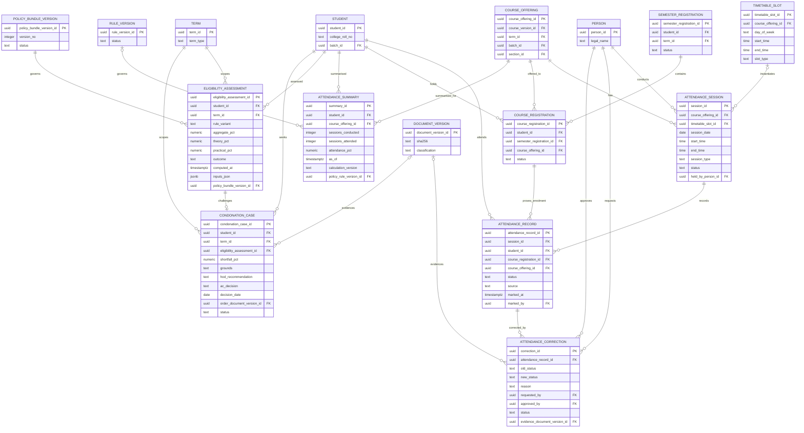
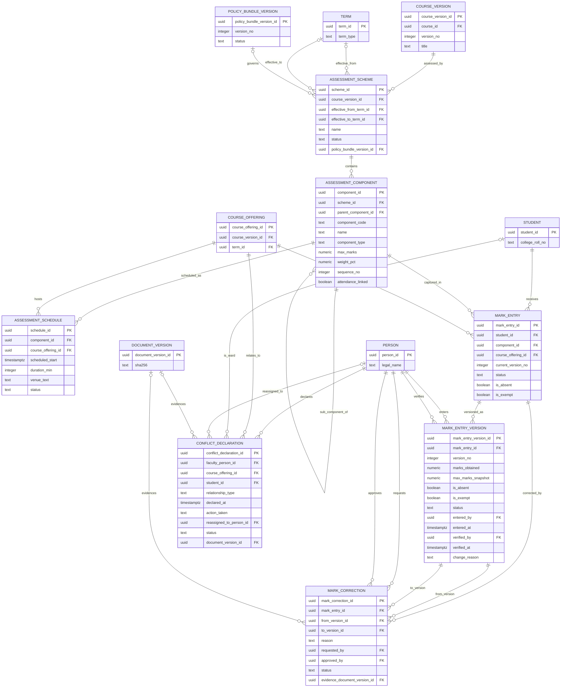
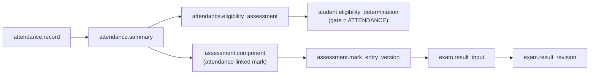

# ERD — Attendance and Internal Assessment

**Domains:** Attendance (`attendance`), Assessment (`assessment`).
**Trace:** Research §8.4–8.5, §9.3–9.4; S1 §§16–19; S2 p.55; S17; G-01, G-13–G-15.
**Purpose:** make the capture unit, the correction history, the computed summary, the eligibility decision, and the versioned mark chain explicit. These are the records most likely to be disputed, so no derived value is stored as if it were the original fact.

---

## 1. Attendance: capture, correction, summary, eligibility

**Capture model:**

| Record | Granularity | Authoritative? | Notes |
|---|---|---|---|
| `attendance_session` | One class/lab meeting | Yes | A cancelled session is not counted in the denominator. |
| `attendance_record` | One student in one session | Yes | Unique per session and student; carries the registration and offering so the student must be enrolled in the session's offering. |
| `attendance_correction` | One change event | Audit | Does not replace the record; the record is updated and the correction preserves old/new. |
| `attendance_summary` | Student × offering | No — derived | Recomputed from records; records `as_of` and policy version. |
| `eligibility_assessment` | Student × term × rule variant | Policy decision | Stores both aggregate and split percentages so a rule change can be re-evaluated without re-capturing attendance. |
| `condonation_case` | Student × term | Institutional decision | References the assessment it challenges and the Academic Council order document. |

**Registration invariant:** `attendance_record` references the student, the `course_registration`, and the `course_offering`. Two composite foreign keys make the rule structural:

- `(course_registration_id, student_id, course_offering_id) → student.course_registration(course_registration_id, student_id, course_offering_id)` proves the registration belongs to this student and this offering.
- `(session_id, course_offering_id) → attendance.session(session_id, course_offering_id)` proves the session belongs to the same offering.

Together they make it impossible to record attendance for a student who is not registered in the exact offering being taught. The direct `student_id` FK remains for query simplicity, but it is not the authority. The service additionally rejects a record when the registration was dropped before the session date; that temporal rule is not expressible as an FK and is documented in `OPEN_DECISIONS.md` OD-14.

**Why two attendance variants:** ATT-01 (S1 §16) says 75% aggregate; ATT-05 (S2 p.55) says 75% separately in theory and practical. MAKAUT's August 2026 notification (S17) does not settle it. The assessment stores `rule_variant` and both percentage sets. The system can compute both, display both, and record which one a decision used. No default gate is enabled until G-01 is resolved.

**Attendance marks:** CIA attendance (5 marks) and PCIA attendance (10 marks) are policy parameters, not hard-coded. The mapping from percentage to marks lives in the assessment scheme/rule version. The attendance summary supplies the percentage; the assessment component records the resulting mark.

**Duty leave:** modelled as `attendance.duty_leave` (Phase B). It is not activated because the research does not define whether duty leave counts toward the 75% (G-14). The schema supports `counts_as_attendance` as a policy parameter when the institution decides.

---

## 2. Assessment: scheme, components, versioned marks

**Mark lifecycle:**

| State | Meaning | Who may act |
|---|---|---|
| `draft` | Faculty is entering; not visible to the student | Assigned faculty |
| `submitted` | Faculty has submitted for verification | Assigned faculty |
| `verified` | HOD/COE has checked | HOD/COE |
| `locked` | Used by result processing; immutable | COE |

A correction does not edit a locked version. It creates a new `mark_entry_version` and a `mark_correction` that references the old and new versions. The `mark_entry.current_version_no` points to the latest. The result processor records which version it used in `exam.result_input`.

**Why a separate `mark_entry` and `mark_entry_version`:** the identity (student, component, offering) is stable; the value is versioned. This allows the student to see the current mark while an audit trail preserves every correction, the reason, the evidence, and the approver.

**Conflict of interest:** `assessment.conflict_declaration` is checked before a faculty member is allowed to enter marks or attendance. If a declaration exists and the action is not reassigned, the authorization service denies the write. This implements ASS-09 as an access rule, not just a policy statement.

**Make-up and reassessment:** a make-up assessment is a new `assessment.schedule` for the same component with a `schedule_type` (regular/makeup/reassessment). The resulting mark is a new `mark_entry_version`. The regulations do not cap reassessments (G-15), so the schema does not impose a cap; the policy version may.

---

## 3. Cross-domain links to results

**Rule:** attendance never flows directly into a result grade. It flows into an assessment component mark (CIA/PCIA attendance marks) and, separately, into an eligibility determination. The result processor uses the component mark and records the eligibility gate outcome; it does not recompute attendance.

---

## 4. Versioning summary

| Entity | Versioned? | History mechanism | Immutable after |
|---|---|---|---|
| `attendance.session` | No | Correction of status is audited | Session is held |
| `attendance.record` | No, current value | `attendance.correction` old/new | Never deleted |
| `attendance.summary` | Yes, by `as_of` | New row per calculation | No — recomputable |
| `attendance.eligibility_assessment` | Yes, by `computed_at` | New row per run/variant | No — recomputable |
| `attendance.condonation_case` | Case state | Decision + order document | Decision recorded |
| `assessment.scheme` | Yes, by effective term | New scheme row | Marks exist |
| `assessment.component` | No, within scheme | New scheme version | Marks exist |
| `assessment.mark_entry` | Current pointer | `mark_entry_version` | Never deleted |
| `assessment.mark_entry_version` | Yes | Immutable rows | Created |
| `assessment.mark_correction` | Event | References old/new | Created |

---

## 5. RLS implications

| Table | Policy intent |
|---|---|
| `attendance.record` | Student sees own; faculty sees own offerings; HOD sees department; Registrar/COE see institution; Guardian sees linked student if consent allows. The registration column tightens row scope to the enrolled offering. |
| `attendance.correction` | Faculty sees own requests; HOD approves within department; Auditor reads. |
| `attendance.condonation_case` | Student sees own case status; HOD sees department; Academic Council members see cases for decision; Auditor reads. |
| `assessment.mark_entry` / `_version` | Student sees own **published** marks only; faculty sees own offerings; HOD sees department; COE sees institution. |
| `assessment.conflict_declaration` | HOD, COE, Auditor; the declaring faculty sees own; the student's identity is restricted. |

**Sensitive-data rule:** condonation evidence and conflict declarations may contain family or medical information. They are Restricted and never enter the document retrieval corpus.

---

## 6. Open decisions that affect this ERD

| Decision | Effect if resolved |
|---|---|
| G-01 attendance variant | One variant becomes `Current`; the other remains `Historical`; eligibility enforcement can be enabled. |
| G-13 capture method | May add a device/source reference; the record model does not change. |
| G-14 duty leave | `attendance.duty_leave` activates; the calculation includes or excludes it. |
| G-15 reassessment cap | A policy parameter; no schema change. |
| G-12 result approval | Does not change marks; changes whether `locked` marks may feed an automated result. |
| OD-14 attendance registration invariant | Composite FKs from `attendance.record` to `course_registration` and `attendance.session` are mandatory in every implementation wave. |
