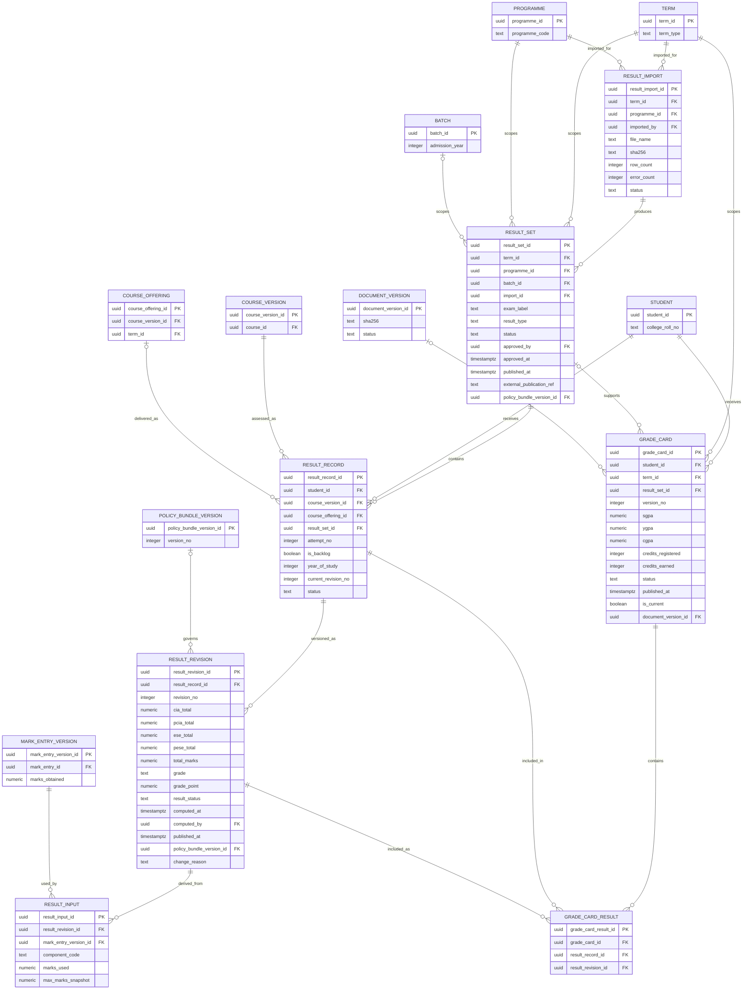
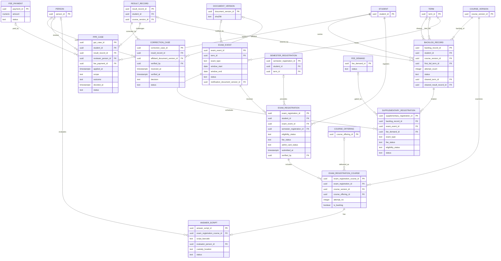
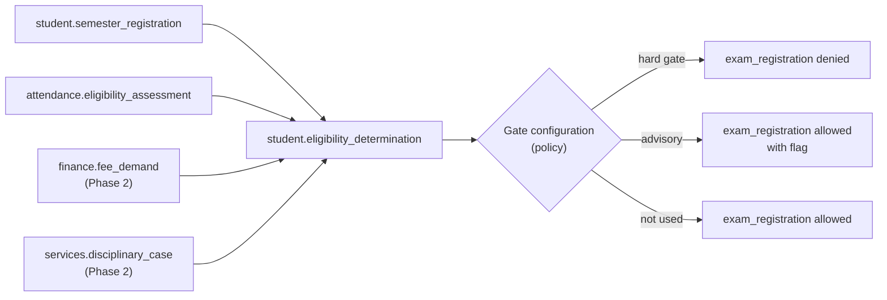

# ERD — Examination and Results

**Domain:** Examination and Results (`exam`), with inputs from `assessment`, `attendance`, `student`, and `finance`.
**Trace:** Research §8.6–8.8, §9.5–9.7, §12 M10–M14; S1 §§20–24, S8, S16 §3.4; G-12, G-16, G-17.
**Purpose:** separate the **initial read-only result view** from the **future examination operation**, and separate the **per-course result** from the **per-term grade card** and the **institutional recommendation** from the **MAKAUT degree award**.

---

## 1. Initial Release — imported, published results (read-only)



**Publication gates for the initial read-only view:**

| Gate | Meaning | Enforced by |
|---|---|---|
| Import provenance | The result file has a SHA-256, source label, row count, and error count. | `result_import` |
| Set status | Only `published` result sets are visible to students. | `result_set.status` |
| External reference | If BCREC did not compute the result, the external publication reference is recorded. | `result_set.external_publication_ref` |
| Revision | The student sees the latest published revision, not an internal draft. | `result_revision` |
| Grade card composition | A grade card references explicit result revisions, so a later correction cannot silently change an old card. | `grade_card_result` |

**Why `result_input` exists:** even when results are imported, the design must be able to answer "which marks produced this result?" If the import does not provide mark-level data, `result_input` is empty for that revision and the revision carries the external source reference. When BCREC begins computing results (Phase 2), the same table records the exact `mark_entry_version` used.

**Result status:** `X` = not eligible for promotion/degree; `XP` = eligible for promotion with backlogs; `P` = passed and promoted (S1 §22.5.1). The database does not map these to integers. The grade is separate: O/E/A/B/C/D/F/I with the policy-defined grade points.

**Why grade cards are versioned:** a result correction or PPR can change a grade. The old grade card must remain retrievable. `grade_card.version_no` and `is_current` preserve the history; the old card is marked `superseded`, never deleted.

---

## 2. Future — examination operations and result computation



**Two different correction routes:** `ppr_case` is student-initiated, theory-only, fee-bearing, and final. `correction_case` is examiner-initiated, affidavit-based, and deadline-bound. They are deliberately not merged. They have different permissions, evidence, and audit trails (research §8.7).

**Examination eligibility:** `exam_registration.eligibility_status` is a summary. The underlying determinations are in `student.eligibility_determination` (attendance, fee, discipline, academic prerequisites). This keeps the fee gate configurable (G-08) and the attendance variant auditable (G-01).

---

## 3. Progression, degree recommendation, and award

```mermaid
erDiagram
    PROMOTION_DECISION {
        uuid promotion_decision_id PK
        uuid student_id FK
        uuid from_term_id FK
        uuid to_term_id FK
        integer backlogs_count
        numeric cgpa
        text decision
        uuid policy_bundle_version_id FK
        uuid approved_by FK
        timestamptz decided_at
    }
    DEGREE_ELIGIBILITY {
        uuid degree_eligibility_id PK
        uuid student_id FK
        integer credits_earned
        numeric cgpa
        integer active_backlogs
        integer mar_points
        text mandatory_courses_status
        text dues_status
        text decision
        uuid policy_bundle_version_id FK
        timestamptz evaluated_at
    }
    DEGREE_RECOMMENDATION {
        uuid degree_recommendation_id PK
        uuid degree_eligibility_id FK
        uuid approved_by FK
        text recommendation_no
        timestamptz recommended_at
        timestamptz submitted_at
        text makaut_reference
        text status
    }
    CERTIFICATE_ISSUE {
        uuid certificate_issue_id PK
        uuid student_id FK
        uuid issued_by FK
        text certificate_type
        text serial_no
        date issued_on
        uuid document_version_id FK
        text status
    }
    MAR_RECORD {
        uuid mar_record_id PK
        uuid student_id FK
        uuid academic_year_id FK
        text activity
        text category
        numeric points
        uuid verified_by FK
        text status
    }
    MOOC_RECORD {
        uuid mooc_record_id PK
        uuid student_id FK
        text platform
        text course_title
        numeric credits
        text usage
        uuid verified_by FK
        text status
    }
    ACHIEVEMENT {
        uuid achievement_id PK
        uuid student_id FK
        text achievement_type
        text title
        date achieved_on
        uuid verified_by FK
        text status
    }
    STUDENT {
        uuid student_id PK
    }
    TERM {
        uuid term_id PK
    }
    ACADEMIC_YEAR {
        uuid academic_year_id PK
        text label
    }
    RESULT_RECORD {
        uuid result_record_id PK
    }
    PERSON {
        uuid person_id PK
    }
    POLICY_BUNDLE_VERSION {
        uuid policy_bundle_version_id PK
    }
    DOCUMENT_VERSION {
        uuid document_version_id PK
    }

    STUDENT ||--o{ PROMOTION_DECISION : receives
    TERM |o--o{ PROMOTION_DECISION : from
    TERM |o--o{ PROMOTION_DECISION : to
    POLICY_BUNDLE_VERSION |o--o{ PROMOTION_DECISION : governs
    PERSON |o--o{ PROMOTION_DECISION : approves
    STUDENT ||--o| DEGREE_ELIGIBILITY : qualifies
    POLICY_BUNDLE_VERSION |o--o{ DEGREE_ELIGIBILITY : governs
    DEGREE_ELIGIBILITY ||--o| DEGREE_RECOMMENDATION : recommends
    PERSON |o--o{ DEGREE_RECOMMENDATION : approves
    STUDENT ||--o{ CERTIFICATE_ISSUE : receives
    PERSON |o--o{ CERTIFICATE_ISSUE : issues
    DOCUMENT_VERSION |o--o{ CERTIFICATE_ISSUE : rendered_as
    STUDENT ||--o{ MAR_RECORD : earns
    ACADEMIC_YEAR ||--o{ MAR_RECORD : scopes
    PERSON |o--o{ MAR_RECORD : verifies
    STUDENT ||--o{ MOOC_RECORD : completes
    PERSON |o--o{ MOOC_RECORD : verifies
    STUDENT ||--o{ ACHIEVEMENT : records
    PERSON |o--o{ ACHIEVEMENT : verifies
```

**Degree authority:** `degree_recommendation` records BCREC's recommendation. It has no column that says BCREC awarded the degree. The award is MAKAUT's act (S16 §3.4). If a MAKAUT reference is later recorded, it is an external reference, not a local degree record.

**Progression and year lag:** `promotion_decision.decision` distinguishes promoted, withheld, and year lag. The policy bundle carries the `2n + 1` limit and the practical-failure rule. The decision references the result records through the policy evaluation; it does not duplicate grades.

**MAR and Honours:** `mar_record` and `mooc_record` are Phase 2 because the entity inventory and the module table disagree on release (C-07). The composite rules (100/75 points, 25/year, 20/16 MOOC credits) are policy parameters, not columns with defaults.

---

## 4. Eligibility and fee linkage (kept configurable)



**Why this is a flow, not an FK:** the institution has not decided whether unpaid dues bar examination (G-08). The `eligibility_determination` table records the fact and the policy version; the gate behaviour is a configuration decision. The schema does not contain a `fee_cleared boolean NOT NULL` that would silently invent a hard gate.

---

## 5. Publication and approval controls

| Control | Implementation |
|---|---|
| Marks entry vs publication | Different permissions; `result_revision.computed_by` and `result_set.approved_by` must be different people where the policy requires. |
| Result set approval | `result_set.approved_by` + `approved_at`; null until approved. |
| External publication | `external_publication_ref` allows read-only import without pretending BCREC approved it. |
| Correction after publication | New `result_revision`; old revision retained; `grade_card` superseded. |
| PPR reviewer independence | `ppr_case.reviewer_person_id` must differ from the original evaluator recorded on the answer script/result input. |
| Audit | `ops.audit_event` records the actor, role assignment, before/after, and reason for every publication, correction, and recommendation. |

**Blocked activation:** automated result publication waits for G-12 (signatory) and M12. The Initial Release can display an imported published result because the publication happened outside the new system and carries an external reference.

---

## 6. RLS implications

| Table | Policy intent |
|---|---|
| `exam.result_record` | Student sees own published results; faculty sees own course results after publication; HOD sees department; COE sees institution; Registrar reads; Auditor reads. |
| `exam.result_revision` | Same as result record; draft revisions are COE-only. |
| `exam.grade_card` | Student sees own current card and historical cards; Registrar/COE see institution; Auditor reads. |
| `exam.result_import` | COE and Auditor only. |
| Future `exam.ppr_case` | Student sees own; reviewer sees assigned; COE sees all; others denied. |
| Future `exam.correction_case` | COE, examiner, Auditor; restricted. |

---

## 7. Open decisions that affect this ERD

| Decision | Effect |
|---|---|
| G-12 result approval signatory | Enables `result_set` approval workflow and automated publication. |
| G-08 fee gate | Determines whether `eligibility_determination` with `gate_code = FEE_CLEARANCE` can block exam registration. |
| G-06 NBA validity | Does not affect results; affects accreditation reporting. |
| G-16 theory examiner appointment | Adds examiner assignment to `answer_script`/`exam_registration_course`. |
| G-17 PPR refund | Adds a refund link on the payment; does not change the case model. |
| G-04 batch boundary | Determines which policy bundle applies to a batch's results. |
