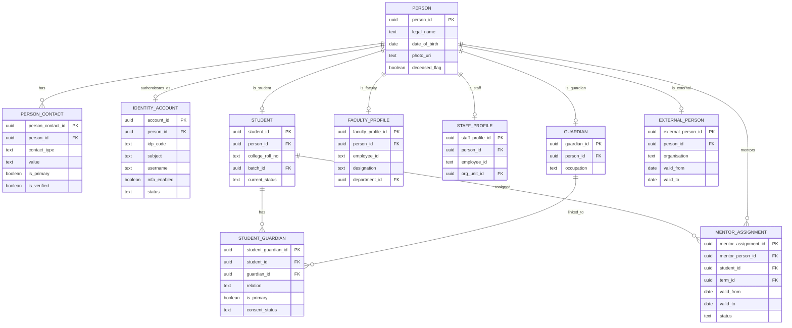
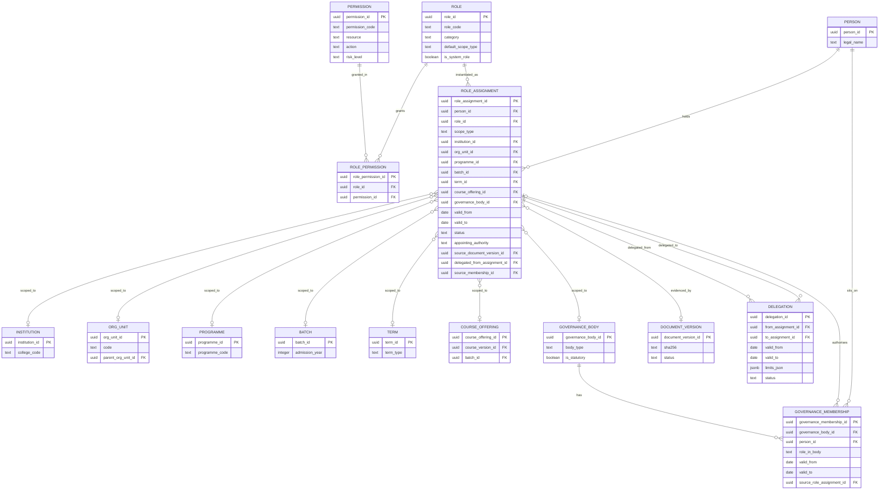

# ERD — Identity, Roles, and Governance

**Domain:** Identity and Access (`iam`) with the governance membership owned by `core`.
**Trace:** Research §7, §11.2–11.3; S6–S9; F-07, F-08.
**Purpose:** show how one human being can hold several concurrent, scoped, time-bound roles without fixed user types, and how a governance seat differs from a system role.

**Reading rules:**
- `||` = exactly one; `|o` = zero or one; `}o` = zero or many; `}|` = one or many.
- A relationship label is a verb, not a table name.
- Every relationship is optional only where the business allows it; the notes below state why.

---

## 1. Person, account, and profiles

**Why the profiles are separate:** a person may be a student and later an employee, or a guardian of one student and an alumnus. The profiles carry different attributes and different access rules. The account is a login link, not an identity; a guardian account is linked to a guardian person and never inherits the student's permissions.

**Cardinality notes:**

| Relationship | Cardinality | Why |
|---|---|---|
| Person → account | 0..1 per IdP | A person may exist before an account is provisioned; a deceased or exited person keeps the record but the account is disabled. |
| Person → student | 0..1 | A person has at most one student career per institution; a second programme is a new student record only if the institution treats it as a separate career (decision deferred). |
| Person → faculty/staff | 0..1 each | Employment profiles are optional and independent; a person can be faculty and staff only if HR explicitly creates both. |
| Student ↔ guardian | 0..* | Multiple guardians are normal; one is primary. |
| Student → mentor assignment | 0..* over time, at most one active per term | Mentor changes are historical, not overwritten. |

---

## 2. Roles, permissions, assignments, and scope

**Scope model:** exactly one of `institution_id`, `org_unit_id`, `programme_id`, `batch_id`, `term_id`, `course_offering_id`, `governance_body_id` is populated, and `scope_type` names it. A database check enforces the "exactly one" rule. This is the integrity fix for the research overview, which drew every assignment as org-unit-scoped.

**Why role and permission are separate:** the role is an institutional concept ("COE", "HOD", "Examination Committee member"); the permission is a system action ("publish_result_set", "enter_marks"). A role can gain or lose a permission without rewriting every assignment. A permission grant is auditable.

**Why governance membership is not a role assignment:** the membership proves the person sits on the body (composition, quorum, minutes). The role assignment proves the system may exercise authority. A membership can generate an assignment, and the link is kept so that revoking the seat can revoke the assignment.

---

## 3. Scoped authority examples

| Person | Role assignment | Scope | Evidence | System consequence |
|---|---|---|---|---|
| Principal | `Principal` | Institution | S6, S7, S8 | Institution-wide academic and executive actions, subject to separation of duties. |
| Registrar | `Registrar` | Institution | S7, S8 | Student records, registration, Academic Council secretariat. |
| COE | `Controller of Examinations` | Institution | S8, S19 | Examination configuration, result set administration. |
| HOD Civil | `HOD` | Org unit (Civil) | S7, S8 | Department attendance, marks verification, mentor allocation, section-teacher allocation. |
| COE as teacher | `Associate Professor` (or `Faculty`) | Department (BS&H) | S7, S19 | Teaching duties; does not by itself grant result publication. |
| Teacher of an offering | `Faculty` | Department | S1 §19 | Mark entry and attendance for an offering **only** where `offering_faculty` allocates the person; the allocation scopes the effect. |
| Class teacher | `Faculty` | Department | S1 §19 | Section-level pastoral and attendance view **only** through an open `section_teacher_assignment`; the assignment scopes the effect. |
| Mentor | `Faculty` | Department | S3 §5.6.29 | Read attendance/results for assigned mentees **only** through `faculty.mentor_assignment`; no separate `Mentor` role. |
| Exam Committee member | `Examination Committee Member` | Governance body | S8 | Read result sets while the committee term is active. |
| Audit reviewer | `Auditor` | Institution | Research recommendation | Read-only audit trail. |

### 3.1 Authority versus operational assignment

There are two different things, and conflating them was the defect behind the class-teacher, HOD, mentor, and faculty-allocation duplication:

| Concept | Where it lives | What it does |
|---|---|---|
| **Authority** | `iam.role_assignment` | Grants a permission. It is time-bound, has exactly one scope, and cites the appointing authority and source evidence. |
| **Operational assignment** | `academic.offering_faculty`, `academic.section_teacher_assignment`, `faculty.mentor_assignment`, `student.section_assignment` | Narrows *where* an already-granted permission applies. It never grants a permission on its own. |

A person may be allocated to a section or an offering without a `Faculty` role, and then the allocation grants nothing. Conversely, a `Faculty` role without an allocation grants no access to a specific offering or section. Both are required.

### 3.2 Reconciling the four allocation models

| Role | Authority source | Operational record | Validity | Who allocates (authority) | Derived cache | Duplicate source removed |
|---|---|---|---|---|---|---|
| HOD | `iam.role_assignment` (`HOD`, scope = department org unit) | — (the role assignment is the record) | `valid_from`/`valid_to` on the assignment | Principal/Registrar assignment | `academic.department.hod_person_id` | A bare `department.hod_person_id` as an authority source. |
| Class/co-class teacher | `iam.role_assignment` (`Faculty`, scope = department) **plus** `academic.section_teacher_assignment` | `academic.section_teacher_assignment` | `valid_from`/`valid_to`; one open class teacher per section | HOD, recorded in `authority_role_assignment_id` | — (no cache needed) | `academic.section.class_teacher_person_id`. |
| Offering teacher/coordinator | `iam.role_assignment` (`Faculty`, scope = department) **plus** `academic.offering_faculty` | `academic.offering_faculty` (`role_in_offering` = instructor/lab_instructor/coordinator/moderator) | `valid_from`/`valid_to`; one open coordinator per offering | HOD | — | `academic.course_offering.coordinator_person_id`. |
| Mentor | `iam.role_assignment` (`Faculty`, scope = department) **plus** `faculty.mentor_assignment` | `faculty.mentor_assignment` | term-bound; one active mentor per student per term | HOD | — | A `Mentor` role that would duplicate `Faculty` plus the assignment. |
| Student section membership | `iam.role_assignment` (Registrar/HOD) that approves the transfer | `student.section_assignment` | `effective_from`/`effective_to`; one open assignment per student | Registrar/HOD, recorded in `authority_role_assignment_id` | `student.section_id` | A bare `student.section_id` as the only membership record. |

**Derived caches:** `academic.department.hod_person_id` and `student.section_id` are denormalised current-value caches. They exist for query speed and reporting, are updated in the same transaction as the authoritative record, and are reconciled nightly. A cache mismatch is a data-quality incident, not an alternative truth.

**Why no `Mentor` or `Course Coordinator` role:** a role is an institutional appointment that carries permissions. Mentoring and coordination are scoped duties of a `Faculty` appointment. Creating separate roles would multiply assignments, complicate revocation, and hide the fact that the underlying permission is the same. The operational assignment supplies the scope.

---

## 4. Versioning and history

| Requirement | Implementation |
|---|---|
| Person name/contact changes | New `person_contact` rows with validity; person name change is audited. |
| Account lifecycle | `status`, `disabled_at`; the account is never deleted because audit references it. |
| Role change | Close the old `role_assignment` with `valid_to`; create a new one with a new source order. |
| Delegation | A separate row with a validity window and limits; the original assignment remains accountable. |
| Governance composition | A new membership row per term; old rows stay. |
| Committee dissolution | `governance_body.term_end` and membership `valid_to`; no deletion. |
| Section teaching | Close the `section_teacher_assignment` row; open a new one. Never overwrite. |
| Student section transfer | Close the `section_assignment` row, open a new one, update the `student.section_id` cache in the same transaction. |
| Offering staffing | Close the `offering_faculty` row; a coordinator change is a new row plus a partial unique check. |

**Separation-of-duties hooks:** `role.permission` includes mutually exclusive pairs (marks entry vs result publication; PPR reviewer vs original evaluator; role assignment vs academic approval). The database stores the grants; the authorization service enforces the pair. `ops.audit_event` records the role assignment used for every sensitive action.

---

## 5. RLS implications

- `iam.person` is readable by the person, Registrar, HR, and Auditor; other roles see a scoped projection, not the base table.
- `iam.role_assignment` is readable by the assignment holder (own), Principal, Registrar, and Auditor; write is restricted to the role-administration permission.
- `core.governance_membership` is readable by Principal, Registrar, body members, and Auditor.
- `iam.identity_account` is never readable by other users; only the account owner and ERP Administrator see authentication metadata.
- `iam.role_assignment` is the only authority source. `academic.offering_faculty`, `academic.section_teacher_assignment`, `faculty.mentor_assignment`, and `student.section_assignment` are joined as scope evidence; they are never queried as grants.
- Scope resolution for every other schema calls `iam.current_person_id()` and `iam.has_permission(permission_code, scope_type, scope_id)`; these are security-definer functions, not table grants. A policy that allows a write must also require the operational assignment where the domain defines one.

---

## 6. What this ERD deliberately does not show

- Authentication factors, passwords, tokens, and sessions: owned by the IdP.
- Student attendance, marks, results, fees: other domains; they reference `person_id` or `student_id`, not the account.
- Committee minutes and case files: `core.governance_body` holds the body; documents and cases are in `doc` and `services`.
- Notifications and preferences: future `iam.user_preference` (not in the Initial Release).
