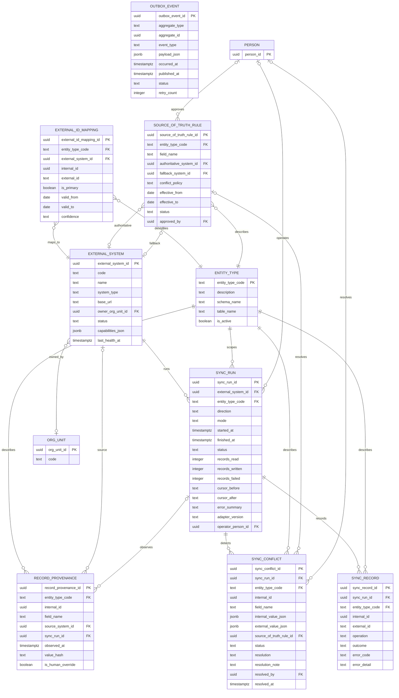
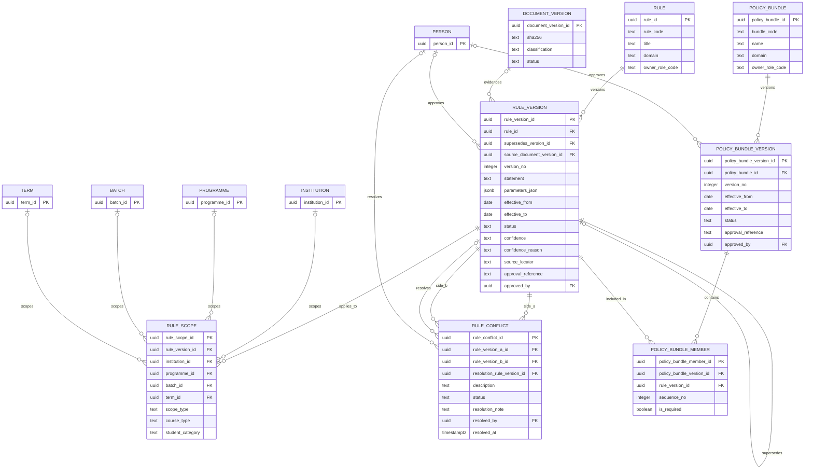
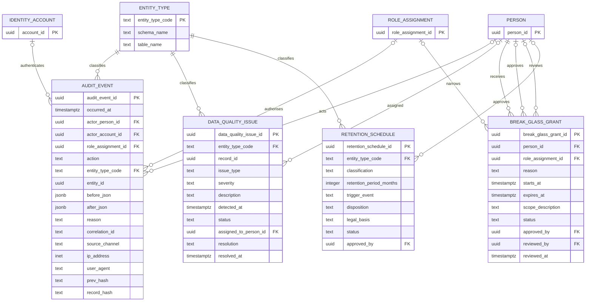

# ERD — Integration, Policy, and Audit

**Domains:** Integration and Synchronization (`integration`), Policy (`policy`), Audit and Operations (`ops`).
**Trace:** Research §9, §11.6, §11.9, §13.1–13.6; S14, S18, S20; G-09, G-10, G-22.
**Purpose:** show the control plane that surrounds the academic domains: how external identity is mapped, which system wins per field, how a rule is versioned and scoped, and how every sensitive action is recorded without becoming mutable business state.

---

## 1. Integration and provenance

**The polymorphic exception:** `external_id_mapping.internal_id`, `record_provenance.internal_id`, `sync_record.internal_id`, `sync_conflict.internal_id`, and `audit_event.entity_id` cannot have a foreign key because they point to different tables. The design controls this with `integration.entity_type`, which is a real FK, and with application-level validation. This is the only intentional exception to referential integrity; it is documented here and in `POSTGRES_ARCHITECTURE.md`.

**Why `entity_type` is a table, not a check constraint:** the set of mapped entities grows as modules are added. A registry row is easier to audit than an ever-growing `CHECK IN (...)` list. The registry also records the schema/table, which helps the data steward and the audit tooling.

**Source-of-truth rule:** `authoritative_system_id` may be null, meaning "internal BCREC application is authoritative". A non-null value means the external system wins for that field. `conflict_policy` is `authoritative_wins`, `manual_review`, or `newest_wins`. The research's warning is enforced: two systems cannot both be authoritative for the same field at the same time.

**Provenance:** `record_provenance` records the last writer per field, the source system, the sync run, the observation time, and a hash of the value. A human override is flagged; the next sync cannot silently revert it without a conflict.

**Outbox:** `outbox_event` makes publication reliable. A transaction that changes a result or a fee demand writes an outbox row in the same transaction. A worker publishes it and marks it sent. Consumers must be idempotent.

---

## 2. Policy: rules, versions, scope, bundles, conflicts

**The rule model in one sentence:** a stable rule identity has immutable versions; each version has parameters, an effective window, a status, a confidence, a source document, and a scope; a named bundle selects the versions used by a calculation.

**Status values:** `Current`, `Draft`, `Historical`, `Superseded`, `Disputed`, `Unknown` (research §0.2). The database does not infer status from dates. A rule can be `Current` with an `effective_to` in the future, or `Superseded` with a past date. The status is the institutional statement.

**Conflict handling:** C-01 (attendance) is a `rule_conflict` between ATT-01 and ATT-05. Both versions remain `Disputed`. A bundle may include both, and the consuming calculation must state which variant it used. The conflict is resolved only by a new rule version with an approval reference, at which point the old versions become `Superseded` and the conflict becomes `resolved`.

**What a bundle is not:** a bundle is not a new policy. It is a reproducible selection. Two bundles may share rules. A bundle version is immutable once used by a result, eligibility assessment, or promotion decision.

---

## 3. Audit, data quality, break-glass, retention

**Audit event:** append-only. `before_json` and `after_json` hold only the changed fields for sensitive entities, not full row copies. `prev_hash` and `record_hash` form a hash chain per partition; a nightly checkpoint can be signed and stored separately. The chain detects tampering but does not prevent a privileged administrator from deleting rows; database privileges and WAL archiving are the real controls.

**Actor model:** `actor_person_id` and `actor_account_id` are both stored. A service account has a null person and a non-null account. `role_assignment_id` is the authority actually exercised; a person with several roles must act under one assignment, never an amorphous "user".

**Correlation:** `correlation_id` links an HTTP request, a background job, and an outbox event. It is mandatory for state changes.

**Data quality:** `data_quality_issue` is a first-class work item. It links to the entity type and record, records severity and assignment, and closes with a resolution. It is not a comment field on a business table.

**Break-glass:** a grant is time-bound and scoped. It must be approved and later reviewed. It does not bypass audit; it creates additional audit events. The research labels break-glass a recommendation, not an observed BCREC practice.

**Retention:** the table exists, but no period is populated until G-22 is decided. `disposition` is `destroy`, `anonymize`, or `archive`. A retention job cannot run against a table with no approved schedule.

---

## 4. Integrity and service-boundary notes

| Concern | Design |
|---|---|
| External IDs | Only in `integration.external_id_mapping`; never on `student`, `exam`, or `finance` tables. |
| Polymorphic IDs | Validated by `integration.entity_type`; no FK. Documented exception. |
| Audit immutability | `ops.audit_event` has no update/delete grant for application roles; only the audit writer may insert. |
| Policy immutability | `policy.rule_version` and `policy.policy_bundle_version` are insert-only after use; updates are blocked by trigger. |
| Integration writes | The integration service calls domain APIs; it has no direct `INSERT/UPDATE` on academic tables. |
| Conflict resolution | A human steward resolves; the service never silently overwrites. |
| Outbox delivery | At-least-once; consumers use an idempotency key. |
| Service accounts | No interactive login; `iam.identity_account` has `account_type = service`; scoped permissions only. |

---

## 5. RLS implications

| Table | Policy intent |
|---|---|
| `integration.external_id_mapping` | Data Steward, Integration Service, Auditor. |
| `integration.sync_conflict` | Data Steward and Auditor; integration service writes but cannot resolve. |
| `integration.record_provenance` | Data Steward, Auditor; read-only to domain owners. |
| `policy.rule_version` | Read by all authenticated roles (rules are internal); write by Academic Council/Registrar. Draft status visible. |
| `policy.rule_conflict` | Read by Academic Council, Registrar, Auditor; write by Registrar. |
| `ops.audit_event` | Auditor and Principal read; no one updates; writes via a security-definer function. |
| `ops.break_glass_grant` | Principal, Auditor; the grantee sees own grant. |
| `ops.retention_schedule` | Registrar, Legal, Auditor; empty until approved. |

---

## 6. Open decisions that affect this ERD

| Decision | Effect |
|---|---|
| G-09 MAKAUT/NAD integration | Determines whether a portal adapter or manual file exchange is built first. |
| G-10 college ERP/IdP | Determines `external_system` rows, adapter capabilities, and the account subject format. |
| G-22 retention | Populates `retention_schedule`; enables disposition jobs. |
| OD-09 source-of-truth approval | Confirms the per-field authority matrix before any sync writes. |
| OD-10 audit retention | Determines partition retention and hash-checkpoint storage. |
