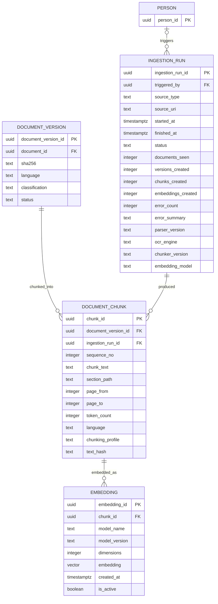
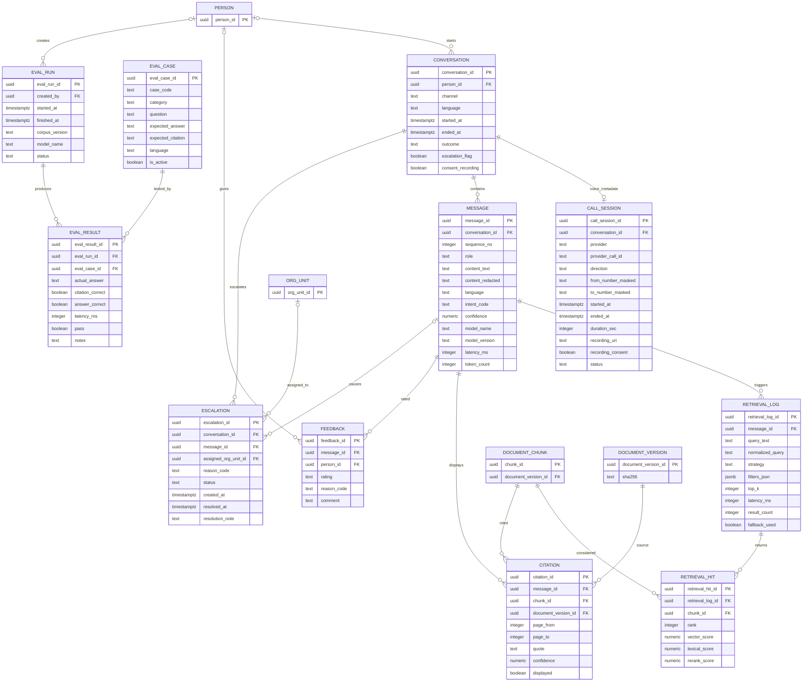

# ERD — Documents, Knowledge, and CIP

**Domains:** Notices and Document Management (`doc`), Knowledge (`knowledge`), CIP Runtime (`cip`).
**Trace:** Research §8.11, §10.10, §11.10, §13.7–13.10; S1, S20; database audit.
**Purpose:** keep the authoritative file, the notice communication, the retrieval chunk, the embedding, the conversation, the citation, and the evaluation result in separate layers. A single "knowledge" table would make provenance, re-embedding, and access control impossible.

---

## 1. Documents and notices

```mermaid
erDiagram
    DOCUMENT {
        uuid document_id PK
        text title
        text document_type
        text issuer_name
        uuid issuer_org_unit_id FK
        text reference_no
        date document_date
        date effective_date
        text classification
        text status
        text source_url
    }
    DOCUMENT_VERSION {
        uuid document_version_id PK
        uuid document_id FK
        uuid supersedes_version_id FK
        integer version_no
        text version_label
        text file_uri
        text mime_type
        bigint file_size
        text sha256
        integer page_count
        boolean ocr_used
        text language
        date effective_from
        date effective_to
        text status
        uuid approved_by FK
        timestamptz approved_at
    }
    DOCUMENT_RELATION {
        uuid document_relation_id PK
        uuid from_version_id FK
        uuid to_version_id FK
        text relation_type
        text note
    }
    NOTICE {
        uuid notice_id PK
        text notice_no
        text category
        uuid issuing_org_unit_id FK
        uuid owner_person_id FK
        text status
    }
    NOTICE_VERSION {
        uuid notice_version_id PK
        uuid notice_id FK
        uuid supersedes_version_id FK
        uuid document_version_id FK
        integer version_no
        text title
        text body_markdown
        timestamptz publish_at
        timestamptz effective_from
        timestamptz effective_to
        text status
        uuid approved_by FK
        timestamptz approved_at
    }
    NOTICE_AUDIENCE {
        uuid notice_audience_id PK
        uuid notice_version_id FK
        text audience_type
        uuid programme_id FK
        uuid batch_id FK
        uuid term_id FK
        uuid role_id FK
        uuid org_unit_id FK
    }
    NOTICE_ACKNOWLEDGEMENT {
        uuid notice_acknowledgement_id PK
        uuid notice_version_id FK
        uuid person_id FK
        timestamptz read_at
        text channel
    }
    ORG_UNIT {
        uuid org_unit_id PK
        text code
    }
    PERSON {
        uuid person_id PK
        text legal_name
    }
    PROGRAMME {
        uuid programme_id PK
        text programme_code
    }
    BATCH {
        uuid batch_id PK
        integer admission_year
    }
    TERM {
        uuid term_id PK
        text term_type
    }
    ROLE {
        uuid role_id PK
        text role_code
    }

    DOCUMENT ||--o{ DOCUMENT_VERSION : versions
    DOCUMENT_VERSION ||--o| DOCUMENT_VERSION : supersedes
    DOCUMENT_VERSION ||--o{ DOCUMENT_RELATION : from
    DOCUMENT_VERSION ||--o{ DOCUMENT_RELATION : to
    ORG_UNIT |o--o{ DOCUMENT : issues
    ORG_UNIT |o--o{ DOCUMENT : owns
    PERSON |o--o{ DOCUMENT_VERSION : approves
    NOTICE ||--o{ NOTICE_VERSION : versions
    NOTICE_VERSION ||--o| NOTICE_VERSION : supersedes
    DOCUMENT_VERSION |o--o{ NOTICE_VERSION : attachment
    ORG_UNIT ||--o{ NOTICE : issues
    PERSON ||--o{ NOTICE : owns
    NOTICE_VERSION ||--o{ NOTICE_AUDIENCE : targets
    PROGRAMME |o--o{ NOTICE_AUDIENCE : targets
    BATCH |o--o{ NOTICE_AUDIENCE : targets
    TERM |o--o{ NOTICE_AUDIENCE : targets
    ROLE |o--o{ NOTICE_AUDIENCE : targets
    ORG_UNIT |o--o{ NOTICE_AUDIENCE : targets
    NOTICE_VERSION ||--o{ NOTICE_ACKNOWLEDGEMENT : acknowledged_by
    PERSON ||--o{ NOTICE_ACKNOWLEDGEMENT : reads
```

**Document vs notice:**

| Concept | Owns | Changes by | Used for |
|---|---|---|---|
| `document` | The evidence file and its metadata | New `document_version` | Rule source, order, policy, circular, prospectus |
| `notice` | The communication and its audience | New `notice_version` | Time-bound announcement, corrigendum, extension |

A notice version may attach a document version (the PDF), but it does not copy the file into a second table. A document may be cited by several notices. Supersession is explicit on both version tables and can also be expressed as a relation (corrigendum, translation, attachment).

**Versioning rules:**

1. The file is immutable. A change creates a new version with a new SHA-256.
2. `supersedes_version_id` points backwards; the old version's `effective_to` is set. The old row is never deleted.
3. A document version is `Draft`, `Active`, `Superseded`, `Withdrawn`, or `Archived`.
4. A notice version is `Draft`, `Scheduled`, `Published`, `Superseded`, or `Withdrawn`.
5. Audience attaches to the **version**, so a corrected notice can have a different audience without rewriting history.

**Classification inheritance:** `document.classification` is one of Public, Internal, Confidential, Restricted, Regulated. Versions, chunks, and embeddings inherit it. A document whose class is `Restricted` or `Regulated`, or whose field-level classification is `R` or `G`, is never chunked into the retrieval corpus. The ingestion job checks both the document class and a deny-list of special-category fields before a chunk is created; a rejected document is recorded as a failed `ingestion_run` with a reason, not silently skipped.

---

## 2. Ingestion: version → chunk → embedding



**Why chunks and embeddings are separate:**

- A chunk is text plus anchors (section path, page range). It is the citation unit.
- An embedding is a model output. A model change creates new embedding rows; it does not rewrite the chunk.
- A chunk may have several embeddings (MiniLM 384, BGE-M3 1024, a future model). Only one is active per model/version.
- Re-chunking creates new chunks; the old chunks and embeddings remain for historical citations unless a retention policy deletes them.

**Ingestion provenance:** every run records parser, OCR engine, chunker, and embedding model versions. A citation can therefore be traced to the exact processing pipeline. If OCR was used, `ocr_used` is true and the text is marked as derived, not original.

**No personal data:** the corpus excludes, at minimum:

- disciplinary and appeal records;
- medical records and condonation evidence;
- fee ledgers and payment details;
- mark sheets, answer scripts, and result revisions;
- identity documents (Aadhaar, PAN, passport, photograph bundles);
- admission/reservation category and category/income certificates;
- guardian income, guardian consent records, and guardian contact details;
- any field classified `R` or `G`.

A chunk that contains a student's marks, category, or guardian income is a data-protection defect, not a retrieval feature. Structured answers about these facts come from the operational tables under RLS, never from the corpus.

---

## 3. CIP runtime: conversation, retrieval, citation, evaluation



**Conversation and message:**

- A conversation is the session envelope; a message is a turn.
- `sequence_no` is unique per conversation and preserves order.
- `content_text` is the working text; `content_redacted` is what may be retained or shown to operators.
- Voice calls add `call_session` with provider IDs, masked numbers, consent, and recording reference. Recordings are Restricted and are not embedded.

**Retrieval and citation:**

- `retrieval_log` records the query, strategy, filters, top-k, latency, and fallback. It is the audit of **what was considered**.
- `retrieval_hit` records the ranked chunks and scores.
- `citation` records what was **shown** to the user, with the exact document version, page range, and quote.
- A factual answer must have at least one citation. A structured answer (e.g. "your attendance is 78%") has no document citation; it records the structured source in the message metadata and must never be answered from the corpus.

**Access filtering before ranking:** the retrieval service applies classification and scope filters before the vector search. A student cannot retrieve an internal committee minute; a CIP operator cannot retrieve a restricted disciplinary record. The filter denies any chunk whose inherited class is `Restricted`/`Regulated` and any document that carries an `R`/`G` field, even if the chunk text itself looks innocuous. This is an application-level filter plus an RLS policy on `knowledge.document_chunk` and `doc.document_version`.

**Evaluation:** `eval_case` is the controlled test set (golden, negative, conflict, version, personal-data, language, access, latency). `eval_run` is a run against a corpus/model version. `eval_result` records pass/fail and latency. A release is blocked if the negative set or the access set fails (research §13.10).

---

## 4. Versioning and retention

| Entity | Versioned? | Retention posture |
|---|---|---|
| `document` | Logical identity | Retain while the document has legal/audit value; no period asserted (G-22). |
| `document_version` | Immutable | Retain superseded versions for historical citation. |
| `notice` / `notice_version` | Immutable versions | Retain; superseded notices remain retrievable for history. |
| `document_chunk` | Per ingestion run | Retain while cited; re-chunking creates new rows. |
| `embedding` | Per model/version | Retain active + one previous model for rollback; old models may be archived. |
| `conversation` / `message` | Append-only | Retain per conversation policy; restricted content redacted. |
| `citation` | Append-only | Retain with the message for audit. |
| `eval_*` | Append-only | Retain for release evidence. |

---

## 5. RLS implications

| Table | Policy intent |
|---|---|
| `doc.document` / `_version` | Classification-based: Public to all; Internal to authenticated; Confidential to scoped roles; Restricted to named roles. |
| `doc.notice` / `_version` | Audience-based: a student sees notices targeting their programme/batch/term/role; staff see internal notices; Principal/Registrar see all. |
| `knowledge.document_chunk` | Inherits the document classification; CIP service sees only chunks whose source version is active or explicitly historical. |
| `knowledge.embedding` | Service-role only; never exposed to end users. |
| `cip.conversation` | Person sees own; CIP Operator sees assigned/operational conversations; Auditor reads. |
| `cip.message` | Same as conversation; `content_redacted` is the default projection. |
| `cip.citation` | Read with the message; document access is re-checked at citation time. |
| `cip.call_session` | Restricted: CIP Operator, Auditor; recordings require consent. |

---

## 6. Open decisions that affect this ERD

| Decision | Effect |
|---|---|
| OD-06 embedding dimension | Fixes `vector(1024)` vs `vector(384)` and the HNSW index. |
| OD-07 corpus scope | Determines which document types are ingested and which are excluded. |
| OD-08 language set | Determines tokenizer, embedding model, and evaluation set. |
| G-19 notice approval | Enables automated notice publishing; until then notices are recorded with an external approval reference. |
| G-22 retention | Enables deletion/archival jobs; until then nothing is destroyed. |
