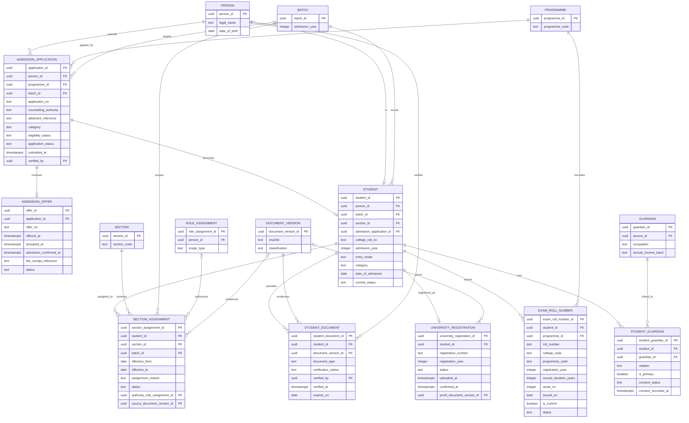
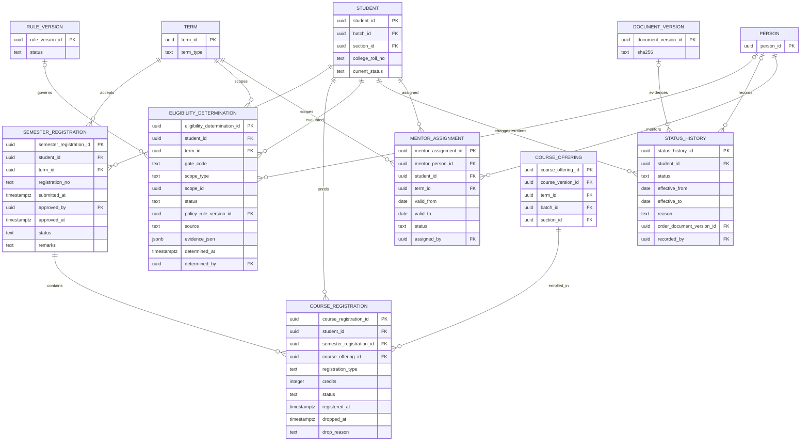
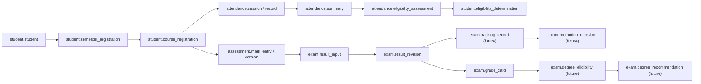

# ERD — Student Academic Records

**Domain:** Student Lifecycle (`student`), with links to Academic Structure, Attendance, Assessment, Examination, Faculty, and Documents.
**Trace:** Research §8.1–8.3, §8.8, §10.5; S1 §9, S18, S20; G-04, G-08, G-11.
**Purpose:** give the student record its own ERD because it is the join point for identifiers, registration, eligibility, attendance, marks, results, mentoring, and status. `ERD_ACADEMIC.md` contains a condensed view; this document is the authoritative student-record diagram.

---

## 1. Admission, identity, and identifiers

**Identifier rules:**

| Identifier | Owner | Uniqueness | Notes |
|---|---|---|---|
| `college_roll_no` | Registrar | Unique per institution | Assigned at admission. |
| `registration_number` | MAKAUT | Unique when present | Generated by the university portal. |
| `exam_roll_number.roll_number` | COE | Unique | 12-digit format; one current per student. |
| `application_no` | Admission Cell | Unique per admission year | Precedes the student record. |
| `offer_no` | Admission Cell | Unique | Ties the offer to the application. |

**Why `EXAM_ROLL_NUMBER` stores components:** the 12-digit format is policy-driven (3 college + 3 programme + 2 year + 1 duration + 3 serial). Storing the components allows validation, re-issue, and format change without parsing the string. The formatted `roll_number` is also stored for external use.

**Guardian consent:** `student_guardian.consent_status` and `consent_recorded_at` gate guardian access. A guardian is a person with a limited account; the link is not a student login.

**Section membership:** `SECTION_ASSIGNMENT` is the historical record of which section a student belonged to and when. `student.section_id` is a derived current-section cache. A transfer closes the old assignment and opens a new one in one transaction; the composite FKs `(student_id, batch_id)` and `(section_id, batch_id)` prevent a cross-batch assignment. `authority_role_assignment_id` records the role (Registrar/HOD) under which the change was approved, and `source_document_version_id` holds the transfer order when one exists. Former students retain their assignments; nothing is deleted.

---

## 2. Registration, eligibility, and term state

**Registration state machine:**

| Record | States | Transition owner |
|---|---|---|
| `semester_registration` | `draft` → `submitted` → `approved` / `rejected` / `cancelled` | Student submits; Registrar approves. |
| `course_registration` | `registered` → `dropped` / `completed` | Student/HOD; drop before the policy deadline. |
| `eligibility_determination` | `pass` / `fail` / `waived` / `unknown` / `not_applicable` | Registrar/COE/system. |
| `student.current_status` | `active` / `detained` / `suspended` / `year_lag` / `graduated` / `withdrawn` | Registrar/Principal. |

**Eligibility gate codes (initial set):**

| Gate | What it checks | Source | Hard gate? |
|---|---|---|---|
| `ACADEMIC_PREREQUISITE` | Prior courses/credits | Academic structure + result | Configurable |
| `ATTENDANCE` | Attendance eligibility | `attendance.eligibility_assessment` | Blocked by G-01 |
| `FEE_CLEARANCE` | Dues | Finance fact | Blocked by G-08 |
| `DISCIPLINE` | Active penalty affecting registration | Services | Blocked by G-20 |
| `DOCUMENT_VERIFICATION` | Required documents verified | Student documents | Configurable |

The gate record is deliberately generic. A new gate does not require a schema change; it requires a policy decision and a `gate_code`.

**Registration integrity:** `course_registration.student_id` is an integrity anchor for attendance and assessment. A composite FK `(semester_registration_id, student_id)` proves it matches the parent semester registration, and a unique key `(course_registration_id, student_id, course_offering_id)` is the target that `attendance.record` uses to prove enrolment in the exact offering. This is a structural guarantee, not an application convention.

**Status history:** the current status is a cached value; the history is the timeline. A status change writes both in one transaction and records the order/evidence. A student who is detained or suspended is not deleted.

**Mentoring:** `mentor_assignment` is in the student record because it scopes access to the student. The mentor's employment profile is in `faculty`. The assignment is term-bound; a mentor change closes the old row and creates a new one.

---

## 3. Links to academic outcomes

**Rule:** the student record owns identity, registration, status, and eligibility. It does not own attendance, marks, results, or fees. The links are by `student_id` and `course_offering_id`; no attendance or mark is copied into the student table.

---

## 4. RLS and privacy

| Table | Policy intent |
|---|---|
| `student.student` | Self; guardian (limited, consented); faculty (students in own offerings); HOD (department); Registrar (institution); Auditor (read). |
| `student.student_document` | Registrar, verified staff, Auditor; the student sees the document type/status but not necessarily the file. |
| `student.university_registration` | Student sees own number; Registrar/COE/Auditor see all. |
| `student.exam_roll_number` | Student sees own; COE/Exam Cell see all. |
| `student.semester_registration` / `course_registration` | Self; faculty (own offerings); Registrar; HOD. |
| `student.eligibility_determination` | Self sees outcome for own gates; Registrar/COE see all; the policy version is visible. |
| `student.status_history` | Self sees current status; restricted reasons are masked; Registrar/Principal/Auditor see full. |
| `student.section_assignment` | Self sees own; Registrar/HOD; class teacher sees own section; Auditor reads. |
| `faculty.mentor_assignment` | Mentor sees assigned students; HOD sees department; student sees own mentor. |

**Sensitive-field contract:** admission category, category/income certificates, guardian income band, identity documents, medical evidence, and disability data are special-category. They are not a single table; the contract follows the field.

| Data element | Where | Class | Default handling |
|---|---|---|---|
| Admission/reservation category | `admission_application.category`, `student.category` | `R/G` | Named roles only; field-level encryption; legal basis; aggregate reporting only; never free text. |
| Category/income certificate | `student_document` (`category_certificate`, `income_certificate`) + `document_version` | `R/G` | Encrypted object storage; signed short-lived URL; access logged; no CIP ingestion. |
| Guardian income band | `guardian.annual_income_band` | `R` | Banded, not exact; Scholarship/Finance/Registrar only. |
| Identity documents | `student_document` + `document_version` | `R/G` | Watermarked, access-logged; verifier sees assigned case only; no CIP ingestion. |
| Medical evidence | `student_document` (`medical`); `attendance.condonation_case.grounds` | `R` | Medical officer, Registrar, case members only; never general faculty. |
| Guardian consent record | `student_guardian.consent_status` | `R` | Legal-basis record; Registrar and DPO only. |
| Photograph | `person.photo_uri`, `student.photo_uri` | `C` | Signed URL; identity-card issuer and Registrar; no face embedding in Initial Release. |
| Date of birth / gender | `person.date_of_birth`, `person.gender` | `C` / `G` | Masked in broad projections; gender supports prefer-not-to-say. |

**Rule:** a default projection omits every `R`/`G` field. The CIP ingestion job rejects a source document that contains any of them. An access to an `R` field writes `ops.audit_event` with the role assignment used. The full matrix is in `DATA_DICTIONARY.md` §1.7; the database policy is in `POSTGRES_ARCHITECTURE.md` §9.3 and §9.5.

---

## 5. Open decisions that affect this ERD

| Decision | Effect |
|---|---|
| G-04 autonomy batch boundary | Determines the programme version and policy bundle for a student. |
| G-08 fee gate | Determines whether `FEE_CLEARANCE` can block semester/exam registration. |
| G-11 admission officer/refund | Determines approval fields and refund records. |
| G-13 attendance capture | Does not change the student record; changes attendance source. |
| OD-11 second programme/career | Determines whether a person can have two student records. |
| OD-13 section teaching and student section history | Fixes the historical assignment model and the derived current-section cache. |
| OD-14 attendance registration invariant | Requires the composite FKs from `attendance.record` to `course_registration` and `attendance.session`. |
| OD-16 sensitive student data | Classifies category, guardian, and identity-document data; DPO must confirm named-role access and legal basis before production. |
