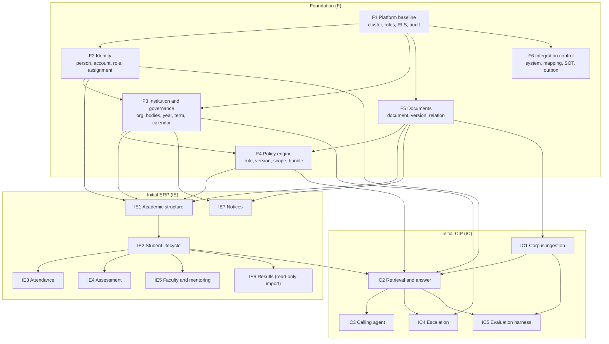
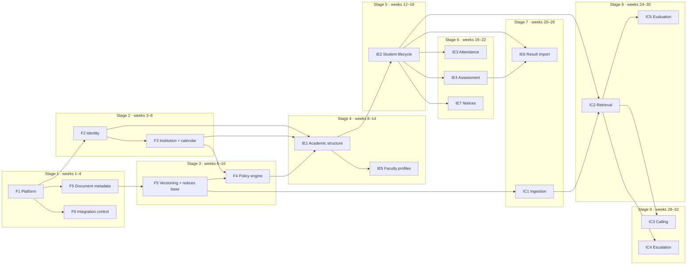

# MVP Dependency Map — BCREC Campus ERP + CIP

**Purpose:** turn the design into an ordered implementation plan. It separates what must exist first (Foundation), what the first ERP release delivers, what the first CIP/Calling Agent release delivers, what is future, and what is built but **cannot be switched on** until the institution decides.

**Companions:** [`ENTITY_CATALOG.md`](ENTITY_CATALOG.md) (phase per entity), [`DATA_DICTIONARY.md`](DATA_DICTIONARY.md) (Initial Release columns), [`OPEN_DECISIONS.md`](OPEN_DECISIONS.md) (decision IDs), [`POSTGRES_ARCHITECTURE.md`](POSTGRES_ARCHITECTURE.md) (platform).

**Reading rule:** a package being "delivered" does not mean its policy-dependent behaviour is enabled. Every blocked feature has an explicit gate in §7.

---

## 1. Phase definitions

| Phase | Code | Meaning | Release gate |
|---|---|---|---|
| Foundation | `F` | Shared platform: identity, governance, calendar, policy, documents, integration control, audit. | Platform review: RLS leak tests, audit, backup restore, seeded reference data. |
| Initial ERP | `IE` | Academic operations: structure, students, attendance, internal assessment, imported results, mentoring, notices. | ERP acceptance: a full term can be recorded end to end without a spreadsheet. |
| Initial CIP | `IC` | Document intelligence, retrieval, citations, conversations, voice calls, escalation, evaluation. | CIP acceptance: golden/negative/access evaluation sets pass; every answer cites or escalates. |
| Future | `2` | Modules whose policy and ownership are not yet approved. | Separate business case per module. |
| Blocked | `B` | Schema and workflow exist, but activation waits on a named institutional decision. | Decision recorded in `OPEN_DECISIONS.md` and an approval document. |

---

## 2. Package overview

**Critical path:** `F1 → F2 → F3 → IE1 → IE2 → IE4 → IE6` for ERP; `F5 → IC1 → IC2 → IC5` for CIP. The two paths meet at `IE2` (student identity) and `F5` (documents).

**Parallelisation:** `F5`/`F6` can run alongside `F3`; `IE5` can run alongside `IE3`/`IE4` once `IE2` is stable; `IC1` can start as soon as `F5` is usable and does not wait for the ERP.

---

## 3. Foundation packages

### F1 — Platform baseline (`F`)

| Item | Detail |
|---|---|
| Entities | None new; creates schemas, roles, extensions, RLS helper functions, `ops.audit_event`, `ops.data_quality_issue`, `ops.break_glass_grant`, `ops.retention_schedule`, `integration.entity_type` |
| Depends on | Nothing |
| Delivers | Cluster, PgBouncer, backup/PITR, `iam.current_person_id()`, `iam.has_permission()`, audit writer, entity registry, migration pipeline |
| Exit criteria | Restore drill passes; RLS helper functions unit-tested; audit chain verifies; no `PUBLIC` grants on application schemas |

**Why first:** every other package references the audit writer and the entity registry. Building identity before the audit path exists produces un-auditable rows.

### F2 — Identity (`F`)

| Item | Detail |
|---|---|
| Entities | IAM-01–IAM-08 |
| Depends on | F1 |
| Delivers | Person, contacts, account link, role, permission, role-permission, scoped assignment, delegation |
| Exit criteria | A person can hold two concurrent roles in different scopes; closing one does not affect the other; an expired assignment denies access; every assignment has a source document or explicit appointing authority |

**Blocking dependency for everything:** no domain can scope access without `role_assignment`.

### F3 — Institution and governance (`F`)

| Item | Detail |
|---|---|
| Entities | GOV-01–GOV-11 |
| Depends on | F1, F2, F5 (documents for orders) |
| Delivers | Institution, society, org tree, governance bodies, memberships, statutory approvals, affiliation records, academic year, term, calendar, milestones |
| Exit criteria | BCREC `120`, 2026-27 year, odd/even terms, and the 18+3 week structure are seeded; a membership generates an optional role assignment; a calendar version is immutable after approval |

### F4 — Policy engine (`F`)

| Item | Detail |
|---|---|
| Entities | POL-01–POL-07 |
| Depends on | F3 (authority/scope), F5 (source document) |
| Delivers | Rule identity, immutable version, scope, conflict, bundle, bundle version, membership |
| Exit criteria | ATT-01 and ATT-05 are both stored with status `Draft`/`Disputed`; a bundle resolves to exact versions; a rule cannot become `Current` without an approval reference; a calculation records the bundle version |

**Seed content (data, not code):** rule identities from research §9, the draft Academic Regulations version, the attendance conflict, the grading table, progression limits, PPR/correction windows. All thresholds remain parameters.

### F5 — Documents (`F`)

| Item | Detail |
|---|---|
| Entities | DOC-01–DOC-03 (document, version, relation); DOC-04–DOC-06 belong to IE7 |
| Depends on | F1, F3 |
| Delivers | Immutable file versions with SHA-256, supersession, relations, classification inheritance |
| Exit criteria | Re-uploading identical bytes is rejected as a duplicate; a superseded version remains retrievable; a restricted document cannot be downgraded without an audit record |

### F6 — Integration control (`F`)

| Item | Detail |
|---|---|
| Entities | INT-01, INT-02, INT-03, INT-04, INT-05, INT-06, INT-07, INT-08, INT-09 |
| Depends on | F1 |
| Delivers | Entity registry, external systems, ID mapping, source-of-truth rules, sync runs, conflicts, provenance, outbox |
| Exit criteria | A dry-run sync records provenance and conflicts without writing a domain table; outbox dispatch is idempotent; every source-of-truth rule defaults to `manual_review` |

**Note:** F6 ships the *control plane*. The actual ERP adapter is Phase 2 (it cannot be built without G-10).

---

## 4. Initial ERP packages (`IE`)

### IE1 — Academic structure

| Item | Detail |
|---|---|
| Entities | ACD-01–ACD-12, ACD-14 |
| Depends on | F2, F3, F4, F5 |
| Delivers | Departments, programmes, programme versions, batches, sections, section teacher assignments, curricula, courses, course versions, offerings, offering faculty, timetable slots |
| Exit criteria | A batch binds one programme version; a course version is immutable after offering; a curriculum references versions; an offering belongs to one term/batch; HOD can allocate faculty; the class teacher is a time-bound `section_teacher_assignment` with an authority role assignment, not a column |

**First data load:** B.Tech CSE/ECE/EE/ME/CE/IT, M.Tech, MBA, MCA as catalogue records, with programme codes from the affiliation record. Intake numbers are data, not schema.

### IE2 — Student lifecycle

| Item | Detail |
|---|---|
| Entities | STU-01–STU-12, STU-15 |
| Depends on | IE1, F2 |
| Delivers | Application, offer, student, guardian, student documents, university registration, exam roll, semester registration, course registration, section assignment, status history, eligibility determination |
| Exit criteria | A student can be admitted, registered for a term, enrolled in offerings, assigned/transferred between sections with history, and given a 12-digit exam roll; status changes are historical; an eligibility gate can be recorded without enabling enforcement |

**This is the hinge.** `IE2` unlocks attendance, assessment, results, mentoring, and CIP personal self-service.

### IE3 — Attendance

| Item | Detail |
|---|---|
| Entities | ATT-01–ATT-06 |
| Depends on | IE2, IE1 |
| Delivers | Sessions, records, corrections, summaries, eligibility assessments (both variants), condonation cases |
| Exit criteria | A session saves 60 records atomically; a record is rejected unless the student is registered in the session's offering (composite FKs); a correction preserves old/new; the summary is recomputable; both attendance variants can be computed for the same student; **no gate blocks a student by default** |

**Blocked behaviour:** automatic detention/eligibility blocking waits on G-01.

### IE4 — Assessment

| Item | Detail |
|---|---|
| Entities | ASM-01–ASM-07 |
| Depends on | IE2, IE1 |
| Delivers | Scheme, components, schedule, mark entry, versioned marks, corrections, conflict declarations |
| Exit criteria | CIA-1/CIA-2/PCIA/PESE/ESE are configurable per course version; a scheme cannot change after marks exist; a correction references old/new versions; a declared conflict blocks the faculty member from assessing that student |

**Assessment weights are seeded from S1 but stored as `Draft`** until the regulation edition is approved.

### IE5 — Faculty and mentoring

| Item | Detail |
|---|---|
| Entities | FAC-01–FAC-03 |
| Depends on | F2, IE1, IE2 |
| Delivers | Faculty profile, staff profile, mentor assignment |
| Exit criteria | Employee IDs unique; a mentor assignment is term-bound; a mentor sees only assigned mentees; designation does not grant permissions |

**Blocked behaviour:** mentoring session notes wait on G-18 (cadence and content policy).

### IE6 — Results (read-only import)

| Item | Detail |
|---|---|
| Entities | EXM-01–EXM-07 |
| Depends on | IE2, IE4 (optional for mark traceability), F5 (grade card PDF) |
| Delivers | Import provenance, result set, result record, result revision, result input, grade card, grade card composition |
| Exit criteria | An imported published result is visible to the student with an external publication reference; no result can be published without an approver or external reference; a revision is immutable; a grade card pins exact revisions |

**Blocked behaviour:** computing results, approving them internally, and automated publication wait on G-12 and Phase 2 exam operations.

### IE7 — Notices

| Item | Detail |
|---|---|
| Entities | DOC-04–DOC-06 |
| Depends on | F3, F5 |
| Delivers | Notice, version, audience |
| Exit criteria | Audience attaches to a version; a superseded notice is not shown as current; a notice can cite a document version |

**Blocked behaviour:** automated approval and scheduled publishing wait on G-19.

---

## 5. Initial CIP packages (`IC`)

### IC1 — Corpus ingestion

| Item | Detail |
|---|---|
| Entities | KNW-01–KNW-03 |
| Depends on | F5 |
| Delivers | Chunks, embeddings, ingestion runs with parser/OCR/chunker/model versions |
| Exit criteria | Every chunk traces to a document version and an ingestion run; a restricted document is refused; a model change creates new embeddings; re-ingestion is idempotent per version |

**Scope guard:** the corpus is institutional documents only — regulations, prospectus, notices, fee circulars, syllabi, committee composition. No student records, marks, answer scripts, medical or disciplinary files.

### IC2 — Retrieval and answer

| Item | Detail |
|---|---|
| Entities | CIP-01, CIP-03, CIP-04, CIP-05, CIP-06, CIP-07 |
| Depends on | IC1, F2, F4, IE2 (for structured self-service) |
| Delivers | Conversation, message, retrieval log, retrieval hits, citation, feedback |
| Exit criteria | Every factual answer has a citation or an explicit structured-source marker; a superseded document is not cited as current; retrieval filters restricted chunks **before** ranking; the no-answer path is reachable |

### IC3 — Calling agent

| Item | Detail |
|---|---|
| Entities | CIP-02 (call session) plus the IC2 tables |
| Depends on | IC2 |
| Delivers | Provider metadata, masked numbers, consent, recording reference, call outcome |
| Exit criteria | Recording is refused without consent; provider call IDs are unique; a call is linkable to the conversation and its citations |

### IC4 — Escalation

| Item | Detail |
|---|---|
| Entities | CIP-08 |
| Depends on | IC2, F3 (org units) |
| Delivers | Reason code, assignment to an office, resolution note |
| Exit criteria | Every no-answer or low-confidence case can be escalated; escalation is visible to the owning office; resolution is audited |

### IC5 — Evaluation harness

| Item | Detail |
|---|---|
| Entities | CIP-09–CIP-11 |
| Depends on | IC1, IC2 |
| Delivers | Case set, run, result, pass/fail, latency |
| Exit criteria | Golden, negative, conflict, version, personal-data, language, access, and latency categories exist; a release is blocked if the negative or access set fails |

**Release gate for the whole CIP:** an evaluation run against the actual corpus with the actual model, not a smoke test.

---

## 6. Future modules (`2`)

These are catalogued so the model does not have to be guessed later. They are **not** in the Initial Release data dictionary.

| Package | Entities | Depends on | Why later |
|---|---|---|---|
| P2-FIN Finance | FIN-01–FIN-09 | IE2, F4, F6 | Fee ownership and ERP boundary unknown; fee gate unresolved (G-08) |
| P2-SRV Student services | SRV-01–SRV-09 | IE2, F4, F5 | Discipline appeal and placement policy unresolved (G-20, G-21) |
| P2-EXOP Examination operations | EXM-08–EXM-12, EXM-19 | IE2, IE4, IE6 | Requires exam event, registration, backlog, supplementary, answer-script custody |
| P2-RES Result computation and publication | EXM-13–EXM-14 plus computation on EXM-02–05 | P2-EXOP, G-12 | Signatory undocumented; do not automate |
| P2-PROG Progression and degree | EXM-15–EXM-18 | P2-RES, F4 | Depends on stable results and degree rules |
| P2-MAR Achievement | EXM-20–EXM-22 | IE2, F5 | Entity/module release conflict (C-07); policy parameters unresolved |
| P2-ACC Accreditation and returns | GOV-12, GOV-13 | F3, F5 | Reporting cycle, not term-critical |
| P2-ANLY Analytics | Read models over existing schemas | IE6, P2-FIN | Needs clean historical data first |
| P2-ADP ERP adapters | Writes via `api.*` functions | F6, G-10 | Vendor data model/API unknown |
| P2-ROOM Room and timetable optimisation | ACD-13 | IE1 | Manual timetable is sufficient initially |

---

## 7. Blocked features and their unblocking decision

| # | Feature | Blocking decision | What is already built | What stays off |
|---|---|---|---|---|
| B-01 | Attendance eligibility / detention | G-01 (aggregate vs split) | Both variants computed and stored | Any automatic gate or detention notice |
| B-02 | Treating Academic Regulations as final | G-02 (approved edition) | Rules stored as `Draft`; CIP discloses status | Promoting a rule to `Current`; removing the draft disclaimer |
| B-03 | Applying rules to a cohort | G-04 (autonomy boundary) | `batch.autonomy_status`; batch-scoped rule scope | Automatic rule selection for a batch |
| B-04 | Fee clearance as an exam gate | G-08 (fee/exam linkage) | `eligibility_determination` with `FEE_CLEARANCE` | Hard block on registration/exam |
| B-05 | Result approval and publication | G-12 (signatory) | `result_set` approval fields; read-only import | Internal approval workflow; automated publication |
| B-06 | Automated notice approval | G-19 (approval authority) | Notice version with approver field | Scheduled auto-publish |
| B-07 | Disciplinary appeal | G-20 (appellate authority) | Configurable `appeal_body_type`/`appeal_decided_by` | Automated appeal routing |
| B-08 | Retention and deletion | G-22 (periods) | `retention_schedule` table | Any automated destroy/anonymize job |
| B-09 | Duty leave counting | G-14 (treatment) | `duty_leave.counts_as_attendance` parameter | Including duty leave in the percentage |
| B-10 | Mentoring session content | G-18 (cadence/confidentiality) | `mentor_assignment` only | Storing mentoring notes |
| B-11 | PPR refund | G-17 (refund policy) | `ppr_case` fee reference (Phase 2) | Refund automation |
| B-12 | Placement eligibility | G-21 (recruiter thresholds) | Policy parameters | Automatic shortlisting |
| B-13 | MAKAUT/NAD API sync | G-09 (API availability) | Manual file import + mapping | Live API polling |
| B-14 | ERP/IdP integration | G-10 (systems) | Adapter boundary, mapping, SOT rules | Direct read/write; automatic account provisioning |

**Rule:** a blocked feature may be *demonstrated* with synthetic data in a staging environment, but it is not enabled for real students.

---

## 8. Implementation dependency graph (work packages)

This graph has two axes that must not be confused. **Stages `S1`–`S9`** are effort-sequencing blocks with illustrative week ranges. **Waves `W1a`–`W6`** in §8.1 are the delivery slices of the 108 Initial Release entities. A stage may span two waves and a wave may span two stages.

**Reading the weeks:** the ranges are **illustrative sequencing**, not a committed schedule. They show what can overlap, not a promise. Actual duration depends on team size and on when the institutional decisions close.

### 8.1 Implementation waves (delivery slices)

The Initial Release is a **logical** boundary of 108 entities. It is delivered in seven waves (`W1a`, `W1b`, `W2`–`W6`) so that a term can go live before every module exists. A wave may reference tables from earlier waves only.

| Wave | Name | Entities | Count | Cumulative | Gate / outcome |
|---|---|---|---:|---:|---|
| **W1a** | Foundation core | IAM-01–IAM-08 (8), GOV-01–GOV-11 (11), POL-01–POL-07 (7), OPS-01–OPS-04 (4), INT-01–INT-09 (9), DOC-01–DOC-03 (3) | 42 | 42 | Gate F: identity, governance, policy, audit, integration control, document metadata |
| **W1b** | Academic structure | ACD-01–ACD-12 (12), ACD-14 (1) | 13 | 55 | A batch binds a programme version; sections and section-teacher history exist; offerings and timetable slots exist |
| **W2** | Student lifecycle | STU-01–STU-12 (12), STU-15 (1) | 13 | 68 | Admission through course registration and section assignment; exam roll issued |
| **W3** | Faculty and mentoring | FAC-01–FAC-03 (3) | 3 | 71 | Faculty profiles and term-bound mentor assignment; no permission from designation |
| **W4** | Attendance and assessment | ATT-01–ATT-06 (6), ASM-01–ASM-07 (7) | 13 | **84** | **Minimum viable term (MVT):** attendance, corrections, both variants, CIA/PCIA marks, corrections, conflict declarations |
| **W5** | Results and notices | EXM-01–EXM-07 (7), DOC-04–DOC-06 (3) | 10 | 94 | Published result import with external reference; notice versions and audiences |
| **W6** | Knowledge and CIP | KNW-01–KNW-03 (3), CIP-01–CIP-11 (11) | 14 | 108 | Corpus ingestion, retrieval, citations, calling, escalation, evaluation |

**Minimum viable term (MVT):** W1a + W1b + W2 + W3 + W4 = **84 entities**. This is the smallest set that can run one academic term end to end without a spreadsheet. It is a release milestone, not a reduced data model: the remaining 24 entities are already catalogued and column-dicted.

**Wave rules:**

1. A wave creates its own tables and may reference tables from any earlier wave.
2. A wave may not reference a table scheduled for a later wave. If unavoidable, the column is created now and the FK is added in the later wave (see §8.2).
3. `ACD-13 academic.room` is not in any Initial wave; it is Phase 2 and has no forward reference (OD-12).
4. A wave is not "enabled" just because its tables exist. Gate B still controls every policy-dependent behaviour.
5. The `F/B` retention schedule ships in W1a because `doc.document` references it; no retention job runs until G-22.

### 8.2 Staged foreign keys

When a later wave owns a table that an earlier wave wants to reference, the column is added early and the constraint is activated with the target. No placeholder table is created. Rows where the column and the FK land in the same wave are listed for completeness; they need no staging.

| Column | Column created in | FK activated in | Reason |
|---|---|---|---|
| `academic.section_teacher_assignment.authority_role_assignment_id` | W1b | W1b | `iam.role_assignment` is W1a, so the target already exists; no staging needed. |
| `academic.section_teacher_assignment.source_document_version_id` | W1b | W1b | `doc.document_version` is W1a. |
| `student.section_assignment.authority_role_assignment_id` | W2 | W2 | `iam.role_assignment` is W1a. |
| `student.course_registration.course_offering_id` | W2 | W2 | `academic.course_offering` is W1b. |
| `attendance.record.course_registration_id` | W4 | W4 | `student.course_registration` is W2; target exists. |
| `assessment.mark_entry.course_offering_id` | W4 | W4 | `academic.course_offering` is W1b. |
| `exam.result_input.mark_entry_version_id` | W5 | W5 | `assessment.mark_entry_version` is W4; target exists. |
| `exam.grade_card.result_set_id` | W5 | W5 | Same wave; insert set before card, no deferral required. |
| `knowledge.document_chunk.document_version_id` | W6 | W6 | `doc.document_version` is W1a. |
| `cip.conversation.person_id` | W6 | W6 | `iam.person` is W1a. |
| `cip.escalation.org_unit_id` | W6 | W6 | `core.org_unit` is W1a. |
| `doc.document.retention_schedule_id` | W1a | W1a | `ops.retention_schedule` is W1a (`F/B`, part of the Initial Release). |
| `academic.timetable_slot.room_id` | — | Phase 2 | Does not exist in the Initial Release; added by a Phase-2 expand migration. |

**How a staging is recorded:** the migration that creates the column writes a comment `-- FK TO <table> DEFERRED TO <wave>` and the schema test suite carries an expected-FK list. The later migration adds `ALTER TABLE ... ADD CONSTRAINT ... NOT VALID` then `VALIDATE CONSTRAINT`. A schema test fails if a deferred FK is still missing at the end of the wave that owns its target.

**Audit result:** after the timetable fix, no cross-wave column is an unresolved forward reference. Every Initial Release FK resolves to an Initial Release table; the only FK that needed staging was `timetable_slot.room_id`, and it was removed rather than staged.

### 8.3 Why these edges exist

| Edge | Reason |
|---|---|
| `F1 → everything` | Audit, RLS helpers, entity registry, and roles are shared. |
| `F2 → F3` | Governance membership references a person. |
| `F3 → F4` | A rule needs an authority, an institution, and a scope. |
| `F5b → F4` | A rule version cites a source document version. |
| `IE1 → IE2` | A student needs a batch and programme version. |
| `IE2 → IE3/IE4` | Attendance and marks are per enrolled student. |
| `IE4 → IE6` | Mark traceability strengthens the result, though import can proceed without it. |
| `F5b → IC1` | You cannot chunk a document that has no version. |
| `IC1 → IC2` | Retrieval needs chunks and embeddings. |
| `IC2 → IC3/IC4/IC5` | Calls, escalation, and evaluation all depend on the answer path. |

---

## 9. Release gates

### Gate F — Foundation ready

- [ ] All Foundation tables exist with the exact data-dictionary columns.
- [ ] RLS leak-test matrix passes for `app_erp`, `app_cip`, `app_integration`, `app_reporting`.
- [ ] Audit writer only inserts; `UPDATE`/`DELETE` denied; hash chain verifies.
- [ ] PITR restore drill completed and documented.
- [ ] Reference data seeded: institution, year, terms, departments, programmes, roles, permissions, entity types, rule identities.
- [ ] No `Draft` rule is marked `Current`.
- [ ] No Initial Release table has a foreign key to a Future/Blocked table (§5.5 of the architecture).
- [ ] W1a schema test confirms every expected FK exists and no deferred FK is unresolved.

### Gate IE — ERP usable for a term

- [ ] A batch, its sections, curriculum, and offerings exist for the live term.
- [ ] A student can be admitted, registered, and enrolled.
- [ ] A section transfer closes the old assignment, opens the new one, and reconciles `student.section_id`.
- [ ] Attendance can be captured and corrected; an unregistered student is rejected; both variants compute.
- [ ] CIA/PCIA marks can be entered, verified, corrected, and locked.
- [ ] An imported result set is visible to students with provenance.
- [ ] A notice reaches the right audience and a superseded notice is not shown as current.
- [ ] Mentor assignment works without granting marks access.
- [ ] Every state change has an actor, role assignment, and correlation ID in audit.
- [ ] No assignment table is treated as a permission grant; the role-assignment check is in every sensitive path.

### Gate IC — CIP safe to answer

- [ ] Corpus contains only approved document types; restricted documents are refused.
- [ ] Superseded versions are excluded from "current" answers and still citable as historical.
- [ ] Golden set ≥ target accuracy; negative set ≥ target refusal; access set = 100% denial.
- [ ] Every factual answer has a citation; every no-answer path escalates.
- [ ] Retrieval p95 is within budget at the expected corpus size.
- [ ] A superseded document is never cited as current in an evaluation run.
- [ ] Recording consent is enforced on the voice path.

### Gate B — Blocked feature enabled

- [ ] Decision recorded with an approval reference in `OPEN_DECISIONS.md`.
- [ ] The corresponding `policy.rule_version` is `Current` with `approval_reference` and source document.
- [ ] The gate is configured (not hard-coded) and reversible.
- [ ] A pilot cohort is run in shadow mode before enforcement.
- [ ] The CIP disclosure text is updated to stop calling the rule draft/disputed.

---

## 10. What can be built in parallel

| Lane | Package | Can start when | Does not need |
|---|---|---|---|
| A — Platform | F1, F6 | Day 1 | Any academic decision |
| B — Identity/governance | F2, F3 | F1 | Curriculum |
| C — Policy/documents | F4, F5 | F3 partially; F5 can start earlier | Student data |
| D — Academic structure | IE1 | F2, F3 | Attendance |
| E — Student records | IE2 | IE1 | Marks |
| F — Attendance + assessment | IE3, IE4 | IE2 | Results |
| G — Faculty/mentoring | IE5 | F2, IE1 | Results |
| H — Result import | IE6 | IE2 | Result computation |
| I — Corpus | IC1, IC5 | F5 | ERP |
| J — Retrieval | IC2 | IC1, F2 | Calling provider |
| K — Voice/escalation | IC3, IC4 | IC2 | ERP |

**Parallelism limit:** `IE2` is a single-team bottleneck. Splitting it across teams creates conflicting student-status and registration logic. Keep it with one owner.

---

## 11. Schedule risks

| Risk | Effect | Mitigation |
|---|---|---|
| G-01 attendance decision late | Attendance ships but cannot gate; manual detention continues | Ship measurement + both variants; run in shadow mode |
| G-12 result signatory late | Results remain read-only | Import published results with external reference; no compute |
| G-10 ERP unknown | Integration is a stub | Build control plane and manual file path; adapter later |
| G-04 batch boundary unclear | Rules cannot be batch-scoped with confidence | Default to `transitional`; require explicit Registrar confirmation per batch |
| Data migration quality | Garbage in the new system | Data-quality work items from day 1; reconciliation reports |
| RLS performance | Slow pages | Index policy predicates; `(SELECT ...)` initplan caching; load test as `app_erp` |
| Scope creep into Phase 2 | Nothing ships | Enforce the phase column in the catalog and the Gate B checklist |
| Release-boundary violation (Initial FK to Future) | Migration cannot run; placeholder tables appear | §5.5 architecture rule; FK audit in CI; staged-FK list in §8.2 |
| Duplicate assignment authority (class teacher/coordinator/HOD caches) | Access leaks or blocked actions | Authority-only-from-role-assignment rule (OD-15); nightly cache reconciliation |

---

## 12. Traceability

| Package | Research basis |
|---|---|
| F1 | §11.6, §11.9; database audit (backup/RLS gaps) |
| F2 | §7.1, §7.4; S6–S9 |
| F3 | §3, §6; S3–S8, S14–S16 |
| F4 | §9.1, §9.14–9.15 |
| F5 | §8.11, §10.10, §13.7 |
| F6 | §13.1–13.6; G-09, G-10 |
| IE1 | §8.2–8.3, §10.4; S1, S9, S14, S15 |
| IE2 | §8.1–8.2, §10.5; S1 §9, S20 |
| IE3 | §8.4, §9.3; S1 §16, S2 p.55, S17 |
| IE4 | §8.5, §9.4; S1 §§17–19 |
| IE5 | §8.9–8.10, §9.11; S3, S12 |
| IE6 | §8.6–8.8, §9.5–9.7; §12 M10 vs M12 |
| IE7 | §8.11, G-19 |
| IC1–IC5 | §13.7–13.10, §11.10; database audit |

**End of dependency map.**
