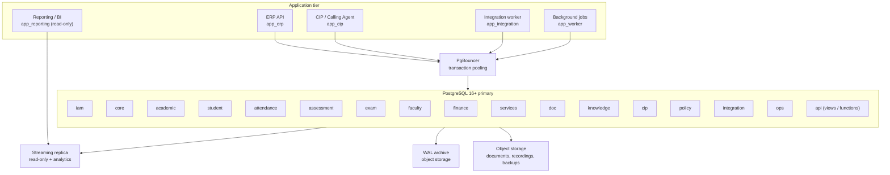
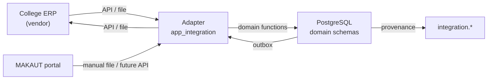

# PostgreSQL Architecture — BCREC Campus ERP + CIP

**Status:** Design. No DDL, migration, cluster, or database was created.
**Inputs:** [`DATA_DICTIONARY.md`](DATA_DICTIONARY.md), [`ENTITY_CATALOG.md`](ENTITY_CATALOG.md), [`DOMAIN_MODEL.md`](DOMAIN_MODEL.md), the seven ERDs, [`docs/database/DATABASE_AUDIT_REPORT.md`](../../database/DATABASE_AUDIT_REPORT.md), and [`docs/database/RETRIEVAL_BENCHMARK_BASELINES_2026-11-06.json`](../../database/RETRIEVAL_BENCHMARK_BASELINES_2026-11-06.json).

**Audience:** database implementer, backend lead, security reviewer, ERP integration lead.

---

## 1. Scope and constraints

| Constraint | Value | Consequence |
|---|---|---|
| Deployment shape | One PostgreSQL cluster, modular monolith | No cross-database distributed transactions; one backup and PITR boundary. |
| Target version | PostgreSQL 16 or 17 | `gen_random_uuid()` built in; `MERGE`, `jsonb` subscripting, incremental sort, parallel hash available; `NULLS NOT DISTINCT` available in 15+. |
| Application count | ERP, CIP, integration worker, reporting | Separate database roles and connection pools per application. |
| Tenancy | One institution, BCREC | `institution_id` is present for future-proofing but is not a tenant discriminator in RLS today (A-01). |
| Time zone | UTC storage, IST presentation | All `timestamptz`; `date` for calendar dates. |
| Money | INR, `numeric(12,2)` | No floating point. |
| Data sensitivity | Public → Regulated | RLS plus column-level masking plus corpus exclusion. |
| Availability target | To be approved | The design supports PITR; the RPO/RTO numbers in §12 are planning targets, not commitments. |

**Out of scope:** vendor ERP internals, MAKAUT portal APIs, payment gateway contracts, object-storage vendor choice. The architecture provides the boundary for each.

---

## 2. Cluster topology



**Rules:**

1. All application traffic goes through PgBouncer in transaction mode. Session-level `SET` cannot be used for request context; use `SET LOCAL` inside a transaction, which transaction pooling preserves.
2. The primary serves writes and latency-sensitive reads. The replica serves analytics, exports, and heavy reports. CIP does **not** read from the replica for eligibility checks, because a lagging replica would produce a wrong answer.
3. Object storage holds originals; PostgreSQL holds metadata and hashes. A database backup without the object store is incomplete, and vice versa.

---

## 3. Schema layout and ownership

### 3.1 Schemas

| Schema | Owner role | Purpose | Write access |
|---|---|---|---|
| `iam` | `owner_iam` | Person, account, roles, permissions, assignments | `app_erp` (admin functions) |
| `core` | `owner_core` | Institution, governance, org, calendar, approvals | `app_erp` |
| `academic` | `owner_academic` | Programme, batch, curriculum, course, offering | `app_erp` |
| `student` | `owner_student` | Admission, student, registration, eligibility | `app_erp` |
| `attendance` | `owner_attendance` | Session, record, correction, summary, eligibility | `app_erp` |
| `assessment` | `owner_assessment` | Scheme, component, marks, corrections | `app_erp` |
| `exam` | `owner_exam` | Imports, result sets, results, grade cards | `app_erp` |
| `faculty` | `owner_faculty` | Faculty/staff profiles, mentoring | `app_erp` |
| `finance` | `owner_finance` | Fee, payment, receipt, scholarship (Phase 2) | `app_erp` |
| `services` | `owner_services` | Discipline, grievance, placement, hostel, library (Phase 2) | `app_erp` |
| `doc` | `owner_doc` | Documents, versions, notices | `app_erp`, `app_cip` (ingestion metadata) |
| `knowledge` | `owner_knowledge` | Chunks, embeddings, ingestion runs | `app_cip` |
| `cip` | `owner_cip` | Conversations, retrieval, citations, evaluation | `app_cip` |
| `policy` | `owner_policy` | Rules, versions, scopes, bundles | `app_erp` |
| `integration` | `owner_integration` | Mappings, sync, provenance, outbox | `app_integration` |
| `ops` | `owner_ops` | Audit, data quality, break-glass, retention | `audit_writer` (insert only) |
| `api` | `owner_api` | Read views, security-definer functions | None (views/functions) |

**Why schema-per-domain instead of one schema:** grants, backup granularity per table, `search_path` hygiene, and a visible ownership boundary. It is not multi-database; cross-schema FKs remain possible and are used deliberately.

### 3.2 Extensions

| Extension | Required? | Use |
|---|---|---|
| `pgcrypto` | Optional | `gen_random_uuid()` is core in 13+; keep for `digest()` if the hash chain is computed in SQL. |
| `pg_trgm` | Yes | Fuzzy person/course/notice search; `gin_trgm_ops`. |
| `unaccent` | Yes | Search normalisation for names. |
| `btree_gist` | Yes | Exclusion constraints mixing `uuid` equality with `daterange`/`int4range` overlap. |
| `pg_stat_statements` | Yes | Query performance. |
| `pgaudit` | Recommended | DDL and privileged-action audit, complementing `ops.audit_event`. |
| `pg_partman` | Optional | Automated monthly partitions for `ops.audit_event`, optional `attendance`/`cip` partitions. |
| `vector` (pgvector) | Yes (target) | Chunk embeddings; see §13. |
| `postgis` | No | No geospatial requirement in the current scope. |
| `citext` | No | Case-insensitive uniqueness is handled with `lower()` expression indexes, which are explicit and avoid type surprises. |

**Extension discipline:** every extension is pinned by version in the deployment manifest. `vector` is the only extension whose version materially affects the data model (index type and distance operator).

---

## 4. Roles, grants, and multi-application access

### 4.1 Role model

Roles are PostgreSQL roles, not application roles. Application roles (`iam.role`) are business data and never become database roles.

| DB role | Login | Inherits | Grants |
|---|---|---|---|
| `owner_<schema>` | No | — | Owns the schema objects; used only by migrations. |
| `app_erp` | Yes | `g_erp` | `SELECT/INSERT/UPDATE` on `iam/core/academic/student/attendance/assessment/exam/faculty/doc/policy`; `EXECUTE` on approved functions. |
| `app_cip` | Yes | `g_cip` | `SELECT` on `doc`, `academic` (catalogue only), `policy`; `SELECT/INSERT/UPDATE` on `knowledge/cip`; `INSERT` on `ops.audit_event` via function. |
| `app_integration` | Yes | `g_integration` | `SELECT/INSERT/UPDATE` on `integration`; `EXECUTE` on domain write functions; no direct academic table writes. |
| `app_worker` | Yes | `g_worker` | `SELECT` on `integration.outbox_event`; `UPDATE` on outbox status; `EXECUTE` on batch functions. |
| `app_reporting` | Yes | `g_reporting` | `SELECT` on `api.*` views only. |
| `audit_writer` | Yes | — | `INSERT` on `ops.audit_event`; no `SELECT`, no `UPDATE`, no `DELETE`. |
| `migration_owner` | Yes | — | DDL in a controlled window; not used at runtime. |
| `dba` | Yes | — | Break-glass only, audited. |

### 4.2 Grant principles

1. **No runtime role owns a table.** Ownership belongs to `owner_<schema>`, so a compromised application cannot `DROP` or `ALTER`.
2. **No `GRANT ALL`.** `PUBLIC` has no privileges on any application schema; `REVOKE ALL ON SCHEMA ... FROM PUBLIC` is part of provisioning.
3. **Views are the contract.** `app_reporting` never touches base tables. `api.*` views expose a stable projection and apply masking.
4. **Functions, not table writes, for cross-domain changes.** `app_integration` calls `api.apply_student_status(...)` and does not hold `UPDATE` on `student.student`.
5. **Audit writer separation.** The audit role can insert but not read. Reading audit is a separate permission held by auditors through a view.
6. **Per-application credentials.** No shared password; each application has its own role and connection string, rotated independently.
7. **Statement timeouts per role.** `app_cip`: `statement_timeout = 8s`; `app_erp`: `30s`; `app_reporting`: `300s` on the replica only.

### 4.3 Multi-application access pattern

| Application | Reads | Writes | Never |
|---|---|---|---|
| ERP | Its domains and `api` views | Domain tables it owns | Writes `knowledge`, `cip`, `integration` mappings directly |
| CIP | `doc`, catalogue, policy, `api` personal-data functions | `knowledge`, `cip` | Reads `student`/`exam` base tables; embeds restricted data |
| Integration worker | `integration`, `api` views | `integration`; domain via functions | Direct `INSERT` into `result_record` or `student.student` |
| Reporting | `api.*` on replica | Nothing | Primary connection; unmasked base tables |
| Background jobs | Outbox, scheduled functions | Status columns, derived summaries | Long transactions holding locks on term-level tables |

**Connection budget (planning):** primary `max_connections = 200`; PgBouncer pools: ERP 40, CIP 20, integration 10, worker 10, admin 5. The exact numbers are sized after load testing, not asserted as final.

---

## 5. Referential integrity

### 5.1 Default policy

| Rule | Implementation |
|---|---|
| Every FK is indexed | The referenced side is a PK/unique; the referencing side gets a btree index (composite with the leading query predicate where known). |
| No cascading deletes on academic data | `ON DELETE RESTRICT` or `NO ACTION`. A student, result, mark, document, or policy version is never removed by deleting a parent. |
| Reference data may restrict | `academic.department`, `core.term`, `iam.role` use `RESTRICT` so an accidental delete fails loudly. |
| Deferred constraints where a transaction creates a cycle | `DEFERRABLE INITIALLY DEFERRED` on the specific FKs listed in §5.3. |
| Cross-schema FKs are allowed | They enforce integrity; ownership is still by schema grants, not by the FK. |
| External IDs are never FKs | They live in `integration.external_id_mapping` only. |
| Release boundary is one-way | An Initial Release table never references a Future/Blocked table. Future tables may reference Initial tables. See §5.5. |

### 5.2 The documented polymorphic exception

Seven columns cannot be foreign keys because they point at different tables:

| Column | Table | Validation |
|---|---|---|
| `internal_id` | `integration.external_id_mapping` | `entity_type_code` FK + application check |
| `internal_id` | `integration.sync_record` | same |
| `internal_id` | `integration.sync_conflict` | same |
| `internal_id` | `integration.record_provenance` | same |
| `entity_id` | `ops.audit_event` | same |
| `record_id` | `ops.data_quality_issue` | same |
| `scope_id` | `student.eligibility_determination` | controlled set + entity registry |

**Mitigation:**

1. `integration.entity_type` is a real table with a real FK. The registry stores `schema_name` and `table_name`, so a steward can verify the target exists.
2. A nightly data-quality job (`ops.data_quality_issue`) detects orphans: for each registry row, it runs an existence check on the target table.
3. A `CHECK`/trigger validates that `internal_id` is non-null when `entity_type_code` is a record-level type.
4. No other polymorphic column is permitted. New ones require an architecture review and an entry here.

**Why not a single `entity` super-table:** it would force every domain to inherit a generic table, break domain ownership, and turn typed FKs into nullable pointers. The registry plus orphan detection is the better trade-off at this scale.

### 5.3 Cycles and deferred constraints

| Cycle | How it arises | Resolution |
|---|---|---|
| `iam.role_assignment.source_membership_id` ↔ `core.governance_membership.source_role_assignment_id` | A seat generates a role, and the role records the seat | Both nullable; the membership is inserted first, then the assignment, then the membership is updated in the same transaction. `role_assignment.source_membership_id` is `DEFERRABLE INITIALLY DEFERRED`. |
| `student.admission_application.batch_id` ← `academic.batch` | An application may precede batch creation | Nullable until allotment; no cycle. |
| `exam.result_record.result_set_id` and `exam.result_set.import_id` | Import produces a set; set contains records | No cycle: import → set → record is a DAG. |
| `exam.grade_card.result_set_id` and `exam.grade_card_result.result_revision_id` | Card references set; membership references revision | No cycle; both are forward references. |
| `policy.rule_version.supersedes_version_id` | Self-reference | Nullable, no deferral needed; insert old before new. |
| `doc.document_version.supersedes_version_id` | Self-reference | Same. |
| `core.org_unit.parent_org_unit_id` | Self-reference | Nullable; insert parent before child. A trigger rejects a cycle. |

**Cycle detection:** `core.org_unit` and any future hierarchy get a recursive-CTE cycle check in a `BEFORE INSERT/UPDATE` trigger. A materialized `path` column makes the check cheap.

### 5.4 Checks that must be database-enforced, not application-only

| Invariant | Mechanism |
|---|---|
| Exactly one scope on `iam.role_assignment` | `CHECK (num_nonnulls(institution_id, org_unit_id, programme_id, batch_id, term_id, course_offering_id, governance_body_id) = 1)` plus `scope_key` equality trigger. |
| `valid_to > valid_from` | `CHECK` on every validity pair. |
| Non-overlapping student status | `EXCLUDE USING gist (student_id WITH =, daterange(effective_from, effective_to, '[]') WITH &&)`. |
| Non-overlapping programme-version year ranges | `EXCLUDE USING gist (programme_id WITH =, int4range(effective_from_admission_year, effective_to_admission_year, '[]') WITH &&)`. |
| One current exam roll per student | Partial unique index `WHERE is_current`. |
| One current grade card per student/term | Partial unique index `WHERE is_current`. |
| Published result set has an approver or external reference | `CHECK (status <> 'published' OR approved_by IS NOT NULL OR external_publication_ref IS NOT NULL)`. |
| Marks within maximum | `CHECK (marks_obtained <= max_marks_snapshot)` on the version row. |
| Draft rule cannot be `Current` without approval | Trigger on `policy.rule_version`. |
| Restricted document never chunked | Trigger on `knowledge.document_chunk` joining `doc.document_version` and `doc.document`. |
| Course registration student matches its semester registration | Composite FK `(semester_registration_id, student_id) → student.semester_registration(semester_registration_id, student_id)`. |
| Student registered in the session's exact offering | Two composite FKs on `attendance.record`: `(course_registration_id, student_id, course_offering_id) → student.course_registration`, and `(session_id, course_offering_id) → attendance.session(session_id, course_offering_id)`. |
| Section assignment batch matches student and section | Composite FKs `(student_id, batch_id) → student.student(student_id, batch_id)` and `(section_id, batch_id) → academic.section(section_id, batch_id)`. |
| One open class teacher per section | Partial unique `(section_id) WHERE role_in_section = 'class_teacher' AND status = 'active' AND valid_to IS NULL`, plus an exclusion constraint on the daterange. |
| One open coordinator per offering | Partial unique `(course_offering_id) WHERE role_in_offering = 'coordinator' AND valid_to IS NULL`. |
| One current section per student | Partial unique `(student_id) WHERE effective_to IS NULL AND status = 'active'` on `student.section_assignment`. |
| Section teacher authority is real | Trigger checks `authority_role_assignment_id` is an open role assignment whose role is HOD/Principal and whose scope covers the section's department. |

### 5.5 Release-boundary foreign-key containment

The Initial Release is a **logical** boundary, not a promise that every Initial table is created in the first migration. Two rules keep the boundary honest:

1. **No forward reference.** An Initial Release table must not have a foreign key to a table whose phase is Future (`2`) or Blocked (`B`). If a feature needs a future table, the Initial table stores a non-FK reference (free text or a receipt number) and the FK is added in the migration that creates the target.
2. **Future tables point back.** A Future table may reference any Initial table. The dependency direction is always Future → Initial.

When a cross-wave cycle exists, the column is created with the earlier wave but the foreign key is added in the migration that creates the target table (`ALTER TABLE ... ADD CONSTRAINT ... NOT VALID; VALIDATE CONSTRAINT`). A placeholder table is never created to satisfy a foreign key.

**Current result:** the only Initial Release violation found by the FK audit was `academic.timetable_slot.room_id → academic.room` (room is Phase 2). The column was removed from the Initial Release; `venue_text` carries the venue, and `room_id` is added by a Phase-2 expand migration. `ops.retention_schedule` is marked `F/B` but is **part of the Initial Release**, so `doc.document.retention_schedule_id` is a valid Initial → Initial reference. After the correction, the audit reports zero Initial → Future foreign keys.

**Why this matters:** an Initial migration that references a non-existent table cannot run. Keeping the logical catalogue complete while staging the DDL is what allows a smaller first release without deleting necessary entities.

---

## 6. Normalization posture

### 6.1 Baseline

The model is in **third normal form**, and in **BCNF** for every table with a single-attribute candidate key. The deliberate exceptions are listed in §6.2 and are all either derived caches or immutable snapshots.

| Normal-form issue | Treatment |
|---|---|
| Repeating contact points | `iam.person_contact` (1:N), not columns `phone1..3`. |
| Multi-valued guardians | `student.student_guardian` join. |
| Curriculum membership | `academic.curriculum_course` join with payload (credits, sequence). |
| Role permissions | `iam.role_permission` join. |
| Governance membership | `core.governance_membership` join with validity. |
| Attendance percentage | Not stored on the student; derived in `attendance.summary`. |
| Marks | Not stored on the result; `result_revision` + `result_input` reference mark versions. |
| Fee amount on demand | Snapshotted in `fee_demand_item`, not recomputed from a mutable structure. |

### 6.2 Deliberate denormalization

| Denormalized field | Why | Consistency control |
|---|---|---|
| `student.current_status` | Avoids a window query on every page load | Updated in the same transaction as `status_history`; a nightly check compares both. |
| `academic.department.hod_person_id` | Fast “who is HOD” lookup for lists and approvals | Derived from the open `iam.role_assignment` (`HOD`, department scope); updated in the assignment transaction; nightly reconciliation. |
| `student.section_id` | Fast current-section filter for class teacher and attendance | Derived from the open `student.section_assignment`; updated in the assignment transaction; nightly reconciliation. |
| `assessment.mark_entry.current_version_no` | Fast pointer to the latest version | Set by the version-insert function; a check confirms the version exists. |
| `exam.result_record.current_revision_no` | Same | Same. |
| `exam.grade_card.is_current` | Partial unique index enforces one current | Set in the publication function. |
| `attendance.summary.attendance_pct` | Avoids recomputation on every read | Derived; `as_of` and `calculation_version` recorded; recomputable. |
| `exam.grade_card.sgpa/ygpa/cgpa` | Published artefact must not change when a rule changes | Snapshotted at publication with the policy bundle. |
| `max_marks_snapshot` on marks and result inputs | A later scheme edit must not rewrite history | Immutable copy at entry time. |
| `total_marks` on result revision | Same | Computed once per revision. |

**Rule:** a denormalized field is allowed only if it is either (a) a pointer to the authoritative row, (b) a published snapshot, or (c) a derived value with recorded inputs and calculation version. It is never a second source of truth that can drift silently.

### 6.3 JSONB policy

`jsonb` is used for:

- `policy.rule_version.parameters_json` — thresholds and bands that vary by rule.
- `attendance.eligibility_assessment.inputs_json` — the inputs used for audit.
- `student.eligibility_determination.evidence_json` — gate evidence.
- `integration.*_value_json` and `payload_json` — external payloads.
- `ops.audit_event.before_json/after_json` — changed fields.
- `core.*.applies_to_json`, `capabilities_json` — small configuration bags.

`jsonb` is **not** used for core relational data, for anything that is joined or filtered frequently, or for anything whose absence would break a constraint. If a JSON field becomes query-critical, it is promoted to a column in a later migration.

---

## 7. Indexing strategy

### 7.1 Baseline indexes

| Index | Rule |
|---|---|
| Primary key | Btree, implicit. |
| Every FK | Btree on the referencing column(s). |
| Unique business key | Unique btree, often on `lower(code)` for case-insensitive codes. |
| Validity queries | `btree (valid_to)` plus partial `WHERE valid_to IS NULL`. |
| Scope queries | Composite `(scope_type, scope_key)` or `(student_id, term_id)` with the selective column first. |
| Status dashboards | `btree (status, created_at DESC)`. |
| Append-only time series | `BRIN (occurred_at)` for `ops.audit_event` and high-volume `attendance.record` at scale. |

### 7.2 Specialised indexes

| Need | Index |
|---|---|
| Name search ("Rahul", "Mondal") | `gin (lower(legal_name) gin_trgm_ops)` |
| Document/chunk full-text | `gin (to_tsvector('simple', chunk_text))` — `simple` preserves names and avoids English stemming on Bengali/Hindi transliteration. |
| Notice search | `gin (to_tsvector('simple', title \|\| ' ' \|\| body_markdown))` |
| JSON parameter lookup | `gin (parameters_json jsonb_path_ops)` only where a query pattern exists. |
| Non-overlapping ranges | GiST exclusion indexes from §5.4. |
| Current-row lookups | Partial unique index `WHERE is_current` / `WHERE status = 'active'`. |
| Covering reads | `INCLUDE` columns on the hottest list queries (e.g. `(student_id) INCLUDE (attendance_pct, as_of)`). |
| Vector search | HNSW with `vector_cosine_ops` once OD-06 fixes the dimension. |

### 7.3 Index discipline

1. **Measure before adding.** Every index is justified by a query pattern, not by "it might help".
2. **Write amplification matters.** `assessment.mark_entry_version` and `attendance.record` are insert-heavy; keep their index count to the necessary lookups.
3. **Unused indexes are removed.** `pg_stat_user_indexes.idx_scan = 0` over a full term is a review trigger.
4. **Partial indexes over low-cardinality flags.** `WHERE status = 'active'` is smaller and hotter than indexing the whole column.
5. **Expression indexes must match the query exactly.** `lower(email)` only helps if the query uses `lower(email)`.
6. **No index on `gender`, `category`, or other sensitive low-selectivity fields** unless a reporting view requires it and RLS permits it.

### 7.4 Vector index specifics

- **HNSW** is the default for read-heavy retrieval. Build with `maintenance_work_mem` sized to the graph (a planning exercise, not a constant).
- **IVFFlat** is the fallback when build memory is constrained; it requires `ANALYZE` and a list count tuned to row count.
- **Exact scan** is acceptable below roughly 50k chunks. The measured in-process baseline (§13.2) shows ~0.6 ms at 10k and ~10.8 ms at 100k for a 384-dimension exact scan, so exact search inside PostgreSQL is a viable starting point and a useful fallback when filtered recall matters.
- **Filtering:** HNSW with a `WHERE` clause can under-return when the filter is selective. pgvector 0.8+ iterative scans mitigate this; the alternative is a two-stage query (filter first into a CTE, then rank) which loses the index. This must be benchmarked with the real corpus before committing to filtered ANN.
- **Re-embedding:** a new model writes new `knowledge.embedding` rows with a new `model_name`/`model_version`. The old index is dropped only after cutover.

---

## 8. Transactions and concurrency

### 8.1 Isolation levels

| Workload | Level | Reason |
|---|---|---|
| Single-record CRUD | `READ COMMITTED` (default) | Sufficient; row locks handle conflicts. |
| Attendance session save | `READ COMMITTED` | One session, many rows, idempotent upsert. |
| Result publication | `SERIALIZABLE` | Cross-row invariant: the set's status, revisions, and grade cards must be consistent. Retry on `40001`. |
| Eligibility assessment | `REPEATABLE READ` | Reads attendance summaries, policy, and registration; must see one snapshot. |
| Promotion/degree decision | `SERIALIZABLE` | Multiple results and backlog rows must be evaluated atomically. |
| Sync apply | `READ COMMITTED` + advisory lock per entity type | Prevents two workers applying the same entity concurrently. |

### 8.2 Patterns

| Pattern | Use |
|---|---|
| **Optimistic concurrency** | `UPDATE ... WHERE row_version = :expected`; zero rows means conflict, return `409`. |
| **Idempotent upsert** | `INSERT ... ON CONFLICT (natural_key) DO UPDATE SET ... WHERE excluded.updated_at > table.updated_at`. |
| **Advisory lock** | `pg_advisory_xact_lock(hashtext('result_publish:' || :term_id))` for a term-level job. Released at commit. |
| **`FOR UPDATE SKIP LOCKED`** | Outbox dispatch and job claim; avoids a separate queue. |
| **Deferred constraint** | Membership/assignment cycle (§5.3). |
| **Savepoint** | Per-row import error handling: mark the row failed, keep the batch. |
| **Two-phase external call** | Write intent + outbox in one transaction; call the external system after commit. Never hold a DB transaction across an HTTP call. |

### 8.3 Transaction boundaries

| Operation | Boundary |
|---|---|
| Create student + admission link + initial status | One transaction, deferred FKs, audit row. |
| Save attendance for a session | One transaction for session + records + audit. |
| Submit marks for an offering | Batched per component; one transaction per batch (500–1000 rows) to bound lock time and WAL. |
| Publish a result set | One transaction for status, revisions visibility, grade cards, outbox, audit. |
| Sync run | Many transactions (one per page), with the run row updated at the end; never one transaction for a million rows. |
| Ingest a document | Document/version/chunks/embeddings in one transaction per document, not per corpus. |

### 8.4 Timeouts and guardrails

| Setting | Value | Why |
|---|---|---|
| `lock_timeout` | 5s (OLTP), 30s (batch) | Fail fast instead of queueing behind a lock. |
| `statement_timeout` | Per role (§4.2) | Prevent a runaway report from blocking the primary. |
| `idle_in_transaction_session_timeout` | 60s | Kill leaked transactions that hold vacuum back. |
| `idle_session_timeout` | 10m | Reap abandoned pooled connections. |
| Batch chunk size | 500–1000 rows | Bounds WAL, locks, and retry cost. |

**Long-running work** (result computation, corpus re-embedding, bulk import) runs in a worker with its own connection, a progress table, and a resumable cursor. It does not run inside an HTTP request.

---

## 9. Row-level security

### 9.1 Model

RLS is enabled on every table that holds student, attendance, assessment, exam, finance, services, document, knowledge, CIP, and person data. Reference tables (terms, programmes, roles) are readable to authenticated roles without row filtering.

**Session context** is set once per transaction:

```sql
SET LOCAL app.person_id = '...';
SET LOCAL app.account_id = '...';
SET LOCAL app.role_assignment_id = '...';
SET LOCAL app.correlation_id = '...';
```

`app.person_id` is the subject; `app.role_assignment_id` is the authority actually exercised. A person with several assignments must set the one they are acting under. This makes every query scope-aware and every audit row attributable.

### 9.2 Helper functions

| Function | Returns | Notes |
|---|---|---|
| `iam.current_person_id()` | `uuid` | Reads `current_setting('app.person_id', true)`. |
| `iam.current_account_id()` | `uuid` | Reads `app.account_id`. |
| `iam.current_role_assignment_id()` | `uuid` | Reads `app.role_assignment_id`. |
| `iam.has_permission(code, scope_type, scope_id)` | `boolean` | Security definer; checks the assignment → role → permission chain and the assignment's validity window. |
| `iam.is_allocated_to_offering(offering_id)` | `boolean` | Exists an open `academic.offering_faculty` row for the current person; scopes effect only, does not replace `has_permission`. |
| `iam.is_section_teacher(section_id)` | `boolean` | Exists an open `academic.section_teacher_assignment` row for the current person; scopes effect only. |
| `iam.is_mentor_of(student_id)` | `boolean` | Exists an active `faculty.mentor_assignment`; scopes read access only. |
| `iam.can_access_student(student_id)` | `boolean` | Self, guardian with consent, active mentor, allocated faculty, open section teacher, HOD, Registrar, COE, Auditor. Each relationship is checked against its validity window. |
| `iam.can_access_offering(offering_id)` | `boolean` | Allocated faculty, enrolled student, HOD, COE. |
| `iam.same_institution(id)` | `boolean` | Institution scope check; today always true for BCREC. |

**Performance rule:** wrap function calls in a subquery so the planner caches the result per statement: `(SELECT iam.current_person_id())`. Without this, the function may be evaluated per row.

### 9.3 Policy patterns

| Table | Policy |
|---|---|
| `student.student` | `USING (student_id IN (SELECT ...))` via `iam.can_access_student(student_id)`. |
| `student.section_assignment` | Self; open class teacher of the section; HOD; Registrar; Auditor. |
| `academic.section_teacher_assignment` | HOD, Principal, the assigned teacher (own rows), Auditor. |
| `attendance.record` | Access if the student is visible **or** the actor is allocated to the offering named by the record; the `course_registration_id` and `course_offering_id` columns make this a scoped predicate, not a student-wide one. |
| `assessment.mark_entry_version` | Student sees own row only when the parent mark is `verified`/`locked` and the result set is published; faculty sees own offerings; COE sees all. |
| `exam.result_revision` | Student sees the published revision only; draft revisions are COE-only. |
| `doc.document_version` | Classification ladder: `P` to all; `I` to authenticated; `C` to scoped roles; `R`/`G` to named roles. |
| `knowledge.document_chunk` | Inherits the source document classification; the CIP service role sees only `P`/`I`/`C` chunks allowed by the query's purpose. |
| `cip.conversation` | Person sees own; operator sees assigned/operational; auditor reads. |
| `ops.audit_event` | No RLS read for application roles; auditors read via `api.audit_view` with a separate grant. |

**Sensitive fields (`R`/`G`):** RLS filters rows, not columns. Category, guardian income, consent records, identity-document metadata, and medical evidence require column-level controls on top of RLS:

1. **No `SELECT *` grant.** The application role gets an explicit column list. The default projection view omits every `R`/`G` column.
2. **Named-role views.** `api.student_admin_view` (Registrar/Admission) and `api.student_self_view` are `SECURITY DEFINER` views with the allowed columns only. General faculty use `api.student_teaching_view`, which never exposes category, income, or identity documents.
3. **Field encryption.** Category and document numbers are encrypted with a KMS-backed key; the application decrypts only inside the named-role service. A database read without the key yields ciphertext.
4. **Access log.** Every read of an `R`/`G` field writes `ops.audit_event` with `role_assignment_id` and the field name.
5. **No analytics export.** `R`/`G` columns are excluded from the analytics replica and from any unmasked extract. Aggregates use bands or counts, never exact values.
6. **No CIP ingestion.** The ingestion job rejects a source that carries an `R`/`G` field; a structured answer about these facts is served from the operational table under RLS, never from the corpus.

### 9.4 Rules and pitfalls

1. **`FORCE ROW LEVEL SECURITY`** on every RLS table so the table owner is also subject to policy. Migrations run as `migration_owner` with a documented bypass, not as a superuser.
2. **Separate policies per command.** `SELECT`, `INSERT`, `UPDATE`, `DELETE` are distinct; a permissive `ALL` policy is a common leak.
3. **`WITH CHECK` is mandatory on `INSERT`/`UPDATE`.** `USING` alone does not stop a user from writing a row they cannot read.
4. **RLS is not a substitute for column grants.** Sensitive columns (`ops.audit_event.before_json`, `student.status_history.reason`) are additionally restricted through views or `SECURITY DEFINER` functions.
5. **Test with the real role.** RLS bugs appear only when connecting as `app_erp`, not as the owner. The test suite runs a matrix of roles × scopes.
6. **Index the policy predicate.** A policy that calls a function on every row without an index turns a 10 ms query into a 10 s scan.
7. **Pooling.** `SET LOCAL` inside a transaction is safe with PgBouncer transaction mode; a bare `SET` is not.
8. **Service accounts.** A worker that has no person context uses a dedicated role with explicit table grants, not an RLS bypass.

### 9.5 Leak tests

| Test | Expected |
|---|---|
| Student A queries student B's attendance | Zero rows. |
| Guardian queries an unlinked student | Zero rows. |
| Guardian with `consent_status != 'granted'` queries the linked student | Zero rows. |
| Faculty queries a student not in their offering | Zero rows. |
| Faculty queries a student in their offering but not their section | Attendance and section views scoped to the offering; no section-teacher view. |
| Former class teacher (assignment closed) queries the section | Zero rows. |
| HOD queries another department | Zero rows. |
| CIP service queries a `Restricted` chunk | Zero rows. |
| Any role selects `student.category` without the named-role view | Column absent / permission denied. |
| Reporting view returns `status_history.reason` | Column absent. |
| Any role updates `ops.audit_event` | Permission denied. |
| An `attendance.record` is inserted for a student not registered in the session's offering | Composite FK rejects the insert. |
| A `section_assignment` crosses batches | Composite FK rejects the insert. |

---

## 10. Auditability and immutability

### 10.1 Layers

| Layer | What it covers | Who writes |
|---|---|---|
| Application audit | Business action, actor, role assignment, before/after changed fields, reason | Domain service, in the same transaction |
| Trigger seal | Rejects `UPDATE`/`DELETE` on append-only tables after a sealing point | Database |
| Hash chain | `prev_hash`/`record_hash` per audit partition | Audit writer function |
| `pgaudit` | DDL, role changes, `COPY`, privileged reads | PostgreSQL |
| WAL archive | Physical history of every change | PostgreSQL |

### 10.2 Append-only tables

`ops.audit_event`, `assessment.mark_entry_version`, `exam.result_revision`, `exam.result_input`, `exam.grade_card_result`, `policy.rule_version`, `policy.policy_bundle_version`, `doc.document_version`, `knowledge.document_chunk`, `knowledge.embedding`, `cip.message`, `cip.retrieval_log`, `cip.retrieval_hit`, `cip.citation`, `integration.sync_run`, `integration.sync_record`.

**Seal trigger:** a `BEFORE UPDATE OR DELETE` trigger raises an exception when the row is sealed. Sealing is either immediate (audit, versions) or at a state transition (`mark_entry_version` seals at `verified`; `document_version` seals at `active`).

### 10.3 What audit does not solve

- It does not stop a superuser. Database superuser access is restricted, logged by `pgaudit`, and reviewed.
- It does not replace backups. A deleted row is recovered from PITR, not from the audit JSON.
- It does not make a wrong business rule correct. It makes the wrong decision attributable.

---

## 11. Retention, archival, and partitioning

### 11.1 Current posture

`ops.retention_schedule` exists but is **not populated with approved rows**. No automated deletion, anonymization, or archival runs. This is deliberate: G-22 is unresolved.

### 11.2 Partitioning candidates

| Table | Partition key | Why |
|---|---|---|
| `ops.audit_event` | `RANGE (occurred_at)` monthly | Hot/cold separation; retention by detach. |
| `attendance.record` | `RANGE` by term or month (optional) | High volume; historical terms are cold. |
| `cip.message` | `RANGE (created_at)` monthly (optional) | Conversation volume grows monotonically. |
| `integration.sync_record` | `RANGE (created_at)` monthly (optional) | Operational, not permanent. |

**Rule:** partition only when a measured volume justifies it. Premature partitioning complicates every query and unique constraint.

### 11.3 Archival pattern

1. Detach the partition.
2. Export to Parquet/CSV in object storage with a manifest (row count, checksum, date range).
3. Mark the detached table `ARCHIVED` and keep it read-only for a cooling-off period.
4. Drop only after the retention schedule approves disposition.

**Anonymization** (for research/analytics) replaces direct identifiers with a salted hash, drops free-text notes, and aggregates quasi-identifiers. It is a separate export, never an in-place update of the production record.

---

## 12. Backup, recovery, and disaster recovery

### 12.1 Design

| Control | Design |
|---|---|
| Physical base backup | Daily full backup to object storage, encrypted. |
| WAL archiving | Continuous to object storage; enables PITR to any second in the retention window. |
| Retention | 30 days of PITR (planning target), 12 monthly full backups. Confirm with BCREC before commitment. |
| Logical backup | Weekly `pg_dump --schema-only` for schema history and a monthly data dump for the core schemas. |
| Replica | One streaming replica in the same region; promotion runbook tested. |
| Object storage | Versioned bucket, immutability window, separate credentials; the SHA-256 in `doc.document_version` is the reconciliation key. |
| Encryption | At rest (volume/object store) and in transit (TLS). Key management is external. |
| Restore drill | Quarterly: restore to an isolated instance, run row-count and checksum checks, record the time. |

### 12.2 Targets (planning, not yet approved)

| Metric | Target | Note |
|---|---|---|
| RPO | ≤ 5 minutes | Depends on WAL archive interval. |
| RTO | ≤ 4 hours | Depends on restore parallelism and object-store throughput. |
| Backup verification | Every restore drill | A backup that has never been restored is not a backup. |

### 12.3 Recovery scenarios

| Scenario | Action |
|---|---|
| Accidental row deletion | PITR to a side instance, extract the row, re-insert with audit. Never restore the primary in place for one row. |
| Corrupt index | `REINDEX CONCURRENTLY`; no data loss. |
| Failed migration | Stop, restore from the pre-migration snapshot, fix forward. Down-migrations are not relied upon. |
| Object storage loss | Rebuild from the replica if available; otherwise the metadata survives but files must be re-sourced. This is why the hash is stored. |
| Region loss | Promote the replica / restore from object storage; runbook owns DNS and application cutover. |

---

## 13. Vector store: pgvector vs ChromaDB

### 13.1 What the decision actually is

Retrieval quality is determined by the **embedding model**, **chunking**, **hybrid fusion**, and **reranking**. The vector store determines **operational fit, filtering, consistency, and scale**. The comparison must not conflate the two.

Multilingual capability is a model property. `all-MiniLM-L6-v2` is English-centric; Bengali and Hindi queries need a multilingual model (for example a multilingual sentence-transformer or BGE-M3) regardless of whether the vectors live in PostgreSQL or Chroma.

### 13.2 Evidence available

| Measurement | Value | Source |
|---|---|---|
| Populated Chroma store | 28 embeddings | Database audit |
| Embedding model in use | `all-MiniLM-L6-v2`, 384 dims, CPU, normalised | Audit + baseline JSON |
| Embedding latency | p50 12.6 ms, p95 14.4 ms, p99 15.2 ms | Baseline JSON |
| Cold model load | 2.03 s | Baseline JSON |
| Exact 384-dim cosine scan, 1k chunks | p50 0.09 ms, p95 0.13 ms | Baseline JSON (NumPy, not pgvector) |
| Exact scan, 10k chunks | p50 0.64 ms, p95 0.94 ms | Baseline JSON |
| Exact scan, 100k chunks | p50 10.78 ms, p95 12.04 ms | Baseline JSON |
| pgvector HNSW build/query/recall | **Not measured** | PostgreSQL/pgvector not installed; Docker unavailable |
| Chroma query latency | **Not measured** | OpenTelemetry import conflict |
| BGE-M3 inference | **Not measured** | Model not available in the audit environment |

**Honest conclusion:** there is no measured evidence that pgvector outperforms Chroma at this institution's scale, and no measured evidence that it underperforms. The decision is therefore architectural, with a benchmark gate before production.

### 13.3 Comparison

| Dimension | pgvector (PostgreSQL) | ChromaDB (current pilot store) |
|---|---|---|
| Operational footprint | None beyond the existing cluster | A second service, its own persistence, backup, and upgrade path |
| Transactional consistency | Chunk, embedding, and document version commit together | Separate write; a failed ingest can leave a chunk without an embedding |
| Metadata filtering | Full SQL: joins, RLS, classification, term, audience | Metadata where-clause; no joins to operational tables |
| Access control | RLS and grants apply to vectors like any row | Application-level collection filtering |
| Backup/PITR | Same backup as the rest of the system | Separate backup; must be reconciled with document versions |
| Multi-model embeddings | Rows keyed by model/version; several models coexist | Collection-per-model; migration is a re-index |
| Index tuning | HNSW/IVFFlat, `maintenance_work_mem`, iterative scans | Managed internally; fewer knobs |
| Recall behaviour | Measured per query plan; filtered ANN needs care | Managed; opaque |
| Scale ceiling | Comfortable to millions of chunks on one primary with proper indexing | Comfortable at current scale; clustering/ops become a separate concern |
| Failure domain | One database to operate | An extra process that can be down while the DB is up |
| Multilingual quality | Model-dependent | Model-dependent |
| Team familiarity | SQL is already required | New client and persistence model |
| Cost | Marginal (existing cluster) | Extra host/container and memory |
| Analytics | Join retrieval logs to enrolment and outcomes in SQL | Export required |

### 13.4 Decision

**Adopt pgvector as the target vector store, conditional on the benchmark gate. Keep Chroma as the pilot fallback.**

Rationale:

1. **One consistency boundary.** The document version, chunk, embedding, and citation already live in PostgreSQL. Keeping vectors there removes a dual-write failure mode that the current audit found in the pilot (a Chroma store with 28 embeddings and no operational link to the source documents).
2. **RLS is decisive.** CIP must not retrieve restricted records. Applying the same classification and scope filters that protect `doc` and `knowledge` is far simpler when the vector is a row in the same database.
3. **Scale is not the constraint.** At the current corpus size, exact scan is sub-millisecond to low-millisecond in-process; PostgreSQL exact scan with an index on metadata will be adequate. HNSW is a refinement, not a prerequisite.
4. **Operational simplicity.** One backup, one PITR, one set of credentials, one monitoring stack. The institution does not yet have a platform team for a second datastore.

**Chroma remains valid if:** the benchmark gate fails (recall < target at the required latency), if retrieval moves to a GPU service, or if the corpus is split into many isolated collections with different lifecycles.

### 13.5 Benchmark gate (must pass before cutover)

| Test | Pass condition |
|---|---|
| Recall@10 on the golden set, filtered and unfiltered | ≥ 0.90 of the exact-scan baseline |
| p95 retrieval latency at 3× current corpus | ≤ 150 ms server-side, excluding model inference |
| HNSW build time and memory at 3× corpus | Fits the maintenance window and `maintenance_work_mem` budget |
| Filtered ANN with a selective term/batch predicate | Returns ≥ 10 results or an explicit "insufficient" signal |
| Re-embedding a new model without downtime | Dual-write + shadow read; rollback in one release |
| Backup/restore of vectors with documents | Restored citations resolve to the correct version and page |

**If the gate fails:** keep Chroma for retrieval, keep PostgreSQL as the system of record for chunks and citations, and add a synchronisation job. The data model does not change; only the index location does.

### 13.6 Migration path (either direction)

1. Add `knowledge.embedding` rows for the new model/version; do not delete the old.
2. Dual-write new chunks to both stores.
3. Shadow-read: compare top-k and citations on the evaluation set.
4. Cut over by configuration flag; keep the old store read-only for one term.
5. Drop the old embeddings/index only after a retention decision.

---

## 14. Redis: evaluate and defer

### 14.1 What Redis would be used for

| Candidate use | Current need | Alternative without Redis |
|---|---|---|
| Session store | The audit found the Redis session factory is dead code; the runtime store is SQLite | Keep sessions in the IdP or a signed cookie; no server-side session needed for stateless APIs |
| Response cache | Low read volume at initial scale | PostgreSQL `UNLOGGED` table or in-process LRU with a short TTL |
| Rate limiting | Per-IP/per-user limits on the CIP API | Token bucket in PostgreSQL or at the reverse proxy |
| Job queue | Outbox dispatch and batch jobs | `SELECT ... FOR UPDATE SKIP LOCKED` on `integration.outbox_event` |
| Pub/sub for live calls | A single CIP instance initially | In-process event bus; revisit at multi-replica |
| Vector cache | Not justified | pgvector query is fast enough at this scale |

### 14.2 Decision

**Reject Redis at initial scale.** The audit evidence is explicit: the Redis store exists but `create_session_store()` is never called, and the only runtime session store is SQLite. Adding Redis now would add a failure domain, a backup gap, and an operational burden for no measured benefit.

### 14.3 Revisit triggers

Adopt Redis (or an equivalent) only when at least one is true and measured:

1. More than one application replica needs a shared cache with sub-millisecond p99.
2. Job throughput exceeds what `SKIP LOCKED` can sustain (measure queue depth and claim latency).
3. Rate limiting must be enforced across replicas at high request rates.
4. Live voice sessions require cross-instance pub/sub or shared ephemeral state.
5. A measured cache hit ratio shows PostgreSQL or in-process caching is the bottleneck.

**If adopted:** Redis is a cache and ephemeral coordination layer, never a system of record. Losing it must degrade performance, not correctness.

---

## 15. ERP integration at the database level

### 15.1 Boundary



**Rules:**

1. **No direct reads from the vendor ERP database.** The schema is unknown (G-10), and coupling to it would make every upgrade a migration.
2. **No direct writes into domain tables.** The adapter calls `api.*` functions that enforce business rules and write audit.
3. **Staging is adapter-local.** Raw payloads land in unlogged/temporary staging tables owned by the adapter, not in domain schemas. They are validated, mapped, and then applied.
4. **Every external ID is a mapping.** `integration.external_id_mapping` is the only place an ERP identifier appears.
5. **Every field has provenance.** `integration.record_provenance` records the last writer and observation time; `integration.source_of_truth_rule` says who wins.
6. **Conflicts are queued.** `integration.sync_conflict` holds the disagreement; nothing is silently overwritten.
7. **Idempotency.** `sync_run` and `sync_record` make a rerun safe; the adapter computes an idempotency key per record.
8. **Outbox for pushes.** A transaction that changes a publishable fact writes `outbox_event`; the worker delivers at least once.

### 15.2 Sync transaction shape

1. Open a run row (`running`).
2. Read a page from the source (cursor-based).
3. For each record: validate → map → call the domain function inside a savepoint → on error, record `sync_record` and continue.
4. Write provenance.
5. Update the cursor and counts; commit.
6. On completion, set the run status and emit an ops metric.

**Why savepoints:** one bad row must not abort a 10,000-row page. The failed rows are visible in `sync_record`, and the run ends `completed_with_errors`.

### 15.3 What cannot be designed yet

| Unknown | Effect |
|---|---|
| ERP data model and APIs (G-10) | Adapter shape, pagination, and rate limits |
| IdP protocol and subject format | `identity_account.idp_code/subject` values |
| MAKAUT/NAD API availability (G-09) | Whether registration and degree data arrive by API or manual file |
| Source-of-truth decisions | `source_of_truth_rule` rows remain `draft` and `manual_review` |

The schema supports all four outcomes. None is assumed.

---

## 16. Capacity and performance model

### 16.1 Planning envelope (illustrative, to be replaced by measured data)

Let:

- `S` = active students (order of a few thousand),
- `C` = courses offered per term,
- `W` = teaching weeks per term (18 per the regulations),
- `H` = contact sessions per course per week (2–4).

Then annual attendance rows ≈ `S × C_enrolled × H × W`. For a worked illustration with `S = 3,000`, average 6 courses, 3 sessions/week, 18 weeks, two terms: ~1.94 million rows/year. That is comfortably within one PostgreSQL primary with monthly partitioning by term, provided the writes are batched.

**These numbers are illustrative.** The actual envelope must come from the Registrar's enrolment data, not from this document.

### 16.2 Hot paths and budgets

| Path | Budget (p95) | Notes |
|---|---|---|
| Student profile read | < 50 ms | Indexed by `student_id`, RLS predicate indexed. |
| Attendance session save (60 students) | < 300 ms | One batched upsert, one audit row. |
| Mark sheet load (offering, 60 students) | < 150 ms | Covering index on `(course_offering_id, component_id)`. |
| Result view for a student | < 100 ms | Partial index on `is_current` and published revisions. |
| Retrieval (vector + filter) | < 150 ms | Excludes LLM inference. |
| Audit write | < 5 ms | Append-only, no read. |
| Nightly summary rebuild | Within the maintenance window | Batched, resumable. |

### 16.3 Scaling levers, in order

1. Fix the query and the index (most "scaling problems" are one missing composite index).
2. Add a covering index or a materialized view for reporting.
3. Move reporting to the replica.
4. Partition the largest append-only table.
5. Add memory and IOPS.
6. Only then consider a second primary or a service split.

**Explicitly rejected:** sharding by programme or batch. The institution is one campus with cross-cutting queries (institution-wide CGPA, affiliation returns); sharding would make the common query distributed for no benefit.

---

## 17. Migration and change management

### 17.1 Principles

| Principle | Rule |
|---|---|
| Expand / contract | Add nullable column → backfill → dual-write → switch reads → drop old. Never rename and drop in one release. |
| Forward-only | No down-migrations in production. Rollback is a restore plus a fix-forward release. |
| One logical change per migration | Reviewable, testable, revertible. |
| Deterministic | No `now()` in a schema-default that must be reproducible; no data-dependent DDL. |
| Lock-aware | `CREATE INDEX CONCURRENTLY`; `ADD CONSTRAINT ... NOT VALID` then `VALIDATE CONSTRAINT`; avoid `ALTER TABLE ... TYPE` on a hot table without a rewrite plan. |
| Tested on a restore | Every migration is run against a recent production restore, not only an empty database. |

### 17.2 Seeded reference data

The initial load is data, not schema: institution (`120`), academic years, terms, departments, programmes, roles, permissions, rule identities, entity types. Seeding is idempotent and versioned. It must not create `policy.rule_version` rows with `status = 'Current'` unless an approval reference exists.

### 17.3 Release gating

A migration is blocked if it:

- creates a table for a Phase 2/Blocked module without the corresponding policy decision,
- adds a foreign key from an Initial Release table to a Future/Blocked table (see §5.5),
- creates a placeholder table only to satisfy a foreign key,
- adds a hard-coded threshold that should be `policy.rule_version.parameters_json`,
- introduces a cascade delete on academic data,
- adds a column that stores an external ID outside `integration.external_id_mapping`,
- adds an authority column that duplicates `iam.role_assignment` (HOD, class teacher, coordinator, mentor),
- adds `attendance.record` without both composite foreign keys,
- enables RLS without a leak test,
- exposes an `R`/`G` column without a named-role view, encryption, and access logging.

**Wave rule:** a wave may create its own tables and reference tables from any earlier wave. It may not reference a table scheduled for a later wave. If a later dependency is unavoidable, the column is added now and the FK is added in the later wave; the migration records a `TODO(OD-12)` in the change log and the schema test suite fails until the FK exists.

---

## 18. Observability

| Signal | Tool | Alert |
|---|---|---|
| Slow queries | `pg_stat_statements` | p95 regression > 20% week over week |
| Lock waits | `pg_locks`, `pg_stat_activity` | Any wait > 30s |
| Connection saturation | PgBouncer metrics | Pool > 80% for 5 min |
| Replication lag | `pg_stat_replication` | > 30s |
| Bloat | `pgstattuple` / bloat query | > 30% dead tuples on a hot table |
| Index usage | `pg_stat_user_indexes` | Unused index after a full term |
| Autovacuum | `pg_stat_user_tables` | `n_dead_tup` growth, wraparound risk |
| Audit chain | Nightly hash verification | Any break |
| Outbox backlog | `integration.outbox_event` count | > 1,000 pending or oldest > 15 min |
| Sync failures | `integration.sync_run` | Failure rate > 1% |
| RLS denials | Application metric | Spike indicates a policy or context bug |
| Backup | Restore drill record | Missing or failed |

**Logging:** `log_min_duration_statement = 500ms`; `log_lock_waits = on`; `log_temp_files = 0` for large sorts; `pgaudit` for DDL. Logs never contain row values for `R`/`G` columns.

---

## 19. Rejected alternatives

| Alternative | Why rejected |
|---|---|
| Microservices with a database per service | Cross-domain transactions (result publication, eligibility) are common; the institution has no platform team for distributed operations. |
| One schema with a `module` column | Weak ownership, accidental cross-writes, RLS complexity. |
| Direct BI access to base tables | Bypasses RLS and masking; a view layer is the contract. |
| MongoDB for documents and marks | Strong relational invariants (marks, results, curriculum) and reporting needs favour SQL. |
| Redis as the primary session/queue store | Unjustified at initial scale; adds a failure domain (see §14). |
| Chroma as the sole vector store | Breaks the transactional link between document version, chunk, embedding, and citation; RLS cannot follow the vector. |
| Storing whole result JSON in one column | Makes correction, audit, and per-course queries impossible. |
| Hard-coded thresholds (`75`, `40`, `6.0`, `120`) | Explicitly forbidden by the research (§9.14); all are policy parameters. |
| Sharding by programme | Breaks institution-wide reporting for no measured gain. |

---

## 20. Traceability

| Architecture area | Research basis |
|---|---|
| Domain schemas and ownership | §10 entity inventory, §12 module table |
| Person/account/profiles and scoped roles | §7.1, §7.4, §11.2–11.3 |
| Versioned policy and reproducibility | §9.1, §9.14–9.15 |
| Append-only academic history | §9.14, §11.6 |
| RLS and separation of duties | §11.2–11.9 |
| Audit and break-glass | §11.6, §11.9 |
| Retention | §11.9, G-22 |
| Integration boundary | §13.1–13.6, G-09, G-10 |
| Vector store | §13.9; database audit; baseline JSON |
| Redis deferral | Database audit (Redis factory unused; SQLite is the runtime session store) |
| Assignment authority reconciliation | §7.1, §7.4, §11.2; OD-15 |
| Release-boundary FK containment | OD-12; entity catalog phase column |
| Sensitive student data | §11.2–11.3; OD-16; DPDP Act 2023 |

**End of architecture document.**
