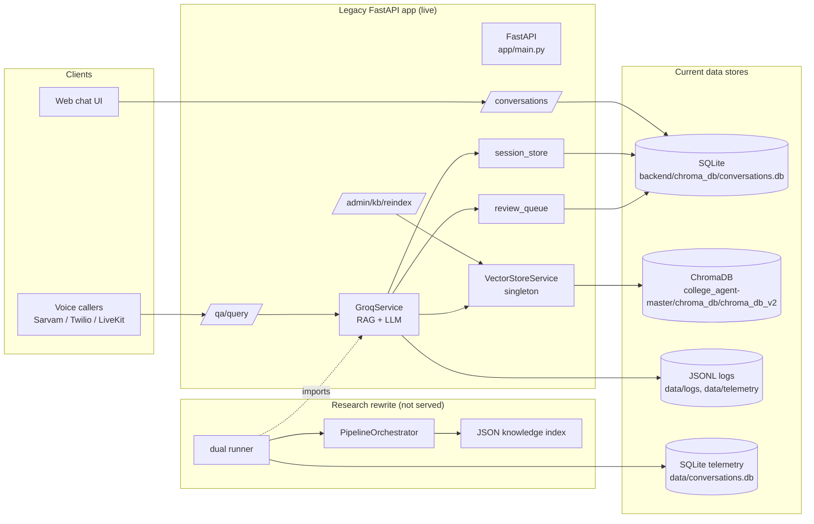
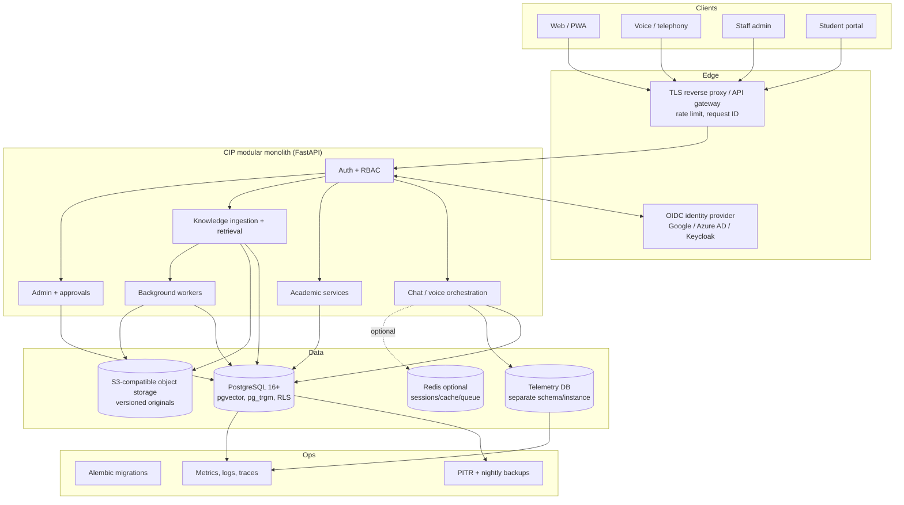
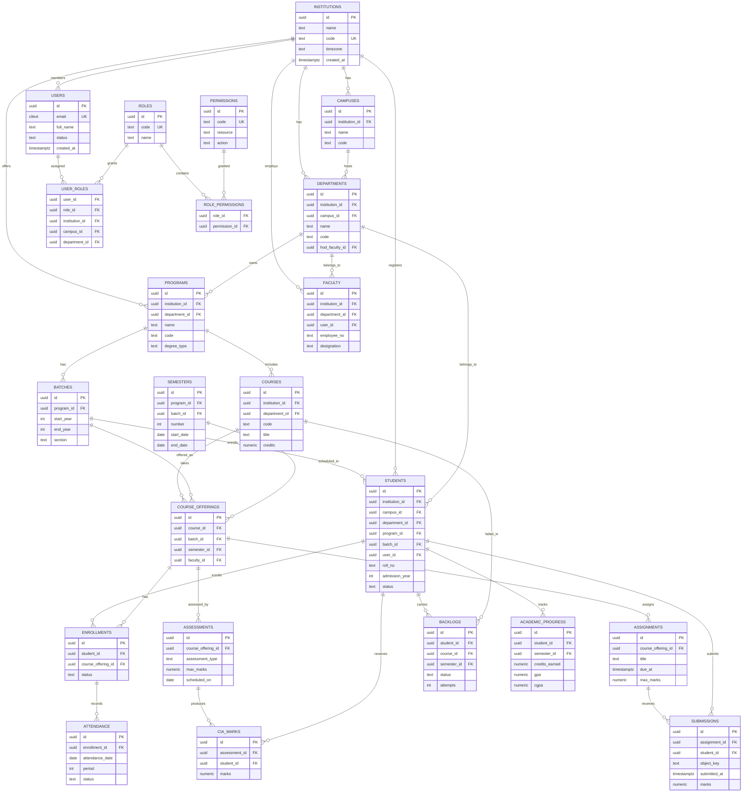
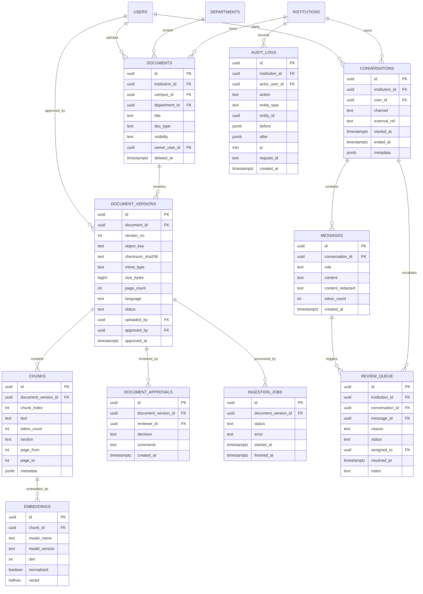

# BCREC Central Intelligence Platform (CIP)
## Database, Vector Store, Embedding and Backend Architecture Audit

**Document type:** Read-only architecture audit and target-design recommendation  
**Audit date:** 2026-11-06  
**Repository:** `<workspace>/college_agent-master`  
**Git revision audited:** `d50ca9b` on branch `brain-v2-research` (63 dirty paths existed before the audit and were not touched)  
**Audience:** Engineering leadership, database/backend engineers, academic stakeholders  
**Status:** Audit complete; no application, database, migration, Chroma or embedding changes were made.

---

## Table of Contents

1. [Executive Summary](#1-executive-summary)
2. [Verified Current Architecture](#2-verified-current-architecture)
3. [SQLite Database Inventory](#3-sqlite-database-inventory)
4. [ChromaDB Inventory](#4-chromadb-inventory)
5. [Embedding Architecture](#5-embedding-architecture)
6. [Existing Data Flow](#6-existing-data-flow)
7. [Technical Debt and Risks](#7-technical-debt-and-risks)
8. [Current vs Proposed Architecture Comparison](#8-current-vs-proposed-architecture-comparison)
9. [Recommended Target Architecture](#9-recommended-target-architecture)
10. [Migration Risks and Compatibility Considerations](#10-migration-risks-and-compatibility-considerations)
11. [Recommended PostgreSQL Schema Groups](#11-recommended-postgresql-schema-groups)
12. [ER Diagram](#12-er-diagram)
13. [Recommended Implementation Phases](#13-recommended-implementation-phases)
14. [Open Questions and Missing Information](#14-open-questions-and-missing-information)
15. [Final Recommendations: The Seven Questions](#15-final-recommendations-the-seven-questions)
16. [Real-Time Voice Retrieval Performance Requirements](#16-real-time-voice-retrieval-performance-requirements)
17. [Appendix A: Evidence Index](#appendix-a-evidence-index)
18. [Appendix B: Method, Safety and Limitations](#appendix-b-method-safety-and-limitations)

---

## 1. Executive Summary

### 1.1 Bottom line

The repository is **not one application with one database**. It contains three generations of work:

1. **A live legacy FastAPI application** under `college_agent-master/backend/`, which is the only runtime that actually serves chat/voice traffic and writes production-shaped data.
2. **An active research rewrite** under the repository-root `src/`, which is a library/pipeline with dual-run hooks, a JSON knowledge index and an optional Postgres/Redis layer that is **not wired into any running service**.
3. **An abandoned prototype** under `next_gen/`, which contains a separate Chroma integration but no populated database.

The reported architecture is broadly correct at the component level, but **materially wrong at the path and operational level**:

| Reported assumption | Verified reality |
|---|---|
| Live chat history is in `backend/data/conversations.db` | The populated live DB is `college_agent-master/backend/chroma_db/conversations.db` because `DB_DIR=./chroma_db` in `college_agent-master/backend/.env`. `backend/data/conversations.db` is empty. |
| Research telemetry is in `data/conversations.db` | Correct, but that file is **not** the live chat DB. It contains 1,911 `pipeline_runs` and also empty legacy `conversations`/`messages` tables, so launching the legacy app from the repository root would write chat data into the telemetry DB. |
| The vector store is in `chroma_db/` | The populated Chroma store is `college_agent-master/chroma_db/chroma_db_v2/chroma.sqlite3` (28 embeddings). The repository-root `chroma_db/` contains only an empty `conversations.db`. Two other Chroma stores exist: one empty and one stale 5.9 MB backup with **zero** embeddings. |
| PostgreSQL conversation storage is implemented but disabled | A SQLAlchemy prototype exists but is **not merely disabled**: its DSN uses the `asyncpg` driver with a synchronous `create_engine`, and it is never instantiated. Enabling it as written would fail. |
| Redis sessions are disabled | True. The Redis store exists, but `create_session_store()` is never called; the only runtime session store is SQLite, and the in-memory/Redis factory is dead code. |
| all-MiniLM-L6-v2 is the embedding model | True for the live Chroma RAG path. The root research KB defaults to a 512-dimensional local hashed n-gram embedder, not MiniLM. |

### 1.2 Readiness scorecard

Scores are relative to a production CIP, not to a demo.

| Dimension | Score | Why |
|---|---:|---|
| Data durability and recovery | 1 / 5 | No real backup; `BackupService` writes `dummy_backup.txt`; no PITR, no Chroma snapshot, no restore test. |
| Referential integrity | 1 / 5 | Foreign keys are declared but never enforced; all 10 live `messages` rows are orphans referencing `test123`. |
| Retrieval correctness | 2 / 5 | Only 28 chunks; 6 uploaded PDFs absent; no `source` metadata; deduplication collapses every result to the same empty key, so the retriever effectively keeps one chunk. |
| Multilingual retrieval | 2 / 5 | English-only markdown KB; English-centric MiniLM; Hindi/Bengali `voice_ready_answers` in `combined_kb.json` are not indexed. |
| Security and privacy | 2 / 5 | Single admin JWT; no RBAC, no RLS, no user table, no audit log; raw user text and LLM prompts persisted in telemetry. |
| Scalability and concurrency | 2 / 5 | SQLite with per-request connections; Chroma embedded in-process; no multi-worker strategy; no pooling. |
| Operability | 1 / 5 | CWD-dependent DB paths; seven `conversations.db` copies; runtime `ALTER TABLE`; no migrations; no DB metrics. |
| Migration readiness | 2 / 5 | Tiny data volume makes migration easy, but metadata is incomplete and the live vectors cannot be mapped back to documents. |
| **Overall** | **~1.5 / 5** | **Pilot-grade, not production-grade. Do not build CIP directly on this foundation.** |

### 1.3 Ten findings that change the plan

1. **The live path is CWD-dependent and split-brained.** `settings.db_dir` defaults to `data`, but `DB_DIR=./chroma_db` is loaded from `backend/.env` only when the process starts in `backend/`. Different launch directories have already created at least seven `conversations.db` files with different schemas and data.
2. **The live database is tiny and partly test data.** It contains 2 conversations, 10 messages, 28 session metadata rows, 244 session turns and 8 review-queue rows. All 10 messages reference `conversation_id = test123`, which has no parent conversation.
3. **The vector index is stale and incomplete.** It has 28 embeddings from 22 markdown files. Six uploaded fee PDFs and the 26-section `combined_kb.json` (including Hindi and Bengali answers) are not represented.
4. **Citations are impossible from the current index.** Metadata keys are only `file_type`, `chunk_id` and `chroma:document`; there is no `source`, `doc_id`, `section`, `language`, `page` or version.
5. **The retriever's deduplication is effectively broken.** It deduplicates on `source:section:subsection`. With all three missing, every chunk has the key `::`, so only the first ranked chunk survives; the context is then capped at four chunks and 700 characters each.
6. **Foreign keys are declared but inert.** `conversations.py` creates `FOREIGN KEY ... ON DELETE CASCADE`, but no code executes `PRAGMA foreign_keys=ON`; SQLite defaults it off. The 10 orphan messages prove it.
7. **There is no backup or recovery capability.** The backup service is a placeholder, the `backups/` directory contains only a 314 KB code zip, and the only Chroma "backup" has zero embeddings.
8. **The environment cannot currently start the live RAG stack.** `opentelemetry-api 1.45.1` is incompatible with `opentelemetry-sdk 1.39.1`; importing Chroma fails with `ImportError: cannot import name '_ExtendedAttributes'`, which also blocks the legacy app.
9. **Telemetry is a shadow database with PII.** `data/conversations.db` is 14 MB for 1,911 runs; 850 runs have an empty `conversation_id`; the JSON payload includes the raw user query, response and a 2.8 KB LLM prompt. It has no WAL/busy-timeout handling, no close, and no retention.
10. **The Postgres and Redis code gives a false sense of readiness.** Postgres is a synchronous engine with an async DSN, never instantiated, with no migrations, FKs or tenancy. Redis silently degrades to no-op if unavailable and is never selected.

### 1.4 Recommendation in one paragraph

Stabilize and instrument the current system first, then migrate the **relational system of record** to PostgreSQL in phases, and move vectors to **pgvector only after** the document/version/chunk metadata contract is fixed and retrieval parity is measured. Do **not** switch embedding models, add Docling, add PaddleOCR, or add Redis just because they are on the proposed list. Keep the existing Chroma index until a labeled evaluation shows pgvector plus the chosen embedder is at least as good. Build CIP as a **modular monolith on one PostgreSQL cluster with strict schemas and row-level security**, not as microservices. Treat the voice latency budget as a hard design constraint: query embedding ≤100 ms, retrieval ≤100 ms and retrieval+ranking ≤200 ms p95, measured on target hardware (§16), with all parsing, OCR, chunking and embedding moved to ingestion. The minimum viable production stack is PostgreSQL + pgvector, FastAPI, S3-compatible object storage, OIDC/RBAC, Alembic, backups/PITR and monitoring; Redis, Docling, PaddleOCR and a GPU embedding service are deferred until measured need.

---

## 2. Verified Current Architecture

### 2.1 Three generations, only one runtime

| Generation | Location | Runtime status | Data stores | Evidence |
|---|---|---|---|---|
| Legacy live app | `college_agent-master/backend/` | The only FastAPI service with `init_db()`, vector-store pre-warm, chat/voice endpoints | SQLite `conversations.db`; Chroma `chroma_db_v2`; JSONL logs | `backend/app/main.py:30-37`, `backend/app/database.py`, `backend/app/services/vector_store.py` |
| Research rewrite | repository-root `src/` | No FastAPI app, no server entry point; used by scripts and `src/dual/runner.py` | JSON knowledge index; SQLite `pipeline_runs`; optional Postgres/Redis (dead) | `src/dual/runner.py:44-76`, `src/telemetry/store.py`, `src/knowledge/kb.py` |
| Abandoned prototype | `next_gen/` | No populated DB; separate Chroma path would be created on first run | Chroma `next_gen/data/chroma_db` (absent), `knowledge_base.json` | `next_gen/src/retrieval/vector.py:13-62` |

The root `src/` tree contains no `FastAPI(...)` or `APIRouter(...)` definition. It is a research library, not a deployable API. The legacy app imports the research pipeline only through `src/dual/runner.py`, and that runner is not called from the live API path.

### 2.2 Runtime topology (verified)



### 2.3 Configuration and the path split-brain

The legacy settings load the first existing environment file from a CWD-relative list, with `override=True`:

- `college_agent-master/backend/app/config.py:10-14` tries `.env`, `backend/.env`, `local.env`, `../.env`, `../local.env`.
- `college_agent-master/backend/.env` contains `DB_DIR=./chroma_db`, `UPLOAD_DIR=./uploads`, `TEMP_AUDIO_DIR=./temp_audio`.
- `settings.db_dir` defaults to `data` if `DB_DIR` is absent (`config.py:68`).
- `database.py:8` computes `DB_PATH = os.path.join(settings.db_dir, "conversations.db")` **at import time**.

Consequences already visible on disk:

| Launch directory | `.env` loaded | Resulting SQLite path | Observed state |
|---|---|---|---|
| `college_agent-master/backend/` | `backend/.env` | `backend/chroma_db/conversations.db` | **Populated live data** |
| repository root | root `.env` (no `DB_DIR`) | `data/conversations.db` | **Telemetry DB**, also has empty chat tables |
| `college_agent-master/` | `college_agent-master/.env` or default | `college_agent-master/data/conversations.db` | Empty chat tables |
| `college_agent-master/backend/` without override | default `data` | `backend/data/conversations.db` | Empty chat tables |
| `college_agent-master/scripts/` | no matching `.env` | `scripts/chroma_db/conversations.db` | Empty chat tables |
| `college_agent-master/backend/tests/` | test cwd | `tests/chroma_db/conversations.db` | Empty session tables |
| repository root (again) | root `.env` | `chroma_db/conversations.db` | Empty chat tables, 5-column session meta |

This is not a cosmetic issue. It means **the same application writes to different databases depending on how it is started**, and one of those databases is also the telemetry database. The vector store, by contrast, is anchored to an absolute path (`vector_store.py:36-40`), so relational data and vectors can diverge across launch modes.

### 2.4 Component verification

| Component | Verified implementation | Status |
|---|---|---|
| HTTP API | FastAPI `app/main.py`, routers for `qa`, `conversations`, `tts`, `stt`, `monitoring`, `auth_routes`, `admin`, `health`, `voice`, `ws_voice`, `knowledge_base` | Live |
| Chat RAG | `GroqService._retrieve_context` calls `VectorStoreService.search_with_scores` with `k=10`, then re-ranks and truncates | Live |
| Embeddings | `langchain_huggingface.HuggingFaceEmbeddings("all-MiniLM-L6-v2")`, CPU, `normalize_embeddings=True` | Live |
| Vector store | LangChain `Chroma` persistent client at an absolute path, collection `bcrec_knowledge_base` | Live |
| Chat history | Raw `sqlite3` in `conversations.py`; `conversations` + `messages` | Live, but test-sized |
| Voice/session memory | Raw `sqlite3` in `session_store.py`; `agent_session_meta` + `agent_session_turns`; last 12 turns | Live |
| Review queue | Raw `sqlite3` in `review_queue.py`; `review_queue` | Live, 8 rows |
| Telemetry | Raw `sqlite3` in `src/telemetry/store.py`; `pipeline_runs` JSON blobs | Research only |
| Postgres | SQLAlchemy models and `PostgresConversationStore`; never instantiated | Dead / broken if enabled |
| Redis | `RedisSessionStore`; factory exists; never called | Dead |
| Backup | `BackupService` writes `dummy_backup.txt` | Placeholder |
| Auth | JWT HS256 via `python-jose`; single admin username from env | Minimal |

---

## 3. SQLite Database Inventory

The full column-level inventory is in `docs/database/DATABASE_INVENTORY.md`. This section summarizes purpose, integrity and operations.

### 3.1 Files found

Seven `conversations.db` files were found, plus three Chroma SQLite stores (covered in Section 4).

| # | Path | Size | Purpose | Tables / rows | WAL | Status |
|---:|---|---:|---|---|---|---|
| 1 | `college_agent-master/backend/chroma_db/conversations.db` | 102,400 B | **Live chat + voice + review** | 5 tables; 2 conv, 10 msg, 28 meta, 244 turns, 8 review | yes | Populated, partly orphan/test data |
| 2 | `data/conversations.db` | 14,123,008 B | **Research telemetry** | 5 tables; 1,911 runs, 9 meta, 106 turns, 0 conv/msg | yes | Largest DB; PII in JSON |
| 3 | `college_agent-master/data/conversations.db` | 24,576 B | Duplicate/empty | 2 tables; 0 rows | yes | Empty |
| 4 | `college_agent-master/backend/data/conversations.db` | 24,576 B | Duplicate/empty | 2 tables; 0 rows | yes | Empty |
| 5 | `chroma_db/conversations.db` | 45,056 B | Duplicate/empty, newer schema | 4 tables; 0 rows | yes | Empty; 5-column meta |
| 6 | `college_agent-master/backend/tests/chroma_db/conversations.db` | 24,576 B | Test artifact | 2 tables; 0 rows | yes | Empty |
| 7 | `college_agent-master/scripts/chroma_db/conversations.db` | 24,576 B | Script artifact | 2 tables; 0 rows | yes | Empty |

All opened read-only and passed `PRAGMA integrity_check = ok`. All use `journal_mode=wal` and 4,096-byte pages. None enable foreign-key enforcement by default.

### 3.2 Live schema (populated DB)

The live DB has five tables:

- `conversations(id TEXT PK, phone_number TEXT, title TEXT NOT NULL DEFAULT 'New Chat', created_at TEXT NOT NULL, updated_at TEXT NOT NULL)`
- `messages(id TEXT PK, conversation_id TEXT NOT NULL, role TEXT NOT NULL, content TEXT NOT NULL, created_at TEXT NOT NULL, FOREIGN KEY(conversation_id) REFERENCES conversations(id) ON DELETE CASCADE)`
- `agent_session_meta(session_id TEXT PK, lang TEXT NOT NULL DEFAULT 'en', updated_at TEXT NOT NULL)` — only 3 columns in this file
- `agent_session_turns(id INTEGER PK AUTOINCREMENT, session_id TEXT NOT NULL, role TEXT NOT NULL, content TEXT NOT NULL, created_at TEXT NOT NULL)`
- `review_queue(id TEXT PK, ts TEXT NOT NULL, session_id TEXT NOT NULL, query TEXT NOT NULL, answer TEXT NOT NULL, source TEXT NOT NULL, confidence REAL, status TEXT NOT NULL DEFAULT 'open', staff_note TEXT DEFAULT '')`

Indexes:

- `idx_messages_conversation` on `messages(conversation_id)`
- `idx_turns_session` on `agent_session_turns(session_id, id)`
- `idx_review_status` on `review_queue(status)`
- Implicit unique indexes on each `TEXT` primary key.

### 3.3 Primary keys, foreign keys and constraints

| Table | PK | FKs declared | FKs enforced | Other constraints |
|---|---|---|---|---|
| `conversations` | `id` TEXT | none | n/a | `title` NOT NULL; no CHECK |
| `messages` | `id` TEXT | `conversation_id → conversations.id ON DELETE CASCADE` | **No** | `role` TEXT with no enum/CHECK |
| `agent_session_meta` | `session_id` TEXT | none | n/a | `lang` NOT NULL |
| `agent_session_turns` | `id` INTEGER | none | n/a | No FK to meta; `role` no CHECK |
| `review_queue` | `id` TEXT | none | n/a | `status` no CHECK |

Two important SQLite details:

1. **TEXT primary keys can contain NULL in SQLite** (unlike `INTEGER PRIMARY KEY`). No `NOT NULL` is declared on `conversations.id`, `messages.id`, etc. The current data has no NULL IDs, but the schema does not prevent them.
2. **`PRAGMA foreign_keys` defaults to OFF and is per connection.** No code in `college_agent-master/backend/app` or `src/` executes `PRAGMA foreign_keys=ON`. Therefore the declared cascade is inert. This is confirmed by the live data: all 10 messages reference `conversation_id='test123'`, and no conversation with that ID exists.

### 3.4 Row counts and distributions (live DB)

| Table | Rows | Notes |
|---|---:|---|
| `conversations` | 2 | One distinct title; 0 non-empty phone numbers |
| `messages` | 10 | 5 user + 5 assistant; **all 10 orphaned** (parent `test123` absent) |
| `agent_session_meta` | 28 | Languages: en 11, hi 10, bn 7 |
| `agent_session_turns` | 244 | 122 user + 122 assistant; 28 distinct sessions; max content 391 chars |
| `review_queue` | 8 | 7 `open`, 1 `answered`; sources: 7 `grounded_refusal`, 1 `transcript_clarification` |

### 3.5 WAL, transactions and concurrency

- All three SQLite access modules set `journal_mode=WAL` and `busy_timeout=5000` on every connection: `database.py:16-18`, `session_store.py:35-36`, `review_queue.py:52-53`.
- Connections are created per operation and generally closed explicitly after `commit()`. There is no connection pool.
- SQLite calls are synchronous and are made from `async def` FastAPI endpoints, so they block the event loop under load.
- `conversations.py` performs two-statement operations (insert message + update conversation timestamp, delete messages + delete conversation) in one connection and commits once. That is atomic, but there is no `try/finally`; an exception between open and close can leak the connection.
- `session_store.save_turn` inserts two rows and upserts metadata in one connection and commits once. It catches all exceptions and silently degrades.
- `review_queue.capture` uses `INSERT OR REPLACE` with a fresh UUID, so it cannot actually replace an existing row by ID; the `OR REPLACE` is misleading.
- `src/telemetry/store.py` is the outlier: `sqlite3.connect` with no WAL, no `busy_timeout`, no explicit `close()`. It relies on the context manager, which commits/rolls back but does **not** close the connection. At 1,911 runs and 14 MB, lock contention and descriptor growth are plausible under concurrent writers.

### 3.6 Timestamp inconsistency

Three formats coexist:

| Table | Example shape | Timezone |
|---|---|---|
| `conversations` | `2026-07-13T15:02:27.874394+00:00` | UTC, aware |
| `messages` | `2026-06-25T00:06:14.445588` | Naive, no offset |
| `agent_session_meta` / `agent_session_turns` / `review_queue` | `2026-08-13 09:08:57` | Local time, no offset |
| `pipeline_runs` | `2026-07-17T09:05:37.932302+00:00` | UTC, aware |

This will require an explicit conversion decision during migration; naive local times are ambiguous around DST in other regions and assume IST here.

### 3.7 Backup and recovery

- `college_agent-master/backend/app/services/backup.py:6-22` explicitly calls itself a "placeholder" and writes `backups/dummy_backup.txt`. It does not copy the SQLite DB, the WAL, or Chroma.
- The repository `backups/` directory contains one file: `21-06-26-college-agent-code.zip` (314,546 bytes), a code archive, not a database backup.
- There is no `sqlite3 .backup`, no `VACUUM INTO`, no WAL checkpoint policy, no scheduled job, no retention, no restore test, no off-host copy.
- Copying `conversations.db` while the app is running without also handling `-wal` and `-shm` is unsafe and can produce a stale or corrupt snapshot.
- The only Chroma "backup" (`chroma_db_v2.backup/chroma.sqlite3`) has 0 embeddings and `dimension = NULL`; it is not a usable restore point.

**Recovery posture: effectively zero. A disk loss loses all live chat, voice memory, review queue and RAG index.**

---

## 4. ChromaDB Inventory

### 4.1 Stores found

| Store | Size | Collection | Embeddings | Status |
|---|---:|---|---:|---|
| `college_agent-master/chroma_db/chroma_db_v2/chroma.sqlite3` | 602,112 B | `bcrec_knowledge_base` | 28 | **Live, populated** |
| `college_agent-master/chroma_db/chroma_db_v2.backup/chroma.sqlite3` | 5,931,008 B | `bcrec_knowledge_base` | 0 | Stale/invalid backup |
| `college_agent-master/backend/chroma_db/chroma_db_v2/chroma.sqlite3` | 188,416 B | none | 0 | Empty, older path |
| `next_gen/data/chroma_db` | absent | would be `bcrec_knowledge` | 0 | Prototype never run |

The live store is a single-node embedded Chroma persistent directory: `chroma.sqlite3` plus HNSW files under a segment UUID directory (`data_level0.bin`, `header.bin`, `length.bin`, `link_lists.bin`).

### 4.2 Collection configuration

| Property | Verified value |
|---|---|
| Collection name | `bcrec_knowledge_base` |
| Collection ID | `bf22ac83-fa5e-46a3-b375-bba5a6fa42de` |
| Dimension | 384 |
| Distance metric | `l2` (squared L2 in Chroma's HNSW configuration) |
| Vector index | HNSW, `max_neighbors=16`, `ef_construction=100`, `ef_search=100`, `num_threads=12`, `batch_size=100`, `resize_factor=1.2` |
| Segments | 2: vector HNSW (`b87d9e68-...`), metadata SQLite (`b2c481d6-...`) |
| Metadata segment rows | 28 embeddings, 84 metadata rows |
| Queue | 86 operations: 57 upserts (op 2), 29 deletes (op 3) |
| `max_seq_id` | 86 |
| FTS | `#document` FTS enabled but unused by retrieval |

The queue history is direct evidence of repeated reindex/delete churn: 57 upserts and 29 deletes to end at 28 live embeddings. Chroma's queue mapping is `ADD=0, UPDATE=1, UPSERT=2, DELETE=3`.

### 4.3 Document and chunk shape

- 28 embeddings.
- `chunk_id` distribution: `0` × 22, `1` × 5, `2` × 1. This implies 22 source documents produced 28 chunks: 22 first chunks, 5 second chunks, 1 third chunk.
- Document lengths: min 160 chars, max 1,089, mean 690, median 745.5. Short documents produce sub-1,000-character chunks despite the 1,000-character chunk setting.
- `file_type` is `.md` for all 28. No PDF, CSV, XLSX, JSON or text chunks are present.
- Embedding IDs are LangChain-generated UUIDs, not stable source-derived IDs.

### 4.4 Metadata schema (critical gap)

| Key | Count | Values |
|---|---:|---|
| `file_type` | 28 | `.md` × 28 |
| `chunk_id` | 28 | 0 × 22, 1 × 5, 2 × 1 |
| `chroma:document` | 28 | full chunk text |
| `source` | **0** | **missing** |
| `doc_id`, `section`, `language`, `page`, `version`, `department` | **0** | **missing** |

The Chroma schema declares a `source` string key, but no row contains it. This is not a Chroma limitation; it is an ingestion bug in the API reindex path.

### 4.5 The metadata bug

The CLI ingest script preserves source:

- `college_agent-master/scripts/ingest_knowledge_base.py:46-50` builds `{"source": chunk["source"], **chunk.get("metadata", {})}`.

The API reindex path does not:

- `college_agent-master/backend/app/api/knowledge_base.py:52-57` builds `metadata=chunk.get("metadata", {"source": md_file.name})`.
- If `chunk["metadata"]` exists and is a dict without `source`, the default is not merged; `source` is lost.
- The same pattern appears for uploads at lines 72-76.

Because `DocumentProcessor` returns metadata that does not guarantee `source`, the live index ended up with no source. The fallback expression only applies when the entire metadata value is missing, not when the key is missing.

### 4.6 Retrieval implementation and limitations

`VectorStoreService.search_with_scores` (`vector_store.py:108-134`):

- Calls `similarity_search_with_relevance_scores(query, k=10)`.
- Filters with `RELEVANCE_THRESHOLD = 0.15`.
- If nothing passes, returns the top 3 anyway ("threshold fallback").
- Returns `(filtered[:k], max_score)`.

`GroqService._retrieve_context` (`groq_service.py:1647-1754`):

- Expands some academic-failure queries.
- Re-ranks by metadata (`semantic_anchor`, `section`, `language`, `source`), all of which are missing in the live index.
- Deduplicates on `f"{src}:{section}:{sub}"`.
- Truncates each chunk to 700 characters and keeps at most 4 chunks.

**The dedup key is the killer.** With `source=""`, `section=""`, `sub=""`, every chunk maps to `"::"`. The first ranked chunk is kept and every subsequent chunk is discarded as a duplicate. The model therefore sees at most **one** chunk of context, not four, regardless of `k=10`. This is a retrieval-quality defect that no embedding upgrade will fix.

Other limitations:

- **No metadata filtering at query time.** Chroma supports `where` / `where_document`; the app never uses it. There is no tenant, department, audience, document-status or language filter.
- **No hybrid retrieval.** Chroma FTS is enabled for `#document` but unused. There is no BM25/tsvector fallback for acronyms, fees, phone numbers or course codes.
- **No reranker, MMR or diversity control.** Re-ranking is a hand-built metadata score.
- **No pagination or score calibration.** The 0.15 threshold is a UI/UX choice, not a measured operating point.
- **No stable citation path.** `sources` are drawn from `metadata["source"]`, which is empty; the API's `source_file` telemetry will be empty.
- **Single-process embedded store.** Multiple Uvicorn/Gunicorn workers would each load their own HNSW index and contend on the same SQLite file. There is no server mode, auth, or write lock coordination.
- **Anonymous telemetry not explicitly disabled.** No `anonymized_telemetry=False` setting was found for Chroma. Treat outbound telemetry as unverified and disable it explicitly in production.

### 4.7 Is migration to pgvector justified?

**Yes, but not on current performance grounds.** With 28 vectors, Chroma is more than adequate. The justification is architectural:

- One transactional system of record for document metadata, versions, approvals and vectors.
- SQL filtering by institution/campus/department/status before ANN.
- Row-level security and backup/PITR inherited from PostgreSQL.
- No dual-write between Chroma and a relational DB.
- Simpler operations for a small team.

Conditions:

- Corpus stays below roughly 1–5 million chunks; above that, benchmark dedicated vector engines (Qdrant, Milvus, Vespa).
- Retrieval parity is measured first (recall@k, MRR, nDCG, citation correctness).
- The document/version/chunk metadata contract is fixed before migration.
- HNSW build memory and `ef_search` are tuned; use `halfvec` for 1024-dimensional embeddings to control storage.

Do **not** migrate the current 28 vectors as-is. They have no source metadata and cannot be mapped back to documents. Re-ingest from source files into the new schema; treat the current index as disposable.

---

## 5. Embedding Architecture

### 5.1 Legacy live path

| Property | Verified value | Evidence |
|---|---|---|
| Model | `all-MiniLM-L6-v2` | `vector_store.py:16` |
| Runtime | `langchain_huggingface.HuggingFaceEmbeddings`, CPU | `vector_store.py:51-55` |
| Normalization | `normalize_embeddings=True` | `vector_store.py:54` |
| Dimension | 384 | collection metadata; model default |
| Max sequence | 256 tokens (model limit) | Model architecture |
| Language | English-centric | Model training data |
| Storage | Chroma, L2 | collection `schema_str` |
| Chunking | 1,000 chars, 200 overlap, recursive separators `["\n\n","\n",". ","? ","! "," ",""]` | `document_processor.py:104-115` |
| Retrieval | `k=10`, threshold 0.15, fallback top 3, metadata dedup, max 4 chunks, 700 chars each | `vector_store.py:118-134`, `groq_service.py:1662-1744` |

Normalization makes L2 ranking equivalent to cosine ranking for normalized vectors, but the reported relevance score is derived from L2 distance and is **not** a cosine score. The 0.15 threshold should be re-calibrated if the metric, model or normalization changes.

### 5.2 Research path

| Property | Verified value |
|---|---|
| Default embedder | `LocalNgramEmbedder` (`local-ngram-v1`) |
| Dimension | 512 |
| Features | Word unigrams + bigrams, character 3-grams + 4-grams, MD5-hashed, L2-normalized |
| Optional real embedder | `SentenceTransformerEmbedder("all-MiniLM-L6-v2")`, 384 dimensions, lazy-loaded |
| Chunking | 160 tokens, 24-token overlap, sentence/line-aligned |
| Retrieval | Hybrid: `0.6 × cosine + 0.4 × IDF lexical`, threshold 0.28, top-k 4 |
| Index | JSON `manifest.json` + `chunks.jsonl` in `data/knowledge/index` |
| Current content | 1 document (`college_agent_master_kb_full.txt`, 50,168 chars), 46 chunks, 512 dims, fingerprint `48e6868d654701dd` |
| Persistence | JSON files loaded into process memory; no database |

The root embedder is deterministic and offline, which is good for reproducible tests but **not** a semantic model. It cannot generalize synonyms or cross-lingual meaning. It should not be used as the production retrieval model.

### 5.3 Evaluation evidence (or lack of it)

There are two cached end-to-end evaluation reports:

- `college_agent-master/backend/benchmarks/eval_reports/demo_eval_20260711_132333.json`
- `college_agent-master/backend/benchmarks/eval_reports/demo_eval_20260711_190204.json`

Both contain 142 queries across EN/HI/BN/HINGLISH/BANGLISH. However:

- `context_len` is **0 for all 142 queries** in both reports.
- `hallucination` is **`YES` for all 142 queries** in both reports.
- `source` is mostly `structured_lookup` (82) and `llm_tools` (52), so most answers bypassed RAG.
- `kb_has_answer` is 92/142 and 97/142 in the two runs.

These reports are not usable as retrieval-quality evidence. They do not report recall@k, MRR, nDCG, precision, citation correctness or answer faithfulness. They also show that the evaluated answer path was dominated by structured lookups, not vector retrieval.

**There is no reliable baseline for "does MiniLM retrieve the right chunk?"** Any model migration must create one.

### 5.4 BGE-M3 evaluation

| Property | MiniLM-L6-v2 | BGE-M3 | Implication |
|---|---|---|---|
| Dimensions | 384 | 1,024 | 2.7× vector storage; use `halfvec` if needed |
| Max context | 256 tokens | 8,192 tokens | Better for long documents and tables |
| Languages | English-centric | 100+ languages, strong multilingual | Likely better for Hindi/Bengali/Banglish |
| Retrieval modes | Dense only | Dense + sparse + multi-vector (ColBERT) | Enables hybrid retrieval without a separate BM25 index |
| Model size | ~90 MB | ~2.2 GB | Slower cold start, more RAM/disk |
| CPU latency | Low | Moderate to high | GPU recommended for ingestion and low-latency queries |
| Cost | Low | Higher (GPU or more CPU) | Justify only with measured quality gain |
| License | Apache 2.0 | MIT | Both permissive; verify packaged model terms |

**Verdict:** BGE-M3 is a credible candidate, especially because the KB is English while callers speak Hindi/Bengali/Banglish. Cross-lingual retrieval is exactly where MiniLM is weakest. But the switch must be earned by a benchmark, not assumed.

Recommended benchmark protocol:

1. Build a labeled set of 150–300 real BCREC queries across languages and intents (fees, admission, hostel, departments, placements, scholarships, unknowns).
2. Label the correct document/chunk(s) or answer spans.
3. Measure recall@5, recall@10, MRR@10, nDCG@10, citation correctness, answer faithfulness, p50/p95 latency and cost per 1,000 queries.
4. Compare: current MiniLM, multilingual-e5-small/base, BGE-M3, and the current model plus hybrid lexical retrieval.
5. Choose on quality per rupee/latency, not on model reputation.

If GPU is unavailable and CPU latency is unacceptable, a strong compromise is `multilingual-e5-base` (768 dims) or `multilingual-e5-small` (384 dims), plus a proper lexical/BM25 component. If the corpus is small and queries are mostly English, MiniLM plus hybrid retrieval may be sufficient.

**Do not regenerate embeddings in this audit.** This section is a decision framework, not an instruction to migrate.

---

## 6. Existing Data Flow

### 6.1 Live web chat

1. Browser calls `/conversations` to create a conversation (`conversations.py:54-75`), which inserts into `conversations`.
2. Browser calls `/conversations/{id}/messages` to add a user message (`conversations.py:177-212`), which inserts into `messages` and updates `conversations.updated_at`.
3. The chat answer path (`/qa/query`) calls `GroqService.generate_response`.
4. `GroqService` retrieves context from Chroma, calls the LLM, and optionally persists a voice-style turn via `save_turn` (`groq_service.py:5875-5901`).
5. `save_turn` writes two rows to `agent_session_turns` and upserts `agent_session_meta` — a **different** table pair from `messages`.
6. Weak/refusal responses are captured in `review_queue` (`qa.py:151-153`).

**Gap:** web `messages` and voice `agent_session_turns` are parallel conversation stores with no shared conversation ID. The live DB has 10 orphan `messages` and 244 session turns, and no linkage between them.

### 6.2 Voice path

1. Telephony/Sarvam/LiveKit calls `/qa/query` with `message`, `session_id`, optional `conversation_id`, language and caller metadata (`qa.py:29-47`).
2. `require_tool_auth` optionally enforces a shared secret; if `SARVAM_TOOL_API_TOKEN` is empty, no auth is enforced (`qa.py:74-92`).
3. `GroqService.generate_response` runs intent routing, structured lookups and/or RAG.
4. `save_turn` persists the last 12 turns per session and the session language/profile.
5. `review_capture` stores weak answers.
6. The `conversation_id` passed by the caller is echoed in the response but **not used to persist a relational conversation**.

### 6.3 Knowledge ingestion

There are two divergent ingestion paths:

**CLI (`college_agent-master/scripts/ingest_knowledge_base.py`)**
- Clears the collection (`:24-26`).
- Processes `backend/data/knowledge_base/departments/*.md` and `topics/*.md` (`:37-51`), preserving `source`.
- Processes `combined_kb.json` `voice_ready_answers` (`:53-...`), including EN/HI/BN answers.
- Processes uploads.
- Adds documents in batches (`:244`).

**API (`college_agent-master/backend/app/api/knowledge_base.py`)**
- Requires `get_current_admin`.
- Clears the collection (`:38-40`).
- Processes the same markdown dirs but **drops `source`** (`:52-57`).
- Processes `uploads/` (`:62-79`), also dropping `source` in the same way.
- Does **not** process `combined_kb.json`.
- Adds in batches of 50 (`:81-87`).

The live index's `file_type=.md` for all 28 chunks indicates the API path (or an older markdown-only script) produced it. The 6 fee PDFs and the 26 multilingual sections are absent. The index is therefore stale relative to both `uploads/` and `combined_kb.json`.

### 6.4 Research/telemetry path

- `src/dual/runner.py` runs the legacy `GroqService` and the new `PipelineOrchestrator` side by side.
- The new pipeline's result is serialized by `save_run` into `pipeline_runs` (`runner.py:75`, `src/telemetry/store.py:58-75`).
- `save_run` stores the full `PipelineResult`: user `text`, `response`, `llm_prompt`, understanding/reasoning/decision JSON, latency and versions.
- `run_json` mean size is 6,493 bytes; max 9,239 bytes.
- 1,911 runs span 2026-07-17 to 2026-08-14; 850 have an empty `conversation_id`; only 5 distinct `conversation_id` values exist including the empty string, i.e. **4 non-empty test IDs**: `count-test`, `dual-test-1`, `list-test` and `test-conv-1`.
- 1,698 runs contain `latency_ms`.

This is research telemetry, not production request telemetry, and it contains raw user text and prompts.

### 6.5 File-based telemetry and logs

- `college_agent-master/data/logs/conversations/` contains **1,196 JSONL files, 7,569,551 bytes** of conversation logs.
- Each line has `conversation_id`, `session_id`, `timestamp`, `turn_number`, `type` and `data`.
- `college_agent-master/data/telemetry/shadow_routing.jsonl` exists (1,896 bytes); `data/telemetry/shadow_routing.jsonl` exists (48,290 bytes).
- `request_log.jsonl` was not present at the expected legacy path at audit time.
- These logs are outside the database, unmanaged by retention, and contain user text.

### 6.6 Data volume summary

| Data set | Volume | Assessment |
|---|---:|---|
| Live conversations | 2 | Test-scale |
| Live messages | 10 (all orphaned) | Test data |
| Voice session turns | 244 | Small pilot |
| Review queue | 8 | Small pilot |
| Research telemetry | 1,911 runs / 14 MB | Growing without retention |
| Chroma embeddings | 28 | Tiny |
| Markdown KB | 22 files | Source content |
| Uploaded PDFs | 6 | Not indexed |
| Combined multilingual answers | 26 sections | Not indexed |
| Conversation JSONL | 1,196 files / 7.57 MB | Unmanaged |
| Root JSON KB | 1 doc / 46 chunks | Research only |

The data volume is **not** the migration problem. The metadata, integrity, security and operational gaps are.

---

## 7. Technical Debt and Risks

### 7.1 Risk register

Severity: **C**ritical, **H**igh, **M**edium, **L**ow. Likelihood is for the next 12 months.

| ID | Risk | Severity | Likelihood | Evidence | Impact | Mitigation |
|---|---|---|---|---|---|---|
| R1 | No backup or restore capability | C | High | `backup.py:6-22`; only code zip in `backups/` | Total loss of chat, voice memory, review queue and RAG index | Implement SQLite `.backup` + Chroma snapshot + off-host copies; test restore |
| R2 | Live RAG stack cannot start | C | Certain today | OTel `api 1.45.1` vs `sdk 1.39.1`; `_ExtendedAttributes` import error | No chat/voice service | Pin compatible OTel versions; lock dependencies |
| R3 | No source metadata; citations impossible | C | Certain | 0 `source` rows; `knowledge_base.py:52-57` | Unverifiable answers; no staff trust; no audit | Fix metadata merge; re-ingest; require source/doc/version |
| R4 | Dedup collapses all chunks to one | C | Certain | `groq_service.py:1724-1736` with empty keys | RAG answers from one chunk; poor recall | Fix metadata and dedup; add tests |
| R5 | Foreign keys not enforced | H | Certain | `PRAGMA foreign_keys=0`; 10 orphan messages | Orphan data; silent corruption | `PRAGMA foreign_keys=ON`; clean data; add constraints in Postgres |
| R6 | CWD-dependent DB paths / split-brain | C | High | `config.py:10-14`, `database.py:8`; 7 DB copies | Writes to wrong DB; telemetry/chat mixing | Absolute config; one DB path; remove duplicates |
| R7 | Schema drift and runtime `ALTER TABLE` | H | High | live meta 3 cols vs root 5 cols; `session_store.py:68-72` | Failed queries; race conditions | Alembic-style migrations; explicit schema version |
| R8 | Telemetry writes without WAL/timeout/close | H | High | `src/telemetry/store.py:37-41` | `database is locked`; descriptor leaks | Use one managed connection; WAL; busy_timeout; close |
| R9 | PII in telemetry and logs | H | Certain | `run_json` has `text`, `response`, `llm_prompt`; 1,196 JSONL logs | Privacy/legal exposure | Classify, redact, encrypt, retain minimally |
| R10 | Postgres/Redis code is dead or broken | H | Medium | `postgres.py:34-37` async DSN + sync engine; `factory.py` never called | False readiness; outage if enabled | Fix or delete; add integration tests |
| R11 | Chroma single-process concurrency | H | Medium | embedded persistent client; no lock | Corruption/contention with >1 worker | Single writer or migrate to pgvector/server |
| R12 | Multilingual retrieval weak | H | High | English KB; English-centric MiniLM; HI/BN answers not indexed | Wrong/no answers for most callers | BGE-M3 or multilingual-e5 + hybrid; index HI/BN |
| R13 | No RBAC/RLS/audit | H | Certain | `auth.py:50-68`; single admin env user | Unauthorized access; no accountability | OIDC + RBAC + RLS + audit log |
| R14 | No migrations or data contracts | H | Certain | only `CREATE TABLE IF NOT EXISTS`; no Alembic | Unsafe changes; environment drift | Versioned migrations; schema tests |
| R15 | Test data mixed with live data | M | Certain | `test123`; test conversation IDs in telemetry | Misleading metrics; bad demos | Separate databases/envs; cleanup |
| R16 | Stale/incomplete vector index | H | Certain | 28 `.md` chunks; 6 PDFs, 26 JSON sections missing | Wrong answers on fees/hostel | Deterministic reindex; coverage checks |
| R17 | No retrieval evaluation | H | Certain | eval reports context_len=0, hallucination=YES all | Cannot prove quality or regressions | Labeled eval set + CI metrics |
| R18 | Chroma anonymous telemetry unverified | M | Medium | no `anonymized_telemetry=False` found | Data leakage | Disable explicitly; network egress policy |
| R19 | Hard-coded/dev credentials and weak auth defaults | H | Medium | default Postgres DSN in settings; empty tool token disables auth | Unauthorized access | Secrets manager; fail-closed auth; rotate |
| R20 | No rate limiting / abuse controls | M | Medium | no limiter found | Cost blowups, DoS | API gateway/rate limit |

### 7.2 Debt inventory

| Area | Debt | Consequence |
|---|---|---|
| Persistence | Four separate raw `sqlite3` access layers | Inconsistent behavior, duplicated bugs |
| Schema | No migration tool; ad-hoc `ALTER TABLE` | Drift already present |
| Config | Two settings modules, CWD-relative `.env`, `override=True` | Wrong environment/path |
| Transactions | No `try/finally`, no rollback paths | Leaked connections, partial writes |
| Integrity | FKs off; no CHECK constraints; TEXT PKs nullable | Orphans, invalid roles/status |
| Time | Three timestamp formats | Ambiguous migration |
| Vectors | No stable IDs or metadata | No citations, duplicates, no incremental update |
| Ingestion | Two divergent pipelines; API drops source | Index cannot be trusted |
| Retrieval | Metadata re-rank on missing fields; broken dedup | One-chunk context |
| Evaluation | No retrieval metrics | Model changes are guesswork |
| Telemetry | SQLite + JSON blobs; no retention | 14 MB and growing; PII |
| Auth | Single admin; env password compare; no user table | Cannot support staff/students |
| Tenancy | No institution/campus/department IDs | Cannot support CIP |
| Ops | No DB metrics, slow-query log, pool stats | Blind to degradation |
| Docs | Runtime docstrings say "in-memory, clears on restart" while code persists | Misleading operators |

---

## 8. Current vs Proposed Architecture Comparison

### 8.1 Side-by-side

| Capability | Current (verified) | Proposed (initial list) | Assessment |
|---|---|---|---|
| Relational store | SQLite, 7 copies, raw `sqlite3` | PostgreSQL | **Adopt**, phased |
| Vector store | Chroma embedded, 28 vectors, no metadata | pgvector | **Adopt**, after metadata/eval |
| Embeddings | MiniLM 384, English-centric | BGE-M3 1024 | **Benchmark**, not automatic |
| Document processing | pypdf/pandas, 1,000/200 char chunks | Docling + PyMuPDF | **Simplify**: PyMuPDF first; Docling conditional |
| OCR | none | PaddleOCR | **Defer** until scanned docs exist |
| Object storage | local `uploads/` | S3-compatible | **Adopt** for production originals |
| Cache/session | SQLite voice sessions; in-memory factory dead | Redis optional | **Defer** until multi-replica/jobs |
| Auth | single admin JWT, env password | OAuth2/OIDC + RBAC | **Adopt**, via IdP |
| Multi-tenancy | none | implied by CIP | **Design now** |
| Migrations | none | not listed | **Must add** Alembic |
| Backup | placeholder | not listed | **Must add** PITR + restore tests |
| Observability | JSONL logs, no DB metrics | not listed | **Must add** |

### 8.2 Component-by-component evaluation

#### PostgreSQL — approve, phased

**Why it fits CIP:** multi-user concurrency, transactions, joins across academic entities, constraints, RBAC/RLS, partitioning, PITR, mature tooling, one system of record for relational + vector data.

**Why not immediately for the live app:** current volume is tiny (2 conversations, 244 turns). The driver is CIP requirements, not load. Migrating now without fixing metadata/config would move the mess, not solve it.

**Caveats:** managed vs self-hosted; data residency; connection pooling (PgBouncer); async driver (`asyncpg`); migrations (Alembic); backup/PITR; upgrade cadence; RLS operational discipline; `maintenance_work_mem` for HNSW builds.

#### pgvector — approve, after parity

**Why:** keeps document metadata, permissions, versions and vectors in one transactional store; SQL filters and RLS; backups for free; no dual-write.

**Caveats:** HNSW memory/build time; filtered ANN can be tricky (pgvector 0.8 iterative scans help); 1024-dim storage (use `halfvec`); index rebuild on model change; not a distributed vector engine. If the corpus exceeds a few million chunks or QPS is high, benchmark Qdrant/Milvus.

#### FastAPI — keep

Already in use and appropriate. Standardize on Pydantic v2, SQLAlchemy 2.0 async + asyncpg, Alembic, dependency injection, API versioning, health/readiness, structured logging, OpenTelemetry with pinned versions, rate limiting and CORS allowlists. No need to rewrite in Django.

#### BGE-M3 — benchmark, conditional

**Strengths:** multilingual (Hindi/Bengali/Banglish), 8,192-token context, dense+sparse+multi-vector, MIT license.

**Weaknesses:** 1,024 dims, ~2.2 GB, CPU latency, GPU cost, index rebuild, threshold recalibration.

**Decision rule:** adopt only if a labeled benchmark shows a material gain over MiniLM/multilingual-e5 at acceptable latency and cost. If no GPU, prefer multilingual-e5-small/base or keep MiniLM plus hybrid lexical retrieval. Do not run BGE-M3 and MiniLM in parallel in production without a clear fallback plan.

#### Docling + PyMuPDF — simplify

**PyMuPDF** is fast and capable for text/layout extraction, but it is **AGPL-3.0 or commercial**. If the project is distributed or the license is unacceptable, use `pypdf` (BSD) + `pdfplumber` (MIT) or `unstructured` (Apache 2.0). **Docling** is MIT and strong for complex layouts/tables, but heavy (PyTorch/models) and slow. For six digital fee PDFs, Docling is overkill.

**Recommendation:** start with PyMuPDF (or pypdf/pdfplumber if licensing requires) + a deterministic table extractor. Add Docling only for complex/scanned documents that fail the simple path. Do not add both at MVP.

#### PaddleOCR — defer

Only justified if the corpus contains scanned images or image-only PDFs. Current uploads are digital fee PDFs. If OCR is needed, evaluate PaddleOCR vs Tesseract vs EasyOCR for **Bengali and Hindi** accuracy; licenses differ. OCR adds latency, storage and review burden.

#### S3-compatible storage — approve for production

**Why:** durable, versioned, immutable originals; presigned URLs; lifecycle/retention; checksums; separation from the database. Use MinIO on-prem if data residency requires it, or S3/Indian cloud object storage. Store object keys, SHA-256, MIME, size and version in Postgres, not blobs.

**Caveat:** adds operational surface. For a single-college pilot, local filesystem + restic/borg backups may be enough; for CIP, S3-compatible is the right default.

#### Redis — defer

Not needed for a single FastAPI instance. Use it only when you have multiple API replicas (shared sessions/rate limits) or background jobs. For jobs, consider a Postgres-native queue (`pgmq`, `procrastinate`) to avoid another component. Do not use Redis as a system of record; it is ephemeral.

#### OAuth2/OIDC + RBAC — approve

Use the college's IdP (Google Workspace, Azure AD, LDAP via Keycloak) instead of custom passwords. Add roles/permissions and scope by institution/campus/department. Enforce student-level isolation with PostgreSQL RLS, not just application checks. Add MFA for admins, short-lived tokens, refresh rotation and audit logs.

### 8.3 Components that are unnecessary at MVP

| Component | Verdict | Reason |
|---|---|---|
| Redis | Defer | Single instance; no distributed sessions/jobs yet |
| Docling | Defer | Six digital PDFs; PyMuPDF/pypdf suffices |
| PaddleOCR | Defer | No scanned corpus identified |
| BGE-M3 GPU service | Defer | Benchmark first; corpus is 28 chunks |
| Dedicated vector DB (Pinecone/Weaviate/Qdrant) | Defer | pgvector is enough below a few million chunks |
| Kafka/Spark/lakehouse | Reject for now | No streaming/analytics scale |
| Kubernetes | Reject for now | One or two VMs and Docker Compose suffice |
| Elasticsearch/OpenSearch | Defer | Postgres FTS + pg_trgm + pgvector cover MVP |
| Graph database | Reject | Academic relationships are relational, not graph-first |
| Microservices | Reject | Modular monolith is cheaper and safer |
| Custom auth server | Reject | Use OIDC/Keycloak |

### 8.4 Cost-conscious sizing (order of magnitude)

| Item | MVP | Notes |
|---|---|---|
| PostgreSQL + pgvector | $30–60/month managed, or ~$20/month VM | 2 vCPU, 4 GB RAM, 100 GB SSD, PITR |
| FastAPI host | $20–40/month | 2 vCPU, 4 GB; 2 workers |
| S3-compatible storage | $2–10/month | <100 GB, versioning |
| Redis (if used) | $10–20/month | Defer |
| GPU for BGE-M3 | $100–300/month or serverless | Defer; batch embed nightly if possible |
| Monitoring/logging | $0–30/month | Open-source stack on the same host |
| **Total excluding LLM/GPU** | **~$60–150/month** | Scales with institutions and documents |

LLM API costs (Groq/Sarvam/OpenAI) are separate and likely dominate variable cost.

---

## 9. Recommended Target Architecture

### 9.1 Principles

1. **One system of record per domain.** PostgreSQL owns relational and vector data; S3 owns original files; telemetry is separate.
2. **Metadata before vectors.** A vector without source, version, department, language and approval status is not usable in an institution.
3. **Multi-tenant by design, not by retrofit.** Every tenant-scoped row carries `institution_id`; campus/department scopes are explicit.
4. **Security in the database.** RLS and constraints enforce isolation; the application is not the only guard.
5. **Evaluate before replacing.** No model or store migration without a labeled baseline and parity gate.
6. **Modular monolith first.** One deployable API, clear modules, one database cluster; split services only when measured.
7. **Boring operations.** Managed Postgres, object storage, PITR, migrations, backups, dashboards.

### 9.2 Logical architecture



### 9.3 Multi-tenancy model

Use a **shared database, shared schema, tenant discriminator + RLS** for the first CIP generation:

- `institutions` is the top-level tenant (a college group or individual college).
- `campuses` belong to institutions; `departments` belong to a campus (or institution, if multi-campus departments exist).
- Every tenant-scoped table has `institution_id NOT NULL`; most also have `campus_id` and `department_id`.
- `users` are global identities; `user_institution_roles` grants a role within an institution/campus/department.
- RLS policy pattern: `institution_id = current_setting('app.institution_id')::uuid`; the API sets this per transaction from the authenticated session. The application role must not own the tables, and `FORCE ROW LEVEL SECURITY` must be enabled.
- Student isolation: `students.user_id = current_setting('app.user_id')::uuid` for student-facing queries; staff see department-scoped rows.
- Stronger isolation: if a future customer requires physical separation, move that institution to a dedicated schema/database. Do not start with schema-per-tenant; it multiplies migrations and operational work.

### 9.4 Document and knowledge model

The core innovation CIP needs is **document versioning and provenance**:

```
documents (logical document)
  └── document_versions (immutable content + object key + checksum + status)
        ├── chunks (text windows + metadata)
        │     └── embeddings (model/version-specific vectors)
        └── document_approvals (review decisions)
```

Rules:

- Only `approved`/`published` versions are retrievable by default.
- A new upload creates a new version; it does not overwrite the old one.
- Re-indexing is idempotent per `(document_version_id, chunk_index, embedding_model, embedding_version)`.
- Citations resolve from `chunk → document_version → document`, including page/section.
- Deletion is soft (`deleted_at`) plus a retention job; vectors are deleted only after the retention window.
- Original files live in S3 with SHA-256; the DB stores the key and checksum, never the blob.

### 9.5 Search architecture

- **Dense:** pgvector HNSW over `halfvec(1024)` or `vector(1024)`.
- **Lexical:** Postgres `tsvector` + GIN, plus `pg_trgm` for fuzzy names/codes.
- **Hybrid:** reciprocal rank fusion (RRF) of dense and lexical results; then a cross-encoder reranker only if evaluation shows a gain.
- **Filters first:** institution, campus, department, visibility, approval status, language, document type. Use partial indexes or filtered ANN; test `ef_search` with filters.
- **Evaluation:** offline labeled set + online citation clicks/feedback; CI regression gates.

### 9.6 Telemetry architecture

- Separate database (recommended) or separate schema with a restricted role.
- Append-only tables; partition by month; retention 30–90 days for raw events, longer for aggregates.
- Redact PII at write time; store hashes/IDs, not raw text, unless explicitly needed and consented.
- Use Postgres for MVP; move to ClickHouse/Timescale only when volume justifies it.
- Do not put telemetry in the OLTP schema; a runaway JSON insert must not lock academic transactions.

### 9.7 Deployment shape

- One PostgreSQL cluster (primary + standby), one object-storage bucket, one API service (2+ workers), one worker service.
- Docker Compose or systemd on 1–2 VMs for MVP; managed Postgres if budget allows.
- Alembic migrations run as a separate job before deploy; never auto-create tables at startup.
- Blue/green or rolling deploy with backward-compatible migrations.
- Secrets in a manager (Vault, cloud secret manager), never in `.env` committed to the repo.
- Daily backups + WAL archiving; weekly restore test to a staging database.

---

## 10. Migration Risks and Compatibility Considerations

### 10.1 Recommended migration strategy

Use a **phased strangler** pattern, not a big-bang cutover:

1. **Stabilize** the live app (pin dependencies, fix config, enable FKs, take backups).
2. **Create** the target Postgres schema and migrations.
3. **Dual-write** new conversations/messages/sessions to SQLite and Postgres behind a flag; keep SQLite as the read path.
4. **Backfill** existing rows into Postgres; validate counts, checksums and sampled content.
5. **Shadow-read** from Postgres and compare responses/IDs with SQLite.
6. **Cut over reads** to Postgres; keep dual-write for one release.
7. **Stop SQLite writes**, keep a read-only snapshot for rollback.
8. **Decommission** the duplicate DBs after a retention period.

For vectors, do **not** dual-write Chroma and pgvector indefinitely. Re-ingest into pgvector, run both retrieval paths in shadow, compare recall and citations, then cut over and freeze Chroma read-only for a rollback window.

### 10.2 SQLite → PostgreSQL data mapping

| SQLite | PostgreSQL | Notes |
|---|---|---|
| `TEXT` UUID IDs | `uuid` | Validate format; generate `gen_random_uuid()` for new rows |
| `INTEGER AUTOINCREMENT` turn IDs | `bigint GENERATED ALWAYS AS IDENTITY` or `uuid` | Preserve ordering if needed |
| ISO/naive/local timestamps | `timestamptz` | Normalize to UTC; document IST assumption |
| `REAL` confidence | `double precision` or `numeric(5,4)` | Clamp 0–1 |
| JSON strings (`run_json`, `profile`) | `jsonb` | Validate JSON; add GIN indexes only if queried |
| Boolean-ish integers | `boolean` | Explicit conversion |
| `TEXT` role/status | `text` + `CHECK` or enum | Prefer `text` + `CHECK` for evolvability |
| `TEXT` PK nullable | `uuid PRIMARY KEY NOT NULL` | Enforce |
| No FK | `REFERENCES ... ON DELETE ...` | Clean orphans first |
| `LIKE` search | `tsvector` + `pg_trgm` | Add generated columns/indexes |

### 10.3 Embedding migration

- Changing the model changes the dimension and the vector space. There is no algebraic conversion between MiniLM-384 and BGE-M3-1024.
- All chunks must be re-embedded; the old vectors are not reusable.
- Re-chunking may also be required (1,000/200 chars vs 160/24 tokens). Treat chunking and embedding as one versioned pipeline.
- Store `embedding_model`, `embedding_version`, `dim`, `normalized`, `chunking_version` with every vector.
- Recalibrate thresholds on the new score distribution.
- Keep the old index read-only until the new one passes parity.

### 10.4 Chroma → pgvector migration

- Current metadata is insufficient; re-ingest from source files, not from Chroma.
- Export documents/chunks only if needed for audit; do not trust `chunk_id`.
- Map L2/cosine semantics explicitly; normalize vectors and use cosine distance (`<=>`) or keep L2 and document it.
- Build the HNSW index after bulk load; set `maintenance_work_mem` high enough.
- Test filtered ANN with realistic tenant/department predicates.
- Compare top-k results and citation correctness on the labeled set.

### 10.5 Compatibility matrix

| Area | Risk | Mitigation |
|---|---|---|
| API response shapes | Clients depend on current JSON | Version `/api/v1`; keep response models |
| IDs | UUIDs vs integers; external references | Preserve existing IDs where valid; map old→new |
| Timestamps | Naive/local vs UTC | Store UTC; format ISO 8601 with offset |
| Unicode | Bengali/Hindi text | UTF-8 everywhere; test collation and normalization |
| Auth | Env admin user has no password hash | Create users; require OIDC or password reset; avoid lockout |
| File paths | `uploads/` local paths in metadata | Migrate to object keys; keep legacy path mapping |
| Permissions | No existing roles | Seed roles/permissions; map admin to super_admin |
| Search behavior | Score thresholds and ranking differ | Shadow compare; recalibrate; A/B |
| Background jobs | None currently | Add idempotent ingestion jobs with retries |
| Backups | No restore procedure | Rehearse restore before cutover |

### 10.6 Rollback plan

- Keep the SQLite files and a Chroma snapshot read-only for at least one full academic cycle.
- Keep feature flags for `read_from_postgres`, `write_to_postgres`, `use_pgvector`.
- If retrieval quality regresses, switch reads back to Chroma/SQLite without data loss.
- If Postgres write path fails, dual-write must not block the user request; queue and retry.
- Document the exact rollback commands and owners; test them in staging.

### 10.7 Cutover checklist

- [ ] Dependency lockfile reproducible; OTel pinned; app starts clean.
- [ ] Backup of SQLite + Chroma + uploads; restore verified.
- [ ] Single canonical DB path; duplicate DBs archived.
- [ ] Orphans cleaned; FK constraints added and validated.
- [ ] Postgres schema + Alembic migration reviewed.
- [ ] Data backfill counts match; sampled content matches.
- [ ] Auth/RBAC/RLS tests pass; student isolation verified.
- [ ] Retrieval parity metrics pass; citations correct.
- [ ] Load test at expected concurrency; p95 within SLO.
- [ ] Monitoring/alerts live; runbooks written.
- [ ] Rollback rehearsed; owner on call.

---

## 11. Recommended PostgreSQL Schema Groups

Use separate **schemas** inside one database for bounded contexts. This gives logical separation without the operational cost of multiple databases. Telemetry should be a separate database (or at minimum a separate schema with a separate role and retention).

### 11.1 Schema map

| Schema | Purpose | Key tables |
|---|---|---|
| `identity` | Users, roles, permissions, sessions | `users`, `roles`, `permissions`, `role_permissions`, `user_roles`, `user_sessions`, `login_events` |
| `institution` | Institutional hierarchy | `institutions`, `campuses`, `departments`, `programs`, `batches` |
| `academic` | Students, faculty, courses, attendance, marks | `students`, `faculty`, `courses`, `course_offerings`, `semesters`, `enrollments`, `attendance`, `assessments`, `cia_marks`, `assignments`, `submissions`, `backlogs`, `academic_progress` |
| `knowledge` | Documents, versions, chunks, vectors, approvals | `documents`, `document_versions`, `chunks`, `embeddings`, `document_approvals`, `ingestion_jobs`, `document_tags` |
| `conversation` | Chat/voice conversations and review | `conversations`, `messages`, `review_queue`, `feedback` |
| `audit` | Append-only audit trail | `audit_logs`, `admin_actions` |
| `ops` | Operations metadata | `feature_flags`, `outbox`, `retention_policies`, `schema_versions` |
| `telemetry` (separate DB) | High-volume events | `pipeline_runs`, `retrieval_events`, `llm_calls`, `stage_latencies`, `errors` |

### 11.2 Identity and access

```text
users(
  id uuid PK,
  email citext UNIQUE NOT NULL,
  full_name text NOT NULL,
  password_hash text NULL,          -- null when OIDC-only
  status text NOT NULL DEFAULT 'active',
  created_at timestamptz NOT NULL DEFAULT now(),
  updated_at timestamptz NOT NULL DEFAULT now()
)

roles(id uuid PK, code text UNIQUE NOT NULL, name text NOT NULL)
permissions(id uuid PK, code text UNIQUE NOT NULL, resource text NOT NULL, action text NOT NULL)
role_permissions(role_id uuid FK, permission_id uuid FK, PRIMARY KEY(role_id, permission_id))
user_roles(
  user_id uuid FK,
  role_id uuid FK,
  institution_id uuid FK,
  campus_id uuid NULL FK,
  department_id uuid NULL FK,
  PRIMARY KEY(user_id, role_id, institution_id, COALESCE(campus_id,...), COALESCE(department_id,...))
)
```

Use `text` + `CHECK` for status/role codes rather than native enums to avoid migration friction.

### 11.3 Institution and academic

```text
institutions(id uuid PK, name text, code text UNIQUE, timezone text DEFAULT 'Asia/Kolkata', created_at timestamptz)
campuses(id uuid PK, institution_id uuid FK, name text, code text, address text, UNIQUE(institution_id, code))
departments(id uuid PK, institution_id uuid FK, campus_id uuid FK, name text, code text, hod_faculty_id uuid NULL, UNIQUE(institution_id, code))

programs(id uuid PK, institution_id uuid FK, department_id uuid FK, name text, code text, degree_type text, duration_years int)
batches(id uuid PK, program_id uuid FK, start_year int, end_year int, section text)
students(id uuid PK, institution_id uuid FK, campus_id uuid FK, department_id uuid FK, program_id uuid FK, batch_id uuid FK, user_id uuid NULL FK, roll_no text, admission_year int, status text, UNIQUE(institution_id, roll_no))
faculty(id uuid PK, institution_id uuid FK, department_id uuid FK, user_id uuid NULL FK, employee_no text, designation text, UNIQUE(institution_id, employee_no))

courses(id uuid PK, institution_id uuid FK, department_id uuid FK, code text, title text, credits numeric(4,1), course_type text, UNIQUE(institution_id, code))
course_offerings(id uuid PK, course_id uuid FK, batch_id uuid FK, semester_id uuid FK, faculty_id uuid NULL FK)
semesters(id uuid PK, program_id uuid FK, batch_id uuid FK, number int, start_date date, end_date date)

enrollments(id uuid PK, student_id uuid FK, course_offering_id uuid FK, status text, UNIQUE(student_id, course_offering_id))
attendance(id uuid PK, enrollment_id uuid FK, attendance_date date, period int NULL, status text, marked_by uuid FK, source text, UNIQUE(enrollment_id, attendance_date, period))
assessments(id uuid PK, course_offering_id uuid FK, assessment_type text, name text, max_marks numeric(6,2), weight numeric(5,2), scheduled_on date)
cia_marks(id uuid PK, assessment_id uuid FK, student_id uuid FK, marks numeric(6,2), entered_by uuid FK, entered_at timestamptz, UNIQUE(assessment_id, student_id))
assignments(id uuid PK, course_offering_id uuid FK, title text, description text, due_at timestamptz, max_marks numeric(6,2))
submissions(id uuid PK, assignment_id uuid FK, student_id uuid FK, object_key text, submitted_at timestamptz, marks numeric(6,2), feedback text, UNIQUE(assignment_id, student_id))
backlogs(id uuid PK, student_id uuid FK, course_id uuid FK, semester_id uuid FK, status text, attempts int, cleared_at timestamptz)
academic_progress(id uuid PK, student_id uuid FK, semester_id uuid FK, credits_earned numeric(5,1), credits_required numeric(5,1), gpa numeric(4,2), cgpa numeric(4,2), status text)
```

Key constraints:

- `CHECK (marks >= 0 AND marks <= max_marks)` where possible (or enforce in a trigger if the max is in another table).
- `CHECK (status IN (...))` for controlled vocabularies.
- Unique natural keys per institution (`roll_no`, `employee_no`, course code).
- Partial indexes for active students/offerings.

### 11.4 Knowledge and documents

```text
documents(
  id uuid PK,
  institution_id uuid FK,
  campus_id uuid NULL FK,
  department_id uuid NULL FK,
  title text NOT NULL,
  doc_type text NOT NULL,             -- policy, fee, syllabus, notice, faq
  visibility text NOT NULL,           -- public, internal, department, private
  owner_user_id uuid FK,
  created_at timestamptz,
  deleted_at timestamptz NULL
)

document_versions(
  id uuid PK,
  document_id uuid FK,
  version_no int NOT NULL,
  object_key text NOT NULL,
  checksum_sha256 text NOT NULL,
  mime_type text NOT NULL,
  size_bytes bigint NOT NULL,
  page_count int NULL,
  language text NULL,
  status text NOT NULL,               -- draft, pending_review, approved, published, retired
  uploaded_by uuid FK,
  approved_by uuid NULL FK,
  approved_at timestamptz NULL,
  effective_date date NULL,
  created_at timestamptz,
  UNIQUE(document_id, version_no)
)

chunks(
  id uuid PK,
  document_version_id uuid FK,
  chunk_index int NOT NULL,
  text text NOT NULL,
  token_count int NOT NULL,
  section text NULL,
  page_from int NULL,
  page_to int NULL,
  metadata jsonb NOT NULL DEFAULT '{}',
  created_at timestamptz,
  UNIQUE(document_version_id, chunk_index)
)

embeddings(
  id uuid PK,
  chunk_id uuid FK,
  model_name text NOT NULL,
  model_version text NOT NULL,
  dim int NOT NULL,
  normalized boolean NOT NULL DEFAULT true,
  vector halfvec(1024) NOT NULL,      -- or vector(1024) / vector(384)
  created_at timestamptz,
  UNIQUE(chunk_id, model_name, model_version)
)

document_approvals(id uuid PK, document_version_id uuid FK, reviewer_id uuid FK, decision text, comments text, created_at timestamptz)
ingestion_jobs(id uuid PK, document_version_id uuid FK, status text, error text NULL, started_at timestamptz, finished_at timestamptz)
```

Indexes:

- `CREATE INDEX ON embeddings USING hnsw (vector halfvec_cosine_ops) WITH (m=16, ef_construction=64);` (tune with measured recall).
- `CREATE INDEX ON chunks USING gin (to_tsvector('simple', text));`
- `CREATE INDEX ON documents (institution_id, department_id, visibility) WHERE deleted_at IS NULL;`
- `CREATE INDEX ON document_versions (document_id, version_no DESC);`
- `CREATE INDEX ON chunks (document_version_id, chunk_index);`

Only approved/published versions are retrievable. The retrieval query joins `chunks → document_versions → documents` and filters by tenant/visibility/status before ordering by vector distance.

### 11.5 Conversation and review

```text
conversations(
  id uuid PK,
  institution_id uuid FK,
  user_id uuid NULL FK,
  channel text NOT NULL,              -- web, voice, whatsapp
  external_ref text NULL,             -- telephony call ID
  started_at timestamptz,
  ended_at timestamptz NULL,
  metadata jsonb DEFAULT '{}'
)

messages(
  id uuid PK,
  conversation_id uuid FK,
  role text NOT NULL CHECK (role IN ('system','user','assistant','tool')),
  content text NOT NULL,
  content_redacted text NULL,
  token_count int NULL,
  created_at timestamptz,
  metadata jsonb DEFAULT '{}'
)

review_queue(
  id uuid PK,
  institution_id uuid FK,
  conversation_id uuid NULL FK,
  message_id uuid NULL FK,
  reason text NOT NULL,
  status text NOT NULL DEFAULT 'open',
  assigned_to uuid NULL FK,
  resolved_at timestamptz NULL,
  notes text NULL,
  created_at timestamptz
)
```

Unify web and voice conversations under one `conversations` table; `channel` distinguishes them. This removes the current split between `messages` and `agent_session_turns`.

### 11.6 Audit and operations

```text
audit_logs(
  id uuid PK,
  institution_id uuid NULL FK,
  actor_user_id uuid NULL FK,
  action text NOT NULL,
  entity_type text NOT NULL,
  entity_id uuid NULL,
  before jsonb NULL,
  after jsonb NULL,
  ip inet NULL,
  user_agent text NULL,
  request_id text NULL,
  created_at timestamptz NOT NULL DEFAULT now()
)
```

- Append-only: revoke `UPDATE`/`DELETE` from the application role.
- Partition by month when volume grows.
- Index on `(institution_id, created_at DESC)` and `(entity_type, entity_id)`.

### 11.7 Telemetry (separate database)

```text
pipeline_runs(
  id uuid PK,
  conversation_id uuid NULL,
  pipeline_version text NOT NULL,
  created_at timestamptz NOT NULL,
  status text NOT NULL,
  latency_ms jsonb,
  run_json jsonb,
  error text NULL
)
retrieval_events(id uuid PK, conversation_id uuid NULL, query_hash text, filters jsonb, top_k int, results jsonb, latency_ms int, created_at timestamptz)
llm_calls(id uuid PK, conversation_id uuid NULL, model text, prompt_tokens int, completion_tokens int, latency_ms int, cost_usd numeric(10,6), created_at timestamptz)
```

Retention: raw events 30–90 days; aggregates retained longer. Redact or hash user text; do not store prompts by default.

### 11.8 RLS pattern

```sql
ALTER TABLE academic.students ENABLE ROW LEVEL SECURITY;
ALTER TABLE academic.students FORCE ROW LEVEL SECURITY;

CREATE POLICY student_self_read ON academic.students
  FOR SELECT
  USING (user_id = current_setting('app.user_id', true)::uuid);

CREATE POLICY staff_department_read ON academic.students
  FOR SELECT
  USING (
    institution_id = current_setting('app.institution_id', true)::uuid
    AND (
      current_setting('app.role', true) IN ('institution_admin','campus_admin')
      OR department_id = current_setting('app.department_id', true)::uuid
    )
  );
```

The API must set `app.user_id`, `app.institution_id`, `app.role` and `app.department_id` at the start of every transaction. Test RLS with a non-owner role; table owners bypass RLS unless `FORCE` is set.

---

## 12. ER Diagram

The model is split into two diagrams for readability. Telemetry is intentionally omitted because it belongs in a separate database.

### 12.1 Identity, institution and academic core



### 12.2 Knowledge, conversation and audit



---

## 13. Recommended Implementation Phases

Durations assume one small team (2–4 engineers) and are estimates, not commitments. Do not start a phase until the previous exit criteria are met.

### Phase 0 — Stabilize and protect (1–2 weeks)

**Goal:** make the current system startable, recoverable and measurable.

- Pin `opentelemetry-api`/`sdk`/`exporter` to compatible versions; add a lockfile.
- Fix the CI/runtime import failure; verify `app.main` imports and Chroma opens.
- Take a consistent backup: SQLite `.backup` (not a raw copy), Chroma directory snapshot, `uploads/`.
- Restore into a scratch directory and verify row counts and a vector query.
- Choose one canonical DB path; record it in config; archive duplicate DBs read-only.
- Enable `PRAGMA foreign_keys=ON`; inventory and clean orphans (start with the 10 `test123` messages).
- Add a `/health` check that verifies DB and vector store.
- Add basic DB metrics/logging (connection count, query latency, lock errors).

**Exit criteria:** app starts from a clean checkout; backup/restore proven; no writes to duplicate DBs; orphan report clean or explicitly accepted.

### Phase 1 — Foundation and identity (2–4 weeks)

**Goal:** PostgreSQL, migrations, auth and tenancy skeleton.

- Provision PostgreSQL 16/17 with `pgvector`, `pg_trgm`, `citext`, `pgcrypto`.
- Add Alembic; create `identity`, `institution`, `audit` schemas.
- Implement OIDC login (or Keycloak if no IdP), users/roles/permissions, admin MFA.
- Seed roles: super_admin, institution_admin, campus_admin, department_admin, faculty, staff, student, auditor.
- Implement RLS policies and tests with a non-owner role.
- Add secrets management, CORS allowlist, rate limiting, request IDs.
- Set up staging and production environments.

**Exit criteria:** login works; RLS prevents cross-institution and cross-student reads; migrations run from zero; audit log captures admin actions.

### Phase 2 — Conversation migration (2–3 weeks)

**Goal:** move chat/voice/review data to Postgres without breaking the live app.

- Create `conversation` schema: `conversations`, `messages`, `review_queue`.
- Unify web messages and voice turns under one conversation model; keep `channel`.
- Implement repository interfaces; dual-write behind flags.
- Backfill live SQLite data; exclude test rows or mark them `is_test`.
- Shadow-read and compare counts/IDs/content hashes.
- Cut over reads; keep SQLite dual-write for one release.
- Add retention/redaction jobs.

**Exit criteria:** zero data loss; response parity; rollback tested; PII policy applied.

### Phase 3 — Knowledge platform and object storage (3–5 weeks)

**Goal:** make documents first-class and citations possible.

- Create `knowledge` schema: documents, versions, chunks, embeddings, approvals, jobs.
- Implement S3-compatible storage with versioning, checksums and presigned URLs.
- Build one deterministic ingestion pipeline (replace the two divergent scripts).
- Fix the `source` metadata bug; require `doc_id`, `version`, `department`, `language`, `page`, `checksum`.
- Process the 22 markdown docs, 6 fee PDFs and `combined_kb.json` multilingual answers.
- Add approval workflow; only approved/published versions are searchable.
- Add coverage tests: every source file has chunks; every chunk has source/version; no duplicate `(version, chunk_index)`.

**Exit criteria:** 100% of approved sources indexed; citations resolve to a document/version/page; reindex is idempotent; coverage dashboard green.

### Phase 4 — Retrieval upgrade and vector cutover (2–3 weeks)

**Goal:** pgvector with measured parity or improvement.

- Build the labeled retrieval set (150–300 queries).
- Baseline current Chroma + MiniLM; record recall@5/10, MRR, nDCG, citation correctness, latency.
- Run the §16.4 benchmark on the target host at 1k/10k/100k chunks, cold and warm, single and concurrent; do not proceed on proxies.
- Benchmark BGE-M3, multilingual-e5-small/base, and MiniLM + hybrid lexical.
- Choose the model and chunking; re-embed into pgvector.
- Implement hybrid retrieval (dense + tsvector/trigram, RRF) and optional reranker.
- Shadow compare; fix dedup and threshold; run A/B.
- Cut over; keep Chroma read-only for rollback.

**Exit criteria:** parity or improvement on the labeled set; p95 latency within SLO; citations correct; rollback proven.

### Phase 5 — Academic modules (4–8 weeks per module)

**Goal:** deliver CIP's academic intelligence.

- Students, faculty, programs, batches, courses, semesters, enrollments.
- Attendance, assessments, CIA marks, assignments, submissions, backlogs, progress.
- Integrations with the college ERP/SIS (source of truth) and import/export.
- RLS for student/parent/faculty views; audit all grade changes.
- Analytics: attendance risk, backlog trends, placement readiness (read-only views/materialized views).

**Exit criteria:** each module has a data owner, import validation, RLS tests, audit trail and reconciliation report against the source system.

### Phase 6 — Telemetry separation and operations (1–2 weeks)

**Goal:** stop mixing telemetry with OLTP.

- Move `pipeline_runs` to a separate database/schema; migrate or archive historical rows.
- Redact PII; hash conversation IDs; define retention.
- Add dashboards: latency, error rate, retrieval confidence, token/cost, DB health.
- Add alerts and runbooks.
- Schedule backups, PITR verification, restore drills.

**Exit criteria:** telemetry isolated; retention enforced; dashboards live; restore drill passed.

### Phase 7 — Hardening and scale (ongoing)

- Load test at 3–5× expected concurrency; tune HNSW/`ef_search`, pool sizes, indexes.
- Partition large tables; archive old data.
- Security review, dependency scanning, penetration test.
- Cost review; right-size instances.
- Document SLOs, on-call, incident response.
- Plan multi-campus/multi-college rollout.

### Phase summary

| Phase | Duration | Primary outcome | Hard dependency |
|---|---|---|---|
| 0 Stabilize | 1–2 weeks | Startable, backed-up, one DB path | None |
| 1 Foundation | 2–4 weeks | Postgres + identity + RLS | Phase 0 |
| 2 Conversations | 2–3 weeks | Chat/voice/review on Postgres | Phase 1 |
| 3 Knowledge | 3–5 weeks | Documents/versions/citations + S3 | Phase 1 |
| 4 Retrieval | 2–3 weeks | pgvector + chosen embedder at parity | Phase 3 + eval set |
| 5 Academic | 4–8 weeks/module | CIP academic data | Phase 1 |
| 6 Telemetry | 1–2 weeks | Isolated telemetry + ops | Phase 1 |
| 7 Hardening | ongoing | Scale, security, cost | Phases 2–6 |

---

## 14. Open Questions and Missing Information

These are not blockers to the audit; they are blockers to a responsible implementation plan. Default assumptions are stated so work can proceed if answers are delayed.

### 14.1 Product and scope

| # | Question | Why it matters | Default assumption |
|---:|---|---|---|
| Q1 | Which of the five applications are live, pilot, or aspirational? | Determines schema priority and load | Calling agent + chat are live; others planned |
| Q2 | What is the expected peak concurrent users/calls per app? | Sizing, pooling, rate limits | <50 concurrent for MVP |
| Q3 | How many institutions/campuses/departments in 12 and 36 months? | Tenancy model, RLS, sharding | 1 institution, 1–3 campuses, ~12 departments initially |
| Q4 | Is there an existing college ERP/SIS/LMS? | Source of truth and integration | Assume an ERP exists; integrate, don't duplicate |
| Q5 | Who owns academic data quality and approvals? | Governance and workflow | Registrar/academic section owns; IT operates |

### 14.2 Data and compliance

| # | Question | Why it matters | Default assumption |
|---:|---|---|---|
| Q6 | What is the data retention policy for chat, voice, marks and documents? | Schema, partitioning, deletion jobs | 90 days raw chat; 1 academic cycle voice; marks per college policy |
| Q7 | What consent is captured for voice recordings/transcripts? | Legal basis for processing | Consent at call start; store transcript, not audio, unless required |
| Q8 | Does the project fall under India's DPDP Act 2023 or other regulations? | Consent, breach notification, data principal rights | Yes; apply data minimisation and retention |
| Q9 | Are there minors (students under 18) in the data? | Extra protection/consent | Assume yes for first-year students |
| Q10 | What is the data residency requirement? | Cloud/region/on-prem | India region; on-prem or Indian cloud |
| Q11 | What is the RPO/RTO? | Backup/PITR design | RPO 15 min, RTO 4 hours |
| Q12 | What PII is allowed in telemetry/logs? | Redaction design | No raw text by default; hashed IDs only |

### 14.3 Retrieval and content

| # | Question | Why it matters | Default assumption |
|---:|---|---|---|
| Q13 | Is `combined_kb.json` authoritative for voice answers? | Ingestion scope and multilingual quality | Yes; index EN/HI/BN answers with language metadata |
| Q14 | Which documents are approved vs draft? | Retrieval eligibility | Only reviewed markdown + fee PDFs; rest draft |
| Q15 | Are the 6 fee PDFs digital or scanned? | OCR need | Digital; OCR deferred |
| Q16 | What languages must be supported? | Embedding choice | English, Hindi, Bengali, Hinglish, Banglish |
| Q17 | Can we obtain 150–300 labeled queries? | Model selection and regression gates | Yes; staff can label |
| Q18 | What is the acceptable answer latency? | Model/GPU choice | p95 < 2.5 s for voice, < 5 s for web |
| Q19 | Who approves KB changes and how often? | Workflow and reindex cadence | Department admins propose; central admin approves |
| Q20 | Should answers be extractive or generative? | Retrieval/citation design | Generative with citations and refusal on low confidence |

### 14.4 Infrastructure and operations

| # | Question | Why it matters | Default assumption |
|---:|---|---|---|
| Q21 | Cloud, on-prem, or hybrid? | Postgres/S3/GPU choices | On-prem or Indian cloud for MVP |
| Q22 | Is there a GPU available? | BGE-M3 feasibility | No; batch embed or use smaller model |
| Q23 | Is there an identity provider? | OIDC integration | Google Workspace or Azure AD; Keycloak fallback |
| Q24 | Who operates backups, upgrades and on-call? | Runbooks and staffing | One DevOps engineer part-time |
| Q25 | What is the budget for DB/GPU/LLM? | Technology choices | $100–200/month infra excluding LLM |
| Q26 | Is Kubernetes already mandated? | Deployment shape | No; Docker Compose/systemd |
| Q27 | What is the migration downtime tolerance? | Cutover strategy | <15 minutes; dual-write preferred |
| Q28 | Are there existing API consumers that cannot change? | Compatibility | Web UI and Sarvam tool contract must remain stable |

### 14.5 Things that could not be verified

- **No production deployment artifacts** (Dockerfile, compose, CI/CD, IaC) were found that define the real production topology; the audit is based on source and local files.
- **No PostgreSQL or Redis instance exists** in the repository or local environment; the Postgres/Redis code paths were reviewed statically, not executed.
- **The live app could not be started** because of the OpenTelemetry version conflict, so runtime behavior, query latency and retrieval quality were not re-measured.
- **`next_gen/` is abandoned** and was not audited in depth; it has no populated database.
- **External services** (Sarvam, Twilio, LiveKit, Groq) may retain data under their own policies; those were not audited.
- **The college ERP/SIS** is not in this repository; integration data contracts are unknown.
- **The 1,196 JSONL conversation logs** were counted but not content-audited for PII; they should be treated as sensitive.

---

## 15. Final Recommendations: The Seven Questions

### 1. Should SQLite be replaced by PostgreSQL?

**Yes, for CIP and any multi-user production use — phased, not big-bang.**

- SQLite is appropriate for local development, tests and a single-user demo. It is not appropriate for a multi-tenant platform with academic records, RBAC, audit logs, concurrent staff/student access, reporting and PITR.
- The current load does **not** force the move (2 conversations, 244 turns). The CIP requirements do.
- Migrate in this order: conversations/messages/sessions/review queue → identity/RBAC/audit → academic data → knowledge metadata.
- Keep SQLite read-only as a rollback path for one academic cycle, then decommission.
- Do not run CIP on SQLite "for now"; the tenancy/RLS model would have to be rebuilt later.

**Verdict: Yes, phased.**

### 2. Should ChromaDB be replaced by pgvector?

**Yes, if PostgreSQL becomes the system of record and the corpus stays modest — after metadata and parity work, not immediately.**

- Today: 28 vectors; Chroma is adequate. There is no performance reason to migrate.
- The real reason is architectural: one transactional store for documents, versions, permissions, approvals and vectors; SQL filtering; RLS; backups/PITR; no dual-write.
- Preconditions: fix the `source` metadata bug, define document/version/chunk IDs, build a labeled retrieval set, measure parity, and re-ingest from source (the current vectors cannot be mapped to documents).
- If the corpus grows beyond a few million chunks or QPS is high, benchmark Qdrant/Milvus instead of forcing pgvector.
- Keep Chroma read-only for a rollback window after cutover.

**Verdict: Yes, later, conditional on parity.**

### 3. Should BGE-M3 replace all-MiniLM-L6-v2?

**Not automatically. Benchmark first; likely yes for multilingual quality, but only if latency and cost are acceptable.**

- MiniLM is fast, small and fine for English FAQ retrieval. It is English-centric and weak for Hindi/Bengali/Banglish cross-lingual retrieval, which is a core BCREC requirement.
- BGE-M3 offers 1,024 dimensions, 8,192-token context and strong multilingual retrieval, plus dense/sparse/multi-vector modes. It is heavier (~2.2 GB), slower on CPU and requires re-embedding and threshold recalibration.
- Build a 150–300 query labeled set; compare MiniLM, multilingual-e5-small/base and BGE-M3 on recall@5/10, MRR, nDCG, citation correctness, faithfulness, p50/p95 latency and cost.
- If no GPU and CPU latency is unacceptable, choose multilingual-e5-small/base or keep MiniLM plus hybrid lexical retrieval.
- Do not switch models without re-indexing; dimensions and vector spaces are incompatible.

**Verdict: Benchmark; adopt only on measured gain.**

### 4. Should telemetry share the primary database?

**No.**

- Telemetry is append-heavy, large-JSON, high-volume, PII-bearing and has a different retention policy. It must not compete with academic transactions for locks, I/O or backup windows.
- Use a separate database (recommended) or at minimum a separate schema with a separate role, retention and resource limits.
- For MVP, a separate database on the same PostgreSQL cluster is acceptable; move to a separate instance/ClickHouse/Timescale when volume justifies it.
- Never put telemetry in the same SQLite file as live chat. The current `data/conversations.db` already mixes 1,911 telemetry runs with empty chat tables, which is exactly the failure mode to avoid.

**Verdict: No; separate store.**

### 5. What should remain separate?

| Concern | Keep separate? | Why |
|---|---|---|
| Original documents | **Yes — S3/MinIO** | Durability, versioning, immutability, lifecycle; DB stores keys/checksums |
| Telemetry/analytics | **Yes — separate DB/schema** | Volume, retention, PII, failure isolation |
| Cache/session | **Conditional — Redis** | Only for multi-replica sessions, rate limits, jobs |
| Background jobs | **Yes — logical worker/queue** | Ingestion and embeddings must not block API requests |
| Identity provider | **Yes — OIDC/IdP** | Don't build auth; use college IdP/Keycloak |
| Backups | **Yes — separate storage** | Off-host, immutable, tested |
| Vector index | **Can share Postgres via pgvector** | Same transactional store is a feature, not a problem, at this scale |
| Audit logs | **In Postgres, append-only/partitioned** | Same DB is fine if immutable and retention-controlled; ship to SIEM if needed |
| Search engine | **No, not initially** | Postgres FTS + pg_trgm + pgvector cover MVP |

### 6. What is the minimum viable production architecture?

**One small, well-operated stack — not a platform of many components:**

- **PostgreSQL 16/17 + pgvector** (managed preferred), 2 vCPU / 4–8 GB / 100 GB SSD, PITR enabled, daily backups, weekly restore test.
- **FastAPI** modular monolith, 2+ workers, behind a TLS reverse proxy/API gateway with rate limiting and request IDs.
- **S3-compatible object storage** with versioning and checksums for originals.
- **Alembic** migrations run as a deploy job; no `create_all` at startup.
- **OIDC + RBAC + RLS** for staff/student access; MFA for admins; audit log.
- **Monitoring/logging/tracing** (Prometheus/Grafana or cloud, structured logs, Sentry) and DB health dashboards.
- **Secrets manager** and separate dev/staging/prod environments.
- **One background worker** for ingestion/embedding jobs (can be the same codebase, separate process).
- **Deferred:** Redis, Docling, PaddleOCR, GPU/BGE-M3, dedicated vector DB, Kubernetes, microservices.

**Cost:** roughly $60–150/month excluding LLM/GPU; LLM usage is the main variable cost.

### 7. What must be completed before database implementation?

Do these in order; do not provision production Postgres before the first six are done:

1. **Fix runtime blockers and lock dependencies.** Align OpenTelemetry versions; verify `app.main` imports and Chroma opens; create a reproducible lockfile.
2. **Freeze and back up the current state.** Use `sqlite3 .backup` (not a raw file copy), snapshot Chroma and `uploads/`, and prove a restore.
3. **Unify configuration and paths.** One canonical DB path, absolute or environment-rooted; remove `override=True` surprises; archive duplicate DBs; ensure chat and telemetry can never share a file.
4. **Define the data model and tenancy.** Institution/campus/department, users/roles/permissions, student/faculty, audit; decide RLS policy and scope.
5. **Classify data and set retention.** PII inventory, redaction rules, retention periods, deletion/export process, consent.
6. **Clean current data.** Remove or mark test rows; fix the 10 orphan messages; reconcile the 3-column vs 5-column schema drift; decide what is authoritative.
7. **Build a labeled retrieval evaluation set and baseline.** 150–300 queries; measure recall@k, MRR, nDCG, citation correctness, faithfulness, latency. Without this, you cannot safely change embeddings or vector stores.
8. **Define the document/chunk/embedding contract.** `source`, `doc_id`, `version`, `department`, `language`, `page`, `checksum`, `approval_status`; fix the `source` bug; make reindex idempotent and coverage-tested.
9. **Choose the embedding/chunking strategy via benchmark.** MiniLM vs multilingual-e5 vs BGE-M3; measure quality, latency and cost; decide on GPU vs CPU/batch.
10. **Design and rehearse the migration.** Dual-write/backfill/shadow-read/cutover/rollback; test on a copy; define RPO/RTO, SLOs, capacity and budget.
11. **Complete the security review.** OIDC, RBAC, RLS, secrets, encryption, audit, dependency scanning, rate limits, CORS, auth fail-closed.
12. **Get stakeholder sign-off.** Scope, phases, data ownership, approvals workflow, IdP, ERP integration, multi-college roadmap.

Only after these should you provision the production database and write the first Alembic migration.

---

## 16. Real-Time Voice Retrieval Performance Requirements

Voice retrieval is a **first-class architectural constraint**, not an optimisation to add later. A calling agent has a much tighter latency budget than a web chat, and a retrieval design that is acceptable for a page load can be unusable on a phone call. This section converts the requirement into budgets, measured baselines, a benchmark protocol and hard acceptance gates. It also records what could and could not be measured in this audit environment.

> **Rule:** no amount of latency tuning is allowed to reduce retrieval accuracy, bypass access control, or drop source/version metadata. Any speed-up must be measured against a labelled quality set and an authorization test suite.

### 16.1 Latency budget for the first spoken response

The 1.5–2.0 s end-to-end target includes telephony, speech recognition and speech synthesis, not just the database. Retrieval must therefore consume a small fraction of the budget.

| Stage | Typical budget | Notes |
|---|---:|---|
| Endpointing / VAD | 200–500 ms | External to the API; barge-in handling |
| ASR final transcript | 200–500 ms | Sarvam/telephony; streaming partials reduce perceived latency |
| Query normalisation | 1–5 ms | App-side; language detection and spelling normalisation |
| **Query embedding** | **≤100 ms target** | Measured 14.4 ms p95 on the audit CPU (§16.2.1) |
| **Authorized retrieval** | **≤100 ms p95 target** | Dense + lexical branches and filters |
| **Ranking / fusion** | **≤100 ms** | Retrieval + ranking ≤200 ms p95 in total |
| Context assembly | 5–20 ms | Join metadata, dedupe, format; no extra round trips |
| LLM time-to-first-token | 300–700 ms | Groq/other provider; dominant variable cost |
| TTS first audio chunk | 150–400 ms | Sarvam/telephony |
| **Total** | **≈1.2–2.4 s** | Stages overlap, so this is not a strict sum; retrieval is ~5–13% of the budget and cannot be the bottleneck |

**Implication:** the database has roughly 100 ms for retrieval and 200 ms for retrieval plus ranking. That is generous for the corpus sizes in scope, but only if the design avoids connection churn, N+1 queries, synchronous telemetry writes and cold model loads.

### 16.2 What was measured, and what was not

The audit environment has **no PostgreSQL server and no pgvector extension**; the Docker daemon is not running, `psql`/`postgres` are absent, and `hnswlib` is not installed. Therefore **no pgvector, PostgreSQL FTS or real Chroma benchmark could be executed.** The numbers below are the measurements that were possible with the installed Python runtime, plus clearly labelled proxies. They are inputs to the design, not substitutes for the required benchmark. Raw values and run parameters are recorded in `docs/database/RETRIEVAL_BENCHMARK_BASELINES_2026-11-06.json`.

**Environment**

| Property | Value |
|---|---|
| OS | Windows 11 (10.0.26200) |
| CPU | 12 logical CPUs, x86-64 |
| RAM | 10.58 GB total; ~1.9 GB free during the runs |
| Python | 3.14 |
| Acceleration | CPU only (no CUDA) |
| PostgreSQL / pgvector | Not installed |
| Docker | Installed but daemon unavailable |
| hnswlib | Not installed |
| Embedding models cached | `all-MiniLM-L6-v2`, `bge-m3`, `all-mpnet-base-v2`, `paraphrase-MiniLM-L3-v2` |

#### 16.2.1 Measured: query embedding latency (MiniLM, CPU)

Method: `sentence_transformers` loaded offline, `all-MiniLM-L6-v2`, `device="cpu"`, `normalize_embeddings=True`, one short query, 3 warm-up calls then 25 timed calls.

| Metric | Value |
|---|---:|
| Cold model load | 2.03 s |
| p50 | 12.6 ms |
| p95 | 14.4 ms |
| p99 | 15.2 ms |
| min / max | 10.1 / 15.8 ms |

**Finding:** MiniLM comfortably meets the ≤100 ms query-embedding target on this CPU (≈7× headroom at p95). The cold load is the risk: 2 s must happen at process start, never on the first caller.

#### 16.2.2 Measured: exact cosine scan at 1k / 10k / 100k chunks (proxy)

Method: NumPy `float32`, 384 dimensions, L2-normalised vectors, one query, full dot product, `argpartition` top-10, 30 timed iterations after 3 warm-ups, single process/thread.

| Chunks | Matrix size | p50 | p95 | p99 | Single-thread QPS |
|---:|---:|---:|---:|---:|---:|
| 1,000 | 1.5 MB | 0.09 ms | 0.13 ms | 0.22 ms | ~10,571 |
| 10,000 | 15.4 MB | 0.64 ms | 0.94 ms | 0.99 ms | ~1,568 |
| 100,000 | 153.6 MB | 10.78 ms | 12.04 ms | 12.09 ms | ~93 |

**Finding:** at 100k chunks, even a **brute-force exact scan** is ~12 ms p95 in-process. HNSW is therefore not required to meet the 100 ms target at these sizes; it is required for larger corpora, higher concurrency, or to avoid per-query O(N) CPU cost. PostgreSQL adds planning, network and row-materialisation overhead, which is why the real benchmark is still mandatory. Random uniform vectors are a regular, memory-friendly workload; real embeddings are clustered, which affects ANN recall and build time but not the exact-scan arithmetic above.

#### 16.2.3 Measured: SQLite FTS5 at 1k / 10k / 100k documents (proxy)

Method: in-memory SQLite FTS5, synthetic 40-word documents, `MATCH` query, top-10, 30 timed iterations after 3 warm-ups. This is an **indicative lexical baseline only**; it is not PostgreSQL FTS.

| Documents | Index build | p50 | p95 | p99 |
|---:|---:|---:|---:|---:|
| 1,000 | 0.04 s | 0.03 ms | 0.04 ms | 0.04 ms |
| 10,000 | 0.35 s | 0.02 ms | 0.02 ms | 0.02 ms |
| 100,000 | 4.3 s | 0.15 ms | 0.17 ms | 0.18 ms |

**Finding:** an inverted-index lexical branch is cheap at 100k documents. The 1k/10k differences are at the noise floor; only the 100k row is meaningfully above it. The lexical branch is not the latency risk; query planning, filtering and access control are.

#### 16.2.4 Not measured

- pgvector HNSW build and query latency, recall, memory and index size.
- PostgreSQL `tsvector`/GIN full-text search, `pg_trgm` and language configurations.
- Hybrid fusion and cross-encoder reranking latency.
- Concurrent query performance and connection-pool behaviour.
- BGE-M3 inference latency (model is cached but ~2.2 GB; not loaded under the available memory).
- Chroma query latency (import currently fails on the OpenTelemetry conflict).

These require the benchmark host defined in §16.4. Any number presented for them without that run is an estimate and must be labelled as such.

### 16.3 Investigation findings

#### 1. PostgreSQL + pgvector HNSW retrieval

**Design to benchmark**

```sql
CREATE TABLE knowledge.chunks (
  id uuid PRIMARY KEY,
  document_version_id uuid NOT NULL,
  chunk_index int NOT NULL,
  text text NOT NULL,
  token_count int NOT NULL,
  language text,
  section text,
  page_from int,
  page_to int,
  embedding vector(384) NOT NULL,
  search_tsv tsvector,
  UNIQUE (document_version_id, chunk_index)
);

CREATE INDEX chunks_embedding_hnsw
  ON knowledge.chunks
  USING hnsw (embedding vector_cosine_ops)
  WITH (m = 16, ef_construction = 64);

CREATE INDEX chunks_tsv_gin ON knowledge.chunks USING gin (search_tsv);
```

Query shape:

```sql
SET LOCAL hnsw.ef_search = 100;
SELECT c.id, c.text, c.section, c.page_from, c.page_to,
       1 - (c.embedding <=> $1) AS score
FROM knowledge.chunks c
JOIN knowledge.document_versions v ON v.id = c.document_version_id
JOIN knowledge.documents d ON d.id = v.document_id
WHERE d.institution_id = $2
  AND v.status = 'published'
  AND d.deleted_at IS NULL
ORDER BY c.embedding <=> $1
LIMIT 10;
```

**What to measure:** build time and peak memory; warm query p50/p95/p99 at `ef_search` 40/100/200; recall@10 against exact scan; effect of filters; index size (`pg_relation_size`, `pg_indexes_size`); behaviour when the filter is selective (post-filtering can return fewer than `k` rows on older pgvector; use pgvector ≥0.8 iterative scans or a filtered strategy).

**Expectation (to be proven):** warm HNSW queries at 100k vectors should be single-digit milliseconds plus SQL overhead; the measured exact scan already gives ~12 ms p95 in-process, so the 100 ms gate has substantial headroom. The risk is not raw ANN speed; it is **filtered** ANN and concurrency.

**Tuning levers:** `m` (16 default), `ef_construction` (64–100), `ef_search` (40–100, raise for recall), `halfvec` for 1024 dimensions, `maintenance_work_mem` for builds, `shared_buffers`, `effective_cache_size`.

#### 2. PostgreSQL full-text search for exact keywords

- Use a **generated `tsvector` column** with the `simple` configuration for multilingual text (Postgres has no Hindi/Bengali stemming by default; `simple` avoids wrong stemming) and a GIN index.
- Use `websearch_to_tsquery('simple', $1)` for user queries; add `pg_trgm` GIN/GiST indexes for typos, course codes, phone numbers, scheme names and numeric strings.
- Exact lexical matching is essential for fees, eligibility ranks, course codes, document names and phone numbers, where dense embeddings are weak.
- Test with real Hindi/Bengali/Hinglish text, not only English; measure query latency and recall.
- Do **not** assume PostgreSQL FTS is sufficient for all languages. If measured recall is poor, evaluate `pgroonga` or an external engine, but only with evidence.

#### 3. Hybrid retrieval (semantic + keyword)

- Run dense and lexical branches **in parallel**; total latency should be `max(branch) + fusion`, not the sum.
- Fuse with **reciprocal rank fusion (RRF)**: `score = Σ 1/(60 + rank_i)`. RRF avoids calibrating incomparable score scales and is robust when switching embedding models.
- Apply authorization/tenant filters **inside both branches**, not after fusion.
- Optional cross-encoder reranker: only if it produces a measured nDCG gain that justifies its latency (typically 20–100 ms per candidate set) and still meets the 200 ms retrieval+ranking p95.
- Keep a **no-lexical fallback** and a **no-dense fallback** for robustness; log which branch contributed.

#### 4. Metadata filtering and index strategy

- Filter columns: `institution_id`, `campus_id`, `department_id`, `visibility`, `status`, `language`, `doc_type`, `effective_date`, `deleted_at`.
- Prefer **filter-first** SQL: selective B-tree/partial indexes on `(institution_id, department_id, status)` with `WHERE deleted_at IS NULL AND status = 'published'`.
- For large tenants, consider **partial HNSW indexes per tenant** only if measurement shows a benefit; otherwise one global index plus filters is simpler.
- With RLS enabled, the policy predicate is part of the plan; benchmark as the **non-owner application role**, not as a superuser.
- Measure recall under filters. A fast query that silently drops valid chunks is a correctness failure, not a performance win.
- If filters are highly selective, a two-step strategy (filter → exact scan over the filtered subset) can beat ANN; measure both.

#### 5. Async connections and connection pooling

- Use **asyncpg** with SQLAlchemy 2.0 async (or asyncpg directly) in FastAPI; never share a connection across concurrent requests.
- Pool sizing: start at `pool_size = workers × 2`, `max_overflow = workers × 2`; measure wait time, not just query time.
- Put **PgBouncer** in transaction mode when worker count is high; note that transaction pooling requires care with prepared statements (`statement_cache_size`).
- Set `statement_timeout` (e.g. 2–5 s), `idle_in_transaction_session_timeout`, and `application_name` per service.
- Set tenant/user context with `SET LOCAL` inside the transaction so RLS works and the setting cannot leak across pooled connections.
- Instrument pool checkout time, query time and errors. The current SQLite code blocks the event loop; that is a direct concurrency risk.

#### 6. Embedding model loading and inference latency

- Load the model **once at process start**, warm it with representative queries, and keep it resident. Cold load was 2.03 s for MiniLM; a first-call load would blow the voice budget.
- Measured MiniLM query latency: **14.4 ms p95** on CPU, well inside the 100 ms target.
- BGE-M3 (1024-d, ~2.2 GB) is likely materially slower on CPU; do not assume it meets 100 ms. Benchmark it on the target host, or use GPU/ONNX/int8. If it cannot meet the gate, use `multilingual-e5-small` (384-d) or keep MiniLM plus hybrid lexical retrieval.
- Batch embeddings for **ingestion only**. Batching a single live query adds waiting time for no benefit.
- Cache query embeddings by `hash(normalized_query + language + model_version)` with a bounded LRU; invalidate on model change.
- Account for tokenisation and truncation (MiniLM max 256 tokens); long voice transcripts must be normalised/summarised before embedding.

#### 7. Caching frequently requested public information

Layer the cache; start with the simplest layer that works:

| Layer | Key | TTL / invalidation | Scope |
|---|---|---|---|
| Query-embedding LRU | query hash + language + model version | LRU, model-version change | Per process |
| Retrieval-result cache | tenant + filters + query hash + **KB version** | 5–60 min or on publish | Per tenant |
| Answer cache | normalised question + language + KB version | Short TTL; invalidate on publish | Public FAQ only |
| HTTP/CDN | URL + tenant | Static assets | Public |

- **Never cache across tenants.** The cache key must include the authorization scope, and the cache must be populated only after access-control filtering.
- Never cache personal/student-specific answers, marks, or anything derived from a private document.
- Include `kb_version` in every key; bump it on publish so stale answers cannot survive a document update.
- Add single-flight/stampede protection and negative caching for "no answer" with a short TTL.
- Redis is only justified when there are multiple API replicas or shared rate limits; a process-local LRU is the MVP default.

#### 8. Connection reuse, batching and round trips

- **One retrieval statement**, not a chain of ORM queries. Join `chunks → document_versions → documents`, apply filters and limits in SQL, return text plus citation metadata in one result set.
- Avoid N+1 hydration; batch any follow-up metadata with `WHERE id = ANY($1)`.
- Use prepared statements where the pooler allows it; avoid `SELECT *`; select only needed columns.
- Set tenant context once per transaction, not per query.
- Keep telemetry, review-queue writes and analytics **off the critical path**: write asynchronously, batch, or use an outbox. The current code persists session turns and review rows synchronously inside the request.
- Do not call the LLM for query rewriting before retrieval unless measured to improve quality; it adds a full model round trip.

#### 9. Work that must happen during ingestion, not live calls

Move all of the following to the ingestion worker:

- File download, parsing, layout analysis, table extraction, OCR.
- Text cleaning, language detection, chunking, token counting.
- Embedding generation (batched), normalisation, dimension validation.
- `tsvector`/`search_text` generation, checksums, thumbnails, page mapping.
- Metadata extraction: document type, department, visibility, effective date, version.
- Deduplication, classification, approval status, coverage checks.
- Precomputed citations and stable chunk IDs.

The live request should do only: **query normalisation → query embedding → authorized retrieval → ranking/fusion → context assembly**. No parsing, no OCR, no chunking, no re-embedding, no reindex, no cold model load.

#### 10. Is a separate vector database justified?

| Condition | Recommendation |
|---|---|
| ≤100k chunks, single institution | **PostgreSQL + pgvector**; exact scan already ~12 ms p95 in-process; no separate store |
| 100k–1M chunks, moderate QPS | pgvector with HNSW; tune `ef_search`, filters, `halfvec` |
| >1–5M chunks or sustained high ANN QPS | Benchmark Qdrant/Milvus/Vespa against pgvector |
| Heavy multi-tenant filtered search | Benchmark payload-filter performance; pgvector partial/iterative scans first |
| Need built-in hybrid/rerank at scale | Evaluate dedicated engines, but account for dual-write and auth duplication |

A separate vector database adds a second system of record, dual-write, backup/restore, access-control duplication and operational cost. At the measured 100k scale it is **not justified**. Revisit only when a measured pgvector gate fails after tuning.

### 16.4 Benchmark protocol

#### 16.4.1 Datasets

| Dataset | Size | Purpose |
|---|---:|---|
| Synthetic uniform | 1,000 / 10,000 / 100,000 chunks | Scaling curve; fixed seed; 384-d and 1024-d |
| Synthetic skewed | 100,000 chunks, Zipfian tenant/department distribution | Filtered ANN realism |
| Real corpus | 22 markdown docs, 6 fee PDFs, 26 `combined_kb.json` sections, chunked at 160–400 tokens | Production-shaped text and multilingual queries |
| Real + synthetic padding | Real corpus padded to 10k/100k with synthetic chunks | Scale test without inventing content |

Record the dataset hash, chunking version, embedding model/version and dimension. Do not compare runs with different chunking.

#### 16.4.2 Query sets

- 150–300 labelled real queries across English, Hindi, Bengali, Hinglish and Banglish.
- Include exact-match intents: fees, eligibility ranks, course codes, document names, phone numbers, dates.
- Include unanswerable/out-of-domain queries to test refusal and negative caching.
- 1,000 synthetic queries for throughput/concurrency only (not quality).
- Keep a held-out set; do not tune `ef_search`, thresholds or fusion weights on it.

#### 16.4.3 Cold vs warm

- **Cold:** restart PostgreSQL (or container), drop OS page cache where the OS allows, do not `pg_prewarm`, then issue the first query; report first-query and first-10-query latency separately.
- **Warm:** 100 warm-up queries, then measure the next 1,000; report p50/p95/p99.
- **Application cold:** process start, model load, first request; measure separately from database cold.
- On Windows, OS cache dropping is not reliably scriptable; run the authoritative benchmark on Linux, or restart the container and report that as cold.

#### 16.4.4 Concurrency

Closed-loop clients at 1, 4, 16 and 64 concurrent queries. Measure p50/p95/p99, throughput (QPS), error rate, CPU, memory and I/O. Report queue/pool wait time separately from query execution time. Test both unfiltered and filtered queries, and both with and without RLS.

#### 16.4.5 Metrics

| Category | Metrics |
|---|---|
| Latency | p50, p95, p99, max; first query vs warm |
| Throughput | QPS at each concurrency level; saturation point |
| Resources | Process RSS, PostgreSQL memory, CPU, disk I/O |
| Index | `pg_relation_size`, `pg_indexes_size`, build time, build peak memory |
| Quality | recall@5/10 vs exact scan, MRR@10, nDCG@10, citation correctness |
| Correctness | filter correctness, RLS isolation, source/version completeness |
| Cost | instance size, storage, cache hit rate, cost per 1,000 queries |

#### 16.4.6 Reporting rules

- Report hardware, OS, PostgreSQL version, pgvector version, index parameters, `shared_buffers`, `work_mem`, `maintenance_work_mem`, `ef_search`, pool size and dataset hash.
- Run each configuration at least 5 times; report the median run and the spread.
- Never report a single p95 from a single run.
- Label every proxy and every estimate; do not mix measured and estimated numbers in one table without a column that says which is which.
- Publish the raw results (CSV/JSON) alongside the summary.

### 16.5 Acceptance gates

| Gate | Target | Blocking? |
|---|---|---:|
| Query embedding p95 | ≤100 ms | Yes |
| Database retrieval p95 (warm, 100k chunks, filtered) | ≤100 ms | Yes |
| Retrieval + ranking p95 | ≤200 ms | Yes |
| End-to-end first spoken response | 1.5–2.0 s | Yes (joint with ASR/LLM/TTS) |
| Recall@10 vs exact scan | ≥98% (or agreed loss budget) | Yes |
| nDCG@10 regression | ≤2% vs baseline | Yes |
| RLS/tenant isolation | 100% correct | Yes |
| Citation/source completeness | 100% of returned chunks | Yes |
| Cold-start first query | Reported; must not occur on caller path | Yes |
| Cost per 1,000 queries | Within agreed budget | No (decision input) |

**If a gate fails:** tune the index and query plan first (`ef_search`, `m`, `ef_construction`, `halfvec`, partial indexes, filter strategy, pool size), then re-measure. Only if pgvector still fails should a dedicated vector database be benchmarked. Do not "fix" latency by lowering recall, skipping filters, dropping citations or caching before authorization.

### 16.6 Recommended simplest architecture that can meet the targets

1. **PostgreSQL 16/17 + pgvector**, one primary, one read replica if needed.
2. **HNSW** `m=16`, `ef_construction=64–100`, `ef_search` tuned to the recall gate; `halfvec(1024)` only if BGE-M3 is chosen.
3. **Hybrid retrieval** with PostgreSQL FTS (`simple` + `pg_trgm`) and RRF; dense and lexical in parallel.
4. **MiniLM or multilingual-e5-small** for MVP; BGE-M3 only after a measured quality/latency win. Pre-warm the model; cache embeddings.
5. **asyncpg pool**, one retrieval statement per request, tenant context set once, telemetry off the critical path.
6. **Process-local LRU** for public FAQ and retrieval results, keyed by tenant + filters + KB version; Redis deferred until multi-replica.
7. **Ingestion worker** performs all parsing, OCR, chunking, embedding, `tsvector` generation and validation.
8. **No separate vector database** at the measured scale.
9. **Measure on target hardware**; §16.2 mixes measured in-process baselines and clearly labelled proxies from a 12-core CPU-only Windows host, none of which are pgvector measurements.

This is the smallest architecture that can plausibly meet the gates. It also preserves the correctness properties the current system lacks: source/version metadata, tenant isolation and citation integrity.

### 16.7 Guardrails against latency-driven quality loss

- No approximate index or reduced `ef_search` without a recall@10 check against exact scan.
- No cache lookup before authorization; no cross-tenant cache keys.
- No dropping `source`, `version`, `page` or `approval_status` to shrink rows.
- No truncating context below the evaluated baseline to save tokens.
- No skipping the lexical branch for exact-code/fee/phone queries.
- No LLM call in the live path unless it is measured to improve quality within the latency budget.
- Every optimisation must ship with a before/after quality and latency report.

### 16.8 Bottom line

The measured data supports a **simple** conclusion: at 1k–100k chunks, the database is not the hard part. Query embedding is ~14 ms p95, exact cosine scan is ~12 ms p95 at 100k, and lexical search is sub-millisecond. The 1.5–2.0 s voice target is dominated by ASR, LLM and TTS. The correct architecture is therefore **PostgreSQL + pgvector + PostgreSQL FTS + a pre-warmed MiniLM-class embedder + ingestion-time heavy work + a small cache**, with a benchmark gate before any migration or model change. A separate vector database, GPU embedding service, Docling/PaddleOCR pipeline or Redis cache is not justified by the current evidence.

**However:** none of the pgvector, PostgreSQL FTS or concurrency numbers have been measured yet. Until the §16.4 benchmark is run on the target host, treat the retrieval budget as **unproven** and do not commit to a production cutover.

---

## Appendix A: Evidence Index

| Claim | Evidence |
|---|---|
| Legacy app is the only FastAPI runtime | `college_agent-master/backend/app/main.py:30-37`; no `FastAPI(` in `src/` |
| DB path is CWD-dependent | `college_agent-master/backend/app/config.py:10-14,68`; `backend/app/database.py:8`; `backend/.env` `DB_DIR=./chroma_db` |
| Live DB is populated | `college_agent-master/backend/chroma_db/conversations.db` (2 conv, 10 msg, 28 meta, 244 turns, 8 review) |
| Telemetry DB | `data/conversations.db` (1,911 runs, 9 meta, 106 turns, 0 conv/msg) |
| WAL/timeout per connection | `database.py:16-18`; `session_store.py:35-36`; `review_queue.py:52-53` |
| Telemetry lacks WAL/timeout/close | `src/telemetry/store.py:37-41` |
| FK declared but not enforced | `messages` schema in `database.py:36-45`; no `PRAGMA foreign_keys=ON`; 10 orphan messages |
| Live session schema drift | live `agent_session_meta` has 3 columns; `chroma_db/conversations.db` has 5; `session_store.py:68-72` ALTERs at runtime |
| Chroma path and model | `vector_store.py:36-62` |
| Collection dimension/metric | `college_agent-master/chroma_db/chroma_db_v2/chroma.sqlite3` `collections.schema_str` |
| 28 embeddings, metadata keys | Chroma `embeddings`/`embedding_metadata` |
| Queue churn | `embeddings_queue`: 57 upserts, 29 deletes |
| Source metadata bug | `knowledge_base.py:52-57,72-76` vs `scripts/ingest_knowledge_base.py:46-50` |
| Dedup collapse | `groq_service.py:1719-1736` |
| Retrieval threshold/fallback | `vector_store.py:118-134`; `groq_service.py:284-287` |
| Chunking | `document_processor.py:104-115`; `src/knowledge/chunking.py:49-93` |
| Root embedder | `src/knowledge/embeddings.py:20-81` |
| Root KB manifest | `data/knowledge/index/manifest.json` (1 doc, 46 chunks, 512 dims, threshold 0.28) |
| Postgres broken/unused | `src/storage/postgres.py:32-41`; `src/config/settings.py:16,35`; no `PostgresConversationStore(` callers |
| Redis unused | `src/storage/factory.py:10-15`; no `create_session_store(` callers |
| Backup stub | `college_agent-master/backend/app/services/backup.py:6-22` |
| Auth single admin | `college_agent-master/backend/app/auth.py:50-68` |
| Telemetry PII | `src/telemetry/store.py:58-75`; `run_json` keys include `text`, `response`, `llm_prompt` |
| Eval reports not retrieval metrics | `backend/benchmarks/eval_reports/*.json`: 142 rows, `context_len=0`, `hallucination=YES` |
| 1,196 conversation logs | `college_agent-master/data/logs/conversations/*.jsonl` |
| Embedding latency | Measured in this audit: `all-MiniLM-L6-v2`, CPU, 25 runs, p50 12.6 ms / p95 14.4 ms / p99 15.2 ms; cold load 2.03 s |
| Exact cosine proxy | Measured in this audit: NumPy float32, 384-d, top-10; 100k chunks p50 10.78 ms / p95 12.04 ms; matrix 153.6 MB |
| Lexical proxy | Measured in this audit: SQLite FTS5, 100k docs p50 0.15 ms / p95 0.17 ms; index build 4.3 s |
| pgvector/FTS unmeasured | No PostgreSQL server or pgvector extension in the audit environment; Docker daemon unavailable |

---

## Appendix B: Method, Safety and Limitations

### Method

- Enumerated all `*.db`, `*.sqlite`, `*.sqlite3` files under the repository (excluding virtualenvs/site-packages).
- Opened every SQLite database read-only using `file:...?mode=ro` and `PRAGMA integrity_check`.
- Inspected `sqlite_master`, `PRAGMA table_info`, `PRAGMA foreign_key_list`, `PRAGMA index_list`, `PRAGMA index_info`, `PRAGMA journal_mode`, page counts and row counts.
- Inspected Chroma's internal SQLite tables (`collections`, `segments`, `embeddings`, `embedding_metadata`, `embeddings_queue`, `max_seq_id`) and HNSW files.
- Read the relevant application, service, API, config, telemetry, storage, embedding and knowledge files.
- Counted files and bytes for uploads, knowledge base, logs and indexes.
- Did not start the live app, run migrations, create/alter tables, modify Chroma, regenerate embeddings, install dependencies, or change application code.
- Created only the two requested documentation files.

### Safety

- No secrets, API keys, passwords or credentials are reproduced in this document.
- No personal student information, phone numbers, names or message content is reproduced; only aggregate counts and structural facts are reported.
- The orphan `conversation_id='test123'` is a test identifier, not PII.
- `DB_DIR=./chroma_db` is a non-secret path and is included to explain the split-brain.

### Limitations

- The live app could not be started because of the OpenTelemetry conflict, so runtime latency and retrieval quality were not re-measured.
- No PostgreSQL/pgvector benchmark was possible in this environment; §16.2 separates measured proxies from unmeasured targets, and §16.4 defines the required run.
- No production Postgres/Redis/S3 instance exists to inspect; those sections are design recommendations, not verified deployments.
- The 1,196 JSONL logs were counted but not content-audited.
- `next_gen/` was not audited in depth because it is abandoned and unpopulated.
- External vendors' data retention is out of scope.
- The proposed stack evaluation is based on the stated requirements, not on a production load test.
- Cost figures are order-of-magnitude estimates, not quotes.

---

**End of audit report.**
