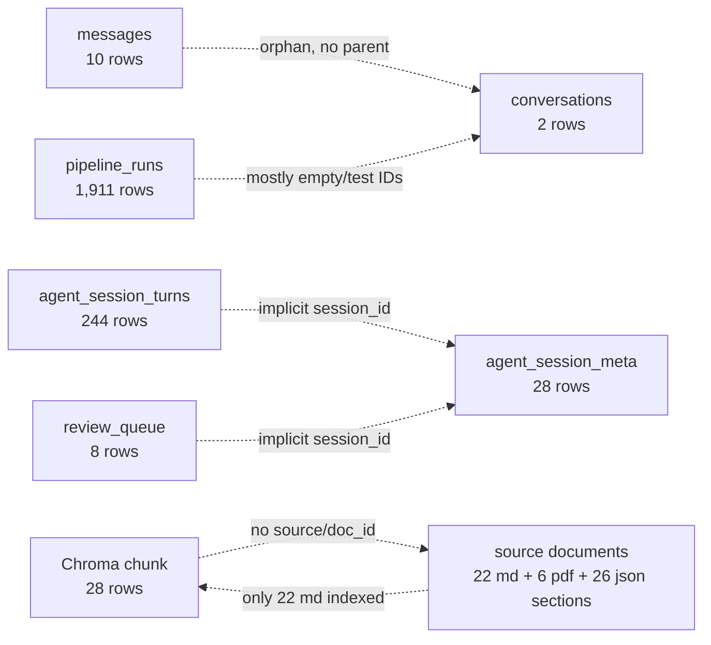

# BCREC CIP — Verified Database and Vector Store Inventory

**Document type:** Read-only inventory (companion to `DATABASE_AUDIT_REPORT.md`)  
**Audit date:** 2026-11-06  
**Repository:** `<workspace>/college_agent-master`  
**Git revision:** `d50ca9b` on `brain-v2-research`  
**Scope:** Every SQLite file, Chroma store, JSON knowledge index and file-based telemetry artifact found in the repository.  
**Safety:** Opened read-only; no tables, rows, collections, embeddings or files were modified. No secrets or personal data are reproduced.

---

## 1. Inventory Summary

### 1.1 All SQLite database files

| # | Path | Size (bytes) | Tables | Total rows | Journal | Role | Status |
|---:|---|---:|---|---:|---|---|---|
| 1 | `college_agent-master/backend/chroma_db/conversations.db` | 102,400 | 5 | 292 | WAL | **Live chat + voice + review** | Populated, partly orphan/test data |
| 2 | `data/conversations.db` | 14,123,008 | 5 | 2,026 | WAL | **Research telemetry** | Populated; PII-bearing JSON |
| 3 | `college_agent-master/data/conversations.db` | 24,576 | 2 | 0 | WAL | Duplicate/empty | Empty |
| 4 | `college_agent-master/backend/data/conversations.db` | 24,576 | 2 | 0 | WAL | Duplicate/empty | Empty |
| 5 | `chroma_db/conversations.db` | 45,056 | 4 | 0 | WAL | Duplicate/empty, newer meta schema | Empty |
| 6 | `college_agent-master/backend/tests/chroma_db/conversations.db` | 24,576 | 2 | 0 | WAL | Test artifact | Empty |
| 7 | `college_agent-master/scripts/chroma_db/conversations.db` | 24,576 | 2 | 0 | WAL | Script artifact | Empty |

All seven passed `PRAGMA integrity_check = ok`. All use `page_size = 4096`.

### 1.2 All Chroma stores

| # | Path | Size (bytes) | Collection | Dimension | Embeddings | Status |
|---:|---|---:|---|---:|---:|---|
| 1 | `college_agent-master/chroma_db/chroma_db_v2/chroma.sqlite3` | 602,112 | `bcrec_knowledge_base` | 384 | 28 | **Live, populated** |
| 2 | `college_agent-master/chroma_db/chroma_db_v2.backup/chroma.sqlite3` | 5,931,008 | `bcrec_knowledge_base` | `NULL` | 0 | Stale/invalid backup |
| 3 | `college_agent-master/backend/chroma_db/chroma_db_v2/chroma.sqlite3` | 188,416 | none | — | 0 | Empty, older path |
| 4 | `next_gen/data/chroma_db` | absent | would be `bcrec_knowledge` | — | 0 | Prototype never run |

### 1.3 Non-database data artifacts

| Artifact | Path | Count / size | Notes |
|---|---|---|---|
| Markdown knowledge base | `college_agent-master/backend/data/knowledge_base/departments/*.md` | 12 files | Department descriptions |
| Markdown knowledge base | `college_agent-master/backend/data/knowledge_base/topics/*.md` | 10 files | Fee, hostel, placement, etc. |
| Combined multilingual KB | `college_agent-master/backend/data/knowledge_base/combined_kb.json` | 1 file, 26 `voice_ready_answers` sections | EN/HI/BN answers; not indexed in live Chroma |
| Uploaded PDFs | `college_agent-master/uploads/*.pdf` | 6 files | Fee PDFs; not indexed in live Chroma |
| Root JSON KB index | `data/knowledge/index/manifest.json` + `chunks.jsonl` | 1 doc, 46 chunks, 512 dims | Research only |
| Conversation logs | `college_agent-master/data/logs/conversations/*.jsonl` | 1,196 files, 7,569,551 bytes | File-based, unmanaged |
| Shadow routing log | `college_agent-master/data/telemetry/shadow_routing.jsonl` | 1,896 bytes | File-based |
| Shadow routing log | `data/telemetry/shadow_routing.jsonl` | 48,290 bytes | File-based |
| Eval reports | `college_agent-master/backend/benchmarks/eval_reports/*.json` | 2 files, 142 rows each | Not retrieval metrics |
| Code backup | `backups/21-06-26-college-agent-code.zip` | 314,546 bytes | Code only, not a DB backup |

---

## 2. Live Chat, Voice and Review Database

**Path:** `college_agent-master/backend/chroma_db/conversations.db`  
**Size:** 102,400 bytes  
**Why this is the live DB:** `college_agent-master/backend/.env` sets `DB_DIR=./chroma_db`; the app was launched from `college_agent-master/backend/`, so `settings.db_dir + "/conversations.db"` resolves here.  
**Journal mode:** WAL  
**Page size / count:** 4,096 / 25  
**Integrity:** `ok`  
**Foreign keys at connection default:** `0` (OFF)

### 2.1 Tables and row counts

| Table | Rows | Purpose |
|---|---:|---|
| `conversations` | 2 | Web chat threads |
| `messages` | 10 | Web chat messages |
| `agent_session_meta` | 28 | Voice session metadata |
| `agent_session_turns` | 244 | Voice session turns |
| `review_queue` | 8 | Staff escalation queue |

### 2.2 `conversations`

```sql
CREATE TABLE conversations (
            id TEXT PRIMARY KEY,
            phone_number TEXT,
            title TEXT NOT NULL DEFAULT 'New Chat',
            created_at TEXT NOT NULL,
            updated_at TEXT NOT NULL
        )
```

| Column | Type | Nullable | Default | Key |
|---|---|---|---|---|
| `id` | TEXT | yes (SQLite TEXT PK allows NULL) | — | PK |
| `phone_number` | TEXT | yes | — | — |
| `title` | TEXT | no | `'New Chat'` | — |
| `created_at` | TEXT | no | — | — |
| `updated_at` | TEXT | no | — | — |

Indexes: `sqlite_autoindex_conversations_1` (unique, `id`).

Observed data:

- 2 rows.
- 1 distinct title.
- 0 rows with a non-empty `phone_number`.
- `updated_at` values use ISO 8601 with `+00:00` (e.g. `2026-07-13T15:02:27.874394+00:00`).
- Both conversations have **zero messages**.

### 2.3 `messages`

```sql
CREATE TABLE messages (
            id TEXT PRIMARY KEY,
            conversation_id TEXT NOT NULL,
            role TEXT NOT NULL,
            content TEXT NOT NULL,
            created_at TEXT NOT NULL,
            FOREIGN KEY (conversation_id) REFERENCES conversations(id) ON DELETE CASCADE
        )
```

| Column | Type | Nullable | Key / FK |
|---|---|---|---|
| `id` | TEXT | yes (TEXT PK) | PK |
| `conversation_id` | TEXT | no | FK → `conversations(id)` ON DELETE CASCADE (declared, **not enforced**) |
| `role` | TEXT | no | no CHECK |
| `content` | TEXT | no | — |
| `created_at` | TEXT | no | — |

Indexes:

- `idx_messages_conversation` (non-unique, `conversation_id`)
- `sqlite_autoindex_messages_1` (unique, `id`)

Observed data:

- 10 rows: 5 `user`, 5 `assistant`.
- All 10 reference `conversation_id = 'test123'`.
- **0 of 10 have a parent row** in `conversations`; all 10 are orphans.
- `created_at` values are naive ISO strings without timezone (e.g. `2026-06-25T00:06:14.445588`).
- Total message content: 390 characters.

### 2.4 `agent_session_meta`

```sql
CREATE TABLE agent_session_meta (
            session_id TEXT PRIMARY KEY,
            lang TEXT NOT NULL DEFAULT 'en',
            updated_at TEXT NOT NULL
        )
```

| Column | Type | Nullable | Default | Key |
|---|---|---|---|---|
| `session_id` | TEXT | yes (TEXT PK) | — | PK |
| `lang` | TEXT | no | `'en'` | — |
| `updated_at` | TEXT | no | — | — |

Indexes: `sqlite_autoindex_agent_session_meta_1` (unique, `session_id`).

Observed data:

- 28 rows.
- Languages: `en` 11, `hi` 10, `bn` 7.
- `updated_at` uses `%Y-%m-%d %H:%M:%S` local time (e.g. `2026-08-13 09:09:43`), no timezone.
- **Schema drift:** the current `session_store.py` expects `default_lang` and `profile` columns (`:44-52`, `:68-72`) and will `ALTER TABLE` them at runtime, but this file still has the 3-column schema. The duplicate `chroma_db/conversations.db` has the 5-column version.

### 2.5 `agent_session_turns`

```sql
CREATE TABLE agent_session_turns (
            id INTEGER PRIMARY KEY AUTOINCREMENT,
            session_id TEXT NOT NULL,
            role TEXT NOT NULL,
            content TEXT NOT NULL,
            created_at TEXT NOT NULL
        )
```

| Column | Type | Nullable | Key |
|---|---|---|---|
| `id` | INTEGER | yes | PK, AUTOINCREMENT |
| `session_id` | TEXT | no | no FK |
| `role` | TEXT | no | no CHECK |
| `content` | TEXT | no | — |
| `created_at` | TEXT | no | — |

Indexes:

- `idx_turns_session` (non-unique, `session_id, id`)
- `sqlite_autoindex_agent_session_turns_1` (unique, `id`)

Observed data:

- 244 rows: 122 `user`, 122 `assistant`.
- 28 distinct sessions.
- Max content length: 391 characters (code truncates at 2,000).
- `created_at` uses `%Y-%m-%d %H:%M:%S` local time.
- No FK to `agent_session_meta`; orphan check returned 0.

### 2.6 `review_queue`

```sql
CREATE TABLE review_queue (
            id TEXT PRIMARY KEY,
            ts TEXT NOT NULL,
            session_id TEXT NOT NULL,
            query TEXT NOT NULL,
            answer TEXT NOT NULL,
            source TEXT NOT NULL,
            confidence REAL,
            status TEXT NOT NULL DEFAULT 'open',
            staff_note TEXT DEFAULT ''
        )
```

| Column | Type | Nullable | Default | Key |
|---|---|---|---|---|
| `id` | TEXT | yes (TEXT PK) | — | PK |
| `ts` | TEXT | no | — | — |
| `session_id` | TEXT | no | — | no FK |
| `query` | TEXT | no | — | user query (truncated to 500 chars in code) |
| `answer` | TEXT | no | — | assistant answer (truncated to 2,000 chars) |
| `source` | TEXT | no | — | escalation origin, not document source |
| `confidence` | REAL | yes | — | — |
| `status` | TEXT | no | `'open'` | no CHECK |
| `staff_note` | TEXT | yes | `''` | — |

Indexes:

- `idx_review_status` (non-unique, `status`)
- `sqlite_autoindex_review_queue_1` (unique, `id`)

Observed data:

- 8 rows: 7 `open`, 1 `answered`.
- Sources: 7 `grounded_refusal`, 1 `transcript_clarification`.
- 7 distinct sessions.
- `ts` uses `%Y-%m-%d %H:%M:%S` local time.
- Orphan check (no matching `agent_session_meta`): 0.

### 2.7 WAL and connection settings in code

| Code path | WAL | `busy_timeout` | `check_same_thread` | Close behavior |
|---|---|---|---|---|
| `backend/app/database.py:13-18` | yes | 5,000 ms | `False` | Caller closes after commit |
| `backend/app/services/session_store.py:33-36` | yes | 5,000 ms | `False` | Closes after commit/read |
| `backend/app/services/review_queue.py:50-53` | yes | 5,000 ms | `False` | Closes after commit/read |
| `src/telemetry/store.py:37-41` | **no** | **no** | default | **no explicit close** |

No code executes `PRAGMA foreign_keys=ON`.

### 2.8 Live DB quality findings

| Finding | Count | Severity |
|---|---:|---|
| Orphan messages (parent conversation missing) | 10 / 10 | High |
| Conversations with zero messages | 2 / 2 | Medium |
| Non-empty phone numbers | 0 / 2 | Info |
| Session meta schema drift (3 vs 5 columns) | 1 file | High |
| Session turns without meta | 0 / 244 | Info |
| Review rows without meta | 0 / 8 | Info |
| Naive/local timestamps | 244 turns, 28 meta, 8 review, 10 messages | Medium |

---

## 3. Research Telemetry Database

**Path:** `data/conversations.db`  
**Size:** 14,123,008 bytes  
**Purpose:** Research pipeline telemetry (`pipeline_runs`) plus a small amount of legacy session data. **Not live chat history.**  
**Journal mode:** WAL  
**Page size / count:** 4,096 / 3,448  
**Integrity:** `ok`  
**Foreign keys:** `0` (OFF)

### 3.1 Tables and row counts

| Table | Rows | Purpose |
|---|---:|---|
| `pipeline_runs` | 1,911 | Serialized `PipelineResult` per run |
| `agent_session_meta` | 9 | Legacy/voice session metadata |
| `agent_session_turns` | 106 | Legacy/voice session turns |
| `conversations` | 0 | Empty legacy table |
| `messages` | 0 | Empty legacy table |

### 3.2 `pipeline_runs`

```sql
CREATE TABLE pipeline_runs (
    id TEXT PRIMARY KEY,
    conversation_id TEXT NOT NULL DEFAULT '',
    pipeline_version TEXT NOT NULL DEFAULT '',
    created_at TEXT NOT NULL DEFAULT '',
    run_json TEXT NOT NULL DEFAULT '{}'
)
```

| Column | Type | Nullable | Default | Key |
|---|---|---|---|---|
| `id` | TEXT | yes (TEXT PK) | — | PK |
| `conversation_id` | TEXT | no | `''` | — |
| `pipeline_version` | TEXT | no | `''` | — |
| `created_at` | TEXT | no | `''` | — |
| `run_json` | TEXT | no | `'{}'` | — |

Indexes:

- `idx_pipeline_runs_created_at` on `created_at`
- `idx_pipeline_runs_conversation` on `conversation_id`
- `idx_pipeline_runs_version` on `pipeline_version`
- `sqlite_autoindex_pipeline_runs_1` (unique, `id`)

### 3.3 Telemetry distributions

| Metric | Value |
|---|---|
| Pipeline versions | `1.0.0` only |
| Created range | `2026-07-17T09:05:37.932302+00:00` → `2026-08-14T17:02:57.025415+00:00` |
| Runs with empty `conversation_id` | 850 / 1,911 (44.5%) |
| Distinct `conversation_id` values | 5 including empty; **4 non-empty test IDs** (`count-test`, `dual-test-1`, `list-test`, `test-conv-1`) |
| Runs with `latency_ms` present | 1,698 / 1,911 |
| `run_json` length | min 4, max 9,239, mean 6,493.6 bytes |
| ID shape | 12-character UUID prefix |
| Runs per day (first days) | 2026-07-17: 126; 07-18: 334; 07-19: 333; 07-20: 324; 07-22: 63 |

### 3.4 `run_json` contract

A sampled latest run has these top-level keys:

```text
brain_response, confidence, decision, errors, knowledge, latency_ms,
llm_diagnostics, llm_prompt, plan, reasoning, response, text,
understanding, versions
```

Observed:

- `text` is the raw user query.
- `response` is the assistant answer.
- `llm_prompt` can be ~2,843 characters.
- `understanding`, `reasoning`, `brain_response`, `decision`, `plan` are nested objects.
- `latency_ms` is a dict of stage → milliseconds.
- `versions` is a dict of component versions.

**Privacy note:** the telemetry DB contains raw user text and prompts. It must be treated as PII-bearing and should be redacted/retained separately from OLTP.

### 3.5 `agent_session_meta` / `agent_session_turns` (telemetry DB)

Same 3-column and 5-column schemas as the live DB (see sections 2.4 and 2.5), with:

- 9 session meta rows, all `lang='en'`.
- 106 turns, 9 distinct sessions.
- `conversations` and `messages` exist but are empty.

### 3.6 Telemetry DB quality findings

| Finding | Detail |
|---|---|
| Mixed purpose | Telemetry tables coexist with empty chat tables; launching the legacy app from the repo root would write chat data here |
| No WAL/busy timeout in code | `src/telemetry/store.py:37-41` |
| No explicit close | Context manager commits but does not close |
| Test pollution | `count-test`, `dual-test-1`, `list-test`, `test-conv-1` |
| No retention | 1,911 rows / 14 MB and growing |
| PII | raw `text`, `response`, `llm_prompt` |
| Weak natural key | 12-char UUID prefix; no unique business key |

---

## 4. Empty / Duplicate Chat Databases

These files are not authoritative. They exist because of CWD-dependent configuration and test/script runs.

### 4.1 `college_agent-master/backend/data/conversations.db`

- Size: 24,576 bytes
- Tables: `conversations` (0), `messages` (0)
- Schema: same as live `conversations`/`messages`
- Index: `idx_messages_conversation`
- WAL: yes
- Note: default `DB_DIR=data` path when `backend/.env` is not loaded.

### 4.2 `college_agent-master/data/conversations.db`

- Size: 24,576 bytes
- Tables: `conversations` (0), `messages` (0)
- Same schema/index as above.
- Note: app launched from `college_agent-master/`.

### 4.3 `chroma_db/conversations.db`

- Size: 45,056 bytes
- Tables:
  - `agent_session_meta` (0) — **5 columns** (`session_id`, `lang`, `updated_at`, `default_lang`, `profile`)
  - `agent_session_turns` (0)
  - `conversations` (0)
  - `messages` (0)
- Indexes: `idx_turns_session`, `idx_messages_conversation`
- Note: app launched from repository root; the newer schema shows the runtime `ALTER TABLE` migration did run here.

### 4.4 `college_agent-master/backend/tests/chroma_db/conversations.db`

- Size: 24,576 bytes
- Tables: `agent_session_meta` (0, 3 columns), `agent_session_turns` (0)
- Index: `idx_turns_session`
- Note: test artifact.

### 4.5 `college_agent-master/scripts/chroma_db/conversations.db`

- Size: 24,576 bytes
- Tables: `conversations` (0), `messages` (0)
- Index: `idx_messages_conversation`
- Note: script launched from `scripts/`.

---

## 5. ChromaDB Inventory (Live Store)

**Path:** `college_agent-master/chroma_db/chroma_db_v2/chroma.sqlite3`  
**Size:** 602,112 bytes  
**Last write:** 2026-08-19 15:35  
**Persistence:** embedded persistent Chroma directory  
**Search:** HNSW, L2

### 5.1 Files in the store

| File | Size (bytes) | Purpose |
|---|---:|---|
| `chroma.sqlite3` | 602,112 | Metadata, queue, collection registry |
| `b87d9e68-71f3-4201-a8c5-3917d1485c07/data_level0.bin` | 167,600 | HNSW level-0 graph |
| `b87d9e68-71f3-4201-a8c5-3917d1485c07/header.bin` | 100 | HNSW header |
| `b87d9e68-71f3-4201-a8c5-3917d1485c07/length.bin` | 400 | HNSW vector lengths |
| `b87d9e68-71f3-4201-a8c5-3917d1485c07/link_lists.bin` | 0 | HNSW links (empty at this size) |

### 5.2 Collection

| Property | Value |
|---|---|
| Tenant | `default_tenant` |
| Database | `default_database` (`00000000-0000-0000-0000-000000000000`) |
| Collection name | `bcrec_knowledge_base` |
| Collection ID | `bf22ac83-fa5e-46a3-b375-bba5a6fa42de` |
| Dimension | 384 |
| `config_json_str` | `{}` |
| `schema_str` | Defines vector index `l2`, HNSW, and string/int indexes |

### 5.3 Segments

| Segment ID | Type | Scope | Collection |
|---|---|---|---|
| `b87d9e68-71f3-4201-a8c5-3917d1485c07` | `urn:chroma:segment/vector/hnsw-local-persisted` | VECTOR | `bf22ac83-fa5e-46a3-b375-bba5a6fa42de` |
| `b2c481d6-74ac-4f50-a476-9ee5bcae4a03` | `urn:chroma:segment/metadata/sqlite` | METADATA | `bf22ac83-fa5e-46a3-b375-bba5a6fa42de` |

`max_seq_id`: metadata segment `b2c481d6-...` has `seq_id = 86`.

### 5.4 HNSW configuration

From `collections.schema_str`:

```json
{
  "space": "l2",
  "hnsw": {
    "ef_construction": 100,
    "max_neighbors": 16,
    "ef_search": 100,
    "num_threads": 12,
    "batch_size": 100,
    "sync_threshold": 1000,
    "resize_factor": 1.2
  }
}
```

The vector index is enabled for `#embedding`; `#document` FTS is enabled but unused by retrieval.

### 5.5 Chroma internal tables and columns

| Table | Columns | Rows |
|---|---|---:|
| `tenants` | `id` | 1 |
| `databases` | `id`, `name`, `tenant_id` | 1 |
| `collections` | `id`, `name`, `dimension`, `database_id`, `config_json_str`, `schema_str` | 1 |
| `segments` | `id`, `type`, `scope`, `collection` | 2 |
| `embeddings` | `id`, `segment_id`, `embedding_id`, `seq_id`, `created_at` | 28 |
| `embedding_metadata` | `id`, `key`, `string_value`, `int_value`, `float_value`, `bool_value` | 84 |
| `embeddings_queue` | `seq_id`, `created_at`, `operation`, `topic`, `id`, `vector`, `encoding`, `metadata` | 86 |
| `max_seq_id` | `segment_id`, `seq_id` | 1 |
| `collection_metadata` | Chroma internal | 0 |
| `segment_metadata` | Chroma internal | 0 |

Key DDL:

```sql
CREATE TABLE "collections" (
    id TEXT PRIMARY KEY,
    name TEXT NOT NULL,
    dimension INTEGER,
    database_id TEXT NOT NULL REFERENCES databases(id) ON DELETE CASCADE,
    config_json_str TEXT,
    schema_str TEXT,
    UNIQUE (name, database_id)
);

CREATE TABLE embeddings (
    id INTEGER PRIMARY KEY,
    segment_id TEXT NOT NULL,
    embedding_id TEXT NOT NULL,
    seq_id BLOB NOT NULL,
    created_at TIMESTAMP NOT NULL DEFAULT CURRENT_TIMESTAMP,
    UNIQUE (segment_id, embedding_id)
);

CREATE TABLE embedding_metadata (
    id INTEGER REFERENCES embeddings(id),
    key TEXT NOT NULL,
    string_value TEXT,
    int_value INTEGER,
    float_value REAL,
    bool_value INTEGER,
    PRIMARY KEY (id, key)
);

CREATE TABLE embeddings_queue (
    seq_id INTEGER PRIMARY KEY,
    created_at TIMESTAMP NOT NULL DEFAULT CURRENT_TIMESTAMP,
    operation INTEGER NOT NULL,
    topic TEXT NOT NULL,
    id TEXT NOT NULL,
    vector BLOB,
    encoding TEXT,
    metadata TEXT
);
```

### 5.6 Embedding metadata distribution

| Key | Rows | Values |
|---|---:|---|
| `file_type` | 28 | `.md` × 28 |
| `chunk_id` | 28 | `0` × 22, `1` × 5, `2` × 1 |
| `chroma:document` | 28 | chunk text |
| `source` | **0** | missing |
| `doc_id` | **0** | missing |
| `section` | **0** | missing |
| `language` | **0** | missing |
| `page` | **0** | missing |
| `version` | **0** | missing |
| `department` | **0** | missing |

**84 metadata rows = 28 embeddings × 3 keys.** Every embedding has exactly the same three keys; no embedding has provenance metadata.

### 5.7 Document length statistics

| Metric | Value |
|---|---:|
| Count | 28 |
| Min | 160 chars |
| Max | 1,089 chars |
| Mean | 690 chars |
| Median | 745.5 chars |

The configured chunker is 1,000 chars / 200 overlap, but many source documents are shorter than 1,000 chars. One document produced 3 chunks; five produced 2; twenty-two produced 1.

### 5.8 Queue operations

| Operation | Count | Meaning |
|---|---:|---|
| `2` | 57 | Upsert |
| `3` | 29 | Delete |
| **Total** | **86** | 28 live embeddings remain |

The queue topic is `persistent://default/default/bf22ac83-fa5e-46a3-b375-bba5a6fa42de`. The upsert/delete churn indicates repeated reindexing or partial rebuilds. Chroma's internal mapping is `ADD=0, UPDATE=1, UPSERT=2, DELETE=3`.

### 5.9 Embedding IDs

- 28 UUIDs generated by LangChain, e.g. `111c4748-2385-489c-a76a-c275a0724560`.
- IDs are not derived from source path or chunk hash, so re-ingesting the same document creates new IDs unless the collection is cleared.
- `clear_collection` deletes all IDs, but a failed/partial reindex can leave a mixed state.

### 5.10 Other Chroma stores

#### `college_agent-master/chroma_db/chroma_db_v2.backup/chroma.sqlite3`

- Size: 5,931,008 bytes
- Collection: `bcrec_knowledge_base`, ID `43b9bd5a-5404-4c1b-aa2a-07d3ad4ef9b6`
- Dimension: `NULL`
- Embeddings: 0
- Metadata rows: 0
- Queue rows: 0
- Segments: 2
- **Not a usable backup.**

#### `college_agent-master/backend/chroma_db/chroma_db_v2/chroma.sqlite3`

- Size: 188,416 bytes
- Collections: 0
- Embeddings: 0
- Segments: 0
- **Empty older path**, created 2026-06-27.

#### `next_gen/data/chroma_db`

- Absent.
- `next_gen/src/retrieval/vector.py:13-62` would create collection `bcrec_knowledge` with MiniLM if the prototype were run.
- No data to inspect.

---

## 6. Root Research Knowledge Index (JSON, not a database)

**Path:** `data/knowledge/index/`  
**Files:** `manifest.json` (52,164 bytes), `chunks.jsonl` (433,364 bytes)

### 6.1 Manifest

| Field | Value |
|---|---|
| `format` | `knowledge-parcel` |
| `version` | `1` |
| `fingerprint` | `48e6868d654701dd` |
| `chunk_count` | 46 |
| `threshold` | 0.28 |
| `embedder.name` | `local-ngram-v1` |
| `embedder.dim` | 512 |
| `embedder.model` | `null` |
| `docs` | 1 |

Document:

| Field | Value |
|---|---|
| `doc_id` | `9f4fb099e69e4e53` |
| `title` | `college_agent_master_kb_full` |
| `chars` | 50,168 |
| `source` | `<workspace>/college_agent-master/college_agent_master_kb_full.txt` |

### 6.2 Chunks

| Metric | Value |
|---|---|
| Chunk count | 46 |
| Vector dimensions | 512 (all) |
| Text length min / max / mean | 801 / 1,522 / 1,114.6 chars |
| Chunk keys | `chunk_id`, `doc_id`, `doc_title`, `index`, `text`, `vector` |
| Chunking | 160 tokens, 24-token overlap, sentence/line-aligned |
| Retrieval | `0.6 × cosine + 0.4 × IDF lexical`, threshold 0.28, top-k 4 |

This index is a deterministic research artifact. It is not used by the live FastAPI app and is not a Chroma or SQL database.

---

## 7. Legacy Ingestion Source Inventory

### 7.1 Markdown documents (22)

Departments (12):

```text
aiml.md, ce.md, csd.md, cse.md, cy.md, ds.md,
ece.md, ee.md, it.md, mba.md, mca.md, me.md
```

Topics (10):

```text
admissions.md, anti_ragging.md, college.md, contacts.md,
departments_overview.md, faculty.md, fees.md, hostel.md,
placements.md, student_life.md
```

### 7.2 Uploaded PDFs (6)

| File | Size (bytes) |
|---|---:|
| `BTech_Fee.pdf` | 131,827 |
| `BTech_Lateral_Fee.pdf` | 131,799 |
| `MBA_Fee.pdf` | 131,814 |
| `MBA_HM_Fee.pdf` | 131,802 |
| `MCA_Fee.pdf` | 131,788 |
| `MTech_Fee.pdf` | 131,799 |

All six are absent from the live Chroma index (`file_type` is `.md` for all 28 embeddings).

### 7.3 `combined_kb.json`

| Property | Value |
|---|---|
| Top-level keys | `meta`, `college`, `principal`, `vice_principal`, `courses`, `fees_summary`, `admission`, `admission_documents`, `infrastructure`, `student_life`, `scholarships`, `placements`, `hostel`, `anti_ragging`, `academics`, `departments`, `branch_change`, `quick_answers`, `important_links`, `voice_ready_answers` |
| `voice_ready_answers` sections | 26, including `admission`, `application_status`, `bonafide`, `campus`, `college_timings`, `courses`, `documents`, `eligibility_by_rank`, `faculty`, `fees`, `hidden_charges`, `hod`, `hostel`, `hostel_application`, `id_card`, `international`, `library`, `online_learning`, `placement`, `policies` |
| Multilingual answers | Many sections have `answers.en`, `answers.hi`, `answers.bn` (e.g. admission: 275/192/176 chars; hostel: 287/259/255) |
| Indexed in live Chroma? | **No** |

### 7.4 Index coverage gap

| Source | Expected | Indexed | Gap |
|---|---:|---:|---:|
| Markdown docs | 22 | 22 | 0 |
| Markdown chunks | — | 28 | — |
| PDFs | 6 | 0 | 6 |
| `combined_kb.json` sections | 26 | 0 | 26 |
| Multilingual answers | Many | 0 | All |

---

## 8. File-Based Telemetry and Logs

### 8.1 Conversation logs

**Path:** `college_agent-master/data/logs/conversations/`  
**Files:** 1,196 JSONL files  
**Total size:** 7,569,551 bytes  
**Line keys (sampled):** `conversation_id`, `data`, `session_id`, `timestamp`, `timestamp_unix`, `turn_number`, `type`

These are outside the database and have no retention policy. They should be treated as PII-bearing.

### 8.2 Shadow routing logs

| Path | Size |
|---|---:|
| `college_agent-master/data/telemetry/shadow_routing.jsonl` | 1,896 bytes |
| `data/telemetry/shadow_routing.jsonl` | 48,290 bytes |

### 8.3 Request log

`college_agent-master/data/telemetry/request_log.jsonl` was not present at the expected path during the audit. The code default is `data/telemetry/request_log.jsonl` relative to CWD (`request_log.py:13,33`).

### 8.4 Evaluation reports

| Path | Rows | Notes |
|---|---:|---|
| `college_agent-master/backend/benchmarks/eval_reports/demo_eval_20260711_132333.json` | 142 | `context_len=0` all; `hallucination=YES` all |
| `college_agent-master/backend/benchmarks/eval_reports/demo_eval_20260711_190204.json` | 142 | `context_len=0` all; `hallucination=YES` all |

Sources: `structured_lookup` 82, `llm_tools` 52, `transcript_clarification` 4, `out_of_domain` 3, `llm_tools+safe_point_unknown` 1. These are not retrieval-quality metrics.

---

## 9. Cross-Database Relationships and Provenance

### 9.1 What is actually related

| From | To | Relationship | Enforced? |
|---|---|---|---|
| `messages.conversation_id` | `conversations.id` | many-to-one | **No** (FK declared, `PRAGMA foreign_keys=0`) |
| `agent_session_turns.session_id` | `agent_session_meta.session_id` | many-to-one, implicit | **No** (no FK) |
| `review_queue.session_id` | `agent_session_meta.session_id` | many-to-one, implicit | **No** (no FK) |
| `pipeline_runs.conversation_id` | `conversations.id` or `agent_session_meta.session_id` | none | **No**; 850 empty, 4 non-empty test IDs |
| Chroma `chunk_id` | source document | **cannot be resolved** | **No** source metadata |
| `pipeline_runs` | live chats | none | No FK or shared ID |

### 9.2 Provenance graph (current state)



### 9.3 Cardinality summary

| Entity | Cardinality | Notes |
|---|---|---|
| Conversations | 2 | No messages |
| Messages | 10 | All orphaned to `test123` |
| Session meta | 28 | 3 languages |
| Session turns | 244 | 2 rows per turn |
| Review queue | 8 | 7 open |
| Pipeline runs | 1,911 | Test-heavy |
| Chroma chunks | 28 | 22 source docs |
| Uploaded PDFs | 6 | Not indexed |
| Combined KB sections | 26 | Not indexed |
| JSON KB chunks | 46 | Research only |

---

## 10. Exact DDL Appendix

### 10.1 Live DB: `college_agent-master/backend/chroma_db/conversations.db`

```sql
CREATE TABLE conversations (
            id TEXT PRIMARY KEY,
            phone_number TEXT,
            title TEXT NOT NULL DEFAULT 'New Chat',
            created_at TEXT NOT NULL,
            updated_at TEXT NOT NULL
        );

CREATE TABLE messages (
            id TEXT PRIMARY KEY,
            conversation_id TEXT NOT NULL,
            role TEXT NOT NULL,
            content TEXT NOT NULL,
            created_at TEXT NOT NULL,
            FOREIGN KEY (conversation_id) REFERENCES conversations(id) ON DELETE CASCADE
        );

CREATE INDEX idx_messages_conversation
        ON messages(conversation_id);

CREATE TABLE agent_session_meta (
            session_id TEXT PRIMARY KEY,
            lang TEXT NOT NULL DEFAULT 'en',
            updated_at TEXT NOT NULL
        );

CREATE TABLE agent_session_turns (
            id INTEGER PRIMARY KEY AUTOINCREMENT,
            session_id TEXT NOT NULL,
            role TEXT NOT NULL,
            content TEXT NOT NULL,
            created_at TEXT NOT NULL
        );

CREATE INDEX idx_turns_session ON agent_session_turns(session_id, id);

CREATE TABLE review_queue (
            id TEXT PRIMARY KEY,
            ts TEXT NOT NULL,
            session_id TEXT NOT NULL,
            query TEXT NOT NULL,
            answer TEXT NOT NULL,
            source TEXT NOT NULL,
            confidence REAL,
            status TEXT NOT NULL DEFAULT 'open',
            staff_note TEXT DEFAULT ''
        );

CREATE INDEX idx_review_status ON review_queue(status);
```

### 10.2 Telemetry DB: `data/conversations.db`

```sql
CREATE TABLE pipeline_runs (
    id TEXT PRIMARY KEY,
    conversation_id TEXT NOT NULL DEFAULT '',
    pipeline_version TEXT NOT NULL DEFAULT '',
    created_at TEXT NOT NULL DEFAULT '',
    run_json TEXT NOT NULL DEFAULT '{}'
);

CREATE INDEX idx_pipeline_runs_created_at ON pipeline_runs(created_at);
CREATE INDEX idx_pipeline_runs_conversation ON pipeline_runs(conversation_id);
CREATE INDEX idx_pipeline_runs_version ON pipeline_runs(pipeline_version);

CREATE TABLE agent_session_meta (
            session_id TEXT PRIMARY KEY,
            lang TEXT NOT NULL DEFAULT 'en',
            updated_at TEXT NOT NULL
        );

CREATE TABLE agent_session_turns (
            id INTEGER PRIMARY KEY AUTOINCREMENT,
            session_id TEXT NOT NULL,
            role TEXT NOT NULL,
            content TEXT NOT NULL,
            created_at TEXT NOT NULL
        );

CREATE INDEX idx_turns_session ON agent_session_turns(session_id, id);

CREATE TABLE conversations (
            id TEXT PRIMARY KEY,
            phone_number TEXT,
            title TEXT NOT NULL DEFAULT 'New Chat',
            created_at TEXT NOT NULL,
            updated_at TEXT NOT NULL
        );

CREATE TABLE messages (
            id TEXT PRIMARY KEY,
            conversation_id TEXT NOT NULL,
            role TEXT NOT NULL,
            content TEXT NOT NULL,
            created_at TEXT NOT NULL,
            FOREIGN KEY (conversation_id) REFERENCES conversations(id) ON DELETE CASCADE
        );

CREATE INDEX idx_messages_conversation
        ON messages(conversation_id);
```

### 10.3 Newer session schema: `chroma_db/conversations.db`

```sql
CREATE TABLE agent_session_meta (
            session_id TEXT PRIMARY KEY,
            lang TEXT NOT NULL DEFAULT 'en',
            updated_at TEXT NOT NULL
        , default_lang TEXT, profile TEXT);

CREATE TABLE agent_session_turns (
            id INTEGER PRIMARY KEY AUTOINCREMENT,
            session_id TEXT NOT NULL,
            role TEXT NOT NULL,
            content TEXT NOT NULL,
            created_at TEXT NOT NULL
        );

CREATE INDEX idx_turns_session ON agent_session_turns(session_id, id);

CREATE TABLE conversations (
            id TEXT PRIMARY KEY,
            phone_number TEXT,
            title TEXT NOT NULL DEFAULT 'New Chat',
            created_at TEXT NOT NULL,
            updated_at TEXT NOT NULL
        );

CREATE TABLE messages (
            id TEXT PRIMARY KEY,
            conversation_id TEXT NOT NULL,
            role TEXT NOT NULL,
            content TEXT NOT NULL,
            created_at TEXT NOT NULL,
            FOREIGN KEY (conversation_id) REFERENCES conversations(id) ON DELETE CASCADE
        );

CREATE INDEX idx_messages_conversation
        ON messages(conversation_id);
```

### 10.4 Chroma live store: key tables

See section 5.5 for the `collections`, `embeddings`, `embedding_metadata` and `embeddings_queue` DDL.

---

## 11. Inspection Method

Commands were read-only. Representative pattern:

```python
import sqlite3
con = sqlite3.connect(f"file:{path}?mode=ro", uri=True)
con.row_factory = sqlite3.Row
con.execute("PRAGMA integrity_check").fetchone()
con.execute("PRAGMA journal_mode").fetchone()
con.execute("PRAGMA foreign_keys").fetchone()
# PRAGMA table_info, foreign_key_list, index_list, index_info
# SELECT COUNT(*) FROM each table
# SELECT key, COUNT(*) FROM embedding_metadata GROUP BY key
```

Other checks:

- Enumerated `*.db`, `*.sqlite`, `*.sqlite3`, excluding virtualenvs/site-packages.
- Opened Chroma's SQLite file read-only and inspected `collections`, `segments`, `embeddings`, `embedding_metadata`, `embeddings_queue`, `max_seq_id`.
- Read HNSW file sizes from the vector segment directory.
- Read `manifest.json` and `chunks.jsonl` for the research index.
- Counted files/bytes for uploads, knowledge base, logs and backups.

**Not done:** no writes, no `CREATE`/`ALTER`/`DROP`, no migrations, no Chroma mutations, no embedding regeneration, no app start, no dependency installation.

---

## 12. Inventory Limitations

| Limitation | Detail |
|---|---|
| Live app not started | OpenTelemetry version conflict prevents importing Chroma and the app; runtime query behavior was not measured |
| No Postgres/Redis/S3 | Only code and local files exist; no live instances to inspect |
| JSONL logs not content-audited | 1,196 files counted, not read for PII or quality |
| `next_gen/` not populated | Prototype Chroma store absent |
| External vendor retention | Sarvam/Twilio/LiveKit/Groq policies out of scope |
| No production deployment | No IaC/CI/CD artifacts found that define the real topology |
| No ERP/SIS | Academic source systems are not in this repository |
| PII redaction | This document reports aggregates only; no message content, names, phone numbers or credentials are reproduced |

---

**End of inventory.**
