# BCREC Campus ERP + Campus Intelligence Platform (CIP)
## Institutional Governance, Roles, Rules, Workflows, and Data Research

**Status:** Research and design input. No implementation, schema, migration, or application change is proposed here.
**Institution studied:** Dr. B. C. Roy Engineering College (BCREC), Durgapur, West Bengal.
**Regulator studied:** Maulana Abul Kalam Azad University of Technology, West Bengal (MAKAUT, WB).
**Research cut-off:** 6 November 2026.
**Author:** Research agent.
**Audience:** Product owner, ERP/CIP architects, academic leadership, registrar, controller of examinations, compliance and audit reviewers.

---

## 0. How to read this document

### 0.1 Evidence labels

Every material statement is labelled so that a reader can tell what is established fact, what is inference, and what is a design recommendation.

| Label | Meaning |
|---|---|
| **[BCREC]** | Stated in an official BCREC document or on an official BCREC page. |
| **[MAKAUT]** | Stated in an official MAKAUT document, order, notification, or page. |
| **[UGC]** | Stated in a UGC regulation or Government of India notification. |
| **[AICTE]** | Stated in an AICTE approval or AICTE process document. |
| **[Inference]** | A conclusion drawn by combining two or more verified sources. Not directly stated by any one source. |
| **[Recommendation]** | A design or process proposal by this research. It is not an institutional rule. |
| **[Unverified]** | Material that could not be confirmed from an official source at the research cut-off. |
| **[Gap]** | A required fact or rule that is unknown, contradictory, or inaccessible. |

### 0.2 Document-status labels for rules

Rules change. A rule must never be stored as a bare number in code without its source and validity window.

| Status | Meaning |
|---|---|
| **Current** | Published by an authority and not known to be superseded at the cut-off. |
| **Draft** | Published but expressly marked draft, or its final approval is not evidenced. |
| **Historical** | Valid for an earlier period or an earlier batch; retained for audit and transcript reconstruction. |
| **Superseded** | Replaced by a later instrument. Retained only for historical reconstruction. |
| **Disputed** | Two official sources conflict; neither has been confirmed as controlling. |
| **Unknown** | No official source located. |

### 0.3 Authority labels

The same process can involve more than one authority. The document distinguishes:

- **Institutional authority** — BCREC bodies and officers acting under autonomy.
- **University authority** — MAKAUT acting under the WBUT Act, 2000 and affiliation conditions.
- **Statutory-council authority** — AICTE, UGC, and State Government.
- **Professional/accreditation influence** — NBA, NAAC, and accreditation criteria. These influence practice but are not, by themselves, law.

### 0.4 A caution about names and dates

This document deliberately names offices, not only individuals. Where an individual is named, it is to evidence that one person can hold several roles. Individuals change; roles persist. Two official BCREC orders issued six months apart already show a change of Principal [S6][S7][S8]. Any design that hard-codes a person or a designation string will break.

---

## 1. Executive summary

BCREC is a private, self-financing engineering college established in 2000, approved by AICTE, accredited by NAAC and NBA for selected programmes, and affiliated to MAKAUT [S15][S2]. It was granted academic autonomy in April 2024 by UGC and MAKAUT for a five-year period beginning with the 2024-25 academic year [S1 §3][S2]. Autonomy is institutional and covers B.Tech, M.Tech, MBA, and MCA [S1 §3.1][S16 §3.10]. The degree, however, is still awarded by MAKAUT; BCREC issues grade cards, transcripts, provisional degree certificates, and other certificates under its own seal [S1 §3.4][S16 §3.4].

The resulting governance picture is **dual-authority**:

- BCREC controls curriculum, instruction, assessment design, examination conduct, result publication, and most student records.
- MAKAUT controls affiliation, university registration/enrolment, the degree award, and the overall regulatory minimums.
- AICTE controls technical-education approval and intake.
- UGC sets the autonomy framework and minimum standards.

This has three consequences for the ERP/CIP design:

1. **A student can be governed by more than one regulation version.** A batch admitted before autonomy may still follow MAKAUT examination and backlog rules, while a batch admitted from 2024-25 follows BCREC's autonomous regulations. BCREC's own notices distinguish "MAKAUT students" from the "Autonomous Batch 2024-25 onwards" for backlog examination fees [S20]. The exact batch boundary is not confirmed [Gap G-04].
2. **The same person routinely holds several institutional roles.** Examples in official 2026 orders include a Professor who is also Vice Principal and a BOG member; a Registrar who is also Member-Secretary of the Academic Council and a member of the Examination Committee; a COE who is also an Associate Professor and an Academic Council teacher representative [S6][S7][S8]. A fixed "user type" model cannot represent this.
3. **The authoritative source differs by field.** MAKAUT is authoritative for the university registration number; BCREC is authoritative for attendance, internal marks, and its own results; the Controller of Examinations is authoritative for published results; Finance is authoritative for fee status. The ERP must be able to configure source-of-truth per domain, not assume one master system.

The most important unresolved academic rule is attendance. BCREC's Academic Regulations say **75% aggregate across all courses**, with condonation between 65% and 75% only by the Academic Council, and no condonation below 65% [S1 §16]. The BCREC Prospectus 2026 says **75% separately in theory and practical**, attributing the rule to MAKAUT [S2 p.55]. MAKAUT's August 2026 notification requires regular class attendance but does not itself state the split; it defers to "applicable University norms and academic regulations" [S17]. This is a direct conflict between two current BCREC publications and must be resolved by the Academic Council before attendance eligibility is automated [Gap G-01]. A second unresolved issue is that the Academic Regulations are published as **"Draft", Edition 1.0** [S1 cover], while the college presents them as its operative regulation. The final approved edition was not located [Gap G-02].

The recommended design posture is therefore:

- Build an independent **Campus ERP core** and **CIP**; treat the existing college ERP as an optional, replaceable adapter.
- Model **people, roles, role assignments, scope, and delegations** as first-class data.
- Store **rules as versioned policy records** with source, authority, effective dates, batch/programme scope, and status.
- Keep **structured academic records** separate from **document text and embeddings**.
- Treat **provenance, audit, conflict resolution, and demo-data isolation** as mandatory.
- Deliver a narrow, trustworthy initial release (identity, academic structure, student enrolment, attendance, internal assessment, notices, document repository, policy/audit, published-result viewing, and the CIP core), then add examination operations, result processing, fees, placement, hostel/library, and analytics.

---

## 2. Scope, method, and limitations

### 2.1 Scope

**In scope**

- BCREC's legal and academic identity.
- BCREC's governance bodies and committees.
- The BCREC–MAKAUT–AICTE–UGC authority relationship.
- Roles, role assignments, and multi-role patterns.
- Student lifecycle, academic, attendance, examination, result, promotion, mentoring, departmental, notice, discipline, and placement workflows.
- A rule repository for attendance, assessment, passing, grading, promotion, supplementary examinations, result correction, PPR, MAR, discipline, placement, and service rules.
- An entity inventory with ownership, access, authority, and release classification.
- An ER overview.
- Access-control requirements.
- Initial vs future module classification.
- ERP integration strategy.
- Structured-data vs RAG separation.
- Open questions, gaps, and a source register.

**Out of scope**

- Implementation code, database schemas, migrations, APIs, UI, infrastructure, and procurement.
- Legal advice.
- Any attempt to access the college ERP, MAKAUT portals, or other restricted systems.
- Any claim that the proposed architecture is automatically correct. Every recommendation is a hypothesis to be validated.

### 2.2 Method

1. Collected official BCREC documents from the public website: Academic Regulations, Prospectus 2026, Service Rules, Organogram, Society structure, BOG order, Academic Council order, Examination Committee order, Academic Calendar 2026-27, Disciplinary Rules, Placement Policy, IQAC composition, NAAC SSR 2021, and the Examination Department page [S1]–[S13], [S19].
2. Collected MAKAUT affiliation orders for 2026-27 and the MAKAUT attendance notification of 20 August 2026 [S14][S17].
3. Collected AICTE Extension of Approval for 2026-27 [S15].
4. Collected the UGC (Conferment of Autonomous Status upon Colleges and Measures for Maintenance of Standards in Autonomous Colleges) Regulations, 2023 [S16].
5. Read the BCREC notice list to reconstruct real operational sequences: university registration, course enrolment, examination form fill-up, result publication, PPR, supplementary examinations, degree availability on NAD, fee collection, scholarships, and book distribution [S20].
6. Extracted text from PDFs with PyMuPDF/pypdf. Five BCREC documents were image-only scans; they were rendered at 300 dpi and OCR'd with the Windows OCR engine. OCR output was manually checked against layout and is marked where column order was reconstructed.
7. Cross-checked every material rule against at least one official document. Where only one source exists, that is stated.

### 2.3 Limitations

- The college ERP was not accessed. The public website exposes an "ERP Login" link, but no credentials were used and no authenticated page was requested. Its data model, APIs, identity provider, and source-of-truth behaviour are unknown [Gap G-10].
- MAKAUT's current B.Tech academic regulation was not located as a single consolidated current document. The MAKAUT "Rules and Regulations" page mostly links amendments from 2011–2015 and older schedules [S21]. Those were not treated as current B.Tech regulations.
- The UGC autonomy letter and the MAKAUT autonomy letter were not obtained in full; their numbers and dates are cited from BCREC documents [S1 §3][S19].
- Several BCREC documents are undated or undated in the extracted text. Dates are given where the document itself gives one.
- The IQAC composition document describes a 2020 restructuring and is therefore historical evidence of practice, not a current composition [S12].
- The NAAC SSR is from 2021, before autonomy, and is historical evidence only [S13].
- The Academic Regulations are marked "Draft" [S1].
- No inference in this document should be read as an official BCREC or MAKAUT statement.

---

## 3. Institutional profile

### 3.1 Legal identity

| Attribute | Value | Evidence |
|---|---|---|
| Legal name | Dr. B. C. Roy Engineering College, Durgapur | [S1 cover][S14] |
| Type | Private, self-financing | [S15 p.1] |
| Established | 2000 | [S15 p.1][S19] |
| Sponsoring body | Dr. B. C. Roy Engineering College Society, Durgapur | [S5][S14] |
| Statutory approval | AICTE | [S15] |
| Affiliating university | MAKAUT, WB | [S14][S1 cover] |
| College code | 120 | [S14][S1 §9.2.2] |
| Autonomy | UGC and MAKAUT, April 2024, five years from 2024-25 | [S1 §3][S2][S19] |
| Campus | Jemua Road, Fuljhore, Durgapur 713206, Paschim Bardhaman, West Bengal | [S1 cover][S14] |

The Society is the sponsoring body. The BOG is the governing body of the college. The Principal is the principal academic and executive authority [S3 §5.5.1]. The Society's office-bearers include President, Vice-President, General Secretary, Treasurer, Assistant Secretary, and members [S5].

### 3.2 Academic portfolio

AICTE's 2026-27 Extension of Approval lists the following approved programmes and intakes [S15 pp.1–3]:

| Level | Programme | Intake 2026-27 |
|---|---|---|
| UG | Civil Engineering | 60 |
| UG | Computer Science and Engineering | 240 |
| UG | Computer Science and Engineering (AI and Machine Learning) | 60 |
| UG | Computer Science and Engineering (Cyber Security) | 30 |
| UG | Computer Science and Engineering (Data Science) | 60 |
| UG | Electrical Engineering | 60 |
| UG | Electronics and Communication Engineering | 120 |
| UG | Information Technology | 30 |
| UG | Mechanical Engineering | 60 |
| PG | Computer Science and Engineering | 18 |
| PG | Electronics and Communication Engineering | 18 |
| PG | Power Systems | 18 |
| PG | Mechanical Engineering | 18 |
| PG | Master of Business Administration | 90 |
| PG | Master of Computer Applications | 120 |
| PG | MBA (Hospital Management) | 60 (new) |
| PG | Construction Technology and Management | 18 (new) |

MAKAUT's 2026-27 affiliation order separately lists B.Tech, M.Tech, MBA, and MBA (Hospital Management). It shows programme codes used in the university system, for example `001` for CSE, `003` for ECE, `013` for Civil, `016` for Electrical, `002` for IT, `007` for Mechanical, `308` for CSE (AIML), `305` for CSE (DS), and `317` for CSE (Cyber Security) [S14 pp.1–3]. These codes are operationally important because BCREC's 12-digit examination roll number embeds the programme code [S1 §9.2.2].

BCREC's Academic Council order for 2025-26 lists departments and HODs for ECE, IT, CSE, CE, CSE (AIML), CSE (DS), CSD, EE, CSE (CS), ME, BS&HU, EMS (Management Studies), and MCA [S7]. The Academic Regulations list B.Tech, M.Tech, MBA, and MCA as the programmes covered by autonomy [S1 §3.1].

**Note:** The AICTE approval includes two new programmes for 2026-27 (MBA Hospital Management and Construction Technology and Management). The MAKAUT affiliation order also lists MBA (Hospital Management) and Construction Technology and Management [S14 pp.4,7]. The existence of approval does not prove that classes have commenced. Admission status should be treated as intake-cycle data, not as a permanent programme attribute [Gap G-05].

### 3.3 Accreditation

- NAAC accreditation is claimed on the prospectus cover and in college documents [S2 cover].
- NBA accreditation is claimed for five courses on the prospectus cover [S2 cover]. The exact programmes and validity dates were not verified from the NBA directory [Gap G-06].
- NIRF participation is visible on the website, but ranking is not a governance attribute [S20].

Accreditation affects data collection (AQAR, SSR, NBA criteria) but does not itself create academic rules. The CIP should treat accreditation evidence as a reporting use case, not as a rule source.

### 3.4 Organisational units

The BCREC organogram shows the following reporting and support units [S4]:

- Board of Governors
- Principal
- Academic Council
- Vice-Principal
- Registrar and Assistant Registrar
- HODs of academic departments
- Faculties, technical staff, and office staff of departments
- Examination Section
- R&D Cell
- IQAC
- Library (Librarian, Deputy Librarian, Library Assistant, Attendant)
- Hostel Superintendent and hostel staff
- Dean (Students' Welfare & Alumni)
- Campus Administrator
- Disciplinary Committee, Anti-Ragging Committee, Selection Committee, Internal Complaint Committee, NBA Committee, Library Committee, Alumni Association, Students Council
- General Secretary of the Society
- Chief Corporate Affairs
- Head (Admin)
- Purchase & Store
- Finance
- Head (CRO)
- Estate & Maintenance
- Security
- Medical Unit
- T&P (Kolkata) and T&P (Campus)
- PR Cell
- HR
- Finance & Accounts staff
- Housekeeping

This is broader than an academic ERP normally models. The initial release should model the academic spine and the offices that own academic data; the estate, security, medical, and purchase units can be represented as org units and future modules.

---

## 4. Regulatory frame

### 4.1 MAKAUT Act and affiliation

MAKAUT's affiliation order is issued under **Section 5(4) of the West Bengal University of Technology Act, 2000 (West Bengal Act XV of 2000)** [S14 p.1]. The order is a **renewal affiliation** for 2026-27, based on an inspection in February and May 2026, a decision of the Inspection Council on 21 May 2026, the AICTE approval dated 20 April 2026, and a MAKAUT competent-authority decision dated 22 May 2026 [S14 p.1].

The conditions that matter most for ERP design are [S14 pp.2–3, 5–6]:

- Admission and conduct of courses must follow State Government, MAKAUT, and AICTE regulations.
- Curriculum, evaluation/assessment procedure, and infrastructure must follow MAKAUT and AICTE norms.
- The institution must not exceed approved intake.
- The institution must furnish returns and reports required by MAKAUT.
- The institution must remain bound by MAKAUT rules on affiliation, course and fee structure, syllabi, and academic regulations governing the conduct of courses.
- The institution must pay MAKAUT fees for inspection, affiliation, **registration of students, examination fees**, and other charges.
- The affiliation is renewed course-wise annually.

**Inference:** Even with autonomy, MAKAUT retains a supervisory and data-return relationship. The ERP must be able to produce MAKAUT-format returns and reconcile registration and examination-fee data with MAKAUT's systems.

### 4.2 UGC autonomy framework

The governing instrument is the **UGC (Conferment of Autonomous Status upon Colleges and Measures for Maintenance of Standards in Autonomous Colleges) Regulations, 2023**, notified in the Gazette on 3 April 2023 [S16]. The 2023 regulations supersede the 2018 regulations [S16 preamble].

Key provisions:

- **§3.3:** An autonomous college may evolve methods of assessment, conduct examinations, and notify results.
- **§3.4:** It may announce results, issue mark sheets and other certificates; **the degree is awarded by the parent university with the college's name on the degree certificate**.
- **§3.8:** It constitutes its own Governing Body, Academic Council, Finance Committee, and Board of Studies.
- **§3.10:** Autonomy is institutional, not partial, and covers UG and PG programmes.
- **§11.1:** The college must have an Examination Cell and maintain all records of student evaluations and examinations.
- **§12.1:** Statutory bodies are Governing Body, Academic Council, Board of Studies, and Finance Committee.
- **§12.2:** Non-statutory committees may include Examination Committee, Grievance Redressal Committee, Admission Committee, Library Committee, Student Welfare Committee, Internal Complaints Committee, and Academic Audit Committee.
- **§3.9:** Teaching staff and Principal are appointed under the UGC minimum-qualification regulations.

### 4.3 AICTE

AICTE's Extension of Approval for 2026-27 is granted under the AICTE Act, 1987 and the AICTE (Grant of Approvals for Technical Education) Regulations [S15 p.1]. It approves the institution, programmes, and intake. It requires disclosure of infrastructure, faculty details, student-faculty ratio, cadre ratio, and audited financial statements [S15 p.5]. It also states that internship is mandatory for all admitted students [S15 p.5].

AICTE does not conduct BCREC's examinations. Its relevance to the ERP is programme/intake validity, faculty and infrastructure disclosure, and internship tracking.

### 4.4 State Government

The State Government's Higher Education Department and the Director of Technical Education appear in the affiliation and BOG structures [S14][S6]. Admission to B.Tech is through WBJEE/JEE Main counselling; lateral entry through JELET; M.Tech through PGT/GATE; MCA through JECA; MBA through JEMAT/CAT/MAT [S1 §§8.1–8.4]. The State's reservation and admission policy applies [S15 p.5][S16 §3.6].

### 4.5 What autonomy does and does not transfer

| Matter | BCREC under autonomy | MAKAUT | Evidence |
|---|---|---|---|
| Curriculum and syllabi | Designs, restructures, and approves through BoS and Academic Council | Sets minimum academic standards; affiliation condition requires conformity | [S16 §3.1–3.2][S14 cond. 4] |
| Assessment methods | Designs CIA/PCIA/ESE and passing standards | Minimum standards; degree award | [S16 §3.3][S1 §§19–20] |
| Conduct of examinations | Conducts its own examinations through its Examination Section | No direct conduct for autonomous batches | [S16 §11][S19] |
| Result publication | Publishes results and issues grade cards/transcripts | Degree award only | [S16 §3.4][S1 §3.4] |
| Degree certificate | Recommends; does not award | Awards degree with college name | [S16 §3.4][S1 §3.4] |
| Provisional degree certificate | Issues under its own seal | — | [S1 §3.4] |
| University registration number | Collects data and uploads to MAKAUT portal | Generates registration number | [S1 §9.2.1][S18] |
| Examination roll number | Generates 12-digit roll number through COE | — | [S1 §9.2.2] |
| Affiliation and intake | Must comply | Renews annually; can withdraw | [S14] |
| Student returns and fees | Must furnish | Receives returns and fees | [S14 conds. 11, 17] |

**Important distinction:** Autonomy does not make BCREC a university. It remains an affiliated autonomous college. The degree is a MAKAUT degree [S16 §3.4]. Any design that issues a BCREC degree would be wrong.

---

## 5. BCREC–MAKAUT authority map (RACI)

R = responsible (does the work), A = accountable (owns the outcome), C = consulted, I = informed.

| Process | BCREC | MAKAUT | AICTE/UGC/State | Notes |
|---|---|---|---|---|
| Programme approval and intake | Proposes | Affiliates course-wise | AICTE approves intake; State admission policy | Annual renewal |
| Curriculum and syllabus | BoS drafts; Academic Council approves; BOG notes | Minimum standards | UGC nomenclature; AICTE model curriculum influence | [S16 §§3.1–3.2, 12] |
| Admission | Registrar conducts under Principal/Society supervision | Allotment via State counselling; registration | State counselling authority | [S3 §5.12.3.17][S1 §9] |
| University registration | Registrar uploads data | Generates registration number | — | [S1 §9.2.1] |
| Semester course enrolment | Department/Registrar | — | — | [S1 §9.2.3] |
| Attendance | Faculty records; HOD monitors; Academic Council condones | Requires regular attendance; defers threshold to regulations | — | [S1 §16][S17] |
| Internal assessment | Faculty conducts CIA/PCIA; HOD/COE monitor | — | — | [S1 §19] |
| End-semester examination | Examination Section/COE conducts | — | — | [S19] |
| Result publication | COE publishes | Receives data for degree | — | [S16 §3.4] |
| PPR and correction | COE administers | — | — | [S1 §§23–24] |
| Promotion | Institution applies policy; reflected on grade card | — | — | [S1 §18] |
| Degree | Recommends | Awards | — | [S16 §3.4] |
| Discipline | Principal/committee | — | UGC anti-ragging norms | [S11] |
| Affiliation returns | Prepares and submits | Receives and inspects | AICTE/State oversight | [S14] |

---

## 6. Governance hierarchy

### 6.1 Society and Board of Governors

The **Dr. B. C. Roy Engineering College Society** is the sponsoring body. Its structure lists President, Vice-President, General Secretary, Treasurer, Assistant Secretary, and members [S5].

The **Board of Governors (BOG)** is the governing body. The revised BOG order dated 2 March 2026 constitutes the BOG for the academic year 2025-26 [S6]. Its members include:

- Chairperson: Prof. B. K. Dutta, Visiting Professor, IIT Kharagpur.
- Society office-bearers: President, Vice-President, General Secretary, Treasurer.
- Principal, BCREC (Secretary).
- Registrar, BCREC.
- Faculty representatives.
- UGC nominee (awaited), DTE nominee, MAKAUT nominee, Higher Education Department nominee.
- Industry representatives (SAIL, CSIR-CMERI, NIT Durgapur).
- Educationists.

The Principal is the **Member-Secretary** of the BOG and prepares its agenda [S3 §5.5.6–5.5.7]. The BOG appoints the Principal and senior staff, approves policy, and owns the institution's finances [S3 §§2–3]. The BOG's exact reservation of powers is set by the Society's rules and the UGC autonomy regulations; the full bye-laws were not obtained [Gap G-07].

### 6.2 Academic Council and Board of Studies

The **Academic Council** is the principal academic body. It is chaired by the Principal [S3 §5.5.6]. The revised Academic Council order dated 20 April 2026 constitutes it for 2025-26 [S7]. Its composition includes:

- Principal (Chairman).
- All HODs (members).
- Vice Principal (member).
- COE (teacher representative).
- T&P Incharge (teacher representative).
- IIC Chairman (teacher representative).
- External experts (CMERI, NIT Durgapur).
- MAKAUT nominees (Biotechnology and MBA).
- Registrar (Member-Secretary).

Under autonomy, the Academic Council develops and approves policies and regulations for curriculum, examination standards, and evaluation methods; the Examination Department implements them [S19]. The Academic Council also has the power to condone attendance shortage between 65% and 75% [S1 §16.2].

**Documentary ambiguity:** The OCR'd Academic Council order is dated 20 April 2026 but states that it constitutes the Council "for the academic year 2025-26" [S7]. A Council constituted at the end of a session, or a misread year, are both possible. The composition is reliable; the stated term should be confirmed against the signed order.

The **Board of Studies (BoS)** is the departmental body that recommends curriculum and courses to the Academic Council [S16 §12]. BCREC publishes BoS structures for CSE, CSE (DS), CSE (AIML), CSE (CS), CSD, IT, ME, ECE, EE, MCA, FMS, Civil, Chemistry, Physics, and Mathematics on its website [S20].

### 6.3 Executive and administrative offices

| Office | Core mandate | Evidence |
|---|---|---|
| Principal | Principal academic and executive authority; chairs Academic Council; Member-Secretary of BOG; oversees discipline, accreditation, and compliance | [S3 §5.5] |
| Vice Principal | Supports Principal; member of Academic Council and Examination Committee | [S7][S8] |
| Registrar | Admissions, registration, student records, scholarships, ID cards, non-teaching staff, custodian of records | [S3 §5.12.3] |
| Assistant Registrar | Supports Registrar | [S4] |
| Controller of Examinations (COE) | Examination roll numbers, schedules, results, PPR, corrections, examination records | [S1 §§9.2.2, 23–24][S8][S19] |
| Deputy COE | Supports COE; member of Examination Committee | [S8][S19] |
| HOD | Departmental academic and administrative head; class allocation, attendance review, mentoring oversight, DAC | [S3 §5.6] |
| Dean (Students' Welfare & Alumni) | Student welfare, discipline committee, alumni | [S4][S11] |
| IQAC Coordinator | Quality assurance, AQAR, internal audits, feedback | [S12] |
| T&P Head/Incharge | Training, placement eligibility, employer relations, placement records | [S3 §5.15][S10] |
| Finance/CFO | Fees, scholarships, financial records; member of Examination Committee | [S8] |
| Head (Admin) | Administration, legal, transport, appointments | [S3 §5.13] |
| Campus Administrator | Campus operations, hostel, discipline | [S4][S11] |
| Librarian | Library and book bank | [S4] |
| Hostel Superintendent | Hostel accommodation and discipline | [S4][S11] |

### 6.4 Committees

BCREC publishes a large committee structure [S20]. Academically relevant committees include:

- Examination Committee (constituted 6 October 2026 for 2026-27) [S8].
- Academic Council [S7].
- Board of Studies (per department) [S20].
- IQAC [S12].
- Disciplinary Committee [S11].
- Anti-Ragging Committee [S20].
- Internal Complaints Committee [S20].
- Students' Grievance Redressal Committee [S20].
- SC/ST Committee [S20].
- MAR Committee [S20].
- MOOCs Committee [S20].
- Time Table (Class) Management Committee [S20].
- Library Committee [S4].
- Purchase Committee [S20].
- Finance Committee [S20].
- Research, Development and Training Committee [S20].
- Training and Placement Committee [S20].
- NSS, cultural, sports, EDC, IIC committees [S20].

The **Examination Committee** composition is particularly important for workflow design [S8]:

| Role in committee | Position |
|---|---|
| Chairman | Principal |
| Member | Vice Principal |
| Member | Registrar |
| Member | Chief Financial Officer |
| Member | HOD (Civil) and IQAC Coordinator |
| Member Secretary | Controller of Examinations |
| Member | Deputy Controller of Examinations |
| Invited members | HODs on rotation |

This confirms that examination governance is not solely a COE function. Finance, Registrar, IQAC, and HODs are formally involved.

### 6.5 Hierarchy diagram

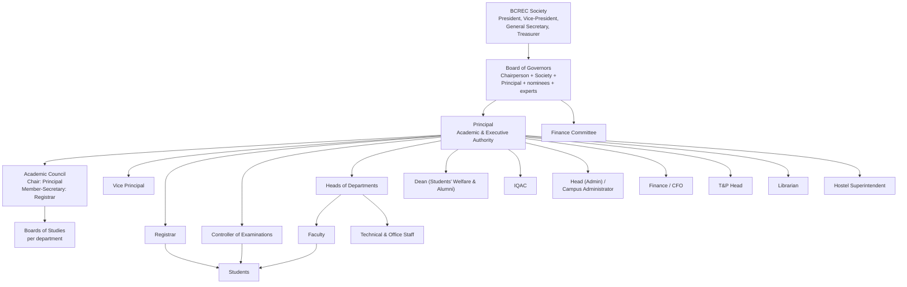

**Reading the diagram:** Solid lines are reporting or constitutional links evidenced by the organogram and orders [S4][S6][S7][S8]. They do not imply that every decision flows downward; the Academic Council and BOG have collective authority. The diagram is deliberately role-based, not person-based.

---

## 7. Role and responsibility model

### 7.1 Why role assignments, not fixed user types

A conventional ERP creates user types such as `student`, `faculty`, `admin`, `accountant`. BCREC's own orders show why that fails:

- The **Principal** is simultaneously the chair of the Academic Council, Member-Secretary of the BOG, chair of the Examination Committee, and chair of the Disciplinary Committee [S3 §5.5][S7][S8][S11].
- The **Registrar** is a BOG member, Member-Secretary of the Academic Council, and a member of the Examination Committee [S6][S7][S8].
- The **COE** is an Associate Professor in BS&H, a teacher representative on the Academic Council, and Member-Secretary of the Examination Committee [S7][S8][S19].
- The **HOD (Civil)** is also the IQAC Coordinator and an Examination Committee member [S7][S8].
- The **T&P Incharge** is an Assistant Professor in IT and a teacher representative on the Academic Council [S7].
- A **Society General Secretary** is a BOG member and an IQAC management member [S6][S12].

A person therefore needs **multiple concurrent role assignments**, each with:

- a role definition;
- a scope (institution, department, programme, batch, semester, course offering, committee);
- a validity period;
- an appointing authority and source order;
- a status (active, suspended, expired, delegated);
- an optional delegation (from whom, until when, with what limits).

### 7.2 Role catalogue

The following roles are evidenced by BCREC documents. The list is not exhaustive; it is the minimum needed for the initial academic ERP.

#### Governance roles

| Role | Scope | Core responsibilities | Evidence |
|---|---|---|---|
| Society office-bearer | Society | Sponsoring body governance | [S5] |
| BOG Chairperson | Institution | Chairs BOG | [S6] |
| BOG Member | Institution | Approves policy, appointments, finances | [S6] |
| BOG Secretary | Institution | Agenda and minutes; Principal acts as Member-Secretary | [S3 §5.5.7] |
| Academic Council Chair | Institution | Chairs Academic Council | [S3 §5.5.6] |
| Academic Council Member | Institution | Approves curriculum, examination standards, condonation | [S7][S19] |
| Academic Council Member-Secretary | Institution | Records and convenes | [S7] |
| Board of Studies Chair/Member | Department | Curriculum recommendations | [S16 §12][S20] |
| Finance Committee Member | Institution | Financial oversight | [S16 §12.1] |

#### Executive and administrative roles

| Role | Scope | Core responsibilities | Evidence |
|---|---|---|---|
| Principal | Institution | Academic and executive authority; discipline; compliance; appointments; oversight | [S3 §5.5] |
| Vice Principal | Institution | Supports Principal; academic and examination committees | [S7][S8] |
| Registrar | Institution | Admissions, registration, records, scholarships, ID cards, non-teaching staff | [S3 §5.12.3] |
| Assistant Registrar | Institution | Registration and records support | [S4] |
| Controller of Examinations | Institution | Exam roll numbers, schedules, results, PPR, corrections | [S1 §§9.2.2, 23–24][S8][S19] |
| Deputy Controller of Examinations | Institution | Supports COE; exam coordination | [S8][S19] |
| Exam Coordinator | Department | Departmental exam coordination | [S19] |
| HOD | Department | Academic and administrative head; workload; attendance; mentoring; DAC | [S3 §5.6] |
| Dean (Students' Welfare & Alumni) | Institution | Student welfare, discipline, alumni | [S4][S11] |
| IQAC Coordinator | Institution | Quality assurance, AQAR, audits, feedback | [S12] |
| Head (Admin) | Institution | Administration, legal, transport, appointments | [S3 §5.13] |
| Campus Administrator | Campus | Campus operations, hostel, discipline | [S4][S11] |
| Finance Officer / CFO | Institution | Fees, accounts, financial control | [S8][S3 §5.12.3.13] |
| Purchase & Store Manager | Institution | Procurement and stores | [S4] |
| Librarian | Library | Library and book bank | [S4] |
| Hostel Superintendent | Hostel | Accommodation and hostel discipline | [S4][S11] |
| T&P Head/Incharge | Institution | Training, placement, employer relations | [S3 §5.15][S10] |
| PRO / PR Manager | Institution | Public relations and communication | [S4] |

#### Academic roles

| Role | Scope | Core responsibilities | Evidence |
|---|---|---|---|
| Professor | Department | Teaching, research, mentoring, academic leadership | [S3 §5.7] |
| Associate Professor | Department | Teaching, research, mentoring | [S3 §5.7] |
| Assistant Professor | Department | Teaching, assessment, mentoring, exam duties | [S3 §5.8] |
| Course Coordinator / Faculty-in-Charge | Course offering | CIA/PCIA, attendance, evaluation, remedial measures | [S1 §§16–19][S3 §5.8] |
| Mentor | Assigned group of students | Attendance, performance, attitude, counselling, parent contact | [S3 §§5.5.27, 5.6.29, 5.8.11][S12][S13] |
| Class Teacher | Class/section | Class-level academic coordination | [S13] (historical) |
| Class Representative | Class/section | Student representation; meets HOD twice per semester | [S3 §5.6.33] |
| Technical Assistant / Lab Instructor | Laboratory | Lab preparation, equipment, lab classes | [S3 §5.9] |
| Workshop Superintendent | Workshop | Workshop operations | [S3 §5.9] |
| External Examiner | Course/exam | External evaluation or viva | [S1 §19.4.5] |
| Invigilator | Exam hall | Examination conduct | [S1 §20][S3 §5.6.28] |

#### Student roles

| Role | Scope | Core responsibilities | Evidence |
|---|---|---|---|
| Student | Self | Attendance, assessments, registration, fees, conduct | [S1 §§9, 16–25] |
| Guardian/Parent | Student | Fee, consent, attendance communication | [S1 §9][S10] |
| Alumni | Self | Alumni association | [S4][S20] |

#### System roles (recommendation, not institutional)

| Role | Purpose |
|---|---|
| ERP Administrator | Configure institution, academic structure, integrations. Not an academic approver. |
| Data Steward | Maintain reference data and resolve duplicates. |
| Audit Reviewer | Read-only access to audit trails and reports. |
| CIP Content Curator | Approve documents for retrieval and citation. |
| CIP Operator | Monitor conversations, escalations, and unanswered questions. |
| Integration Service Account | Machine-to-machine sync; least privilege; no interactive login. |

### 7.3 Multi-role evidence

The following examples are drawn from official 2026 orders. They are included to show role overlap, not to publish a staff directory.

| Person (as named in the order) | Roles evidenced | Source |
|---|---|---|
| Prof. (Dr.) Arindam Mondal | Principal; Chairman, Examination Committee | [S8] |
| Prof. (Dr.) K. M. Hossain | Professor, ECE; Vice Principal; Academic Council member; BOG faculty representative | [S6][S7] |
| Prof. (Dr.) G. S. Panda | Registrar; Academic Council Member-Secretary; Examination Committee member | [S7][S8] |
| Dr. Subhashish Pal | Associate Professor, BS&H; COE; Academic Council teacher representative | [S7][S8][S19] |
| Dr. Falguni Chakraborty | Deputy COE; Examination Committee member | [S8][S19] |
| Prof. (Dr.) Sanjay Sengupta | HOD, Civil; IQAC Coordinator; Examination Committee member; BOG invitee | [S6][S7][S8] |
| Mr. Prabal Sahu | Assistant Professor, IT; T&P Incharge; Academic Council teacher representative | [S7] |
| Shri Tarun Bhattacharya | General Secretary, BCREC Society; BOG member; IQAC management member | [S5][S6][S12] |

**Design consequence:** `Person` and `RoleAssignment` must be separate entities. A role assignment must not be inferred permanently from a designation string. When a new order is issued, the old assignment is closed with an end date; history is retained.

### 7.4 Role assignment record (conceptual)

A role assignment should capture:

| Field | Why |
|---|---|
| `person_id` | Who holds the role. |
| `role_id` | What the role is. |
| `scope_type` + `scope_id` | Where the role applies (institution, department, programme, batch, course offering, committee, hostel). |
| `starts_at`, `ends_at` | Validity. |
| `status` | Active, suspended, expired, revoked. |
| `appointing_authority` | Who appointed (BOG, Principal, Society, MAKAUT). |
| `source_document_id` | The order or letter that evidences the appointment. |
| `delegated_from_assignment_id` | If the authority is delegated. |
| `delegation_limits` | What may be approved, up to what value or scope. |
| `created_by`, `approved_by` | Audit. |

### 7.5 Separation of duties

The following separations are recommended because the documents imply independent checks:

1. **Marks entry vs result approval.** A faculty member enters marks; the COE (or a designated moderation committee) approves publication. A faculty member must not publish a final result unilaterally [Recommendation, consistent with S1 §§23–24 and S8].
2. **Correction affidavit vs correction approval.** The examiner submits the affidavit; the COE verifies and processes the correction [S1 §23].
3. **PPR evaluation vs original evaluation.** The reviewer must not be the original evaluator [S1 §24.4].
4. **Attendance condonation vs attendance recording.** Faculty records; HOD verifies; Academic Council condones [S1 §16.2].
5. **Fee collection vs result eligibility.** Finance confirms dues; COE/Examination Section confirms examination eligibility. The exact rule that links dues to eligibility is not stated in the Academic Regulations [Gap G-08].
6. **Role assignment vs academic approval.** An ERP administrator may create a role assignment only with an approved source order; the administrator must not be able to grant themselves academic authority [Recommendation].

### 7.6 Recommended role-responsibility matrix

This matrix is a **design model**, not an institutional order. It translates the duties in the Service Rules, Academic Regulations, and committee orders into a RACI pattern. A = accountable (one per activity), R = responsible (does the work), C = consulted, I = informed. Where a document does not name the accountable role, the matrix marks the closest evidenced role and flags it.

| Activity | Principal | Vice Principal | Registrar | COE | HOD | Faculty | Mentor | Finance | IQAC | Academic Council | BoS | T&P |
|---|---|---|---|---|---|---|---|---|---|---|---|---|
| Curriculum and syllabus approval | C | I | I | C | R | C | — | — | C | A | R | — |
| Course allocation and timetable | I | C | C | C | A/R | C | — | — | — | I | — | — |
| Attendance recording | I | — | I | C | A | R | C | — | — | I | — | — |
| Attendance condonation | I | — | R | I | C | — | — | — | — | A | — | — |
| CIA/PCIA conduct | I | — | — | C | A | R | — | — | C | I | — | — |
| Internal marks submission | I | — | — | C | A | R | — | — | — | I | — | — |
| Result approval and publication | A | C | I | R | C | — | — | — | — | C | — | — |
| PPR and correction | I | — | I | A/R | C | C | — | C | — | I | — | — |
| Promotion decision | A | — | R | C | C | — | — | — | — | I | — | — |
| Degree recommendation | A | — | R | C | C | — | — | C | — | I | — | — |
| Discipline | A | C | C | — | C | C | C | — | — | — | — | — |
| Placement | A | — | I | — | C | C | C | — | — | — | — | R |
| Notice publication | A | C | C | C | R | — | — | C | — | I | — | — |
| Fee collection and dues | A | — | C | C | — | — | — | R | — | — | — | — |
| Mentoring | I | — | — | — | A | C | R | — | C | — | — | — |
| Accreditation and quality data | A | — | C | C | C | C | — | — | R | C | — | — |

**How to use it:** The matrix is a starting point for access-control design and for asking the institution "who is accountable here?" It must not be treated as approved until the Principal and Registrar sign it. Two rows are especially uncertain: **result approval** (G-12) and **notice publication** (G-19).

---

## 8. Student lifecycle and academic workflows

The workflows below reconstruct what the documents say must happen. Where a step is implied by a document but its actor or approval is not stated, the step is marked **[Gap]** or **[Recommendation]**. The diagrams are not screenshots of the college ERP; they are models built from the Academic Regulations, the academic calendar, the notice list, and the committee orders.

### 8.1 Lifecycle at a glance

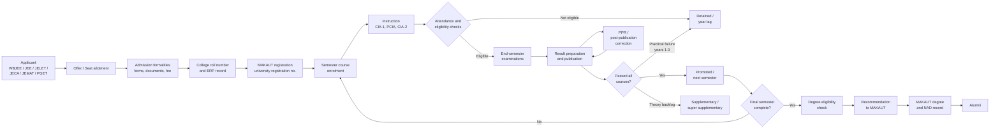

**Note:** The loop from result to supplementary to result is real and iterative. A student can carry theory backlogs across semesters while being promoted [S1 §18.1.1]. The diagram therefore does not treat "pass" as a single event.

### 8.2 Admission and registration

The Academic Regulations describe a seven-step admission workflow plus university registration and roll-number generation [S1 §9].

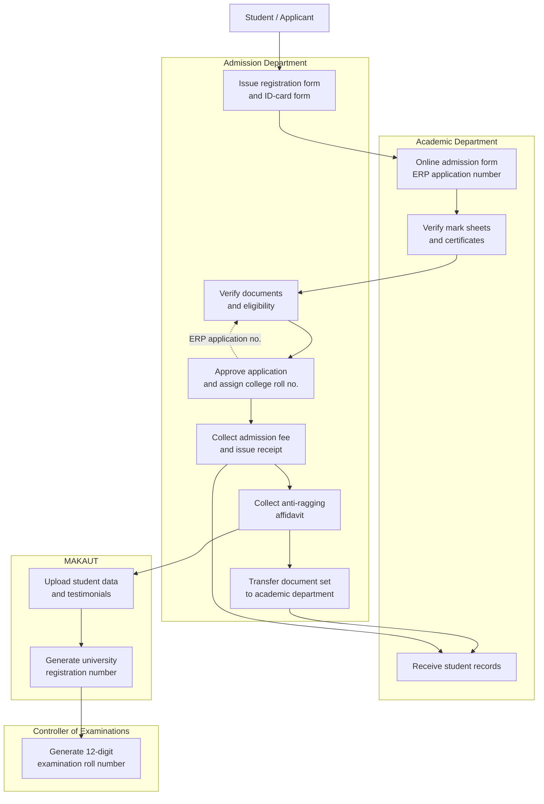

**Evidence and qualifications**

- The Academic Regulations describe the sequence, but they do not name the approving officer for admission, the fee-refund policy, or the document-retention period [Gap G-11].
- The 12-digit examination roll number format is explicitly documented: 3-digit college code (`120`), 3-digit programme code, 2-digit registration year, 1-digit course duration, 3-digit serial [S1 §9.2.2]. Example: `120001244001`.
- University registration is performed by uploading data to the MAKAUT portal; MAKAUT generates the registration number [S1 §9.2.1][S18]. BCREC notices repeatedly close registration windows, which confirms that registration is a time-bound annual operation, not a one-time attribute [S20].
- From the second semester onward, a student must submit a course enrolment/registration form before each semester [S1 §9.2.3]. Registration is linked to academic and financial prerequisites, but the exact prerequisite rules are not stated [Gap G-08].
- Anti-ragging affidavits are collected at admission [S1 §9.1 Step 4]. This is a UGC compliance requirement, not a BCREC invention.

### 8.3 The semester cycle

BCREC's provisional academic calendar for 2026-27 gives the operational dates [S9]:

| Activity | Odd semester 2026-27 | Even semester 2026-27 |
|---|---|---|
| Commencement | 03.08.2026 | 06.01.2027 |
| CIA-1 marks submission (assessment and display before this date) | 16.09.2026 | 02.03.2027 |
| PCIA marks submission | 05.11.2026 | 03.05.2027 |
| CIA-2 marks submission | 18.11.2026 | 06.05.2027 |
| Pre-examination activities (form fill-up and verification) | 23.11.2026 – 30.11.2026 | 11.05.2027 – 21.05.2027 |
| Tentative theory/practical/sessional examinations | Not reliably reconstructed from the OCR'd calendar; the source gives 17.09.2026, 06.11.2026, 19.11.2026, 25.11.2026, and 24.12.2026 as an unordered date set | Not reliably reconstructed; the source gives 07.05.2027 and 20.06.2027 among an unordered date set |

The calendar also carries MAR and MOOC submission windows for both semesters. Their column order was not reliably reconstructed from the scan, so they are not reproduced here; the academic section must supply them as data.

**Caution:** The table above reproduces the OCR'd calendar. The OCR separated activity labels from their date columns, so the examination-window cells could not be reconstructed reliably and are left unreconstructed rather than guessed. Several dates also appear out of chronological order relative to the activity labels, which is a further reason not to treat them as confirmed. The calendar is explicitly provisional and "may be subject to change" [S9]. The ERP must store dates as data with version history, not as constants, and the academic section must supply the authoritative calendar.

The Academic Regulations describe the semester as **21 weeks: 18 weeks of instruction plus 3 weeks of examinations**, with a minimum of 90 working days, odd semester from July and even semester from January [S1 §2.3.2]. The 2026-27 calendar's odd semester runs 03.08.2026 to 24.12.2026 (about 20.5 weeks), consistent with the regulation.

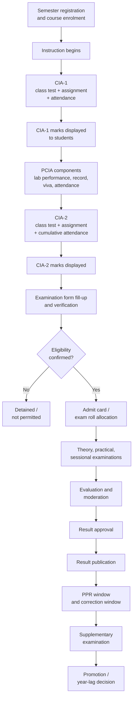

**Gap:** The regulations describe CIA-1, CIA-2, PCIA, and ESE, but they do not define the moderation procedure, the result-approval signatory, or the timetable for result publication [Gap G-12]. The Examination Committee order shows that the Principal chairs the committee and the COE is Member-Secretary [S8], which implies approval at committee level, but no signed approval workflow was located.

### 8.4 Attendance workflow

Attendance is the most consequential and least settled rule in the documents. BCREC's Academic Regulations require **75% aggregate attendance across all courses** for end-semester eligibility, allow condonation of 65%–75% only by the Academic Council, and forbid condonation below 65% [S1 §16]. The BCREC Prospectus 2026 states **75% separately in theory and practical**, attributed to MAKAUT [S2 p.55]. MAKAUT's notification of 20 August 2026 requires regular attendance but does not state the split [S17].

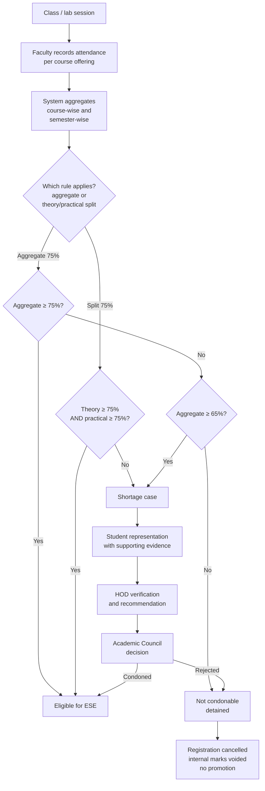

**Design warning:** Automating either variant without an Academic Council decision would create a rule that the institution has not actually chosen. Both variants must be representable as policy versions, and the system must record which version was applied to which student and semester [Recommendation].

**Attendance data granularity:** The regulations require course-wise attendance and use attendance as a 5-mark CIA component and a 10-mark PCIA component with an explicit percentage-to-mark table [S1 §19.1.1, §19.2.1.5]. The system therefore needs session-level or at least course-week-level records, not only a semester percentage. The documents do not prescribe a biometric or app-based capture method [Gap G-13].

**Duty leave and special leave:** The service rules and prospectus mention duty leave and special leave in other contexts, but the Academic Regulations do not define how duty leave affects the 75% calculation [Gap G-14]. A CIP answer that asserts a rule here would be inventing policy.

### 8.5 Internal assessment (CIA and PCIA)

| Component | Marks | Sub-components | Evidence |
|---|---|---|---|
| CIA-1 (theory) | 40 | Class test 25, assignment/task 10, attendance 5 | [S1 §19.1.1] |
| CIA-2 (theory) | 40 | Class test 25, assignment/task 10, attendance 5 | [S1 §19.1.1] |
| ESE (theory) | 60 | Written examination, 3 hours | [S1 §19.1.2] |
| PCIA (practical) | 60 | Lab performance 20, experiment execution 15, record/report 10, viva/quiz 5, attendance 10 | [S1 §19.2.1] |
| PESE (practical) | 40 | Write-up 10, execution 10, result evaluation 10, viva 10 | [S1 §19.2.2] |

**Weightage:** Theory is 40% CIA + 60% ESE. Practical is 60% PCIA + 40% PESE [S1 §19].

**Conflict of interest:** A faculty member with a ward or close relative enrolled in a subject must declare the relationship in writing to the HOD at the start of the semester and is excluded from assessing that subject [S1 §19]. This is a real workflow requirement and an access-control rule, not merely an ethical statement.

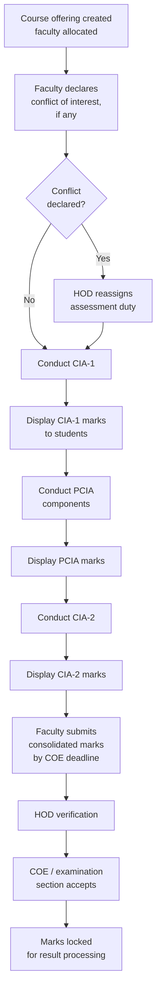

**Make-up assessments:** A student who misses CIA-1 or CIA-2 for a genuine reason may apply to the HOD or Principal with documents; if approved, a make-up test or assignment is arranged before the semester examinations. Without a valid reason, the marks are forfeited [S1 §19.1.1]. This needs a formal exception workflow with evidence and approval.

**Remedial and reassessment:** If a student scores below 40% in CIA, the course coordinator implements remedial measures and reassesses [S1 §17.1.1]. For practical PCIA below 50%, remedial tasks and reassessment follow [S1 §17.2.1]. The regulations do not cap the number of reassessments or specify who approves the final CIA mark after reassessment [Gap G-15].

### 8.6 End-semester examination and results

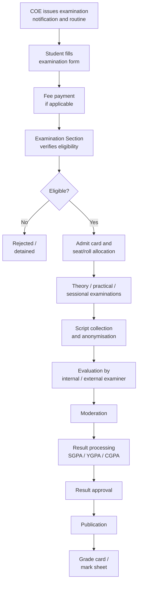

**Result statuses:** `X` = not eligible for promotion/degree; `XP` = eligible for promotion with backlogs; `P` = passed and promoted [S1 §22.5.1].

**Grading:** Seven-point scale O (10), E (9), A (8), B (7), C (6), D (5), F (2), plus provisional `I` (2) [S1 §22.1–22.2]. Grade-point to percentage conversion uses `(CGPA − 0.75) × 10` [S1 §22.5].

**Gap — result approval authority:** The Academic Regulations say results are published by the institution and the COE administers PPR and corrections [S1 §§23–24]. The Examination Committee order shows the Principal as chair and the COE as Member-Secretary [S8]. But no document states who signs the final result sheet or whether the Academic Council ratifies results. This must be confirmed before building an approval chain [Gap G-12].

**Gap — external examiners:** Practical ESE is conducted by the laboratory faculty in the presence of an external examiner appointed by the Principal from a panel of three recommended by the HOD [S1 §19.2.2]. Theory ESE examiner appointment is not described in the extracted text [Gap G-16].

### 8.7 Post-publication review and correction

Two different mechanisms exist and must not be conflated.

```mermaid
flowchart TD
    subgraph CORR["Post-publication amendment (error by examiner)"]
        C1["Error identified"] --> C2["Examiner informs COE"]
        C2 --> C3["Examiner executes affidavit<br/>before Judicial Magistrate<br/>on Rs.100+ stamp paper"]
        C3 --> C4["Submit to COE within<br/>7 working days of publication"]
        C4 --> C5["COE verifies"]
        C5 --> C6["Result corrected"]
    end
    subgraph PPR["Post Publication Review (student request)"]
        P1["COE issues PPR notification"] --> P2["Student applies online<br/>and pays non-refundable fee"]
        P2 --> P3["Application scrutinised"]
        P3 --> P4["Fresh re-evaluation by<br/>faculty who is not the<br/>original evaluator"]
        P4 --> P5["Revised result<br/>communicated"]
        P5 --> P6["Final and binding"]
    end
```

| Aspect | Post-publication amendment | PPR |
|---|---|---|
| Trigger | Incorrect or erroneous marks entry by examiner | Student dissatisfaction with evaluation |
| Who initiates | Examiner | Student |
| Scope | Any result error | Theory papers only |
| Evidence | Affidavit before Judicial Magistrate, ₹100+ stamp paper | Online application, prescribed fee |
| Deadline | 7 working days from publication | Window specified in COE notification |
| Decision | COE verifies and corrects | Re-evaluator; outcome final and binding |
| Source | [S1 §23] | [S1 §24] |

**Design note:** The amendment path is an examiner-initiated integrity process; the PPR path is a student-initiated grievance process. They need separate case types, separate permissions, and separate audit trails [Recommendation]. The PPR fee is non-refundable; the regulations do not say whether the fee is refunded if marks change [Gap G-17].

### 8.8 Promotion, supplementary examinations, and award

**Promotion:** A student may be promoted with backlogs if they clear them within the course-completion time limit, calculated as `2n + 1` years (9 years for B.Tech, 5 years for M.Tech/MBA/MCA) [S1 §18.1.1, §18.1.3]. Disciplinary violations can block promotion and are reviewed by the disciplinary committee [S1 §18.1.2].

**Practical failure — year lag:** A student in years 1–3 who scores below 50% in PESE must repeat the academic year, re-register for all courses of both semesters, attend fully, complete remedial work, and undergo all assessments afresh [S1 §17.2.3]. This is a severe consequence and is easy to model incorrectly if practical and theory rules are merged.

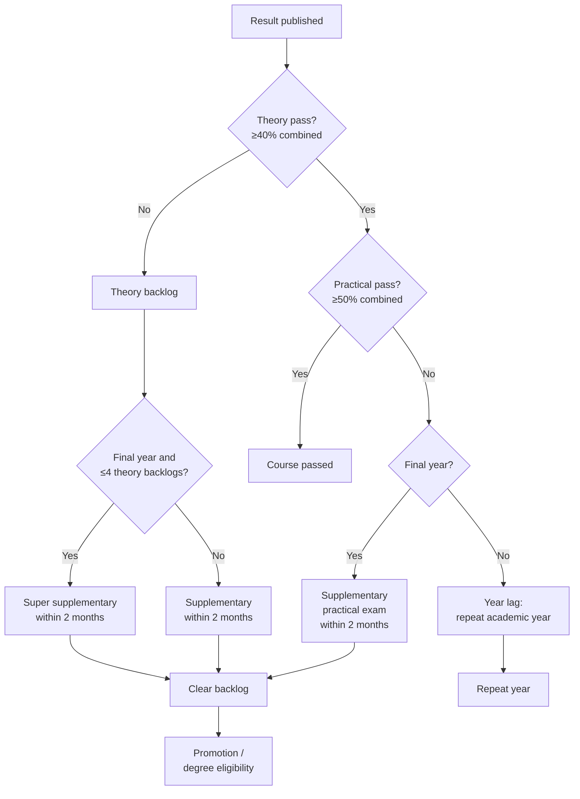

**Degree eligibility:** The regulations require at least a D grade in each theory course and a C grade in each practical/sessional course, a minimum CGPA of 6.0, completion of mandatory non-credit courses as "Satisfactory", and no F or I grade in any course [S1 §§19.3, 20.3, 22.2]. MAR points (100 for regular, 75 for lateral entry) are also required for B.Tech [S1 §17.3].

**Award:** BCREC recommends; MAKAUT awards the degree with the college's name on the certificate [S16 §3.4][S1 §3.4]. BCREC issues grade cards, transcripts, and provisional degree certificates [S1 §3.4]. MAKAUT makes degree certificates and mark sheets available on the National Academic Depository [S20].

### 8.9 Mentoring and student support

Mentoring is a documented duty rather than a formal regulation:

- The Principal oversees faculty counselling activities as mentors and compliance [S3 §5.5.27].
- The HOD guides faculty in counselling activities as mentors [S3 §5.6.29].
- Assistant Professors guide students through counselling activities [S3 §5.8.11].
- The IQAC composition document (historical) describes mentor–mentee systems and parent interaction as quality practices [S12].
- The prospectus advertises continuous mentoring and career counselling [S2].

**Gap:** No document located specifies mentor-to-student ratio, meeting frequency, record format, escalation thresholds, or confidentiality rules [Gap G-18]. A CIP must not assert these. The ERP can store mentor allocation, meeting notes, flags, and referrals, but the cadence must be configured by the institution.

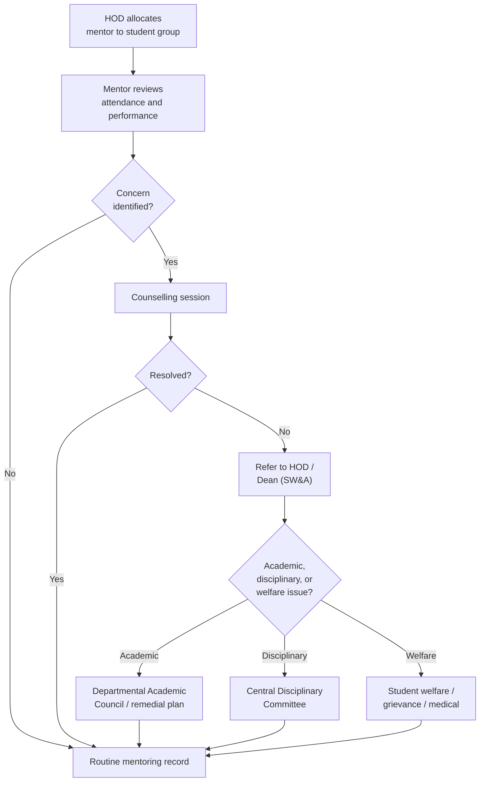

### 8.10 Departmental governance

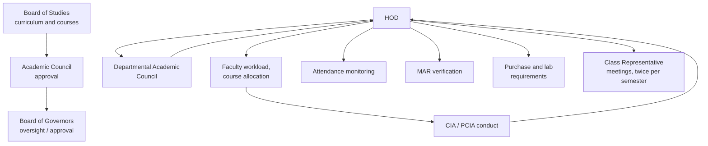

**HOD duties** include administering the department, holding classes regularly, convening the Departmental Academic Council, informing parents/guardians about attendance and performance, conducting class tests and assignment schedules, encouraging MOOCs, participating in anti-ragging and disciplinary committees, and guiding mentors [S3 §5.6]. The HOD must ensure at least two class-representative meetings per semester [S3 §5.6.33].

**Workload:** 40 working hours per week; teaching contact hours are Principal 4, Professor 8, Associate Professor 12, Assistant Professor 16 per week. Two tutorial or two laboratory hours count as one teaching hour [S3 §5.4]. Work distribution is Principal 10% teaching/30% R&D/60% administrative; HOD 30/30/40; Professor 30/40/30; Associate Professor 40/40/20; Assistant Professor 50/30/20 [S3 §5.4.4]. These are configurable workload rules, not attendance rules.

### 8.11 Notice and communication workflow

BCREC publishes notices through a public notice list with individual notice pages and PDF downloads [S20]. Between 2023 and 2026 the list contains over 400 notices. The observed notice types include:

| Notice type | Examples observed | Implied owner |
|---|---|---|
| Academic calendar | Provisional academic calendar under autonomy | COE / Principal |
| Class routine | First/third/fifth/seventh semester routines, revised routines | HOD / timetable committee |
| Examination | Form fill-up, routine, results, supplementary, PPR | COE |
| Registration and enrolment | University registration closing, course enrolment | Registrar |
| Fee | Semester fee, examination fee, backlog fee, late-fee extension | Finance |
| Scholarship | SVMCM, WBFS, AIKYASHREE, NSP, AICTE schemes | Registrar / scholarship cell |
| Holiday and working day | Holiday notices, rescheduled holidays, working Saturdays | Principal / HR |
| Admission and counselling | WBJEE rounds, decentralised counselling, offer letters | Admission cell |
| Recruitment and tender | Faculty recruitment, tenders, quotations | HR / purchase |
| Student services | Book distribution, library cards, hostel, transport | Librarian / hostel / admin |
| Events and sports | Tech fest, cultural fest, sports, orientation | Respective committees |
| Discipline and compliance | Anti-ragging committee order, attendance directives | Principal |

**Gap — approval workflow:** No published document states who drafts, verifies, approves, and publishes a notice, or who may issue a corrigendum [Gap G-19]. The notice list shows corrigenda and revised notices ("Revised Notice", "Corrigendum", "Extension"), which proves that versioning is an operational reality even though the approval path is undocumented.

**Recommended notice lifecycle (not an institutional rule):**

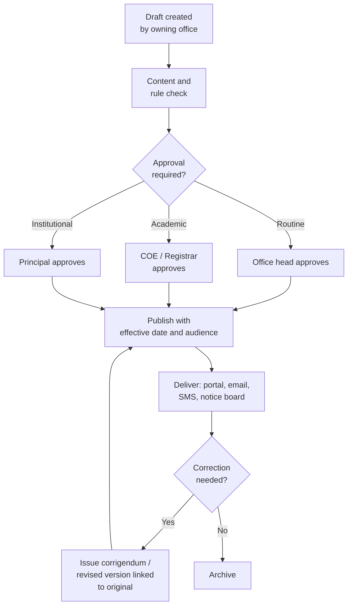

**CIP consequence:** Every notice used for retrieval must carry its publication date, effective date, audience, issuing office, version, and supersession link. A notice about the 2025-26 examination fee must never be retrieved as if it applied to 2026-27 [Recommendation].

### 8.12 Discipline

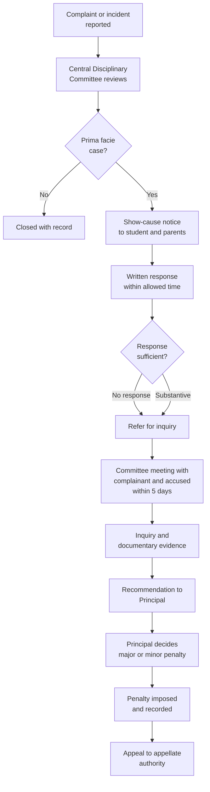

**Committee composition:** Principal (Chairman), Vice-Principal, Registrar, Dean (Students' Welfare & Alumni), Campus Administrator, HODs, Hostel Superintendents, and faculty representatives from each branch. No inquiry may be conducted by fewer than half the committee members [S11 §4].

**Penalties:** Major misconduct can lead to warning, parent call, suspension, expulsion with year lag, scholarship withdrawal, fine of ₹20,000–25,000, local administration involvement, or rustication with information to the university. Minor misconduct can lead to warning, parent call, hostel expulsion, deferral from examination for one semester, debarment from internal tests, debarment from office, daily reporting to mentor/HOD, or fines of ₹5,000–15,000 [S11 §6].

**Anomaly to resolve:** The document says a student may appeal to the "Appellate Authority of the Institute i.e. Principal" [S11], while the Principal also decides the penalty as chair of the committee. That concentrates first-instance and appellate authority in one office. Whether a separate appellate authority exists should be confirmed [Gap G-20]. The design should support an appeal body distinct from the deciding authority even if the institution currently names the Principal.

### 8.13 Training and placement

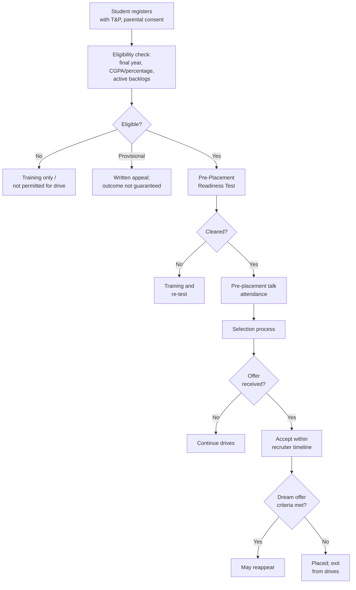

**Eligibility:** Final-year students of the branch; CGPA 6.75 or 60% with no active backlogs unless the recruiter explicitly allows; training attendance as mandated; clearance of the Pre-Placement Readiness Test [S10]. Students with active backlogs must still attend training. Provisional eligibility may be granted pending revaluation, subject to written appeal, but the student bears the outcome [S10].

**Conduct rules:** Missing two registered drives without valid reason, falsifying résumé/LinkedIn/GitHub information, misconduct in selection, contacting recruiters without authorisation, unprofessional dress, or resigning post-acceptance without due process can attract disciplinary action. Offers must be accepted within the recruiter's timeline, with digital confirmation to the T&P Cell [S10].

**Dream offer clause:** Reappearance is allowed only if the first offer's CTC qualifies or the offer is from a core-domain company aligned with the branch. Students placed below the minimum LPA may continue until a higher CTC or dream offer [S10].

**Gap:** The placement policy is issued for the "Dr. B. C. Roy Society" and covers B.Tech, MBA, and MCA [S10]. Its date and approval authority are not visible in the OCR'd copy [Gap G-21]. The minimum LPA is stated to differ by course and institute but the values are not in the extracted text.

### 8.14 Fee and scholarship touchpoints

Fees are not merely a finance concern; they gate registration, examination form fill-up, and clearance:

- The B.Tech fee structure itemises tuition, development, examination, library, student welfare, training, admission, caution money, MAKAUT student development fund, MAKAUT registration fee, prospectus, MAKAUT degree certificate, dress kit, and hostel charges [S23].
- Notices repeatedly set and extend semester-fee deadlines and warn about late fees [S20].
- A notice specifically covers "Payment of Fees for Appearing in Semester End Examinations" [S20], and another covers backlog examination fees for MAKAUT students but not the autonomous batch from 2024-25 [S20].
- Scholarships include AICTE TFW, WBFS, Swami Vivekananda Merit-cum-Means, AIKYASHREE, SVMCM, NSP minority/SC/ST/OBC schemes, and institutional MBA tuition waivers and PG stipends [S22][S20].

**Gap:** The Academic Regulations mention financial prerequisites for semester registration but do not state whether unpaid dues bar examination eligibility, and if so under what policy [Gap G-08]. The notices imply a link but do not establish a rule. The ERP should model fee status as a separate fact and let the institution configure whether it is a hard gate [Recommendation].

### 8.15 Workflow evidence summary

| Workflow | Evidence strength | What is missing |
|---|---|---|
| Admission | Strong sequence, weak actor mapping | Approving officer, refund policy, retention |
| University registration | Strong | Portal API/export format, error handling |
| Semester enrolment | Strong | Prerequisite and fee-gate rules |
| Attendance | Strong rule, conflicting variants | Split vs aggregate, duty leave treatment |
| CIA/PCIA | Strong | Moderation, reassessment cap, approval |
| ESE and results | Moderate | Result approval signatory, examiner appointment |
| PPR/correction | Strong | Fee refund, correction propagation to MAKAUT |
| Promotion | Moderate | Batch-specific variation, disciplinary interplay |
| Mentoring | Weak | Ratio, cadence, record format, confidentiality |
| Departmental governance | Moderate | DAC composition and quorum |
| Notice | Observed practice only | Approval matrix, corrigendum authority |
| Discipline | Strong | Appellate authority separation |
| Placement | Strong policy, unknown date | Approval date, minimum LPA values |
| Fee/scholarship | Observed practice only | Eligibility gates, refund rules |

---

## 9. Rule repository

### 9.1 Rule record model

A rule must be stored as a record, not as a literal in application code. The minimum fields are:

| Field | Purpose |
|---|---|
| `rule_id` | Stable identifier. Never reused. |
| `rule_code` | Human-readable code such as `ATT-01`. |
| `title` | Short name. |
| `statement` | The rule in plain language. |
| `parameters` | Structured values (thresholds, marks, durations). |
| `scope` | Institution, programme, batch, semester, course type, student category. |
| `authority` | Who made the rule: BCREC Academic Council, BCREC BOG, MAKAUT, UGC, AICTE, State. |
| `source_id` | Link to the source register entry. |
| `source_locator` | Section, clause, page, or paragraph. |
| `effective_from`, `effective_to` | Validity window. |
| `status` | Current, Draft, Historical, Superseded, Disputed, Unknown. |
| `confidence` | High, Medium, Low, with reason. |
| `supersedes` / `superseded_by` | Version chain. |
| `conflict_notes` | Competing rule and why it conflicts. |
| `applies_to_batches` | Admissions affected. |
| `approval_record` | Order number, meeting date, resolution. |

### 9.2 Admission and registration rules

| ID | Rule | Value / parameter | Scope | Authority | Source | Effective | Status | Confidence |
|---|---|---|---|---|---|---|---|---|
| ADM-01 | B.Tech admission routes | JEE Main or WBJEE; JELET for lateral entry | UG | State counselling + BCREC | S1 §8.1.2.1 | Current | Current | High |
| ADM-02 | B.Tech eligibility | 10+2 with Physics, Mathematics, and one of Chemistry/Biology/Biotechnology/Computer Science/Computer Application/Technical Vocational; individual pass in all three; English ≥30%; aggregate ≥45% (40% for SC/ST/OBC-A/OBC-B/PWD) | UG | BCREC | S1 §8.1.1 | Current | Draft | High for text, Medium for currency |
| ADM-03 | MCA eligibility | BCA or bachelor's degree in computer science engineering | PG | BCREC | S1 §8.3.1.1 | Current | Draft | Medium |
| ADM-04 | Admission workflow | 7 steps: forms, online form and ERP number, approval/roll/fee, anti-ragging affidavit, uniform, document transfer, classes | Institution | BCREC | S1 §9.1 | Current | Draft | High |
| REG-01 | College code | `120` | Institution | MAKAUT / BCREC | S14; S1 §9.2.2 | Current | Current | High |
| REG-02 | Examination roll format | 12 digits: 3 college + 3 programme + 2 year + 1 duration + 3 serial | Institution | COE | S1 §9.2.2 | Current | Draft | High |
| REG-03 | University registration | Student data uploaded to MAKAUT portal; MAKAUT generates registration number | Institution / university | MAKAUT | S1 §9.2.1; S18 | Current | Current | High |
| REG-04 | Semester enrolment | Mandatory from second semester before semester commencement | Institution | BCREC | S1 §9.2.3 | Current | Draft | High |
| REG-05 | Registration prerequisites | "Academic and financial prerequisites" must be fulfilled | Institution | BCREC | S1 §9.2.3.1(c) | Current | Draft | Low — parameters not stated |

### 9.3 Attendance rules

| ID | Rule | Value / parameter | Scope | Authority | Source | Effective | Status | Confidence |
|---|---|---|---|---|---|---|---|---|
| ATT-01 | Minimum attendance for ESE eligibility | 75% aggregate across all courses, including mandatory courses | All programmes | BCREC Academic Council | S1 §16.1 | 2024-25 | Draft | High text, Medium currency |
| ATT-02 | Condonation band | 65% to below 75% may be condoned by Academic Council on representation with evidence and genuine grounds | All programmes | BCREC Academic Council | S1 §16.2 | 2024-25 | Draft | High |
| ATT-03 | Absolute floor | Below 65% shall not be condoned under any circumstances | All programmes | BCREC Academic Council | S1 §16.3 | 2024-25 | Draft | High |
| ATT-04 | Consequence of uncondoned shortage | Not eligible for ESE; detained; semester registration cancelled; internal marks voided; not promoted | All programmes | BCREC | S1 §16.4 | 2024-25 | Draft | High |
| ATT-05 | Separate theory and practical attendance | 75% separately in theory and practical, attributed to MAKAUT | All programmes | BCREC prospectus (claims MAKAUT) | S2 p.55 | 2026 | **Disputed** | Medium |
| ATT-06 | Attendance marks in CIA | 5 marks per CIA (CIA-1 and CIA-2), cumulative for CIA-2 | Theory | BCREC | S1 §19.1.1 | 2024-25 | Draft | High |
| ATT-07 | Attendance marks in PCIA | 10 marks, mapped from ≥95% = 10 down to <65% = 0 | Practical | BCREC | S1 §19.2.1.5 | 2024-25 | Draft | High |
| ATT-08 | University attendance directive | Regular attendance by teachers, officers, staff, and students; defers threshold to applicable norms | Institution | MAKAUT | S17 | 20-08-2026 | Current | High |

**Conflict ATT-01 vs ATT-05:** Both are published by BCREC in 2026. ATT-01 is in the Academic Regulations; ATT-05 is in the Prospectus and attributes the split to MAKAUT. MAKAUT's August 2026 notification does not state the split. Until the Academic Council resolves it, the system must support both variants and record which was applied.

### 9.4 Assessment rules

| ID | Rule | Value / parameter | Scope | Authority | Source | Effective | Status | Confidence |
|---|---|---|---|---|---|---|---|---|
| ASS-01 | Theory weightage | CIA 40 + ESE 60 = 100 | Theory courses | BCREC | S1 §19 | 2024-25 | Draft | High |
| ASS-02 | Practical weightage | PCIA 60 + PESE 40 = 100 | Laboratory courses | BCREC | S1 §19 | 2024-25 | Draft | High |
| ASS-03 | CIA components | Class test 25 + assignment 10 + attendance 5 = 40 per CIA | Theory | BCREC | S1 §19.1.1 | 2024-25 | Draft | High |
| ASS-04 | PCIA components | Lab performance 20 + experiment execution 15 + record 10 + viva 5 + attendance 10 = 60 | Practical | BCREC | S1 §19.2.1 | 2024-25 | Draft | High |
| ASS-05 | PESE components | Write-up 10 + execution 10 + result evaluation 10 + viva 10 = 40 | Practical | BCREC | S1 §19.2.2 | 2024-25 | Draft | High |
| ASS-06 | CIA timing | CIA-1 near mid-semester; CIA-2 near end; CIA-2 attendance cumulative | Theory | BCREC | S1 §19.1.1 | 2024-25 | Draft | High |
| ASS-07 | Make-up assessment | Apply to HOD/Principal with documents; approved make-up before semester exams; otherwise marks forfeited | All | BCREC | S1 §19.1.1 | 2024-25 | Draft | High |
| ASS-08 | Remedial reassessment | CIA below 40% or PCIA below 50% triggers remedial measures and reassessment | All | BCREC | S1 §17.1.1, §17.2.1 | 2024-25 | Draft | High |
| ASS-09 | Conflict of interest | Faculty with ward/close relative in a subject must declare to HOD at semester start and be excluded from assessment | All | BCREC | S1 §19 | 2024-25 | Draft | High |
| ASS-10 | ESE theory duration | 3 hours, 60 marks | Theory | BCREC | S1 §19.1.2 | 2024-25 | Draft | High |
| ASS-11 | External examiner for practical ESE | Principal appoints from panel of three recommended by HOD; exam conducted by lab faculty with external examiner present | Practical | BCREC / Principal | S1 §19.2.2 | 2024-25 | Draft | High |
| ASS-12 | CO attainment | Direct 80% + indirect 20%; 5–6 COs per course mapped to Bloom levels | All | BCREC (NBA practice) | S1 §19.1.3 | 2024-25 | Draft | Medium — "for demonstration" |
| ASS-13 | Mandatory non-credit courses | Satisfactory / Not Satisfactory; passing mandatory for degree; no grades | All | BCREC | S1 §19.3 | 2024-25 | Draft | High |

### 9.5 Passing and grading rules

| ID | Rule | Value / parameter | Scope | Authority | Source | Effective | Status | Confidence |
|---|---|---|---|---|---|---|---|---|
| PAS-01 | Theory pass | ≥40% combined CIA + ESE | Theory | BCREC | S1 §20.1 | 2024-25 | Draft | High |
| PAS-02 | Laboratory pass | ≥50% combined PCIA + PESE | Practical | BCREC | S1 §20.2 | 2024-25 | Draft | High |
| PAS-03 | Programme pass | At least D in each theory; C in each practical/sessional; CGPA ≥6.0 | All programmes | BCREC / AICTE | S1 §20.3 | 2024-25 | Draft | High |
| PAS-04 | No unresolved grades | No F or I grade may remain for degree completion | All programmes | BCREC | S1 §22.2 | 2024-25 | Draft | High |
| GRD-01 | Grading scale | O 90–100 (10), E 80–89 (9), A 70–79 (8), B 60–69 (7), C 50–59 (6), D 40–49 (5), F <40 (2) | All | BCREC | S1 §22.1 | 2024-25 | Draft | High |
| GRD-02 | Incomplete grade | `I` with grade point 2; converted when assessment completed | All | BCREC | S1 §22.2 | 2024-25 | Draft | High |
| GRD-03 | Percentage conversion | `(SGPA/YGPA/CGPA − 0.75) × 10` | All | BCREC | S1 §22.5 | 2024-25 | Draft | High |
| GRD-04 | SGPA/YGPA/CGPA | Credit-index weighted averages | All | BCREC | S1 §22.4 | 2024-25 | Draft | High |
| GRD-05 | Result status | X not eligible; XP eligible with backlogs; P passed and promoted | All | BCREC | S1 §22.5.1 | 2024-25 | Draft | High |

**Arithmetic caution:** Under the grade table, D has grade point 5 and F has 2. A student who passes a course with D still receives 5 points; a student with F receives 2 and must clear the backlog. The `I` grade of 2 is provisional, not a pass. Any CGPA calculation that treats `F` or `I` as zero will produce a different result from the published formula.

### 9.6 Progression and award rules

| ID | Rule | Value / parameter | Scope | Authority | Source | Effective | Status | Confidence |
|---|---|---|---|---|---|---|---|---|
| PRO-01 | Promotion with backlogs | Allowed if backlogs cleared within course-completion limit | All | BCREC | S1 §18.1.1 | 2024-25 | Draft | High |
| PRO-02 | Course-completion limit | `2n + 1` years; B.Tech 9 years; M.Tech/MBA/MCA 5 years | All | BCREC | S1 §18.1.3 | 2024-25 | Draft | High |
| PRO-03 | Disciplinary block | Disciplinary violations can make a student non-eligible for promotion; committee reviews | All | BCREC | S1 §18.1.2 | 2024-25 | Draft | High |
| PRO-04 | Practical failure year lag | Years 1–3 with PESE <50% repeat the academic year, re-register both semesters, and redo all assessments | Years 1–3 | BCREC | S1 §17.2.3 | 2024-25 | Draft | High |
| SUP-01 | Supplementary timing | Within two months of result publication; schedule by COE | All | BCREC / COE | S1 §21; S1 §17.1.2 | 2024-25 | Draft | High |
| SUP-02 | Odd/even mapping | Odd-semester backlogs in odd supplementary; even in even supplementary | All | BCREC | S1 §21 | 2024-25 | Draft | High |
| SUP-03 | Carry forward | Uncleared backlog moves to corresponding semester next year | All | BCREC | S1 §21 | 2024-25 | Draft | High |
| SUP-04 | Super supplementary | Final-year students; both odd and even backlogs; ≤4 theory papers; within two months of final result | Final year | BCREC | S1 §21 | 2024-25 | Draft | High |
| SUP-05 | Supplementary fee | Fee payable as determined by institution | All | BCREC | S1 §17.1.4 | 2024-25 | Draft | High — amount not stated |
| DEG-01 | Degree award | MAKAUT awards degree with college name on certificate | All | MAKAUT / UGC | S16 §3.4; S1 §3.4 | Current | Current | High |
| DEG-02 | Certificates issued by college | Results, mark sheets, transcripts, provisional degree certificate under college seal | All | BCREC | S1 §3.4 | 2024-25 | Draft | High |
| DEG-03 | NAD availability | MAKAUT degree certificates and mark sheets available on National Academic Depository | All | MAKAUT | S20 | 2024–2026 | Current | High |

### 9.7 Result correction and review rules

| ID | Rule | Value / parameter | Scope | Authority | Source | Effective | Status | Confidence |
|---|---|---|---|---|---|---|---|---|
| COR-01 | Correction trigger | Incorrect result due to inadequate or erroneous marks entry by examiner | All | BCREC | S1 §23 | 2024-25 | Draft | High |
| COR-02 | Correction evidence | Affidavit before Judicial Magistrate, Durgapur Sub-Divisional Court, on ≥₹100 non-judicial stamp paper | All | BCREC | S1 §23 | 2024-25 | Draft | High |
| COR-03 | Correction deadline | 7 working days from result publication | All | BCREC | S1 §23 | 2024-25 | Draft | High |
| PPR-01 | PPR scope | Theory papers only; practical, sessional, project excluded | All | BCREC | S1 §24.1 | 2024-25 | Draft | High |
| PPR-02 | PPR application | Online to COE; prescribed non-refundable fee per paper; incomplete applications rejected | All | BCREC / COE | S1 §24.3 | 2024-25 | Draft | High |
| PPR-03 | PPR evaluator | Experienced faculty who is not the original evaluator | All | BCREC | S1 §24.4 | 2024-25 | Draft | High |
| PPR-04 | PPR outcome | Revised result communicated; final and binding; no further review | All | BCREC | S1 §24.6 | 2024-25 | Draft | High |
| PPR-05 | PPR notification | COE issues notification after result declaration | All | COE | S1 §24.2 | 2024-25 | Draft | High |

### 9.8 MAR and Honours rules

| ID | Rule | Value / parameter | Scope | Authority | Source | Effective | Status | Confidence |
|---|---|---|---|---|---|---|---|---|
| MAR-01 | MAR points | 100 points over four years for regular entry; 75 points over three years for lateral entry | B.Tech | BCREC | S1 §17.3.2 | 2024-25 | Draft | High |
| MAR-02 | Yearly distribution | 25 points per year | B.Tech | BCREC | S1 §17.3.3 | 2024-25 | Draft | High |
| MAR-03 | MAR backlog | Must be cleared in the subsequent academic year | B.Tech | BCREC | S1 §17.3.3.4 | 2024-25 | Draft | High |
| MAR-04 | MAR certification | Respective committees certify points | B.Tech | BCREC | S1 §17.3.7.2 | 2024-25 | Draft | High |
| MAR-05 | Honours MOOC credits | 20 credits regular; 16 credits lateral entry; approved platforms | B.Tech (Honours) | BCREC / BoS | S1 §17.4.1 | 2024-25 | Draft | High |
| MAR-06 | MOOCs and MAR separation | MOOC credits for Honours cannot also count as MAR points | B.Tech (Honours) | BCREC | S1 §17.4.9 | 2024-25 | Draft | High |

### 9.9 Discipline rules

| ID | Rule | Value / parameter | Scope | Authority | Source | Effective | Status | Confidence |
|---|---|---|---|---|---|---|---|---|
| DIS-01 | Committee composition | Principal (Chair), VP, Registrar, Dean (SW&A), Campus Administrator, HODs, Hostel Superintendents, faculty representatives | Institution | BCREC | S11 §4 | Undated | Current | Medium — no date |
| DIS-02 | Quorum | No inquiry with fewer than half the committee members | Institution | BCREC | S11 §4 | Undated | Current | Medium |
| DIS-03 | Show cause | Written notice to student and parents; time allowed for response | Institution | BCREC | S11 §6 | Undated | Current | Medium |
| DIS-04 | Inquiry meeting | With complainant and accused within 5 days of complaint, not later than a week | Institution | BCREC | S11 §6(iv) | Undated | Current | Medium |
| DIS-05 | Major penalties | Warning, parent call, suspension, expulsion with year lag, scholarship withdrawal, ₹20,000–25,000 fine, local administration, rustication | Institution | BCREC | S11 §6 | Undated | Current | Medium |
| DIS-06 | Minor penalties | Warning, parent call, hostel expulsion, exam deferral, debarment from internal tests/office, daily reporting, ₹5,000–15,000 fine | Institution | BCREC | S11 §6 | Undated | Current | Medium |
| DIS-07 | Appeal | Appeal to "Appellate Authority of the Institute i.e. Principal" | Institution | BCREC | S11 | Undated | **Disputed** | Low — same office decides and hears appeal |

### 9.10 Placement rules

| ID | Rule | Value / parameter | Scope | Authority | Source | Effective | Status | Confidence |
|---|---|---|---|---|---|---|---|---|
| PLC-01 | Academic eligibility | Final year; CGPA ≥6.75 or ≥60%; no active backlogs unless recruiter allows | B.Tech/MBA/MCA | BCREC Society T&P | S10 §A | Undated | Current | Medium |
| PLC-02 | Training attendance | Minimum attendance as per college mandate in all T&P training modules | All placement participants | BCREC T&P | S10 §A.2 | Undated | Current | Medium |
| PLC-03 | PPRT | Pre-Placement Readiness Test clearance required | All placement participants | BCREC T&P | S10 §A.3 | Undated | Current | Medium |
| PLC-04 | Provisional eligibility | Pending revaluation; written appeal; outcome not guaranteed | Final year | BCREC T&P | S10 §A.1 | Undated | Current | Medium |
| PLC-05 | Dream offer | Reappearance only if first offer CTC qualifies or offer is core-domain aligned with branch | Placed students | BCREC T&P | S10 §B.10 | Undated | Current | Medium |
| PLC-06 | Offer acceptance | Accept within recruiter timeline; digital confirmation to T&P Cell | All | BCREC T&P | S10 §D | Undated | Current | Medium |
| PLC-07 | Conduct | Penalties for missed drives, falsified credentials, misconduct, direct recruiter contact, unprofessional dress, improper resignation | All | BCREC T&P | S10 §C | Undated | Current | Medium |

### 9.11 Service and workload rules

| ID | Rule | Value / parameter | Scope | Authority | Source | Effective | Status | Confidence |
|---|---|---|---|---|---|---|---|---|
| SRV-01 | Working hours | 40 hours per week | All employees | BCREC Society | S3 §5.4.1, §5.4.3 | 01-07-2019 | Current | High |
| SRV-02 | Teaching contact hours | Principal 4; Professor 8; Associate Professor 12; Assistant Professor 16 per week | Faculty | BCREC Society | S3 §5.4.1 | 01-07-2019 | Current | High |
| SRV-03 | Tutorial/lab equivalence | Two tutorial or two laboratory hours = one teaching hour | Faculty | BCREC Society | S3 §5.4.2 | 01-07-2019 | Current | High |
| SRV-04 | Work distribution | Principal 10/30/60; HOD 30/30/40; Professor 30/40/30; Associate Professor 40/40/20; Assistant Professor 50/30/20 (teaching/R&D/administrative %) | Faculty | BCREC Society | S3 §5.4.4 | 01-07-2019 | Current | High |
| SRV-05 | Principal authority | Principal academic and executive authority; chairs Academic Council; Member-Secretary of BOG; may re-delegate but remains accountable | Institution | BCREC Society / BOG | S3 §5.5 | 01-07-2019 | Current | High |
| SRV-06 | HOD duties | Department administration, classes, DAC, parent communication, class tests, MOOCs, committees, mentoring | Department | BCREC | S3 §5.6 | 01-07-2019 | Current | High |
| SRV-07 | Class representative meetings | At least two per semester | Department | BCREC | S3 §5.6.33 | 01-07-2019 | Current | High |
| SRV-08 | Registrar duties | Academic administration, records, admissions, registration, scholarships, ID cards, statutory compliance | Institution | BCREC | S3 §5.12.3 | 01-07-2019 | Current | High |

### 9.12 Calendar and examination rules

| ID | Rule | Value / parameter | Scope | Authority | Source | Effective | Status | Confidence |
|---|---|---|---|---|---|---|---|---|
| CAL-01 | Semester duration | 21 weeks: 18 instruction + 3 examinations; ≥90 working days | All | BCREC | S1 §2.3.2 | 2024-25 | Draft | High |
| CAL-02 | Semester start | Odd from July; even from January | All | BCREC | S1 §2.3.2 | 2024-25 | Draft | High |
| CAL-03 | 2026-27 dates | Odd 03.08.2026–24.12.2026; even 06.01.2027–20.06.2027 | All autonomy batches | BCREC | S9 | 2026-27 | Current (provisional) | High |
| EXM-01 | Examination roll | 12-digit format generated by COE | All | COE | S1 §9.2.2 | 2024-25 | Draft | High |
| EXM-02 | Practical external examiner | Principal appoints from HOD-recommended panel of three | Practical | Principal / HOD | S1 §19.2.2 | 2024-25 | Draft | High |
| EXM-03 | Admit card | Issued after form fill-up and eligibility verification | All | COE | S20 (observed) | Current | Current | Medium |

### 9.13 Affiliation and compliance rules

| ID | Rule | Value / parameter | Scope | Authority | Source | Effective | Status | Confidence |
|---|---|---|---|---|---|---|---|---|
| AFF-01 | Affiliation renewal | Course-wise annual renewal | Institution | MAKAUT | S14 p.1 | 2026-27 | Current | High |
| AFF-02 | Intake limit | Must not exceed approved intake | Institution | MAKAUT / AICTE | S14; S15 | 2026-27 | Current | High |
| AFF-03 | Returns and reports | Institution must furnish MAKAUT-required returns | Institution | MAKAUT | S14 conds. 11, 17 | 2026-27 | Current | High |
| AFF-04 | Fees to MAKAUT | Inspection, affiliation, student registration, examination fees | Institution | MAKAUT | S14 | 2026-27 | Current | High |
| AFF-05 | Curriculum conformity | Curriculum, evaluation, infrastructure must follow MAKAUT and AICTE norms | Institution | MAKAUT / AICTE | S14 cond. 4 | 2026-27 | Current | High |
| AFF-06 | Autonomy term | Five years from 2024-25 | Institution | UGC / MAKAUT | S1 §3; S2 | 2024-25 to 2028-29 | Current | High |

### 9.14 Rules that must not be hard-coded

The following values change by batch, programme, or academic year and must be configuration, not constants:

1. Attendance threshold and whether it is aggregate or split.
2. Condonation band and approving body.
3. CIA/PCIA component marks and attendance-mark mapping.
4. Passing percentages and minimum grades.
5. Grade-point table and percentage-conversion formula.
6. Promotion and year-lag conditions.
7. Supplementary and super-supplementary windows and backlog caps.
8. PPR fee, window, and eligible course types.
9. MAR points, yearly distribution, and certification authority.
10. MOOC credit requirements for Honours.
11. Discipline penalty amounts and committee composition.
12. Placement eligibility thresholds and dream-offer criteria.
13. Faculty workload norms.
14. Examination roll-number format.
15. Fee heads, amounts, deadlines, and late fees.
16. Semester dates and examination windows.

**Design rule:** A policy change must create a new version with an effective date and an approval reference. Existing student records must continue to point to the version applied at the time. Retrospective application must be an explicit, audited decision, never an accidental side effect of editing a configuration row.

### 9.15 Remaining rule conflicts

| Conflict | Source A | Source B | Current treatment |
|---|---|---|---|
| Attendance: aggregate vs theory/practical split | S1 §16 (75% aggregate) | S2 p.55 (75% separately) | Disputed; both modelled |
| Academic Regulations draft vs operative | S1 cover says "Draft, Edition 1.0" | College presents it as operative; notices cite autonomy rules | Treated as Draft with high practical authority; final edition not located |
| Batch boundary for autonomy | S1 §3 says autonomy applies to all programmes | S20 distinguishes "MAKAUT students" from "Autonomous Batch 2024-25 onwards" | Modelled as batch-scoped; exact boundary unconfirmed |
| Result approval authority | S1 says COE administers results | S8 shows Principal chairs Examination Committee | Approval chain unconfirmed |
| Discipline appeal authority | S11 names Principal as appellate authority | S11 also has Principal decide the penalty | Flagged as disputed |
| Practical ESE failure for final year vs years 1–3 | S1 §17.2.2 (final year supplementary) | S1 §17.2.3 (years 1–3 year lag) | Both modelled by year of study |

---

## 10. Entity inventory

### 10.1 How to read the inventory

Each entity is classified as **Initial** (needed for the first trustworthy release) or **Future** (needed later, or dependent on integration or policy decisions). "Owner" is the office accountable for the data. "Authority" is the source of truth: BCREC office, MAKAUT, or an external body. "Access roles" lists the roles from Section 7; row-level scope is described in Section 11.

This is a logical inventory, not a schema. It deliberately avoids column types, keys, and indexes, because implementation is out of scope.

### 10.2 Institution and governance

| Entity | Why needed | Key attributes | Relationships | Owner | Access roles | Authority | Release |
|---|---|---|---|---|---|---|---|
| Institution | Root legal entity; every record scopes to it | Legal name, college code, AICTE ID, address, affiliation, autonomy status | Has org units, programmes, people, documents | Principal / Registrar | All read; ERP Admin write | BCREC | Initial |
| Society | Sponsoring body; appoints BOG and senior staff | Name, registration, office-bearers, rules | Owns Institution; appoints BOG | Registrar | Principal, BOG, Auditor | BCREC | Initial |
| GoverningBody | Statutory body under UGC autonomy | Composition, term, chair, secretary | Has memberships; approves policy | Principal / BOG Secretary | Principal, BOG, Auditor | UGC / BCREC | Initial |
| GovernanceMembership | A person's seat on a body, with dates | Person, body, role in body, start, end, order reference | Person, GovernanceBody, Document | Registrar | Principal, Auditor | BCREC | Initial |
| Committee | Non-statutory or statutory committee | Name, type, purpose, constitution order, term | Memberships, cases, minutes | Principal | Principal, committee members | BCREC | Initial |
| CommitteeMembership | Who sits on which committee and in what capacity | Person, committee, role (chair/member/member-secretary/invitee), dates | Person, Committee, Document | Registrar | Principal, Auditor | BCREC | Initial |
| StatutoryApproval | AICTE approval, MAKAUT affiliation, UGC autonomy, NBA/NAAC | Authority, reference number, date, validity, scope, conditions | Institution, Programme, Document | Registrar | Principal, Auditor, Compliance | AICTE / MAKAUT / UGC | Initial |
| Accreditation | NBA/NAAC status and validity | Body, programme/scope, grade, valid from/to, certificate | Programme, Document | IQAC Coordinator | IQAC, Principal, Auditor | NBA / NAAC | Future |
| OrgUnit | Departments, cells, offices, committees as an org tree | Name, type, parent, head, cost centre | Parent/child, people, roles | Principal / HR | All read; ERP Admin write | BCREC | Initial |
| AffiliationRecord | Course-wise annual affiliation and intake | Programme, intake, year, order, conditions | Programme, StatutoryApproval | Registrar | Principal, Compliance, Auditor | MAKAUT | Initial |
| RegulatoryReturn | Returns and reports submitted to MAKAUT/AICTE | Type, period, due date, submitted date, file, status | Institution, Document | Registrar | Principal, Compliance, Auditor | MAKAUT / AICTE | Future |

### 10.3 People, identity, and roles

| Entity | Why needed | Key attributes | Relationships | Owner | Access roles | Authority | Release |
|---|---|---|---|---|---|---|---|
| Person | One human being, regardless of how many roles they hold | Name, date of birth, contact, identifiers, photo | Roles, student/faculty/staff profiles, committees | Registrar / HR | Self, Registrar, HR, Auditor | BCREC | Initial |
| PersonContact | Multiple addresses, phones, emails with type and priority | Type, value, verified, effective dates | Person | Registrar | Self, Registrar | BCREC | Initial |
| IdentityAccount | Login identity linked to a person | Username, identity provider, MFA state, status, last login | Person | ERP Admin | ERP Admin, Auditor | BCREC | Initial |
| Role | Role definition, not a person | Code, name, category, description, default scope type | RoleAssignments, Permissions | ERP Admin | ERP Admin, Auditor | BCREC (design) | Initial |
| RoleAssignment | The core of the role-based model | Person, role, scope, start/end, status, appointing authority, source order, delegation | Person, Role, OrgUnit/Programme/Committee, Document | Registrar / Principal | Principal, Registrar, Auditor | BCREC | Initial |
| Delegation | Temporary transfer of authority | From assignment, to assignment, limits, start/end, reason, approval | RoleAssignment | Principal | Principal, Auditor | BCREC | Initial |
| FacultyProfile | Academic staff attributes | Designation, department, qualifications, joining date, workload, status | Person, Department, CourseOffering | HR / HOD | HOD, HR, Principal, Auditor | BCREC | Initial |
| StaffProfile | Non-teaching staff attributes | Designation, office, reporting manager, joining date | Person, OrgUnit | HR | HR, Principal, Auditor | BCREC | Initial |
| ExternalPerson | External examiner, nominee, industry expert, vendor contact | Name, organisation, role, validity, contact | CommitteeMembership, CourseOffering | COE / Registrar | COE, Registrar, Auditor | BCREC | Future |
| UserPreference | Locale, notification channel, accessibility | Person, key, value | Person | Self | Self | BCREC | Future |

### 10.4 Academic structure

| Entity | Why needed | Key attributes | Relationships | Owner | Access roles | Authority | Release |
|---|---|---|---|---|---|---|---|
| AcademicYear | Groups terms, batches, fees, calendars | Label (2026-27), start, end, status | Terms, Batches, FeeStructures | Registrar | All read; ERP Admin write | BCREC | Initial |
| Term | Odd/even/supplementary period | Academic year, type, start, end, working days, status | AcademicYear, CourseOfferings, Exams | COE / Registrar | All read; COE write | BCREC | Initial |
| Programme | Degree programme and level | Code, name, level (UG/PG), duration, department, AICTE/MAKAUT code | Department, Curriculum, Batches | Registrar / Dean | All read; Registrar write | BCREC / MAKAUT | Initial |
| ProgrammeVersion | Programme rules change by batch | Version, effective batch, regulation reference, credits, status | Programme, Curriculum, Batch | Registrar / Academic Council | Academic Council, Registrar, Auditor | BCREC | Initial |
| Department | Academic unit | Code, name, HOD, programmes, labs | OrgUnit, Programmes, Faculty | Principal | All read; HOD write | BCREC | Initial |
| Curriculum | Set of courses for a programme version and term | ProgrammeVersion, term, credits, course list, approval | ProgrammeVersion, Courses | HOD / BoS | HOD, Academic Council, Auditor | BCREC | Initial |
| Course | Course catalogue entry | Code, title, type (theory/practical/sessional/project/MOOC), credits, outcomes | Curriculum, CourseOfferings | HOD / BoS | HOD, Faculty, Auditor | BCREC | Initial |
| CourseVersion | Course content and assessment pattern can change | Version, syllabus, COs, assessment pattern, effective batch | Course, Curriculum | HOD / BoS | HOD, Academic Council, Auditor | BCREC | Initial |
| CourseOffering | A course taught to a batch/section in a term | CourseVersion, term, section, faculty, capacity, timetable | Course, Term, Section, Faculty, Enrolments | HOD | HOD, Faculty, Students | BCREC | Initial |
| Batch | Admission cohort; critical for rule scoping | Programme, admission year, regulation version, autonomy status, current term | Programme, Students, ProgrammeVersion | Registrar | Registrar, HOD, Auditor | BCREC | Initial |
| Section | Class group within a batch | Batch, name, strength, class teacher | Batch, CourseOfferings, Students | HOD | HOD, Faculty, Students | BCREC | Initial |
| TimetableSlot | Scheduled class/lab session | CourseOffering, day, time, room, faculty, type | CourseOffering, Room, Faculty | HOD / Timetable Committee | HOD, Faculty, Students | BCREC | Initial |
| Room | Classroom/lab venue | Code, type, capacity, building | TimetableSlot | Campus Administrator | Admin, HOD | BCREC | Future |

### 10.5 Students and enrolment

| Entity | Why needed | Key attributes | Relationships | Owner | Access roles | Authority | Release |
|---|---|---|---|---|---|---|---|
| Student | Academic identity of a learner | College roll no., admission year, programme, batch, section, status, category | Person, Batch, Enrolments, Results | Registrar | Self, Registrar, HOD, Faculty, Auditor | BCREC | Initial |
| Guardian | Parent/guardian contact and consent | Name, relation, contact, occupation | StudentGuardianLink | Registrar | Registrar, Student, Guardian | BCREC | Initial |
| StudentGuardianLink | Many-to-many with primary flag | Student, guardian, relation, primary, consent status | Student, Guardian | Registrar | Registrar, Student | BCREC | Initial |
| AdmissionApplication | Applicant pipeline and eligibility evidence | Application no., applicant details, counselling allotment, eligibility, documents, status | Person, Programme, Documents | Admission Cell | Admission, Registrar, Auditor | BCREC | Initial |
| AdmissionOffer | Offer, acceptance, fee, admission confirmation | Application, offer date, acceptance, fee receipt, status | AdmissionApplication, FeePayment | Admission Cell | Admission, Finance, Registrar | BCREC | Initial |
| StudentDocument | Verified documents and their provenance | Student, type, file, verified by, verified date, expiry | Student, Document | Registrar | Registrar, Student, Auditor | BCREC | Initial |
| UniversityRegistration | MAKAUT registration number and status | Student, registration no., year, status, proof | Student, Document | Registrar | Registrar, Student, Auditor | MAKAUT | Initial |
| ExamRollNumber | 12-digit examination identity | Student, roll no., programme code, year, serial, status | Student, Programme | COE | COE, Exam Cell, Student | BCREC | Initial |
| SemesterRegistration | Student's registration for a term | Student, term, status, prerequisites met, fee status, approval | Student, Term, CourseRegistrations | Registrar | Registrar, Student, Auditor | BCREC | Initial |
| CourseRegistration | Course-level enrolment | Student, CourseOffering, type (regular/backlog/audit), status | SemesterRegistration, CourseOffering | Registrar / HOD | Student, Faculty, HOD | BCREC | Initial |
| StudentStatusHistory | Status changes must be auditable | Student, status (active/detained/suspended/graduated/withdrawn), effective date, reason, order | Student | Registrar | Registrar, Principal, Auditor | BCREC | Initial |
| BranchChange | Programme change requests and approvals | Student, from/to programme, reason, eligibility, approval, effective term | Student, Programme | Registrar | Registrar, Principal, Auditor | BCREC | Future |
| StudentMigration | Inter-college or inter-university migration | Student, from/to institution, approval, documents | Student | Registrar | Registrar, Principal | MAKAUT / BCREC | Future |

### 10.6 Attendance

| Entity | Why needed | Key attributes | Relationships | Owner | Access roles | Authority | Release |
|---|---|---|---|---|---|---|---|
| AttendanceSession | The unit of capture | CourseOffering, date, slot, faculty, topic, type, status | CourseOffering, AttendanceRecords | Faculty | Faculty, HOD | BCREC | Initial |
| AttendanceRecord | One student's presence | Session, student, status (present/absent/late/excused), source, captured at | AttendanceSession, Student | Faculty | Faculty, Student, HOD | BCREC | Initial |
| AttendanceSummary | Computed per course and term | Student, CourseOffering, conducted, attended, percentage, computed at, rule version | Student, CourseOffering | System / HOD | Student, Faculty, HOD, Auditor | BCREC | Initial |
| AttendanceCondonationCase | The Academic Council decision | Student, term, shortfall, grounds, evidence, HOD recommendation, AC decision, order | Student, Term, Document | Registrar / Academic Council | Student, HOD, AC, Auditor | BCREC | Initial |
| AttendanceCorrection | Fixing a wrongly marked record | AttendanceRecord, old/new status, reason, approved by, timestamp | AttendanceRecord | Faculty / HOD | Faculty, HOD, Auditor | BCREC | Initial |
| DutyLeave | Leave that may or may not count as attendance | Student, dates, type, approval, evidence | Student, AttendanceRecord | HOD | HOD, Student, Auditor | BCREC | Future — rule undefined |

### 10.7 Assessment and results

| Entity | Why needed | Key attributes | Relationships | Owner | Access roles | Authority | Release |
|---|---|---|---|---|---|---|---|
| AssessmentScheme | The marks pattern applied to a course version | CourseVersion, components, weights, max marks, pass rules, effective batch | CourseVersion, AssessmentComponents | COE / Academic Council | COE, HOD, Auditor | BCREC | Initial |
| AssessmentComponent | A mark-bearing component | Scheme, name (CIA-1/CIA-2/PCIA/PESE/ESE), max marks, sub-components, weight | AssessmentScheme, MarkEntries | COE | COE, Faculty, HOD | BCREC | Initial |
| AssessmentSchedule | When an assessment happens | Component, course offering, date/time, room, duration, status | AssessmentComponent, Timetable | COE | COE, Faculty, Students | BCREC | Initial |
| MarkEntry | The raw mark, with audit | Student, component, marks obtained, max, entered by, entered at, status, version | Student, AssessmentComponent | Faculty | Faculty, HOD, COE, Auditor | BCREC | Initial |
| MarkCorrection | Any change after submission | MarkEntry, old/new value, reason, evidence, approved by, timestamp | MarkEntry | COE | COE, HOD, Auditor | BCREC | Initial |
| ModerationRecord | Moderation applied to a cohort | CourseOffering, rule, before/after distribution, approved by | CourseOffering, ResultRecord | COE / Moderation Committee | COE, Principal, Auditor | BCREC | Future |
| ResultRecord | Per-student, per-course outcome | Student, CourseOffering, total, grade, grade point, status, attempt, published at | MarkEntry, GradeCard | COE | COE, Student, HOD, Auditor | BCREC | Initial |
| ResultApproval | Who approved which result set | Term, programme, batch, approver, role, timestamp, signature/reference | ResultRecord | COE | COE, Principal, Auditor | BCREC | Initial — signatory to confirm |
| GradeCard | Published semester grade card | Student, term, SGPA, YGPA, CGPA, status, published at, version | ResultRecord | COE | Student, COE, Registrar | BCREC | Initial |
| Transcript | Consolidated academic record | Student, programme, all results, CGPA, issue date, serial | ResultRecord | Registrar / COE | Student, Registrar, Auditor | BCREC | Future |
| AnswerScript | Evaluated script and re-evaluation link | Exam registration, course, evaluator, marks, scan, custody | ResultRecord, PPRCase | COE | COE, Examiner, Auditor | BCREC | Future |

### 10.8 Progression, awards, and student achievement

| Entity | Why needed | Key attributes | Relationships | Owner | Access roles | Authority | Release |
|---|---|---|---|---|---|---|---|
| PromotionDecision | Year/semester promotion outcome | Student, from/to term, backlogs, CGPA, rule version, decision, approver | Student, BacklogRecord, ResultRecord | Registrar / COE | Registrar, COE, HOD, Auditor | BCREC | Initial |
| BacklogRecord | Active and cleared backlogs | Student, course, attempt count, first fail term, status, cleared term | Student, ResultRecord, SupplementaryRegistration | COE | COE, Student, HOD | BCREC | Initial |
| SupplementaryRegistration | Entry to a supplementary/super supplementary exam | Student, backlog, exam term, fee, eligibility, status | BacklogRecord, ExamRegistration | COE | COE, Student, Finance | BCREC | Initial |
| ExamRegistration | Form fill-up for an examination | Student, term, courses, fee status, eligibility, admit card status | SemesterRegistration, FeeDemand | COE | COE, Student, Finance | BCREC | Initial |
| PPRCase | Student-initiated review | Student, course, result, application, fee, reviewer, outcome, decision date | ResultRecord, AnswerScript | COE | COE, Student, Reviewer, Auditor | BCREC | Initial |
| CorrectionCase | Examiner-initiated correction | Examiner, course, result, affidavit, COE verification, new grade | ResultRecord, Document | COE | COE, Examiner, Auditor | BCREC | Initial |
| DegreeEligibility | Whether a student may be recommended | Student, credits, CGPA, backlogs, MAR, mandatory courses, dues, decision | Student, MARRecord, ResultRecord | Registrar / COE | Registrar, COE, Principal, Auditor | BCREC | Initial |
| DegreeRecommendation | The institution's recommendation to MAKAUT | Student, eligibility, recommendation date, batch, status | DegreeEligibility | Registrar | Registrar, Principal, Auditor | BCREC | Initial |
| CertificateIssue | Provisional degree, transcript, bonafide, character | Student, type, serial, issue date, issued by, status | Student, Document | Registrar | Registrar, Student, Auditor | BCREC | Initial |
| MARRecord | Mandatory Additional Requirements points | Student, activity, category, points, evidence, verified by, year | Student, Document | MAR Committee | Student, MAR Committee, HOD | BCREC | Initial |
| MOOCRecord | MOOC credits for Honours and MAR | Student, platform, course, credits, certificate, verification, usage (Honours/MAR) | Student, Document | MOOCs Committee | Student, MOOCs Committee | BCREC | Future |
| Achievement | Awards, publications, patents, sports, cultural | Student, type, title, date, evidence, verification | Student, Document | Dean (SW&A) / IQAC | Student, Dean, IQAC | BCREC | Future |

### 10.9 Student services, discipline, and placement

| Entity | Why needed | Key attributes | Relationships | Owner | Access roles | Authority | Release |
|---|---|---|---|---|---|---|---|
| FeeHead | Named charge | Code, name, refundable flag, frequency | FeeStructure, FeeDemand | Finance | Finance, Auditor | BCREC | Initial |
| FeeStructure | Batch/programme-specific amounts | Programme, batch, term, heads, amounts, effective year | Programme, Batch, FeeHead | Finance | Finance, Registrar, Auditor | BCREC | Initial |
| FeeDemand | Amount due from a student | Student, term, heads, amount, due date, concession, status | Student, FeeStructure, Payment | Finance | Student, Finance, Registrar | BCREC | Initial |
| Payment | Money received | Demand, amount, mode, reference, date, status | FeeDemand, Receipt | Finance | Finance, Student, Auditor | BCREC | Initial |
| Receipt | Proof of payment | Payment, serial, date, issued by | Payment | Finance | Student, Finance | BCREC | Initial |
| Scholarship | Scheme definition | Name, sponsor, eligibility, benefit, validity | ScholarshipAward | Registrar / Scholarship Cell | Registrar, Student, Finance | Government / BCREC | Future |
| ScholarshipAward | A student's award and disbursement | Student, scheme, year, amount, status, disbursement reference | Student, Scholarship, Payment | Registrar | Student, Registrar, Finance | Government / BCREC | Future |
| DisciplinaryCase | Incident to decision | Student(s), complaint, category, show-cause, response, inquiry, recommendation, decision, appeal | Student, DisciplinaryAction, Document | Principal / CDC | Principal, CDC, Student, Auditor | BCREC | Initial |
| DisciplinaryAction | Penalty and its execution | Case, penalty type, amount, dates, effect on exam/promotion, status | DisciplinaryCase, Student | Principal | Principal, Registrar, Auditor | BCREC | Initial |
| Grievance | Student complaint outside discipline | Student, category, description, evidence, assigned to, status, resolution | Student, Document | Dean (SW&A) / Grievance Cell | Student, Dean, Auditor | BCREC | Future |
| MentorAssignment | Mentor–mentee relationship | Mentor (faculty), student, term, status | FacultyProfile, Student | HOD | HOD, Mentor, Student | BCREC | Initial |
| MentoringSession | Record of mentoring contact | Assignment, date, mode, notes, concerns, referrals, confidentiality | MentorAssignment, Grievance | Mentor | Mentor, Student, HOD | BCREC | Future |
| PlacementRegistration | Student's opt-in and eligibility | Student, year, eligibility, CGPA, backlogs, consent, PPRT status | Student, PlacementDrive | T&P | Student, T&P, Auditor | BCREC | Future |
| PlacementDrive | A recruiter event | Company, date, roles, CTC, eligibility, rounds, status | PlacementApplication | T&P | T&P, Student | BCREC | Future |
| PlacementApplication | Student's participation and outcome | Drive, student, round, status, offer | PlacementRegistration, PlacementOffer | T&P | T&P, Student | BCREC | Future |
| PlacementOffer | Offer terms and acceptance | Student, company, CTC, role, location, offer date, acceptance, dream-offer flag | PlacementApplication | T&P | T&P, Student, Auditor | BCREC | Future |
| HostelAllocation | Room and mess | Student, hostel, room, term, status | Student, FeeDemand | Hostel Superintendent | Hostel, Student, Finance | BCREC | Future |
| LibraryLoan | Book bank and library transactions | Student, item, issued, due, returned, fine | Student, FeeDemand | Librarian | Librarian, Student | BCREC | Future |

### 10.10 Documents, notices, and knowledge sources

| Entity | Why needed | Key attributes | Relationships | Owner | Access roles | Authority | Release |
|---|---|---|---|---|---|---|---|
| Document | Any source file: regulation, order, notice, policy, circular | Title, type, issuer, reference no., date, effective date, status, hash, storage URI, classification | Versions, Chunks, Citations | Registrar / CIP Curator | All read by classification; Curator write | Issuing authority | Initial |
| DocumentVersion | Documents are revised | Document, version, file, hash, change note, supersedes, effective date | Document, Chunks | CIP Curator | Curator, Auditor | Issuing authority | Initial |
| DocumentChunk | Retrieval unit derived from text | Version, sequence, text, section path, page, token count | DocumentVersion, Embedding | CIP Curator | CIP service, Curator | Derived | Initial |
| Embedding | Vector representation of a chunk | Chunk, model, dimensions, vector, created at, model version | DocumentChunk | CIP service | CIP service only | Derived | Initial |
| Notice | A time-bound communication | Title, issuer, category, publish date, effective date, audience, body, attachment, status | NoticeVersion, Audience | Issuing office | All read; issuer write | BCREC | Initial |
| NoticeVersion | Corrections and revisions | Notice, version, change note, published at, supersedes | Notice, Acknowledgement | Issuing office | Issuer, Auditor | BCREC | Initial |
| NoticeAudience | Who a notice applies to | Notice, programme, batch, term, role, all | Notice | Issuing office | Issuer, Auditor | BCREC | Initial |
| Acknowledgement | Proof a student/staff saw a notice | Notice, person, read at, channel | Notice | Issuing office | Issuer, Self | BCREC | Future |
| Citation | Link from an answer to a source passage | Message, chunk, document, page, quote, confidence | Message, DocumentChunk | CIP | CIP service, Auditor | Derived | Initial |
| IngestionRun | Provenance of document processing | Source, started, finished, status, counts, errors, model versions | Document, DocumentChunk | CIP Curator | Curator, Auditor | BCREC | Initial |

### 10.11 Integration, audit, and CIP operations

| Entity | Why needed | Key attributes | Relationships | Owner | Access roles | Authority | Release |
|---|---|---|---|---|---|---|---|
| ExternalSystem | A system we exchange data with | Name, type (ERP, MAKAUT portal, payment, email, LMS), base URL, owner, status | Mappings, SyncRuns | ERP Admin | ERP Admin, Auditor | BCREC | Initial |
| ExternalIdMapping | Stable internal ID to external ID | Entity type, internal ID, external system, external ID, valid from/to, confidence | All core entities, ExternalSystem | Data Steward | Data Steward, Integration Service, Auditor | BCREC | Initial |
| SourceOfTruthRule | Which system wins for which field | Entity, field, authoritative system, fallback, conflict policy, effective dates | ExternalSystem | Data Steward | Data Steward, Auditor | BCREC | Initial |
| SyncRun | Each import/export attempt | System, direction, started, finished, status, counts, cursor, error summary | ExternalSystem | Integration Service | Integration Service, Auditor | BCREC | Initial |
| SyncConflict | A detected disagreement | Entity, field, internal value, external value, rule, resolution, resolved by, resolved at | SyncRun, SourceOfTruthRule | Data Steward | Data Steward, Auditor | BCREC | Initial |
| AuditEvent | Who did what, when, and why | Actor, role assignment, action, entity, before/after, reason, IP, timestamp, correlation ID | All entities | Audit / Security | Auditor, Principal | BCREC | Initial |
| Conversation | A CIP session | Channel (web/voice), started, ended, language, user, outcome, escalated | Messages, Feedback | CIP Operator | CIP Operator, Auditor | BCREC | Initial |
| Message | A turn in a conversation | Conversation, role (user/assistant/system), text, intent, confidence, model, latency | Conversation, Citations | CIP | CIP Operator, Auditor | BCREC | Initial |
| Feedback | User rating and reason | Message, rating, reason, comment, created at | Message | CIP Operator | CIP Operator, Auditor | BCREC | Initial |
| RetrievalLog | What was retrieved and why | Message, query, filters, chunk IDs, scores, latency, fallback used | Message, DocumentChunk | CIP | CIP Operator, Auditor | BCREC | Initial |
| DataQualityIssue | Known data defects | Entity, record, issue type, severity, detected by, status, resolution | Any entity | Data Steward | Data Steward, Auditor | BCREC | Initial |
| PolicyVersion | A versioned rule set used by the system | Policy code, version, parameters, effective from/to, approval reference, status | RuleRepository | Academic Council / Registrar | Academic Council, ERP Admin, Auditor | BCREC | Initial |

### 10.12 ER overview

The diagram shows the principal relationships only. Join tables and audit tables are omitted for readability; they exist in the inventory above.

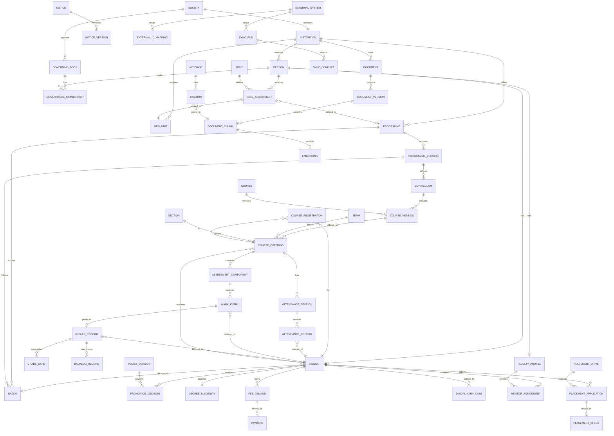

**Reading the diagram:** The academic spine is `Institution → Programme → ProgrammeVersion → Curriculum → Course → CourseOffering → Registration → Attendance/Assessment → Result → Progression/Degree`. The governance spine is `Society → GoverningBody → RoleAssignment → Person`. The evidence spine is `Document → DocumentVersion → DocumentChunk → Embedding → Citation`. The three spines meet only through explicit identifiers and audit records; they do not share a single "everything" table.

**Design caution:** The diagram shows `Student` as a profile of `Person`, not as a separate human. A person may be a student and later an employee or alumni. Reusing `Person` avoids duplicate humans but requires careful access control so that alumni status does not expose current student data.

---

## 11. Access requirements

### 11.1 Principles

1. **Identity is separate from role.** A person authenticates once; authority comes from time-bound role assignments.
2. **Scope is mandatory.** A role assignment without a scope is a design error. "HOD" is meaningless without a department; "faculty" is meaningless without a course offering.
3. **Least privilege, least data.** A mentor sees their mentees, not the whole college. A faculty member sees the courses they teach, not every course.
4. **Deny by default.** Access is granted explicitly, never inherited from a designation string.
5. **Every override is audited.** Break-glass access requires a reason and expires.
6. **History is immutable.** Closing a role assignment does not delete it.

### 11.2 Identity and authentication

| Requirement | Detail |
|---|---|
| Unique identity per person | One account per human; no shared department logins. |
| Multiple identifiers | College roll number, employee ID, MAKAUT registration number, examination roll number, email, phone. |
| Strong authentication | Password plus MFA for staff and privileged roles; MFA recommended for students. |
| Account lifecycle | Provision on admission/appointment; disable on exit; retain record for audit. |
| Guardian access | Separate, limited identity linked to a student; not a student login. |
| Alumni access | Separate limited identity; no access to current academic records. |
| Service accounts | Machine-to-machine only; no interactive login; scoped to specific APIs. |
| Session controls | Idle timeout, device/session listing, revocation. |

**Gap:** BCREC's identity provider and whether it uses a college email domain, Google Workspace, Microsoft 365, or a custom directory is unknown [Gap G-10]. The design must integrate with an existing IdP rather than create a parallel one.

### 11.3 Authorization model

Use **role-based access control with attribute and scope constraints** (RBAC + ABAC):

```
permission = role_permission
             AND scope_match(assignment.scope, resource.scope)
             AND attribute_condition(resource, actor, context)
             AND NOT explicitly_denied
```

Examples:

| Role | Scope | Permission | Attribute condition |
|---|---|---|---|
| Faculty | Course offering | Enter CIA/PCIA marks | Offering is assigned to the faculty; marks window is open |
| Faculty | Course offering | View attendance | Same offering |
| HOD | Department | Approve attendance condonation recommendation | Student belongs to department |
| HOD | Department | View all results | Department only; not other departments |
| COE | Institution | Publish results | Result set approved; no unresolved moderation |
| Registrar | Institution | Create/modify student record | Not after graduation lock; changes audited |
| Finance | Institution | View fee status | No access to marks or medical data |
| Mentor | Assigned mentees | View attendance and results | Mentees only; read-only |
| Principal | Institution | Approve promotion exceptions | Policy version and evidence attached |
| Academic Council member | Institution | Approve condonation | Meeting/quorum recorded |
| Examination Committee member | Institution | View result sets | Committee term active |
| Student | Self | View own attendance, marks, results, notices | After publication, not before |
| Guardian | Linked student | View attendance, fee status, notices | Consent recorded; no marks unless policy allows |
| CIP Curator | Document corpus | Approve/publish documents | Classification allows |
| CIP Operator | Conversations | View/escalate conversations | No access to restricted personal data |
| Integration Service | Mapped APIs | Read/write specific fields | Source-of-truth rule permits |
| Auditor | Institution | Read audit trail and reports | Read-only; no mutation |

### 11.4 Data classification

| Class | Examples | Default access | Handling |
|---|---|---|---|
| Public | Prospectus, published notices, programme list, public results notices | Anyone | No restriction; still versioned |
| Internal | Timetables, committee composition, circulars | Staff and students | Authenticated |
| Confidential | Attendance, internal marks, fee status, contact details | Need-to-know role + scope | Encrypted at rest; access logged |
| Restricted | Medical records, disciplinary cases, grievances, identity documents, bank details | Named roles only | Field-level encryption; strict audit; retention policy |
| Regulated personal data | Aadhaar-like identifiers, caste/category, disability, biometric data | Statutory basis only | Minimise collection; mask by default; consent/legal basis recorded |

**Recommendation:** Do not store identity document images longer than the statutory retention period. Prefer verified attributes and a reference to the document's storage location over duplicating the document in multiple systems.

### 11.5 Sensitive-data rules

- **Disciplinary records** are visible to the Principal, committee, Registrar, and the student concerned. They are not visible to faculty generally, mentors, or the CIP.
- **Medical and counselling records** are visible only to the medical officer or counsellor and, where necessary, the Dean (SW&A). They must not be used in academic decisions without explicit policy.
- **Caste/category and income data** used for scholarships and reservations are restricted to the scholarship cell and Registrar; they must not appear in general student profiles.
- **Fee data** is visible to Finance, the student, and the guardian. Faculty and mentors see only a clearance flag if the institution configures one.
- **PPR and answer scripts** are visible to the COE, the assigned reviewer, and the student only to the extent the regulations allow.
- **CIP retrieval** must never surface restricted records. If a user asks a question whose answer depends on their own restricted data, the CIP should route to the authenticated self-service record, not retrieve it from documents [Recommendation].

### 11.6 Audit requirements

Every state-changing action must record:

| Field | Why |
|---|---|
| Actor | Who acted. |
| Role assignment used | Which authority was exercised. |
| Action | Create, update, approve, publish, delete, export, view-sensitive. |
| Entity and record | What changed. |
| Before and after | What the values were. |
| Reason | Why, especially for overrides and corrections. |
| Timestamp | When, in a consistent timezone (IST). |
| Correlation ID | Links a request across services. |
| Source channel | Web, mobile, API, import. |

**Non-repudiation:** Result publication, degree recommendation, fee waiver, and disciplinary decisions should record an explicit approval event with the approver's role assignment, not merely the last user who edited the record.

**Retention:** Academic records, results, degree recommendations, and audit events should be retained for the period required by the institution and regulators. The exact period is not stated in the documents reviewed [Gap G-22]. A CIP must not assert a retention period.

### 11.7 Scope matrix

| Resource | Student | Guardian | Faculty | Mentor | HOD | COE | Registrar | Finance | Principal | AC | Auditor |
|---|---|---|---|---|---|---|---|---|---|---|---|
| Own profile | RW | R | RW | R | R | R | RW | R | R | R | R |
| Other student profile | — | — | R (class) | R (mentee) | R (dept) | R | RW | R (fee) | R | R | R |
| Attendance | R (own) | R (linked) | RW (course) | R (mentee) | R (dept) | R | R | — | R | R | R |
| Internal marks | R (own, published) | — | RW (course) | R (mentee) | R (dept) | RW | R | — | R | R | R |
| Results | R (own) | — | R (course) | R (mentee) | R (dept) | RW | R | — | R | R | R |
| PPR case | RW (own) | — | — | — | R (dept) | RW | R | — | R | — | R |
| Fee demand | R (own) | R (linked) | — | — | — | R (clearance) | R | RW | R | — | R |
| Scholarship | RW (own) | R | — | — | R (dept) | — | RW | RW | R | — | R |
| Discipline | R (own) | R (linked) | — | — | R (dept) | — | R | — | RW | R | R |
| Notice | R | R | R | R | RW (dept) | RW | RW | R | RW | R | R |
| Documents | R (public) | R (public) | R (internal) | R (internal) | R | R | RW | R | RW | R | R |
| Audit trail | — | — | — | — | R (dept) | R | R | R | R | R | RW |

R = read, W = write, RW = read and write within scope, — = no access.

### 11.8 Separation-of-duties controls

| Control | Rule |
|---|---|
| Marks entry vs result publication | The person who enters marks cannot publish the result set alone. |
| PPR reviewer vs original evaluator | Must be different people. |
| Attendance recording vs condonation | Faculty records; Academic Council condones. |
| Role assignment vs academic approval | ERP Admin can create assignments only from an approved source order; cannot self-approve academic decisions. |
| Fee waiver vs fee collection | Finance proposes; Principal or delegated authority approves. |
| Degree eligibility vs degree recommendation | Registrar computes; Principal approves; MAKAUT awards. |
| Document ingestion vs publication | Curator ingests; a second reviewer publishes high-stakes documents. |
| Integration vs source of truth | Integration service cannot override a field for which another system is authoritative unless a conflict rule allows it. |

### 11.9 Break-glass and emergency access

A break-glass mechanism may be needed for medical emergencies, police requests, or disaster recovery. If implemented:

- it must require a stated reason and a second approver where feasible;
- it must expire automatically (for example, within hours);
- it must generate an immediate alert to the Principal and Auditor;
- it must be reviewable after the fact;
- it must not allow silent bulk export.

**Note:** This is a recommendation, not an observed BCREC practice. No document reviewed describes break-glass access.

### 11.10 CIP-specific access requirements

| Requirement | Detail |
|---|---|
| Corpus authorisation | Retrieval must filter documents by classification and by the user's role/scope before ranking. |
| Personal-data exclusion | The vector index must not contain restricted personal records. Personal questions route to structured self-service. |
| Provenance display | Every answer must show the source document, version, date, and section. |
| Stale-source suppression | A superseded document must not be cited as current unless the user explicitly asks for history. |
| Conflict disclosure | If two current sources conflict, the CIP must say so and cite both. |
| No-answer behaviour | If retrieval confidence is low or sources conflict, the CIP must say it does not know and offer escalation. |
| Language | The CIP should answer in the user's language, including Bengali and Hindi, without translating institutional names incorrectly. |
| Conversation retention | Conversation logs are internal/confidential; access is limited to CIP operators and auditors. |

---

## 12. Initial versus future modules

The initial release should be narrow enough to be trustworthy. A module belongs in the initial release only if (a) the rule is documented, (b) the owner is known, and (c) the data can be captured without guessing. Modules that depend on unresolved rules or on the unknown college ERP move to the future roadmap.

| # | Module | Initial scope | Why now | Key dependency | Release |
|---|---|---|---|---|---|
| M1 | Identity and access | Person, account, role, role assignment, scope, delegation, audit | Every other module depends on correct authority | Identity provider decision | Initial |
| M2 | Institution and academic structure | Institution, org units, programmes, programme versions, batches, terms, courses, offerings, sections, timetable | Provides the scoping frame for all rules | Academic Council approval of structure | Initial |
| M3 | Admission and student records | Application, offer, admission, documents, college roll, university registration, exam roll | Creates the student identity and identifiers | Registrar process ownership | Initial |
| M4 | Semester enrolment | Semester registration, course registration, eligibility flags | Gate for attendance and assessment | Prerequisite rules (G-08) | Initial |
| M5 | Attendance | Session capture, records, summaries, correction, condonation case | Highest operational pain and highest rule risk | Attendance rule decision (G-01) | Initial |
| M6 | Internal assessment | CIA-1, CIA-2, PCIA components, mark entry, display, correction, conflict-of-interest declaration | Faculty work happens every semester | Assessment scheme configuration | Initial |
| M7 | Notices and document repository | Notice publishing, versioning, audience, document metadata, versioning, classification | Needed for CIP grounding and audit | Approval matrix (G-19) | Initial |
| M8 | Policy and audit core | Policy versioning, audit events, data-quality issues, source register | Prevents silent rule drift | Institutional sign-off | Initial |
| M9 | CIP core | Document ingestion, retrieval, citation, self-service intents for timetable, attendance, published results, and notices | Delivers immediate student and staff value | Approved corpus and identity | Initial |
| M10 | Result viewing | Read-only display of published results imported or entered from the examination process | Students need results; read-only avoids premature automation | Result data source | Initial |
| M11 | Examination operations | Form fill-up, eligibility, fee, seating, invigilation, script tracking, evaluation, moderation | High volume, high risk, many actors | Result approval chain (G-12) | Future |
| M12 | Result processing and publication | Grade computation, SGPA/CGPA, result approval, publication, grade card | Depends on examination operations | M11 and approval policy | Future |
| M13 | PPR and correction | PPR case, fee, reviewer assignment, correction case, affidavit workflow | Depends on published results | M12 | Future |
| M14 | Promotion and degree | Promotion decision, backlog tracking, degree eligibility, recommendation, certificates | Depends on stable results | M12 and degree policy | Future |
| M15 | Fees and scholarships | Fee structure, demand, payment, receipt, dues, scholarship schemes | Finance already runs this; integration is the challenge | Finance system decision | Future |
| M16 | Discipline | Case, show cause, inquiry, penalty, appeal | Sensitive and low-volume; needs careful access control | Appellate authority clarity (G-20) | Future |
| M17 | Mentoring | Mentor assignment, session notes, referrals | Valuable but cadence undefined | Mentoring policy (G-18) | Future |
| M18 | Placement | Registration, eligibility, drives, offers, dream-offer logic | Separate lifecycle; policy is documented | T&P ownership and data quality | Future |
| M19 | Library and hostel | Loans, fines, room allocation, mess | Operational, not academic-spine critical | Library/hostel systems | Future |
| M20 | Analytics and accreditation | Dashboards, AQAR/NBA data, attrition, pass rates | Needs clean historical data | M1–M14 | Future |
| M21 | Mobile application | Student/guardian app, notifications | Channel, not a new domain | M1–M9 | Future |
| M22 | Workflow/BPM engine | Configurable approvals, SLA, escalation | Useful at scale; premature for initial | Process stability | Future |
| M23 | ERP adapters | Bi-directional sync with the college ERP and MAKAUT portals | Unknown until access is granted | ERP documentation (G-10) | Future |
| M24 | Alumni | Alumni identity, events, giving | Separate from current student data | Alumni office | Future |

**Sequencing rationale:** The initial release deliberately stops at *recording and displaying* results, not at *computing and publishing* them. Result computation is where rule conflicts, moderation, and approval authority collide. Doing it early would force the team to invent policy.

**Anti-pattern to avoid:** Building the CIP first and the academic core later. Without the academic core, the CIP has no authoritative attendance, timetable, or result data, and will answer from documents that may be stale.

---

## 13. ERP integration strategy and CIP separation

### 13.1 Integration principles

1. **API-first.** Every capability the CIP or a future module needs should be available through a documented API, even if the first implementation is a batch import.
2. **Stable internal IDs.** Internal identifiers never change when an external system changes its ID. External IDs live in a mapping table.
3. **External ID mappings.** Every synced entity carries the external system, external ID, validity window, and confidence.
4. **Import and export.** Bulk CSV/Excel import and export are required from day one, because most Indian college systems exchange data this way.
5. **Sync history.** Every run records start, end, counts, cursor, errors, and operator.
6. **Conflict resolution.** Conflicts are detected, queued, and resolved by a named steward; they are never silently overwritten.
7. **Provenance.** Every field that comes from an external system records its source, timestamp, and sync run.
8. **Configurable source of truth.** The institution decides which system wins per field, and can change it with a versioned policy.
9. **Versioned APIs.** Breaking changes require a new version and a deprecation window.
10. **Idempotency.** Repeated imports must not create duplicates.
11. **Least-privilege service accounts.** Each adapter has only the scopes it needs.
12. **Human override with audit.** A human can correct an imported value, but the override is recorded and the next sync must not silently revert it without a rule.

### 13.2 Adapter pattern

```
Campus ERP core
   ├── Student API ──> Adapter A (college ERP)
   ├── Academic API ─> Adapter B (MAKAUT registration export)
   ├── Finance API ──> Adapter C (payment gateway / finance system)
   ├── Document API ─> Adapter D (website / file share)
   └── CIP API ──────> Adapter E (chat/voice channels)

Each adapter implements:
  describe()            -> capabilities, version, owner
  pull(entity, cursor)  -> records + next cursor
  push(entity, record)  -> external ID or error
  health()              -> status, last success
  map(entity)           -> internal <-> external field mapping
```

**Why an adapter, not direct database access:** The college ERP's schema is unknown, may change, and may be vendor-controlled. Direct reads create hidden coupling. An adapter gives a replaceable boundary and a place to log provenance.

### 13.3 Source-of-truth matrix (recommended, not confirmed)

| Data | Authoritative source | Reason | Fallback |
|---|---|---|---|
| Person legal identity | BCREC Registrar / HR | Institution admits and employs | Admission application |
| Student admission status | BCREC Registrar | Institution controls admission | Counselling allotment |
| College roll number | BCREC Registrar | Institution generates | — |
| MAKAUT registration number | MAKAUT | University generates | BCREC upload record |
| Examination roll number | BCREC COE | Institution generates | — |
| Course registration | BCREC Registrar / HOD | Institution controls enrolment | Student form |
| Attendance | BCREC faculty | Only the class teacher knows | Correction by HOD |
| Internal marks | BCREC faculty | Only the evaluator knows | Moderation record |
| ESE marks | BCREC COE | Examination cell controls | Answer script |
| Published result | BCREC COE | Institution publishes under autonomy | Grade card |
| Degree award | MAKAUT | University awards | NAD record |
| Fee demand and payment | BCREC Finance | Institution bills and receives | Payment gateway |
| Scholarship award | Government portal / BCREC | Scheme owner | Disbursement record |
| Placement offer | BCREC T&P | T&P records the drive | Recruiter letter |
| Notice | Issuing office | Owner publishes | Website copy |
| Policy rule | Academic Council / BOG | Approving body | Published regulation |

**Critical warning:** "Configurable source of truth" does not mean "any system can win." It means the institution records a decision per field, with a reason and an effective date. Allowing two systems to write the same field without a rule guarantees silent corruption.

### 13.4 Sync patterns

| Pattern | Use | Risk |
|---|---|---|
| Full snapshot import | Initial load, small reference data | Slow; overwrites if not versioned |
| Incremental delta | Daily student/fee updates | Missed deletes; cursor errors |
| Event/webhook | Real-time payment or result event | Duplicate events; ordering |
| Manual file exchange | MAKAUT returns, government scholarship lists | Human error; no schema validation |
| Scheduled export | Regulatory returns, analytics | Stale data; format drift |
| Reconciliation report | Detect drift between systems | Requires a trusted key |

**Recommendation:** Start with full snapshot plus incremental delta for the known sources. Add event-driven sync only when the external system supports it and the volume justifies it.

### 13.5 Conflict resolution

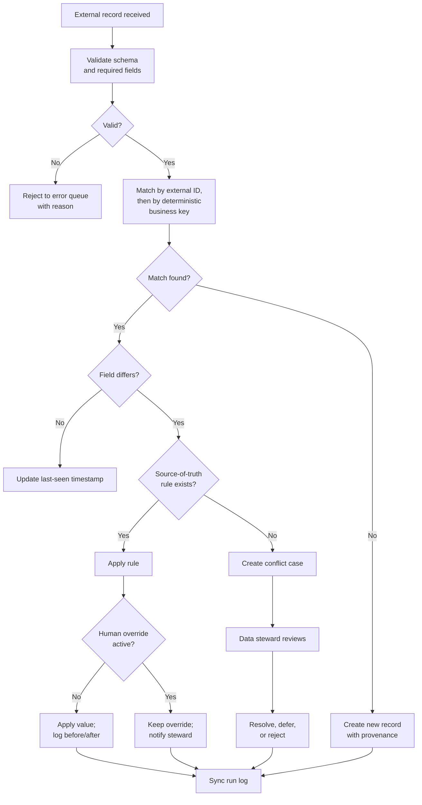

**Deterministic matching keys** matter. A student should be matched by MAKAUT registration number or college roll number, never by name and date of birth alone. Name matching is a last resort and must be queued for review.

### 13.6 MAKAUT and government integration realities

- **MAKAUT registration** is performed through a university portal, not an API documented in the sources reviewed [Gap G-09]. The first integration is likely manual upload plus a recorded response file.
- **Examination fees and forms** are collected by the college and remitted to MAKAUT for non-autonomous students; the notices distinguish MAKAUT students from the autonomous batch [S20]. The ERP must therefore support two fee/exam paths by batch.
- **Degree records** are available on the National Academic Depository, but the college's access mechanism is not documented [Gap G-09].
- **AICTE returns** and **NAAC/NBA data** are periodic reporting exercises, not live integrations. They should be export templates, not APIs, in the first release.

### 13.7 Structured data versus document RAG

This separation is mandatory. Mixing them produces answers that cannot be audited and records that cannot be trusted.

| Concern | Structured academic data | Document / RAG corpus |
|---|---|---|
| Content | Students, attendance, marks, results, fees, roles | Regulations, notices, policies, circulars, prospectuses |
| Storage | Relational tables | Object storage for originals; text/chunks in database; vectors in a vector index |
| Query | Deterministic SQL/API with filters | Semantic + lexical retrieval, then grounded generation |
| Answer type | Exact value, count, status | Explanation with citation |
| Authority | Owning office | Issuing authority |
| Change | Transactional, audited | New version; old version retained |
| Personal data | Yes, access-controlled | No restricted personal data |
| Failure mode | Wrong value (detectable) | Wrong or stale citation (must be disclosed) |
| Audit | Before/after row history | Document version, chunk, page, quote |

**Hard rule:** Never answer "What is my attendance?" from an embedded document. Query the attendance table. Never answer "What is the attendance rule?" from a student record. Retrieve the regulation and cite it.

### 13.8 CIP behaviour requirements

| Requirement | Behaviour |
|---|---|
| Grounding | Answer only from retrieved, approved sources or structured APIs. No free-form institutional facts. |
| Citation | Every factual answer shows document title, version, date, section/page, and a link. |
| Version awareness | Prefer the current version; disclose when a superseded version is cited for historical questions. |
| Conflict disclosure | If two current sources disagree, state the conflict and cite both; do not pick one silently. |
| Uncertainty | If retrieval confidence is low, say so and offer a human contact or escalation. |
| Personal data | Route to authenticated self-service; never retrieve personal records from the document index. |
| Scope | Apply the user's role and scope before retrieval; do not reveal documents the user may not see. |
| Language | Answer in the user's language; preserve proper nouns and codes. |
| Latency | Voice first response should target a measured budget; do not promise a number before benchmarking. |
| Logging | Log query, retrieved chunks, model, latency, and citation for audit and evaluation. |
| Feedback | Capture thumbs up/down and reason; feed into curation, not automatic policy change. |
| Freshness | Ingest new notices on a schedule; mark documents stale when a newer version is published. |
| No invention | If the corpus does not contain the answer, say "not found in official sources" and escalate. |

### 13.9 Retrieval architecture (candidate, not commitment)

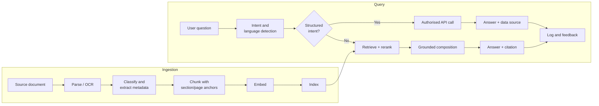

**Technology posture:** PostgreSQL with pgvector remains a leading candidate for a single-database deployment, but its performance at the required scale is unverified in this environment [see database audit]. A dedicated vector database is justified only after measured retrieval latency and recall require it. The CIP must not be architected around a vector database it has not benchmarked.

### 13.10 Evaluation requirements

| Test | Purpose |
|---|---|
| Golden question set | Known questions with known correct answers and citations. |
| Negative set | Questions the corpus cannot answer; the CIP must refuse, not invent. |
| Conflict set | Questions where two sources disagree; the CIP must disclose. |
| Version set | Questions about an old rule; the CIP must cite the historical version. |
| Personal-data set | Questions about a student's own data; the CIP must route, not retrieve. |
| Language set | Bengali, Hindi, and English variants of the same question. |
| Latency set | Voice and text queries at expected concurrency. |
| Access set | Users with different roles must not see out-of-scope documents. |

**Release gate:** The CIP should not be exposed to students until the negative set and the access set pass. A confident wrong answer about attendance or fees is worse than no answer.

---

## 14. Risks, open questions, and gaps

### 14.1 Design and delivery risks

| ID | Risk | Likelihood | Impact | Mitigation |
|---|---|---|---|---|
| R-01 | Automating the disputed attendance rule | High | High | Model both variants; obtain Academic Council decision before enabling eligibility blocking |
| R-02 | Treating the Draft Academic Regulations as final | High | High | Version it as Draft; obtain final approved edition; cite status in CIP |
| R-03 | Hard-coding designations or persons | High | High | Person + RoleAssignment + scope + validity |
| R-04 | Wrong batch boundary for autonomy | Medium | High | Batch-scoped rules; confirm boundary with Registrar and COE |
| R-05 | Unclear result approval chain | High | High | Do not automate publication until signatory is confirmed |
| R-06 | Assuming fees gate examination eligibility | Medium | High | Model fee status separately; configure gate only after policy decision |
| R-07 | Personal data leaking into RAG | Medium | High | Exclude restricted records from corpus; retrieval-time access filters; test set |
| R-08 | Stale notice retrieved as current | High | High | Versioning, effective dates, supersession links, current-version preference |
| R-09 | Unknown college ERP behaviour | High | High | Adapter boundary; no direct DB dependency; discovery before integration |
| R-10 | Two systems writing the same field | Medium | High | Source-of-truth matrix per field; conflict queue; no silent overwrite |
| R-11 | OCR or PDF extraction errors in source documents | High | Medium | Store original + hash; mark OCR-derived text; human verification for high-stakes rules |
| R-12 | Over-engineering microservices early | Medium | Medium | Modular monolith first; split only on measured need |
| R-13 | Vendor lock-in for vectors or LLM | Medium | Medium | Abstraction layer; re-embedding plan; export raw text and metadata |
| R-14 | Untested backup and restore | Medium | High | Restore drills; documented RPO/RTO; audit log backup |
| R-15 | Incomplete audit trail | Medium | High | Mandatory audit events for all state changes; immutable storage |
| R-16 | Privacy/consent gaps for guardian and alumni access | Medium | High | Consent records; purpose limitation; access review |
| R-17 | Sensitive placement/fee/discipline data overexposed | Medium | High | Classification, field-level access, masking |
| R-18 | Diagrams mistaken for approved process | High | Medium | Label as research models; require institutional sign-off |
| R-19 | Policy change applied retrospectively by accident | Medium | High | Effective-dated policy versions; explicit retro-application workflow |
| R-20 | Single-person dependency for role knowledge | High | Medium | Document role duties; cross-train; source-order references |

### 14.2 Open questions for the institution

These are questions that the documents cannot answer and that must be resolved by BCREC before the affected module is automated.

| ID | Question | Why it matters | Likely owner |
|---|---|---|---|
| Q-01 | Is attendance 75% aggregate or 75% separately in theory and practical? | Gates examination eligibility and detention | Academic Council |
| Q-02 | Which batch first falls under autonomy — 2024-25 entry only, or all batches from 2024-25? | Determines which regulation applies to a student | Registrar / COE |
| Q-03 | Is the "Draft" Academic Regulations document the operative regulation, and is there a final approved edition? | Legal and audit basis for every academic rule | Academic Council / BOG |
| Q-04 | Who signs and approves the final result sheet? | Blocks result publication automation | COE / Principal |
| Q-05 | Does unpaid fee status bar examination form fill-up or result release? | Determines whether finance is a hard gate | Principal / Finance |
| Q-06 | How is duty leave treated in the attendance calculation? | Changes eligibility outcomes | Academic Council |
| Q-07 | Who may issue, revise, and withdraw a notice? | Blocks notice workflow automation | Principal / Registrar |
| Q-08 | Is the Principal the appellate authority in disciplinary cases, or is there a separate body? | Affects natural justice and workflow | Principal / BOG |
| Q-09 | What is the mentor-to-student ratio and required meeting cadence? | Determines mentoring module design | HODs / Dean (SW&A) |
| Q-10 | What is the retention period for academic, disciplinary, medical, and audit records? | Compliance and storage design | Registrar / Legal |
| Q-11 | What identity provider and ERP does the college currently use? | Integration and single sign-on | IT / ERP Admin |
| Q-12 | Does the college ERP expose APIs, or only database/files? | Adapter design | IT / ERP vendor |
| Q-13 | What are the exact placement policy approval date and minimum LPA values? | Eligibility and dream-offer logic | T&P |
| Q-14 | Which NBA programmes are accredited and until when? | Accreditation reporting | IQAC |
| Q-15 | What is the BOG's reserved-powers list and quorum? | Governance workflow and approvals | BOG Secretary |

### 14.3 Gap register

| ID | Gap | Why it matters | How to close |
|---|---|---|---|
| G-01 | Attendance rule conflict: aggregate vs theory/practical split | Directly changes pass/detain outcomes | Academic Council resolution with dated order |
| G-02 | Academic Regulations marked Draft, Edition 1.0; final edition not located | Rules may not be formally approved | Obtain final approved edition and BOG/AC resolution |
| G-03 | No consolidated current MAKAUT B.Tech regulation located | University minimums cannot be fully verified | Request from MAKAUT or college academic section |
| G-04 | Batch boundary for autonomy unconfirmed | Wrong regulation applied to a cohort | Registrar/COE confirmation with admission data |
| G-05 | Admission status of new 2026-27 programmes not confirmed | Programme/intake records may be wrong | Admission office confirmation |
| G-06 | NBA programme list and validity not verified | Accreditation reporting may be inaccurate | NBA directory / IQAC certificate |
| G-07 | BOG bye-laws and reserved powers not obtained | Approval authority unclear | Society/BOG office |
| G-08 | Fee/registration/exam eligibility linkage not stated | Hard gate may be invented | Finance and Principal policy decision |
| G-09 | No documented MAKAUT/NAD API or access method | Integration must be manual initially | MAKAUT portal documentation / liaison |
| G-10 | College ERP data model, APIs, and identity provider unknown | Integration design is provisional | IT discovery and vendor documentation |
| G-11 | Admission approving officer and refund/retention rules not stated | Admission workflow incomplete | Registrar |
| G-12 | Result approval signatory and moderation process not stated | Result publication cannot be automated safely | COE / Examination Committee |
| G-13 | Attendance capture method not prescribed | Data quality and audit risk | Academic Council / IT |
| G-14 | Duty leave treatment in attendance not defined | Eligibility ambiguity | Academic Council |
| G-15 | Reassessment cap and final CIA approval not defined | Mark integrity risk | COE / HOD |
| G-16 | Theory examiner appointment process not described | Examination integrity and workload | COE |
| G-17 | PPR fee refund rule not stated | Student grievance risk | COE / Finance |
| G-18 | Mentoring ratio, cadence, and record rules not defined | Module design and privacy | Dean (SW&A) / HODs |
| G-19 | Notice approval and corrigendum authority not published | Publishing risk | Principal / Registrar |
| G-20 | Disciplinary appellate authority overlaps with deciding authority | Natural justice risk | Principal / BOG |
| G-21 | Placement policy date, approving authority, and minimum LPA values missing | Eligibility logic incomplete | T&P |
| G-22 | Record retention periods not stated | Compliance and storage risk | Registrar / Legal |

**Note on gap numbering:** G-03 and G-09 were reserved for the MAKAUT regulation and portal/API gaps. No gap is silently renumbered; if a gap is closed, it is marked closed with the closing evidence rather than deleted.

### 14.4 What would change the design

The following findings would materially change the recommendations:

1. **The college ERP is authoritative and has good APIs.** Then the Campus ERP core should focus on the CIP, workflow gaps, and integration, not on duplicating student records.
2. **The college ERP is end-of-life or unreliable.** Then the Campus ERP core becomes the system of record and needs a migration and dual-run plan.
3. **The Academic Council confirms the theory/practical split.** Then the attendance model simplifies to two thresholds; the aggregate variant becomes historical.
4. **The final Academic Regulations differ from the Draft.** Then every rule ID in Section 9 must be re-verified and versioned.
5. **MAKAUT mandates a specific data format or API.** Then the adapter and export templates follow the mandate, not this document.
6. **Autonomy is not renewed after 2028-29.** Then batch scoping and the MAKAUT regulation path become central again.
7. **The institution adopts a different identity provider.** Then role assignment and SSO design change at the integration layer, not the domain model.

---

## 15. Source register

**Access date for all web sources:** 6 November 2026, unless otherwise stated.
**Status key:** C = current at cut-off; D = draft; H = historical/superseded; P = provisional.

| ID | Source | Issuer | Date | URL | Used for | Status |
|---|---|---|---|---|---|---|
| S1 | BCREC Academic Regulations (Draft), Edition 1.0 | Dr. B. C. Roy Engineering College | 2024-25 (undated in text) | https://www.bcrec.ac.in/display-pdf-download/BCREC%20Acadaemic%20Regulations%20Draft.pdf | Admission, attendance, assessment, passing, grading, promotion, supplementary, MAR, PPR, correction, conduct | D |
| S2 | BCREC Prospectus 2026 | Dr. B. C. Roy Engineering College | 2026 | https://bcrec.ac.in/public/storage/downloads/9c9c256c-dc69-447b-a652-3bc643f1b97b_compressed.pdf | Institutional profile, programmes, attendance statement p.55, student services | C |
| S3 | Revised Service Rules (1st Revision) | BCREC Society | 24.07.2019, effective 01.07.2019 | https://www.bcrec.ac.in/display-pdf-download/ServiceRule.pdf/BCREC%20Service%20Rule | Principal, HOD, faculty, registrar duties; workload; committee roles | C |
| S4 | BCREC Organogram | Dr. B. C. Roy Engineering College | Undated | https://www.bcrec.ac.in/public/pdf/BCREC_BOG_STRUCTURE_PRESENT.pdf | Reporting units, committees, hierarchy | C |
| S5 | BCREC Society Structure | Dr. B. C. Roy Engineering College Society | Undated | https://www.bcrec.ac.in/public/pdf/BCREC_SOCIETY_STRUCTURE_PRESENT.pdf | Society office-bearers | C |
| S6 | Office Order: Revised Board of Governors | BCREC Principal's Office | 02.03.2026; No. BCR/PR/14/2026/31 | https://www.bcrec.ac.in/display-pdf-download/Revised%20BOG.pdf | BOG composition 2025-26; multi-role evidence | C |
| S7 | Office Order: Revised Academic Council | BCREC Principal's Office | 20.04.2026; Ref. BCR/PR/14/2026/39 | https://www.bcrec.ac.in/display-pdf-download/Revised%20Academic%20Council.pdf | Academic Council composition 2025-26; multi-role evidence | C |
| S8 | Office Order: Examination Committee | BCREC Principal's Office | 06.10.2026; Ref. BCR/PR/14/2026/115 | https://www.bcrec.ac.in/display-pdf-download/Examination-Committee.pdf | Examination Committee composition 2026-27; Principal change | C |
| S9 | Provisional Academic Calendar 2026-27 | BCREC Controller of Examinations | 2026 | https://www.bcrec.ac.in/display-pdf-download/Provisional%20Academic%20Calendar%20under%20Autonomy%20for%20Academic%20Sessi.pdf | Semester dates and CIA/PCIA deadlines; MAR/MOOC windows present but not reproduced | P |
| S10 | Training & Placement Policy | Dr. B. C. Roy Society | Undated | https://www.bcrec.ac.in/display-pdf-download/Training_Placement_Policy.pdf/Placement%20Policy | Placement eligibility, PPRT, dream offer, conduct | C (assumed) |
| S11 | Disciplinary Rules for Students | Dr. B. C. Roy Engineering College | Undated | https://www.bcrec.ac.in/display-pdf-download/Disciplinary_Rule_for_the_students_of_BCREC.pdf | Disciplinary committee, procedure, penalties, appeal | C (assumed) |
| S12 | IQAC Composition | Dr. B. C. Roy Engineering College | 2020 restructuring | https://bcrec.ac.in/bcrec-iqac-composition.html | Historical mentoring and quality practices | H |
| S13 | NAAC Self-Study Report | Dr. B. C. Roy Engineering College | 2021 | https://bcrec.ac.in/NAAC_SSR.pdf | Pre-autonomy institutional practice | H |
| S14 | MAKAUT Affiliation Renewal 2026-27 | Maulana Abul Kalam Azad University of Technology, WB | 29.05.2026 | https://www.bcrec.ac.in/display-pdf-download/MAKAUT%20APPROVAL%202026.pdf | Affiliation conditions, programme codes, intake, registration/exam fees, returns | C |
| S15 | AICTE Extension of Approval 2026-27 | All India Council for Technical Education | 20.04.2026; F.No. Eastern/1-46258943244/2026/EOA | https://www.bcrec.ac.in/display-pdf-download/EOA%20Report%202026-2027.PDF | Approved programmes, intake, disclosures, internship | C |
| S16 | UGC (Conferment of Autonomous Status upon Colleges and Measures for Maintenance of Standards in Autonomous Colleges) Regulations, 2023 | University Grants Commission | Gazette 03.04.2023 | https://www.ugc.gov.in/regulations | Autonomy scope, assessment, results, degree award, Examination Cell, statutory bodies | C |
| S17 | Notification on Regular Attendance and Discharge of Duties | MAKAUT, WB | 20.08.2026; No. MAKAUT/RE/Notice-106/226 | https://makautwb.ac.in/datas/users/0-notifica_reg_atten_disc26.pdf | Attendance directive; defers threshold to applicable norms | C |
| S18 | MAKAUT Registration Portal | MAKAUT, WB | Accessed 06.11.2026 | https://makaut.wb.gov.in/ | University registration and student services | C |
| S19 | BCREC Examination Department Page | Dr. B. C. Roy Engineering College | Accessed 06.11.2026 | https://www.bcrec.ac.in/facality-details-withtype/1 | Examination roles, COE/Deputy COE, examination process | C |
| S20 | BCREC Notice List | Dr. B. C. Roy Engineering College | 2023–2026 (405 notices observed) | https://www.bcrec.ac.in/notice-list | Operational sequences: registration, enrolment, exam forms, results, PPR, supplementary, NAD, fees, scholarships, book distribution | C |
| S21 | MAKAUT Rules and Regulations Page | MAKAUT, WB | Accessed 06.11.2026 | https://makautwb.ac.in/page.php?id=199 | Older amendments and schedules; not treated as current B.Tech regulation | H |
| S22 | Policy for Award of Scholarships and Freeships | Dr. B. C. Roy Engineering College | Undated | https://bcrec.ac.in/Policy_Scholarship.pdf | TFW, WBFS, SWC, MBA waivers, PG stipend, NSP verification | C (assumed) |
| S23 | B.Tech Fee Structure 2026-30 | Dr. B. C. Roy Engineering College | 2026 | https://www.bcrec.ac.in/display-pdf-download/B.Tech-Fee-Structure-2026-2030-1.pdf | Fee heads, semester amounts, MAKAUT registration and degree fees | C |

### 15.1 Source limitations

| Source | Limitation |
|---|---|
| S1 | Marked "Draft"; no final approved edition located; extracted text has formatting artefacts. |
| S2 | Prospectus is a marketing and information document, not a regulation; attendance statement conflicts with S1. |
| S3 | Dated 2019; designations and reporting lines may have changed; used for duties and workload, not current incumbents. |
| S4, S5 | Undated; used for structure, not for current membership. |
| S6, S7, S8 | Scanned image PDFs; text was OCR'd and column order reconstructed; names and designations verified against visible layout. |
| S9 | Explicitly provisional; dates may change; OCR ordering of columns is imperfect. |
| S10, S11 | Undated; approval authority and effective date not visible. |
| S12, S13 | Historical, pre-autonomy; not evidence of current composition or rules. |
| S14 | Affiliation order for one academic year; conditions may change annually. |
| S15 | Approval for one academic year; programme existence does not prove classes commenced. |
| S16 | Central regulation; state and university implementation may add requirements. |
| S17 | Attendance notification does not state the 75% threshold or the theory/practical split. |
| S18 | Portal access limited to public pages; no authenticated exploration attempted. |
| S19 | Public page; committee composition and process detail may be incomplete. |
| S20 | Notice list is a public communication channel, not a policy repository; titles may be truncated or contain typographical errors. |
| S21 | Page mostly links older amendments; not a consolidated current regulation. |
| S22, S23 | S22 is an undated policy; S23 is a one-year fee schedule. Amounts and schemes change annually. |

### 15.2 Documents known to exist but not obtained

| Document | Why it matters | Status |
|---|---|---|
| Final approved BCREC Academic Regulations | Legal basis for all academic rules | Not located |
| UGC autonomy letter F.2-10/2023/(AC-Policy) | Exact autonomy conditions | Cited only via S1/S2 |
| MAKAUT autonomy letter 7.30/MAKAUT/Autonomy(BCREC)/2024/567 | Exact autonomy conditions and batch applicability | Cited only via S1 |
| BCREC Society bye-laws / BOG rules | Reserved powers, quorum, appointment process | Not obtained |
| BCREC Examination Manual / moderation guidelines | Result approval and moderation | Not obtained |
| BCREC Admission SOP | Approving officer, refunds, document retention | Not obtained |
| BCREC Mentor Handbook | Ratio, cadence, confidentiality | Not located |
| College ERP documentation | Integration, identity, data model | Not accessible |
| MAKAUT current B.Tech regulation (consolidated) | University minimum standards | Not located |
| NBA accreditation certificates | Programme-level validity | Not verified |

---

## 16. Document control and maintenance

### 16.1 What this document is

This is a **research and design-input document**. It is not a policy manual, not a legal opinion, and not an implementation specification. Every rule statement is attributed to a source and labelled with a status. Every recommendation is marked as a recommendation.

### 16.2 How to update it

1. When a new order, regulation, or notice is issued, add it to the source register with a date and URL.
2. If it changes a rule, create a new rule version in Section 9 and set the old version's `effective_to`.
3. If it resolves a gap, mark the gap closed with the closing evidence; do not delete the gap.
4. If it contradicts an existing rule, add a conflict row in Section 9.15 and mark both rules **Disputed** until resolved.
5. If it changes a role or committee, close the old role assignment and create a new one with the source order.
6. Re-run the CIP evaluation set after any corpus update that affects attendance, fees, results, or degree rules.

### 16.3 Review cadence

| Trigger | Action |
|---|---|
| New academic year | Re-verify calendar, fees, intake, affiliation, and batch rules |
| New Academic Council or BOG order | Re-verify governance composition and reserved powers |
| New MAKAUT notification | Re-verify affiliation, registration, examination, and attendance rules |
| New UGC/AICTE regulation | Re-verify autonomy scope and approval conditions |
| New ERP or portal | Re-verify source-of-truth matrix and adapters |
| Any PPR/correction policy change | Re-verify result and audit workflow |

### 16.4 Confidence statement

The research is strongest on **documented rules** (Academic Regulations, Service Rules, UGC regulations, MAKAUT affiliation, AICTE approval) and **observed sequences** (notice list). It is weakest on **internal approval workflows**, **the college ERP**, **current committee practice**, and **the final status of the Draft Academic Regulations**. Those weaknesses are stated as gaps rather than filled with assumptions.

**Bottom line:** BCREC's academic model is a dual-authority system in which the college controls curriculum, assessment, examinations, and results for autonomous batches, while MAKAUT controls affiliation, registration, and the degree. The ERP/CIP must therefore be built around **versioned rules, scoped role assignments, batch-aware policy, and explicit provenance** — not around fixed user types or hard-coded thresholds.
